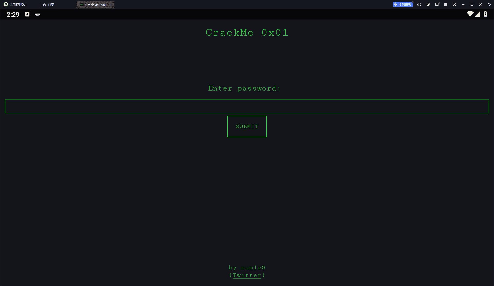
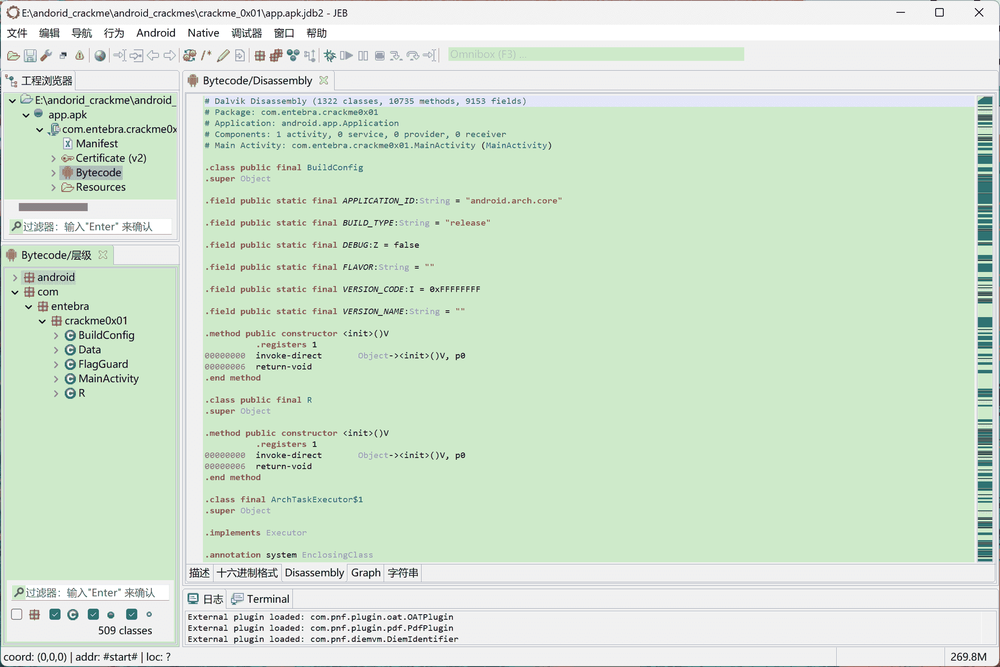
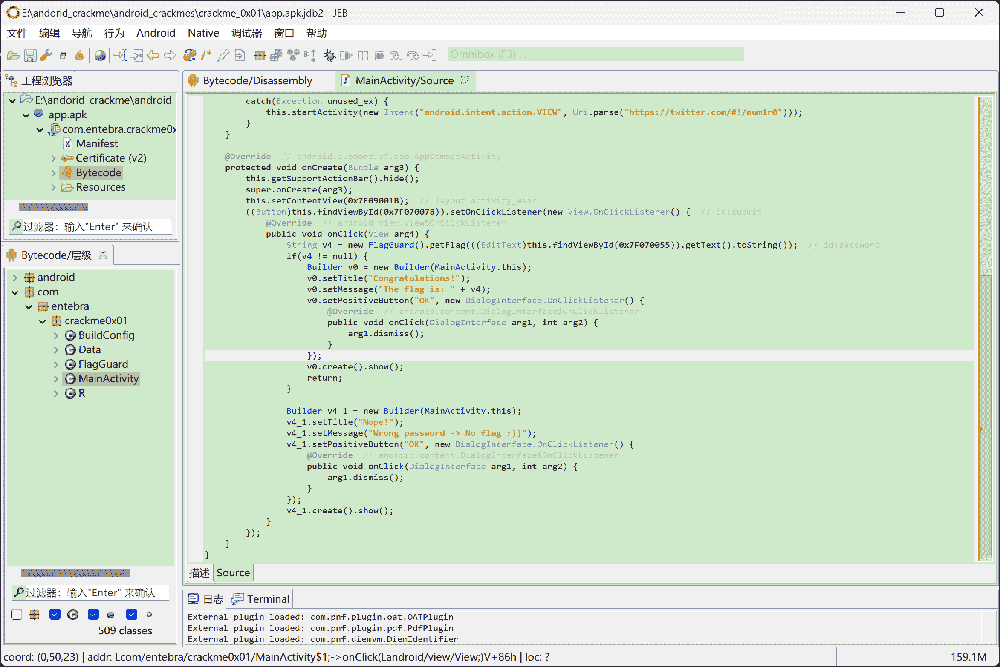
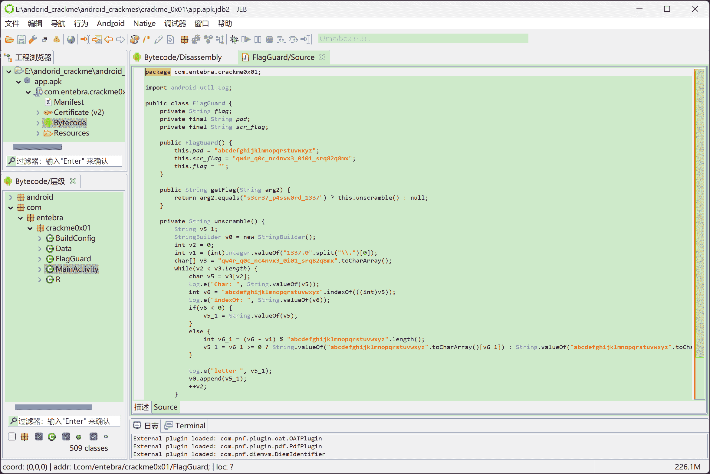
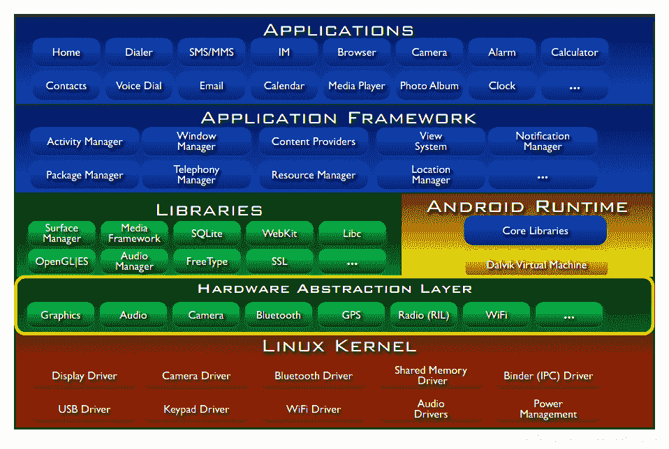

# [Android 原创] 一个简单的android-crackme学习[第一天 学习时长 2h]

- 原帖: https://www.52pojie.cn/forum.php?mod=viewthread&tid=1939873
- 抓取时间: 2026-11-01T23:59:45

## 一个简单的android-crackme学习[第一天/学习时长:2h]

程序地址：

[//github.com/num1r0/android_crackmes" target="_blank" rel="noopener noreferrer nofollow"](https://github.com/num1r0/android_crackmes:rel="nofollow noopener" href="https)

### 破解过程

将程序`APK`放入`Jeb`中，感觉`MainActivity`有点像`Qt`中的`QMainwight`主窗口故直接进入查看

问题一：窗口中有点像汇编语言是是什么？

问题二：安卓程序的目录结构是什么？

看不懂，直接反汇编：

代码逻辑更清楚了，`onCreate`中为`submit`按钮绑定了一个事件，当按钮被单击时获取`id`为`password`的文本输入框的内容进行校验，如果校验结果不为`null`则认为是`ok`，然后再来看校验的那部分：

在`getFlags()`函数中可以很容易的看出内置的字符串`s3cr37_p4ssw0rd_1337`。将其输入破解成功。整个过程很简单，反编译后根据简单的代码逻辑跟进就行。

### 今日所学

#### 问题一解决：

[//www.52pojie.cn/thread-687375-1-1.html" target="_blank" rel="noopener noreferrer nofollow"](https://www.52pojie.cn/thread-687375-1-1.html:href="https)

[//blog.csdn.net/pinksofts/article/details/132244543" target="_blank" rel="noopener noreferrer nofollow"](https://blog.csdn.net/pinksofts/article/details/132244543:rel="nofollow noopener" href="https)

[//source.android.google.cn/docs/core/runtime/dalvik-bytecode?hl=zh-cn" target="_blank" rel="noopener noreferrer nofollow"](https://source.android.google.cn/docs/core/runtime/dalvik-bytecode?hl=zh-cn:rel="nofollow noopener" href="https)

经过查阅资料，这种语言是`smali`是`Dalvik` 字节码的汇编语言表示形式。但与PC上`C`程序从编译到运行程序过程中(包括预处理、编译、汇编和链接四个主要阶段。)有一个显式的汇编阶段，即编译器将 `C` 代码转换成汇编代码（`ASM`），然后汇编器将汇编代码转换成机器码，这个过程是将高级语言（`C`）转换成底层机器码的重要步骤之一。但`smali`并不显式出现在Android 应用程序的编译和运行过程中。他的作用好像仅仅限于便于对`Dalvik` 字节码的阅读和修改。

什么是`Dalvik`？见百度：

>
用于Android平台的虚拟机，`Dalvik`是[//baike.baidu.com/item/Google/86964?fromModule=lemma_inlink" target="_blank" rel="noopener noreferrer nofollow"](https://baike.baidu.com/item/Google/86964?fromModule=lemma_inlink:rel="nofollow noopener" href="https)公司自己设计用于Android平台的[//baike.baidu.com/item/虚拟机/104440?fromModule=lemma_inlink" target="_blank" rel="noopener noreferrer nofollow"](https://baike.baidu.com/item/虚拟机/104440?fromModule=lemma_inlink:rel="nofollow noopener" href="https)。`Dalvik`虚拟机是Google等厂商合作开发的Android移动设备平台的核心组成部分之一。它可以支持已转换为 `.dex`（即`Dalvik Executable`）格式的Java应用程序的运行，`.dex`格式是专为`Dalvik`设计的一种[//baike.baidu.com/item/压缩格式/2844535?fromModule=lemma_inlink" target="_blank" rel="noopener noreferrer nofollow"](https://baike.baidu.com/item/压缩格式/2844535?fromModule=lemma_inlink:rel="nofollow noopener" href="https)，适合内存和处理器速度有限的系统。`Dalvik` 经过优化，允许在有限的内存中同时运行多个虚拟机的实例，并且 [1]每一个`Dalvik` 应用作为一个独立的`Linux` 进程执行。独立的进程可以防止在虚拟机崩溃的时候所有程序都被关闭。

个人感觉就像是`docker`作用一样，将应用包括环境打包成独立运行环境而不影响同一操作系统上的其他应用

但百度解释中的`.dex`格式又是什么？一切像是没有限制条件的递归，好像并未触及本质，不禁想要问出接下来的两个问题：

##### 1.问题三：什么是android?

Android 操作系统的体系架构和主要组成部分如下：

- Linux 内核（`Linux Kernel`）

  - Android 使用 `Linux` 内核作为底层的操作系统核心，提供了基本的系统服务和硬件驱动支持。
  - `Linux` 内核管理设备驱动、内存管理、进程管理、网络堆栈等底层系统功能。

- 应用运行时（Runtime）

  - `ART`（`Android Runtime`）：从 Android 5.0（Lollipop）开始，`ART` 替代了之前的 `Dalvik VM`，用于执行应用程序的字节码。
  - `ART` 支持 `AOT`（Ahead-of-Time）编译，可以在应用安装时将部分字节码直接编译成本地机器码，提升应用性能和效率。
  - `Dalvik VM`：Android 5.0 之前使用的虚拟机，用于执行应用程序的 `Dalvik` 字节码（`.dex` 文件）。

- 应用框架（Application Framework）

  - 提供开发 Android 应用程序所需的各种类库和服务。
  - 包括活动管理、窗口管理、资源管理、通知管理、内容提供者、视图系统（UI 组件）、电话管理等核心服务。
  - 允许开发者使用 `Java API` 访问 Android 平台的功能。

- 应用程序（Applications）

  - 包括内置的核心应用（如电话、联系人、浏览器、邮件等）以及第三方开发的应用程序。
  - 应用程序通过 Android 应用包（`APK`）的形式分发和安装。

- 系统库（Libraries）

  - 提供了 Android 系统层次的共享代码和功能。
  - 包括图形库、媒体库、`SQLite` 数据库引擎、网络库等。

- 系统运行时环境（System Runtime Environment）

  - Android 系统的核心服务和管理功能，包括安全性、内存管理、进程管理、系统驱动程序等。

##### 2.问题四：android编译到运行全过程？

类比于PC机上的应用编译到可执行文件`.exe`，可以用

阶段 |

C 语言流程 |

Android 应用程序流程 |

编写代码
