# [Android 原创] 新手分析某住宿APP的登录密码加密算法

## 基本信息
- 原帖: https://www.52pojie.cn/forum.php?mod=viewthread&tid=1941260
- 抓取时间: 2026-11-01T16:55:41.746Z

## 工具
- `Reqable`
- `JADX`
- `CyberChef`
- `w8DXoQ==`

## 分析过程

### 抓包
使用`Reqable`进行抓包，得到抓包结果，手机号是明文，密码是经过加密的：
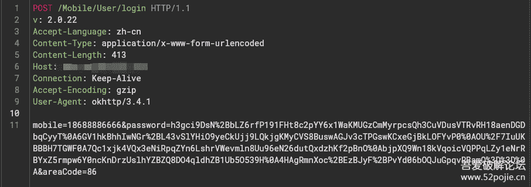

### 分析
使用`PKID`查看加固信息，发现是360加固。我一开始使用的是`frida-dexdump`，结果每次脱都出错，后来使用的`funDex`成功脱下来
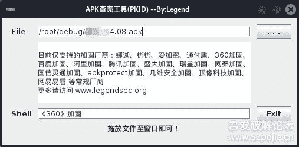

将dex拖入到`JADX`中，然后搜索"`password`"和"`mobile`"都没有找到符合条件的地方。我想着找到点击登录按钮的方法是不是就好多了？
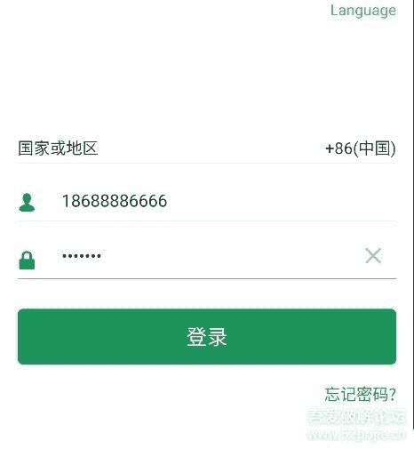

我在终端中输入`adb shell dumpsys window | grep -E 'mCurrentFocus|mFocusedApp'`，通过`Adb`命令获取当前`Activity`的名字，然后在去`JADX`中找到相应的页面。
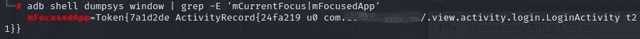

取得这些信息以后，我在`JADX`中找到了这个位置
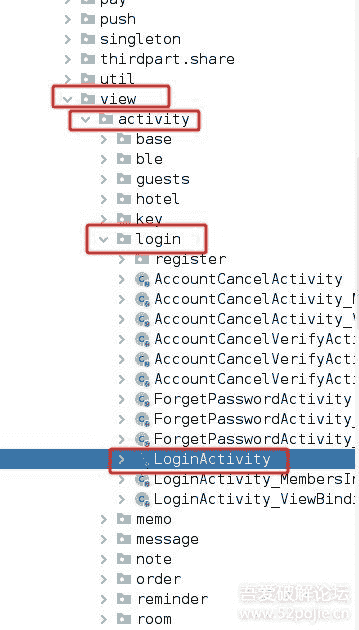

所幸这些代码不是很多，也比较容易分析，否则让我这小白又得挠破头皮了，在这代码中找到了一个`login()`的方法，里面又调用了另一个`Login()`，同时传入了三个参数，分别是账号、密码、区号，这不是跟上图抓包的数据参数一样吗，于是果断跟进去看看
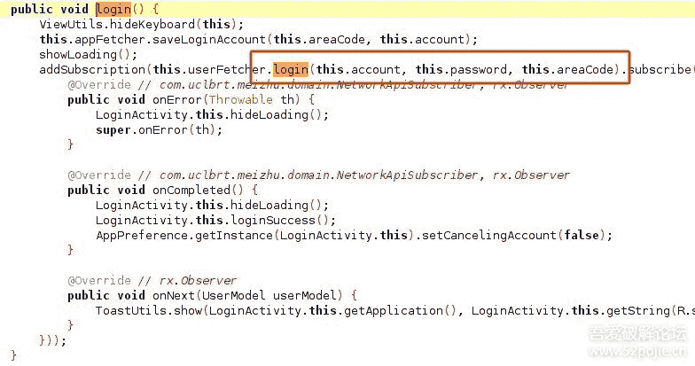

跟进来以后，可以看到它又调用了一个`login`的方法，可以看到传密码的参数这里是将明文密码给加密了，我跟进到了加密密码的这个方法`encodeLoginPassword`中
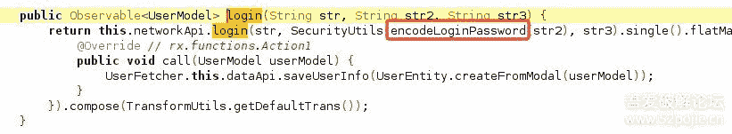

可以看到，这个对密码的加密方式是将用户输入的密码加上"11111111"以后再进行的加密，加密方法有两个参数，第一个是加密的内容，第二个是`publickey`
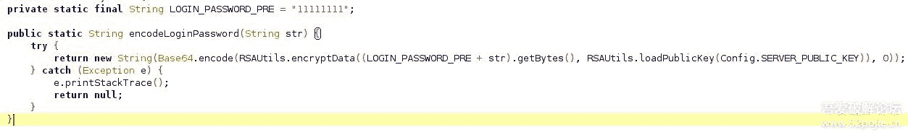

先去获取一下`publickey`，他好像能直接跳转

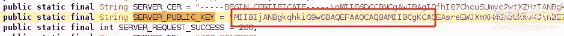

获取完`publickey`以后，再进`encryptData`方法里看一下，可以看到是`RSA/ECB/PKCS1Padding`加密的
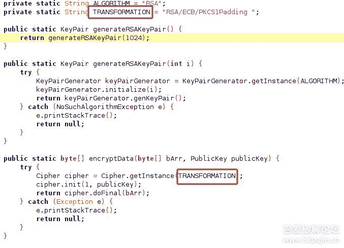

到此基本已分析完毕，使用`CyberChef`计算一下（说实在的，算了和没算一样，没法验证，我没有账号

）
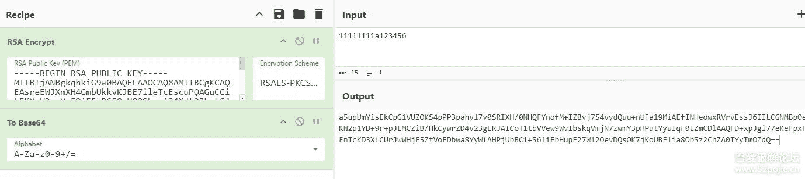

使用Python写一下代码(chatGPT生成的，我懒)

```python
from cryptography.hazmat.primitives import serialization
from cryptography.hazmat.primitives.asymmetric import padding
from cryptography.hazmat.backends import default_backend
import base64

# 加密函数
def rsa_encrypt(data):
    public_key_pem = b"""
    -----BEGIN RSA PUBLIC KEY-----
    MIIBIjANBgkqhkiG9w0BAQEFAAOCAQ8AMIIBCgKCAQEAsreEWJXmXH4GmbUkkvKJBE7ileTcEscuPQAGuCCibFKYqW2szVmFOi55ePC58rH89Ohmzf24Xdt2JhmLC4Nvz8qlU3g0p1HpBi96+yq2rlQ2A5iCt08b820i0MIGTPa9PoTl6rSLDNtLUaCGBYXIyzJlX2TXE1gCHcs40BG/2i3xeBYhkGxpIaSwYvSuZt/Jd/qzKKGqXvHy0gneLT8ExXdgU+k/t1lHXfTYD+bGr69p2w8FRLlqBaIoqUF0Oom5Gi5lBCXhzAUnWoE3Uz9PI7mgqr8dhCXdf5DSlp4/PEqOsE88dAQkk3xOeCQoy0QR3kxO+oZrb97YVrz6xpKW3QIDAQAB
    -----END RSA PUBLIC KEY-----
    """
    public_key = serialization.load_pem_public_key(public_key_pem, backend=default_backend())
    ciphertext = public_key.encrypt(
        data,
        padding.PKCS1v15()  # PKCS1v15 对应于 PKCS1Padding
    )
    return base64.b64encode(ciphertext)

if __name__ == '__main__':
    data = b"11111111a123456"
    encrypted_data = rsa_encrypt(data)
    print("加密结果:")
    print(encrypted_data.decode())
```

这个app使用算法助手分分钟就能搞定了，但是对于一个新手来说，这种简单的app是非常适合练习的。由于我没有这个app的账号，所以根本没法验证我搞的是不是正确的。

新手学习，各位勿喷
