# [Android 原创] 拟娲数像永久VIP破解教程-MT(NP)管理器

- 原帖：https://www.52pojie.cn/forum.php?mod=viewthread&tid=1943120
- 抓取时间：2026-11-01T16:55:29.739Z

## 前言

声明：本文仅供学习交流使用，所涉及的APP和破解版均不提供下载渠道。所涉及的技术请勿用于非法活动，否则所带来的一切后果自负。

## 工具

- `MT管理器`或`NP管理器`
- `Jadx`

## 附件文件

原版APK：[//www.123pan.com/s/y2B0Vv-YUlW3.html](https://www.123pan.com/s/y2B0Vv-YUlW3.html:https)

## 教程

### 软件分析

需要用户登录，登录就送一天VIP（去登录功能有时间再研究）。

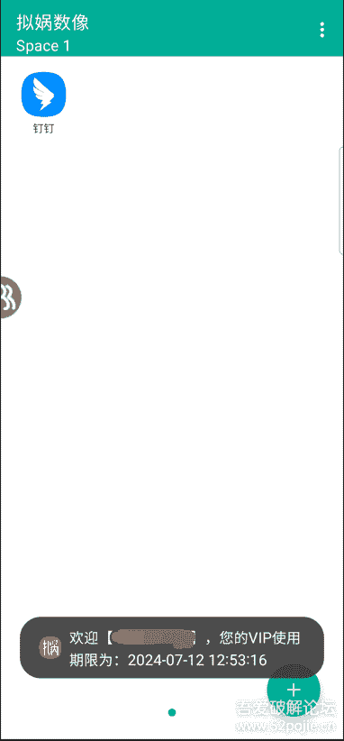

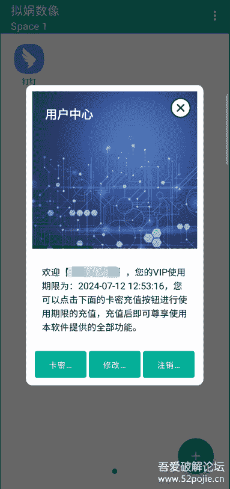


### `MT管理器`打开APK文件

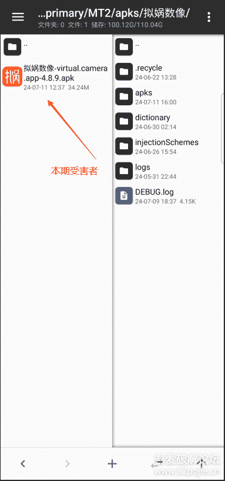

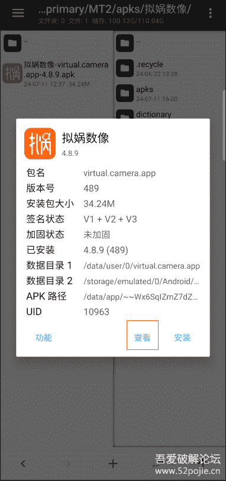

### 使用`dex++`编辑所有dex文件

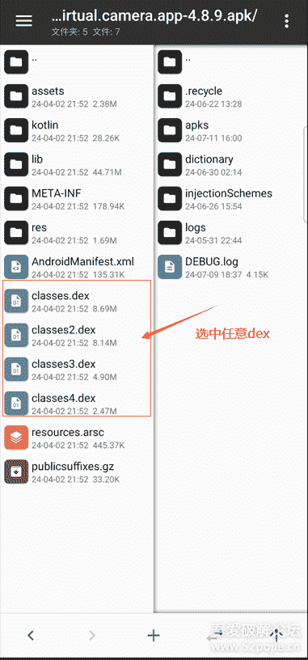

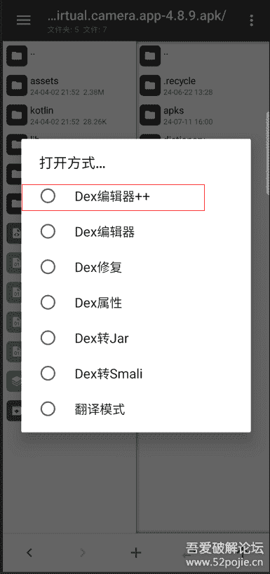

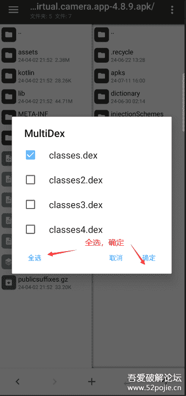

### 发起新搜索

由于已经具体分析知道关键词，一般情况下搜VIP。

搜索内容：`vipExpDate`

搜索路径：`/`

搜索类型：字符串

搜索子目录：勾选

区分大小写：无

正则表达式：无

完全匹配：无

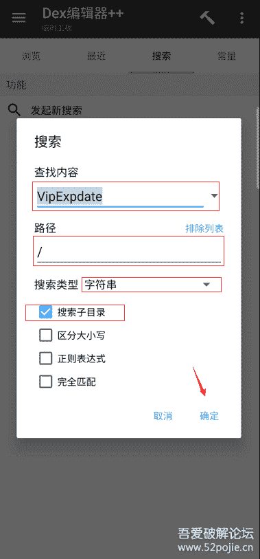

### 等待搜索结束，查看搜索结果

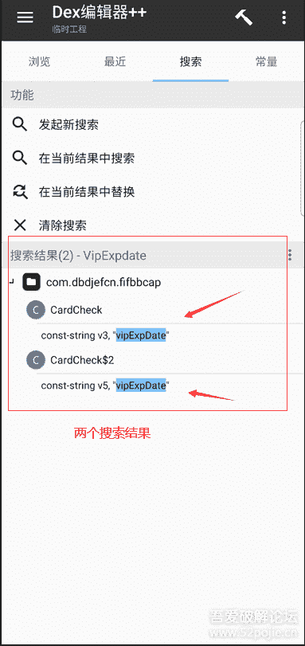

### 分析Smali代码

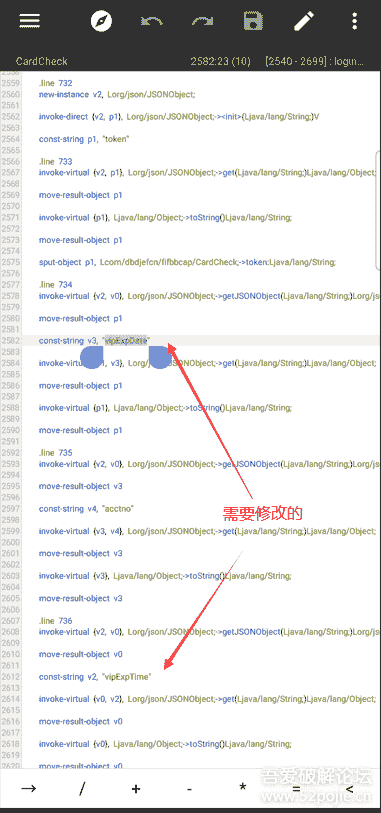

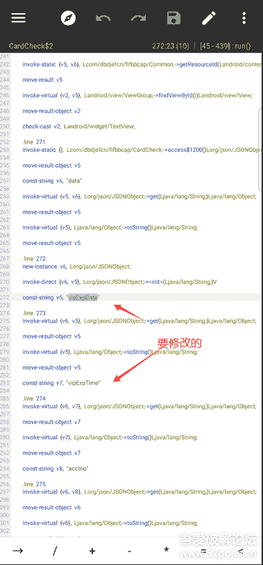

### Smali代码转Java代码分析VIP逻辑

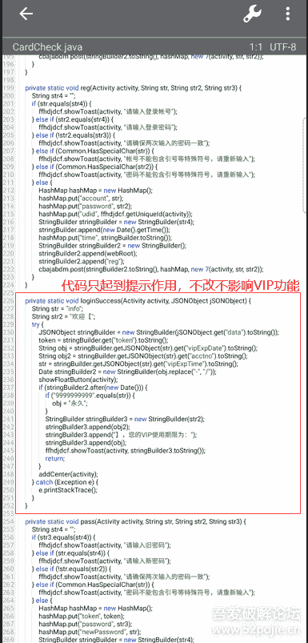

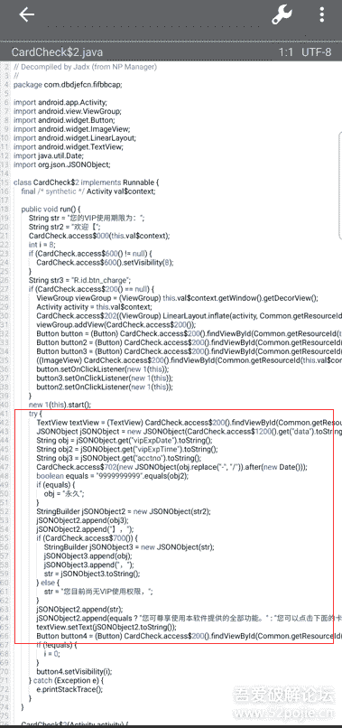

登录成功回调显示VIP信息，不修改不影响功能

```java
public static void loginSuccess(Activity activity, JSONObject jSONObject) {
    try {
        JSONObject jSONObject2 = new JSONObject(jSONObject.get("data").toString());
        token = jSONObject2.get("token").toString();
        String obj = jSONObject2.getJSONObject("info").get("vipExpDate").toString();
        String obj2 = jSONObject2.getJSONObject("info").get("acctno").toString();
        String obj3 = jSONObject2.getJSONObject("info").get("vipExpTime").toString();
        Date date = new Date(obj.replace("-", "/"));
        showFloatButton(activity);
        if (date.after(new Date())) {
            if ("9999999999".equals(obj3)) {
                obj = "永久";
            }
            ffhdjdcf.showToast(activity, "欢迎【" + obj2 + "】，您的VIP使用期限为：" + obj);
        } else {
            addCenter(activity);
        }
    } catch (Exception e) {
        e.printStackTrace();
    }
}
```

实际检测VIP功能代码，

```java
try {
    TextView textView = (TextView) CardCheck.viewCenter.findViewById(Common.getResourceId(this.val$context, "R.id.tv_info"));
    JSONObject jSONObject = new JSONObject(CardCheck.userInfo.get("data").toString());
    String obj = jSONObject.get("vipExpDate").toString();//VIP过期时间，VIP检测的的时间
    String obj2 = jSONObject.get("vipExpTime").toString();//VIP timestamp 改为9999999999为显示永久
    String obj3 = jSONObject.get("acctno").toString();
    boolean unused2 = CardCheck.isValid = new Date(obj.replace("-", "/")).after(new Date()); //检测vipExpDate是否在本地机器的时间后面，修改本地时间也可实现VIP功能
    boolean equals = "9999999999".equals(obj2);//
    if (equals) {
        obj = "永久";
    }
    StringBuilder sb = new StringBuilder("欢迎【");
    sb.append(obj3);
    sb.append("】，");
    if (CardCheck.isValid) {
        str = "您的VIP使用期限为：" + obj + "，";
    } else {
        str = "您目前尚无VIP使用权限，";
    }
    sb.append(str);
    sb.append(equals ? "您可尊享使用本软件提供的全部功能。" : "您可以点击下面的卡密充值按钮进行使用期限的充值，充值后即可尊享使用本软件提供的全部功能。");
    textView.setText(sb.toString());
    Button button4 = (Button) CardCheck.viewCenter.findViewById(Common.getResourceId(this.val$context, "R.id.btn_charge"));
    if (!equals) {
        i = 0;
    }
    button4.setVisibility(i);
} catch (Exception e) {
    e.printStackTrace();
}
```

通过代码分析，只需要修改`vipExpDate`的值，即可达到破解目的，但是为了显示永久VIP，同时也修改`vipExpTime`的值

### 逻辑整理完毕，修改Smali代码

根据字符串最后存储到的寄存器，修改具体的值

```asm
move-result-object p1    ##最后字符串存到的寄存器
const-string p1, "2099-12-31 23:59:59" ##将字符串存储到该寄存器

move-result-object v0
const-string v0, "9999999999"
```

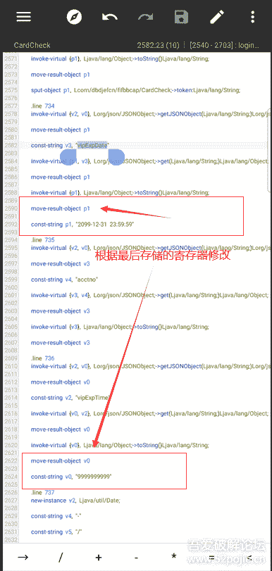

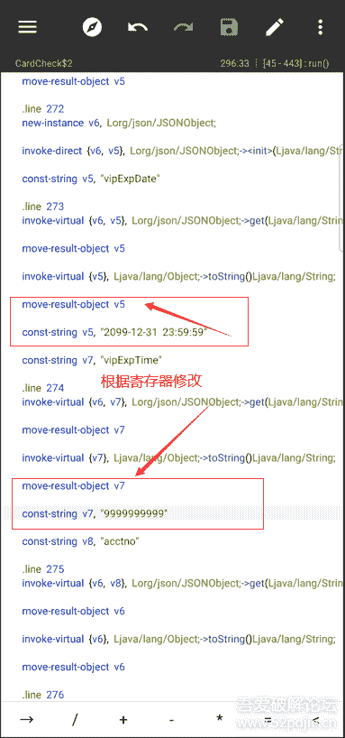

### 保存代码，打包签名并安装

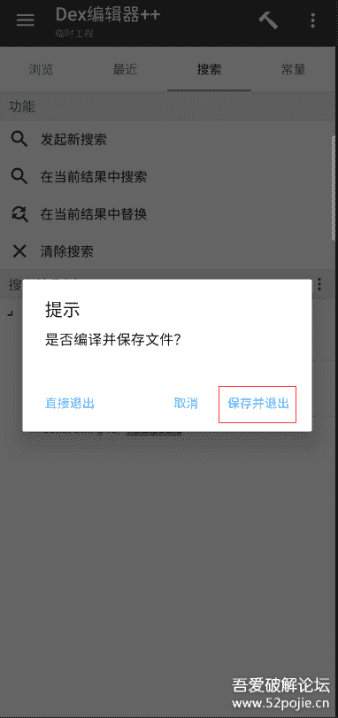

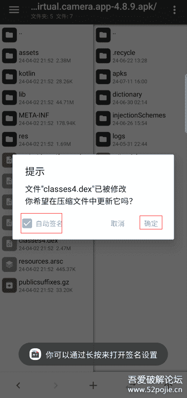

### 测试VIP情况

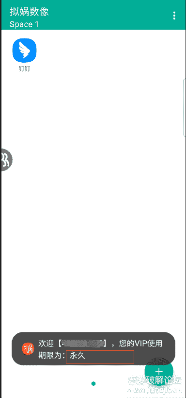

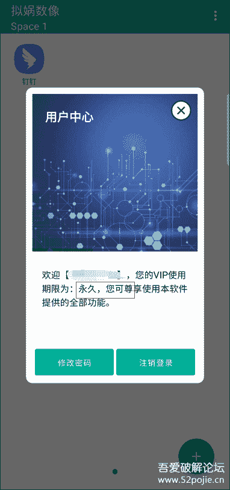
