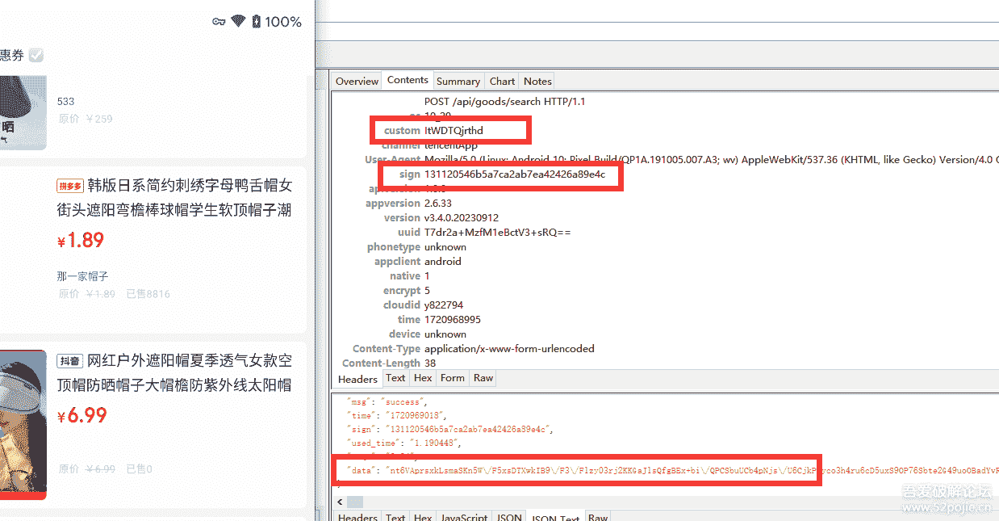
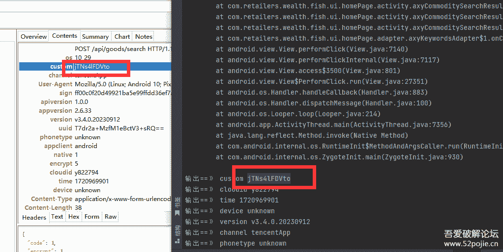
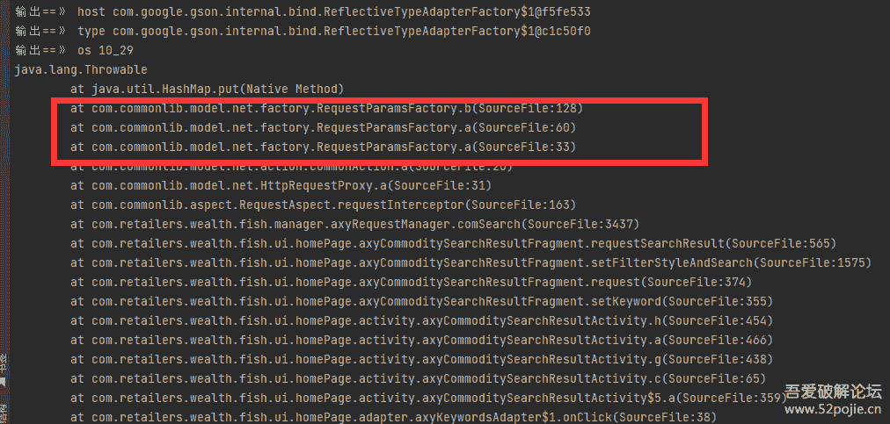
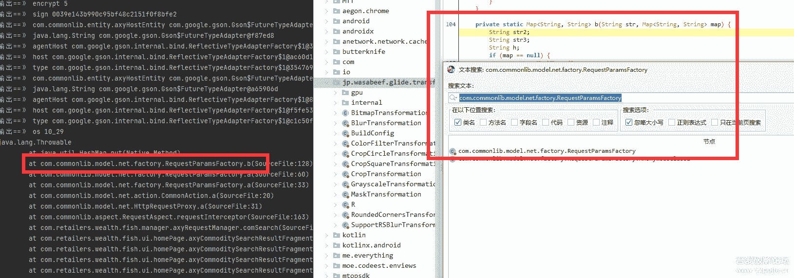
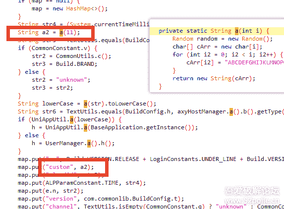
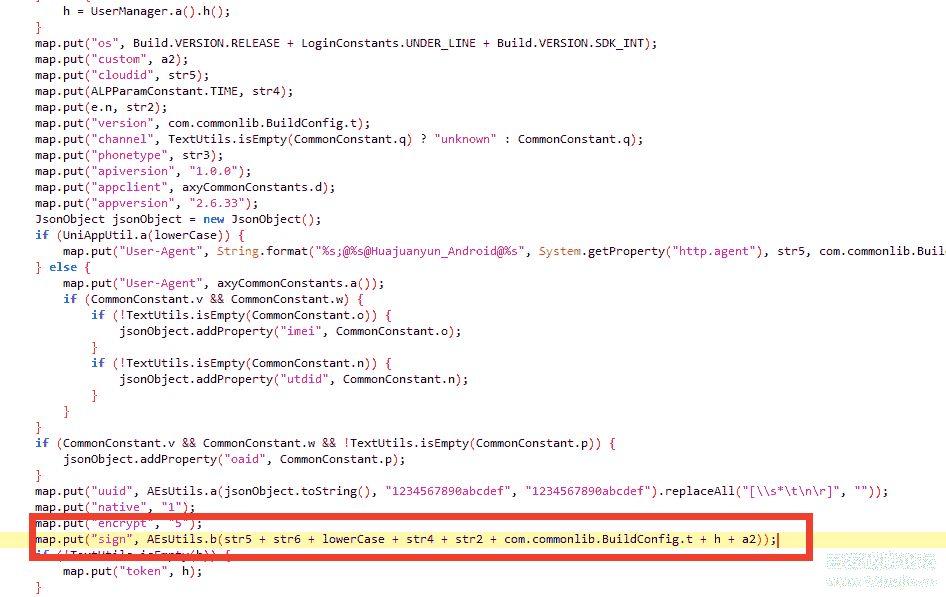
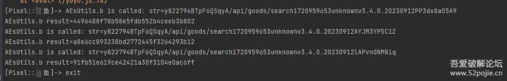
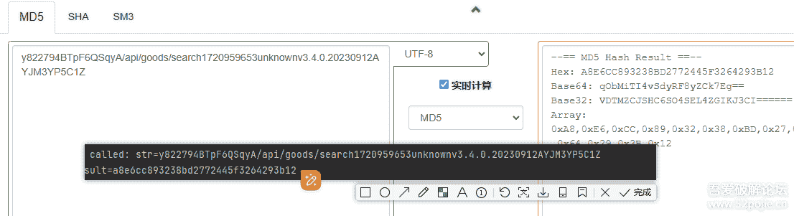
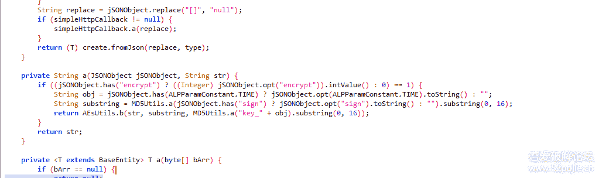
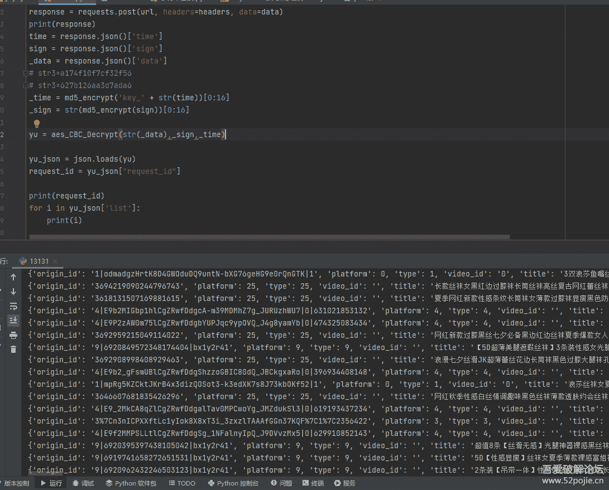

# [Android 原创] 某鱼app逆向分析

- 原帖: https://www.52pojie.cn/forum.php?mod=viewthread&tid=1944003
- 抓取时间: 2026-11-01T16:55:15.733Z

最近的学习app的逆向分析，于是随便拿了一个试试手本文仅用于学习研究，请勿用于非法用途和商业用途！如因此产生任何法律纠纷，均与作者无关！

有问题，麻烦版主立即删除用到的工具：`jadx-gui`，`pycharm`，`postern`，`charles`，`frida`

## 一、抓包分析

### 1.1 打开`postern`+`charles`看包

通过抓包分析得出 `custorn=ItWDTQjrthd`、`sign=131120546b5a7ca2ab7ea42426a89e4c` 是加密的 `time` 时间戳

返回信息`data`是密文

### 1.2 hook参数位置

直接上结果，hook `hashMap`会看到 `custom` 的值与抓包得到的结果一致

看栈可以猜出来肯定是234的位置

### 1.3 打开jadx分析

直接搜第一个，刚好有一个`b()`方法

进到方法里面发现`custom`的`a(11)`是一个随机值，直接用`py`生成就好

`sign`的值大概就是 `y822794BTpF6QSqyA/api/goods/search1720959653unknownv3.4.0.20230912lAPvnONMNiq`

头部参数拼接

进到`b()`方法里面发现正好是`md5`加密的

到网站测试 刚好对上

这个时候就能够成功发送请求了

## 二、解析回来的参数

在hook头部信息的时候刚好发现解析回来参数的位置就在旁边

取返回参数的`sign` 和`key`_+回来的时间戳 通过`md5`加密取0-16位作为`key`和`iv`用`AES` `AES/CBC/PKCS7PADDING`解析

这个`Java`层相对简单 以前的版本好像有`so`层加密 后面可能躺平了

下面上结果

后面我在试试某物，某西西
