# [Android 原创] 某西西app逆向分析

- 原帖: https://www.52pojie.cn/forum.php?mod=viewthread&tid=1944302
- 抓取时间: 2026-11-01T16:55:11.730Z

本文仅用于学习研究，请勿用于非法用途和商业用途！如因此产生任何法律纠纷，均与作者无关！

有问题，麻烦版主立即删除

用到的工具：`jadx-gui`，`pycharm`，`postern`，`charles`，`frida`，`ida`

这里我下的是某西西6.26的版本，在用`jadx`分析的时候记得开启反混淆

## 抓包分析

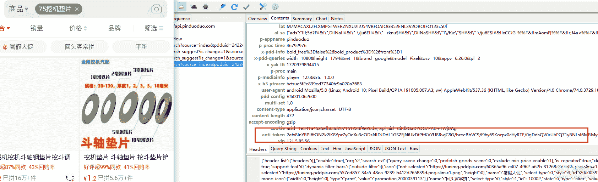

通过`curl`复制到`pycharm`得出结果是头部得出`anti-token`加密

## 打开 Frida Hook

还是`hook` `hashMap` 当`key == "anti-token"`就查看堆栈

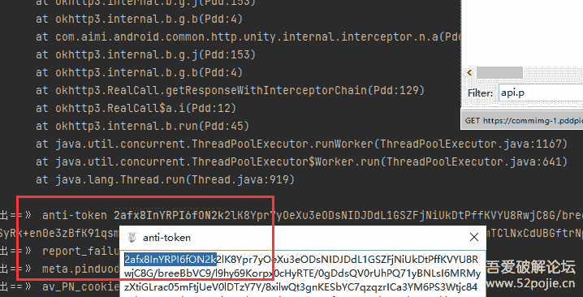

输出和花瓶抓包结果一致

## 根据堆栈信息打开 JADX 分析

根据堆栈信息打开`jadx`分析，分析前面几个，直接搜类

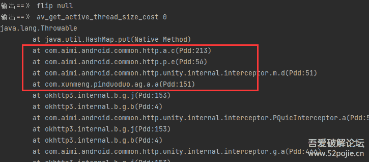

可能是这里，进去看一下

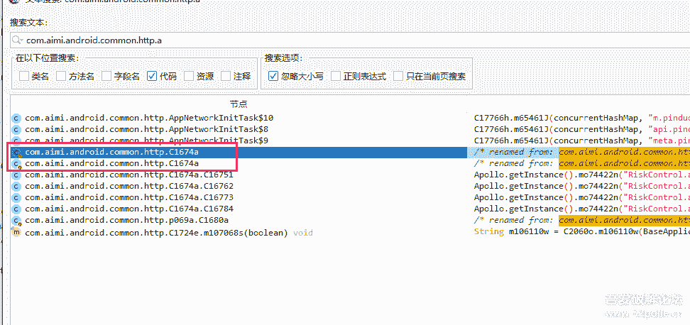

经过`frida`调试得出

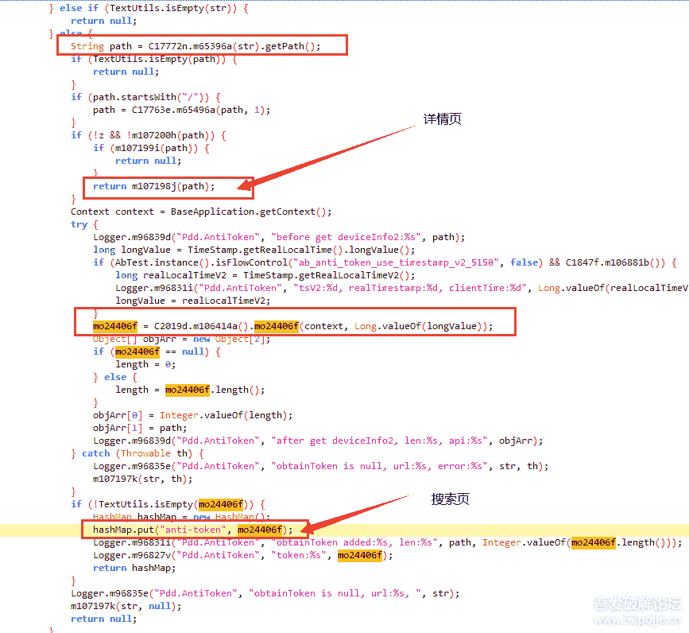

进到`mo24406f`这个方法里面发现是个接口

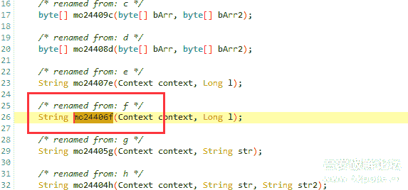

直接搜这个名字的接口

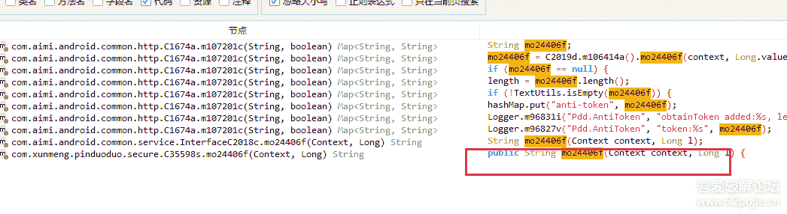

进去复制`frida`和抓包结果对比 很成功就是这里

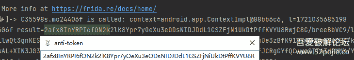

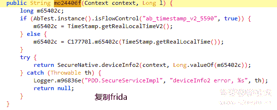

`return SecureNative.deviceInfo2(context, Long.valueOf(m65402c));` `deviceInfo2`进到里面就会发现到了`native` 这里还没有`so`文件的信息，他是动态加载的

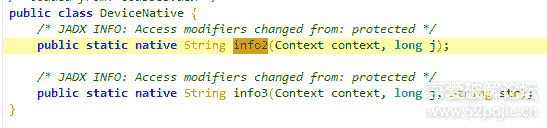

找到动态加载的`so`文件，如果想分析动态的`so`文件 得从Android得底层开始

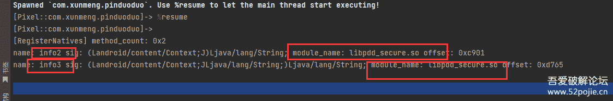

直接解压本地的`apk`文件找

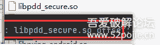

用`ida`打开`so`文件查看导出表刚好看到`device_info2`

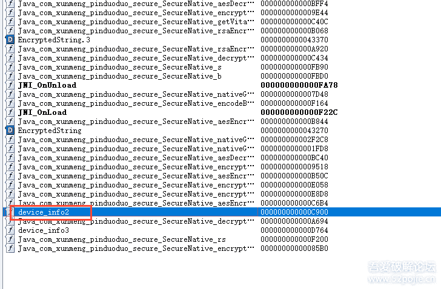

这里就要分析汇编了 ，我先发表帖子 。晚点有继续
