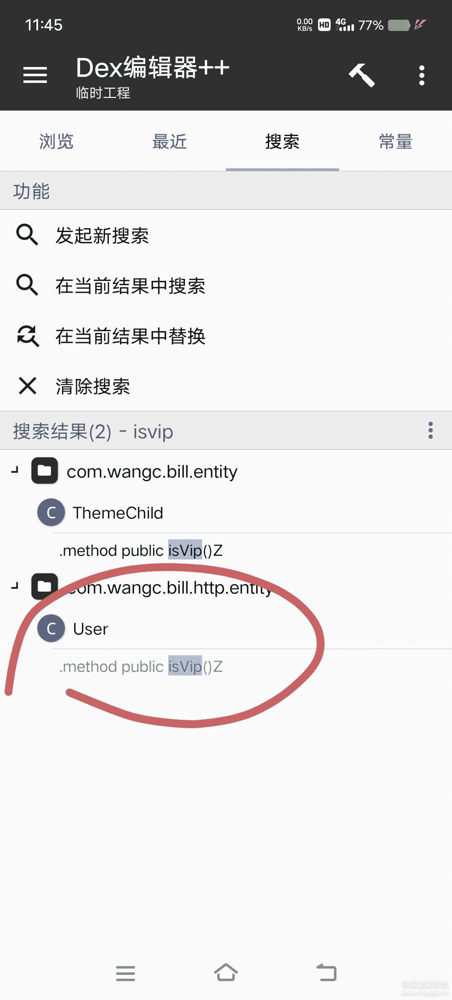
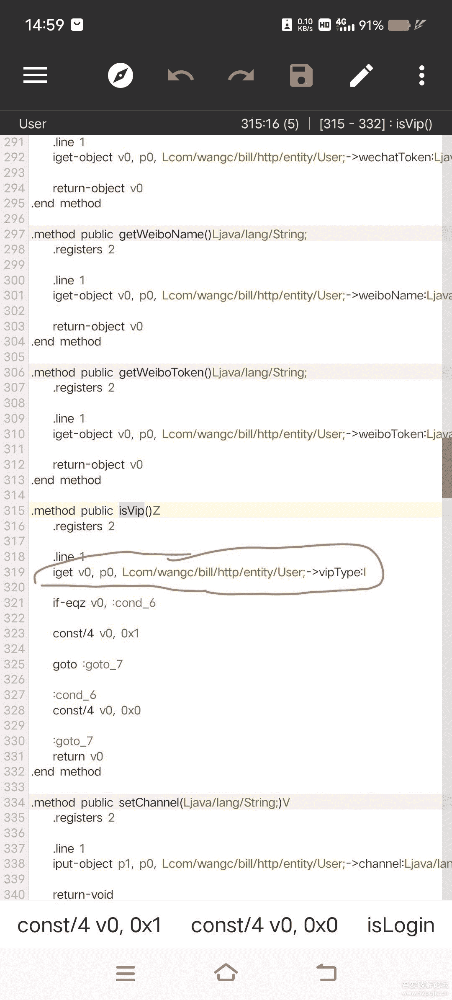
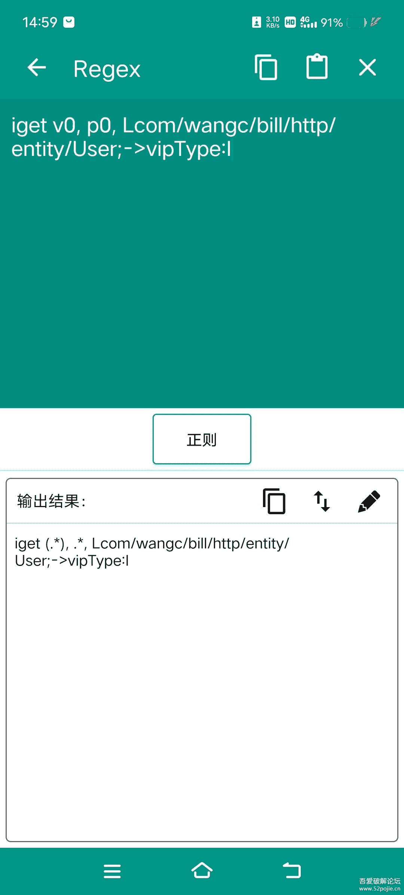
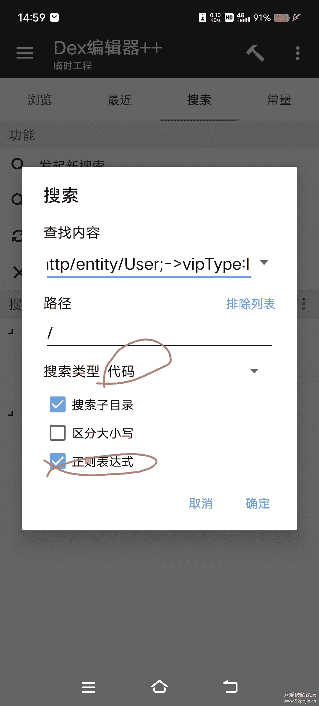
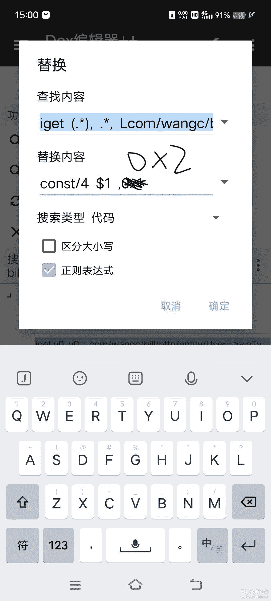
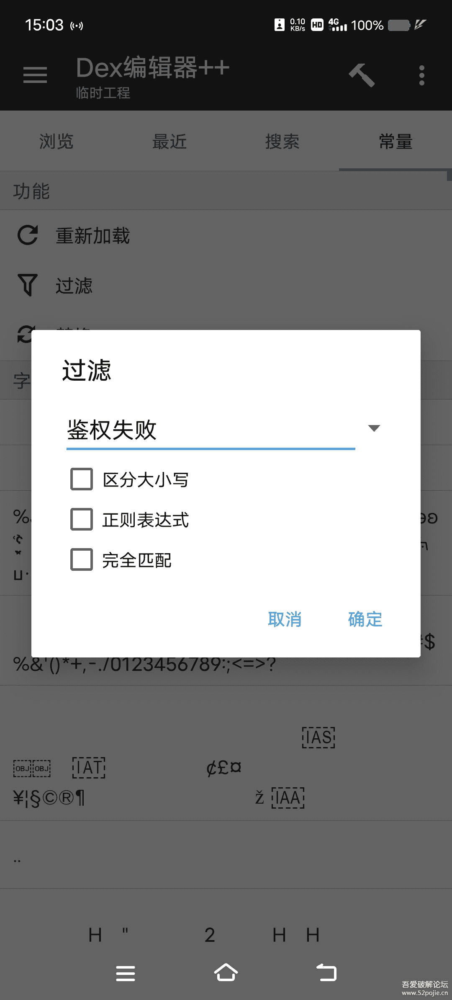
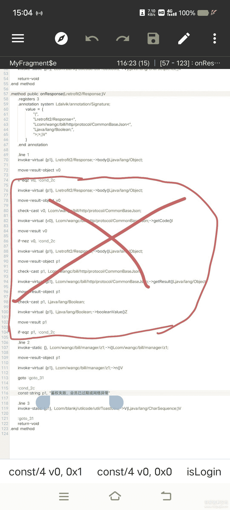
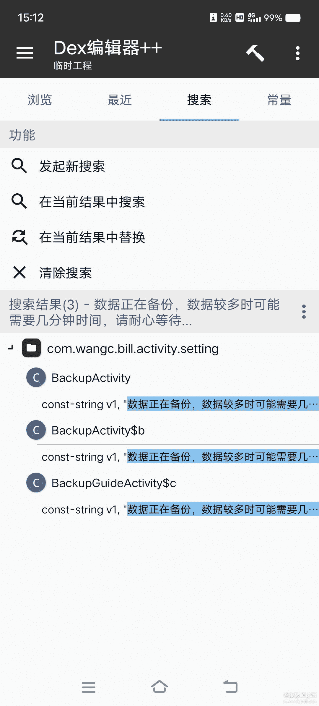
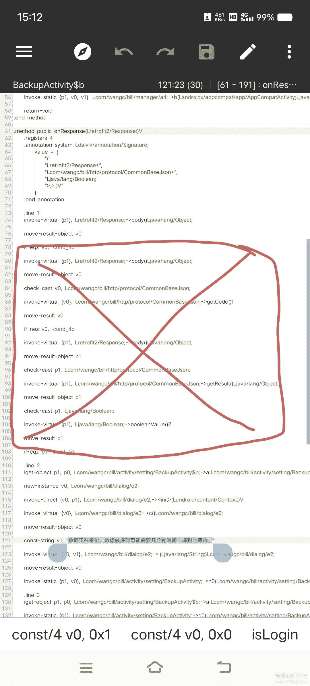
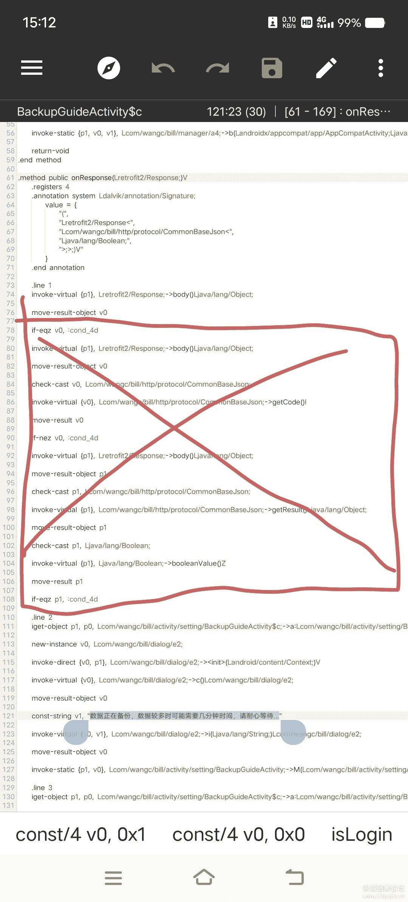

# [Android 原创] 一木记账app破解永久高级会员和云上传功能

- 原帖: https://www.52pojie.cn/forum.php?mod=viewthread&tid=1946342
- 抓取时间: 2026-11-01T16:54:51.718Z

## 前言
大家好，我是安柯，一名Android逆向作者，非常荣幸能来到吾爱论坛来发展，今天给大家带来Android软件某记逆向教程。

## 准备工具
一木记账 、 mt管理器
np管理器
编码工具箱
下载地址：https://www.123pan.com/s/WENkjv-KXr5v.html

## 教程开始
1. 提取安装包并打开 `dex` 文件，方法名搜索 `isvip`，找到第二个方法名进去

2. 选择 319 行的代码转成正则表达式

3. 转换完成后回到管理器并且搜索此正则表达式，然后替换为 `const/4 $1, 0×2`

4. 接下来解锁云端上传功能，常量分别过滤“鉴权失败”和“数据正在”，分别删除掉方法名内的所有判断语句（如下图所示）

5. 最后保存去签安装即可

## 结尾
本人第一次发帖，不喜勿喷，欢迎大家在评论区讨论学术，感谢大家的支持！
