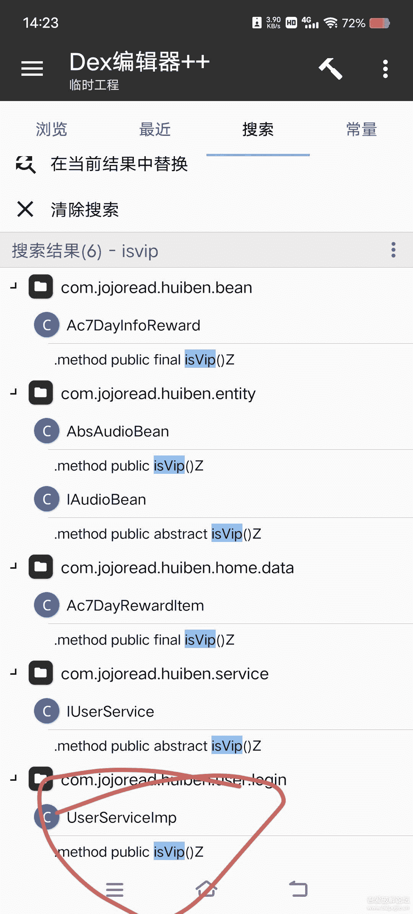
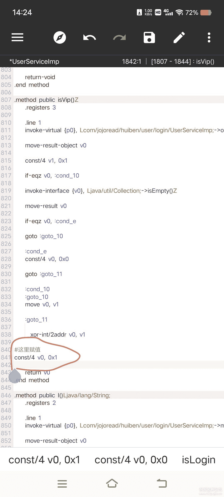
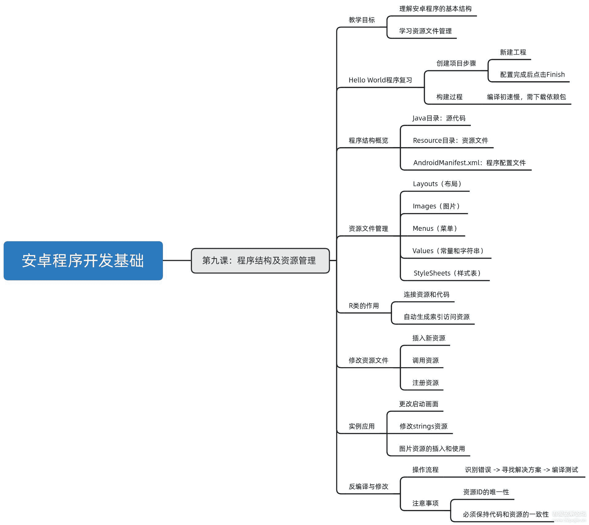

# [Android 原创] 叫叫绘本 一步破解会员 以及 关于逆向知识点分享

- 原帖: https://www.52pojie.cn/forum.php?mod=viewthread&tid=1946935
- 抓取时间: 2026-11-01T16:54:44.714Z

## 前言
大家好，我是安柯

我看上期的教程大家反馈很积极啊
于是我又来了

## 工具
mt管理器 ， 叫叫绘本

## 教程
1. 打开安装包的dex文件，方法名搜索`isvip`，打开最后一个方法名

2. 末尾赋值`const/4 v0,0×1`

3. 去签安装即可

## 尾声
我看今天的教程有点水，那就再补充一点安装包结构分析吧

最后在此谢谢大家支持喔！以后会带来更优质的逆向教程，希望大家共同进步！

