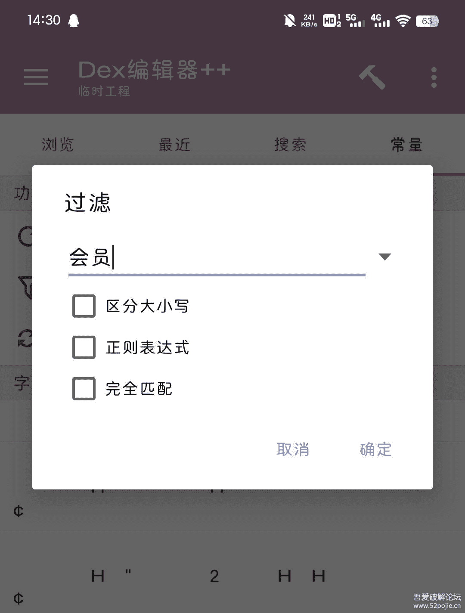
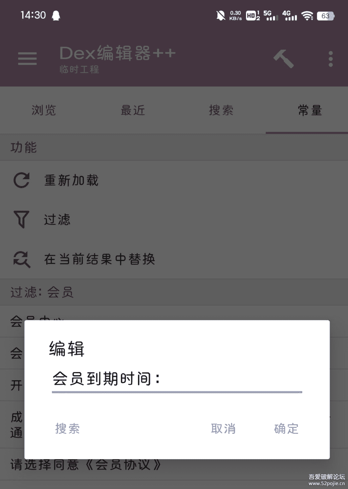
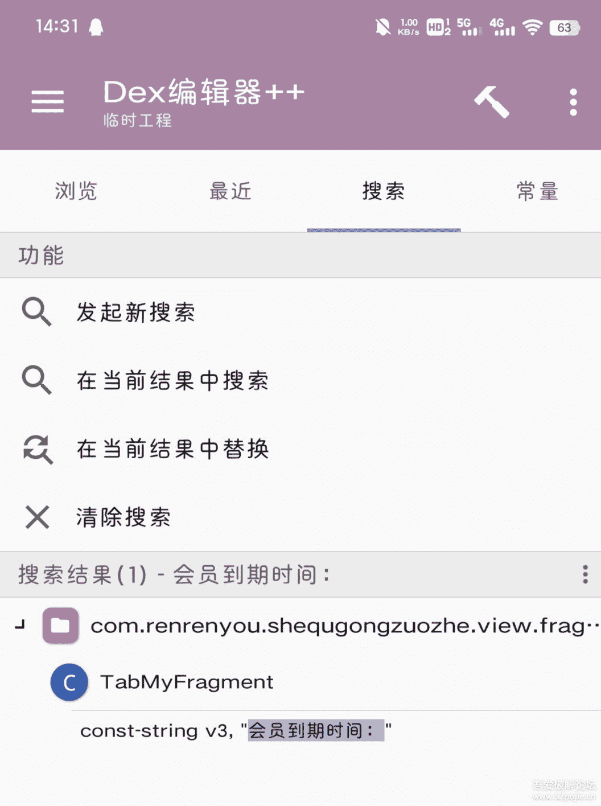
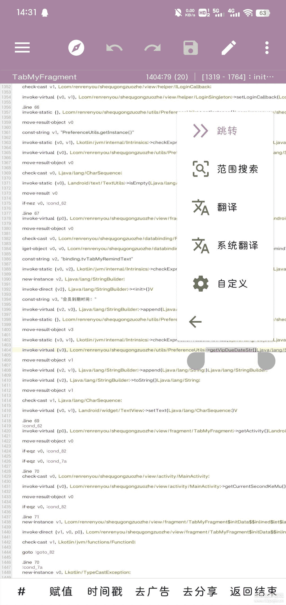
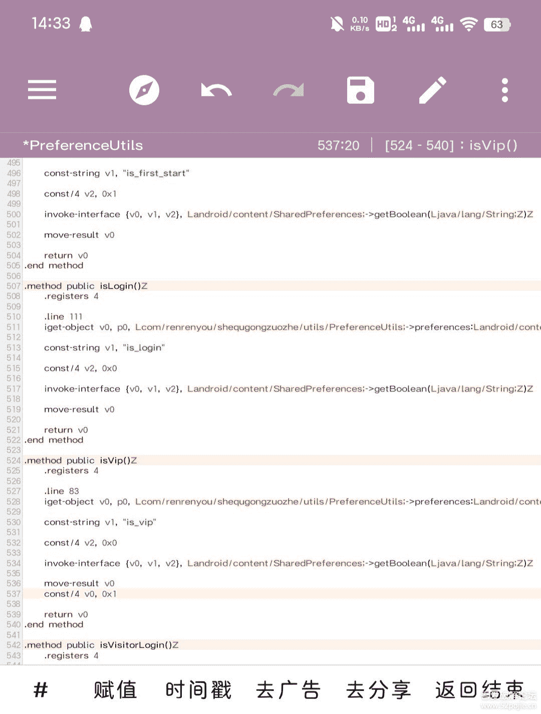
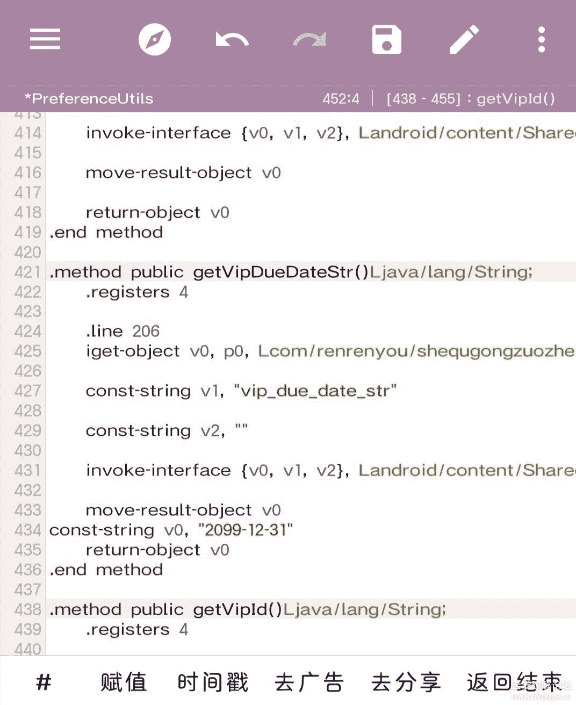
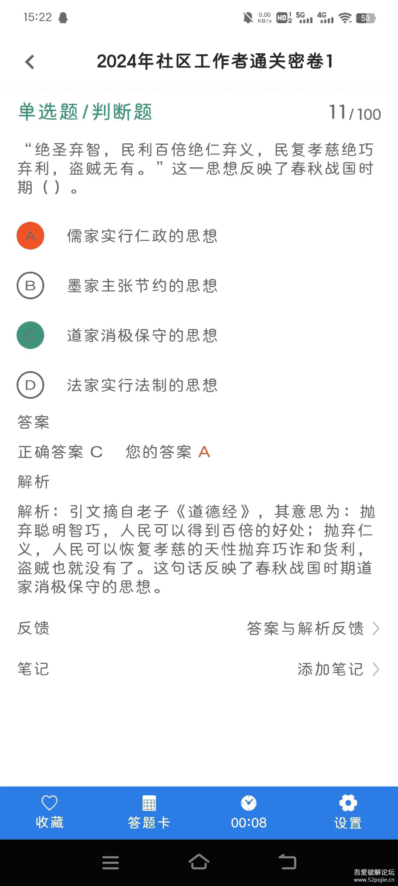

# [Android 原创] 社区工作者易题库免登陆解锁会员

- 原帖: https://www.52pojie.cn/forum.php?mod=viewthread&tid=1947010
- 抓取时间: 2026-11-01T16:54:38.711Z

新人第一次发帖，不喜勿喷，感谢感谢～

## 准备工具

社会工作者易题库、mt管理器、np管理器

## 教程开始

提取安装包去签并打开 dex 文件，常量过滤会员，选择`"会员到期: "`搜索。

只有一个结果点进去，往下滑找到`->getVipDueDateStr`，跳转进去。

往下滑，找到`method public isVip()Z`赋值`const/4 v0, 0x1`。

在`method public getUserName()Ljava/lang/String;`

内置一下`const-string v0, "52pj"`到这会员已解锁。

如果想继续美化一下时间，可以在`method public getVipDueDateStr()Ljava/lang/String;`进去赋值`const-string v0, "2099-12-31"`

之后保存退出签名安装即可。

成品图如下:

教程结束～
