# [Android 分享] 小熊录屏2.4.7.1解锁会员功能

- 原帖: https://www.52pojie.cn/forum.php?mod=viewthread&tid=1947553
- 抓取时间: 2026-11-01T16:54:25.706Z

## 准备工具

- 小熊录屏
- mt管理器
- np管理器

## 教程开始

### 方法一

1. 提取安装包，去签，打开`dex`文件，`dex++`，全选，常量过滤"会员"，啥都没有，那就打开`resources.arsc`文件，选`Arsc`编辑器，搜索资源值"会员"，字符串，找到"永久vip会员"，长按复制`ID`。

    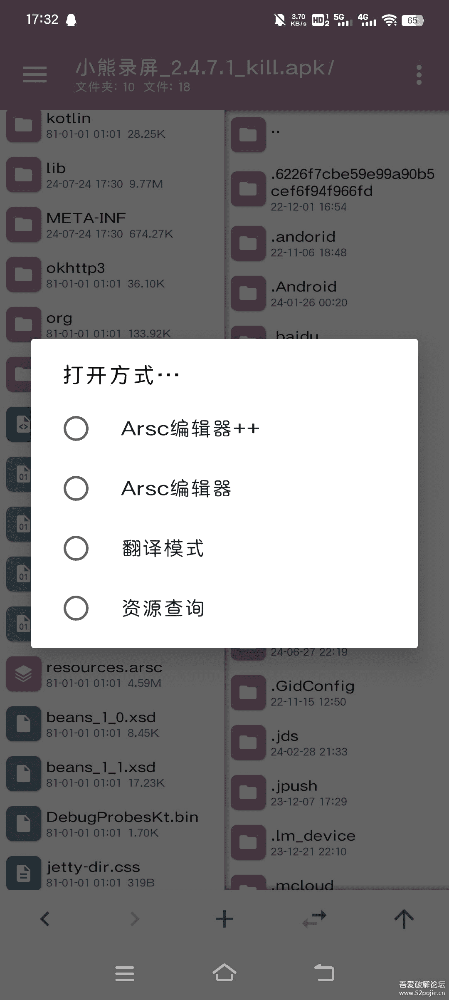

    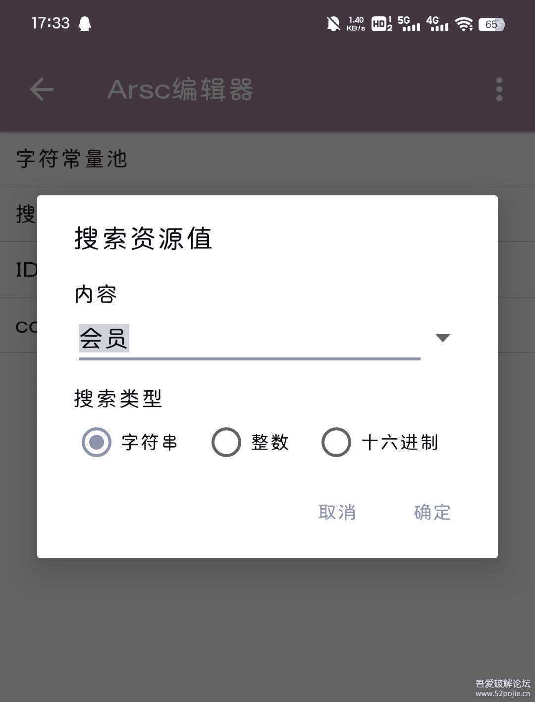

    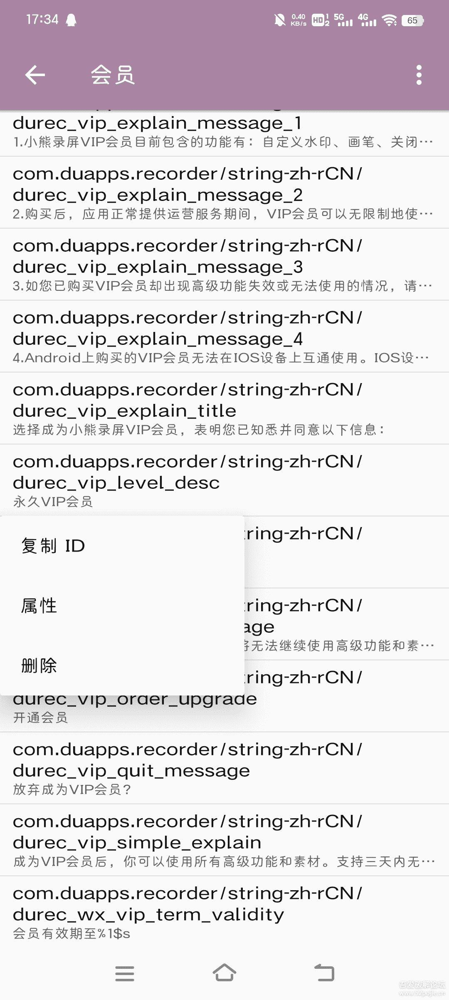

2. 打开`dex`文件，`dex++`，全选，搜索刚复制的`ID`，搜索类型选整数，出来两条结果，点第二个结果进去，因为它是`VIPActivity`。

    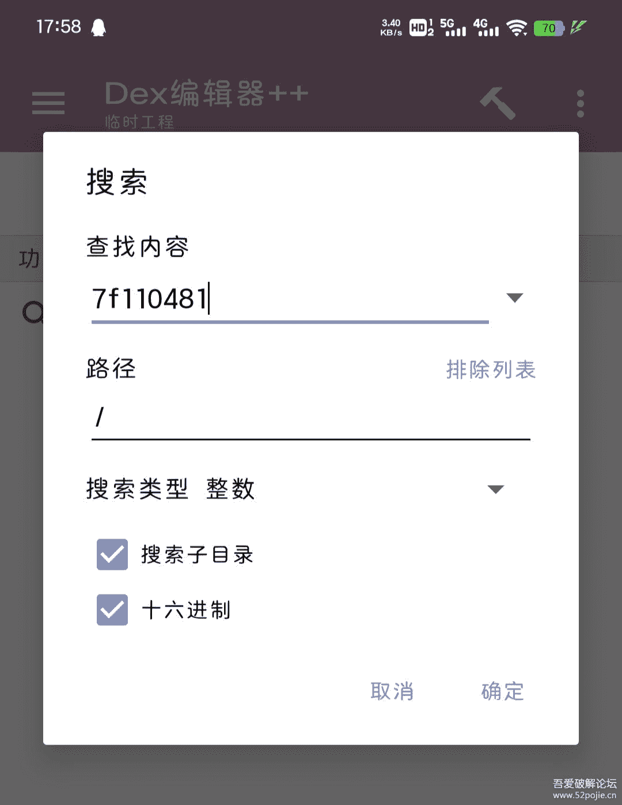

    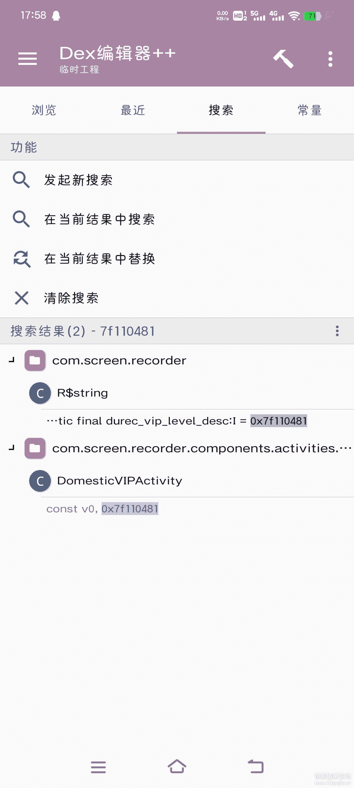

    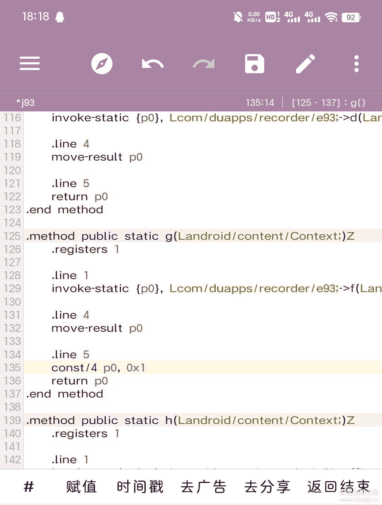

3. 上滑找到`invoke-static {p0}, Lcom/duapps/recorder/j93;->g(Landroid/content/Context;)Z`，跳转进去赋值`const/4 p0, 0x1`。

4. 返回保存签名安装即可。

#### 方法一成品图

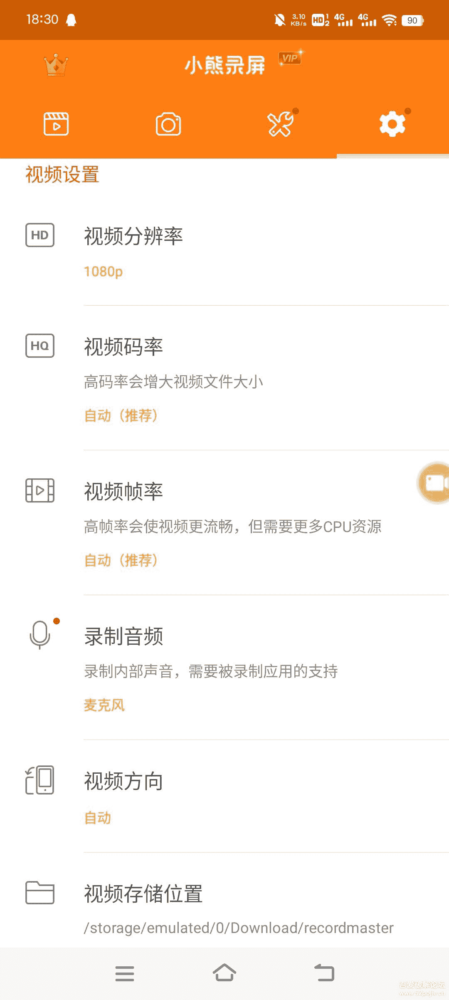

### 方法二

但大佬不熬夜的听冬酱有个更方便的方法，既可以解锁会员功能又可以让页面干净，更重要的是重启后不会恢复到原来的设置，水印也不用每次都关闭。我在这也分享出来。

1. 打开`dex`文件，`dex++`，全选，搜索`not_login`，代码，选第一条结果进入。

    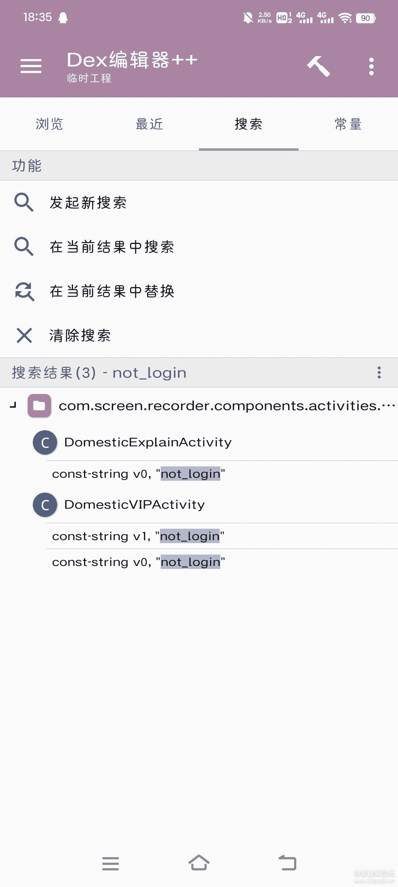

    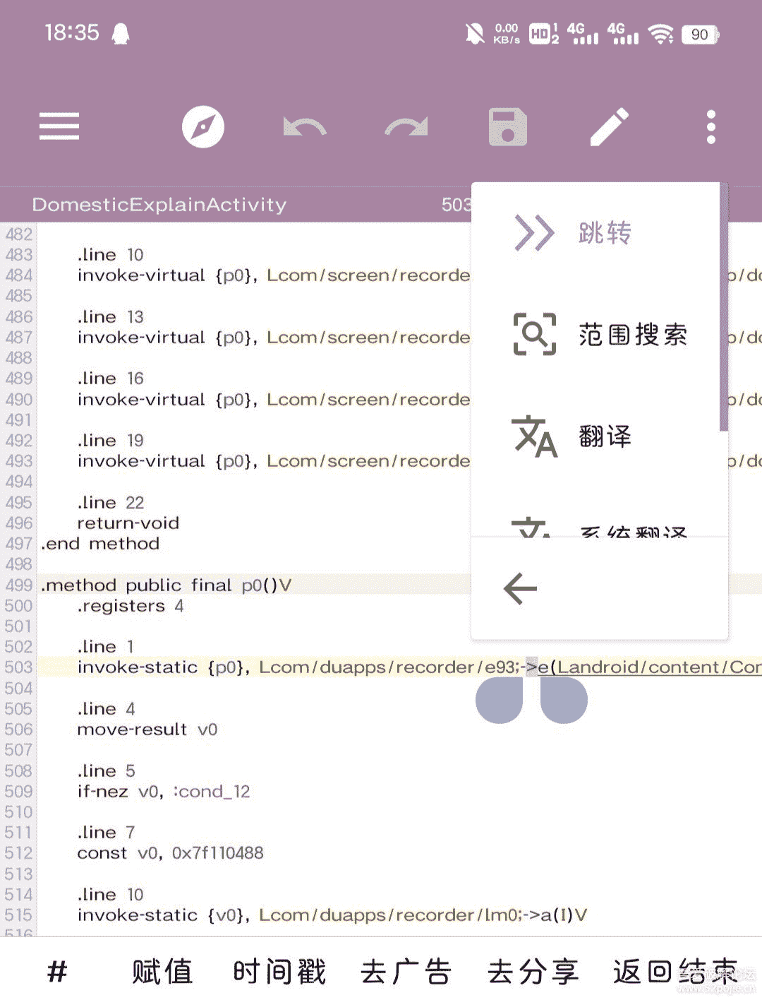

2. 上滑找到：

    ```smali
    invoke-static {p0}, Lcom/duapps/recorder/e93;->e(Landroid/content/Context;)Z
    ```

    这里的判断很重要，看一下流程图。

    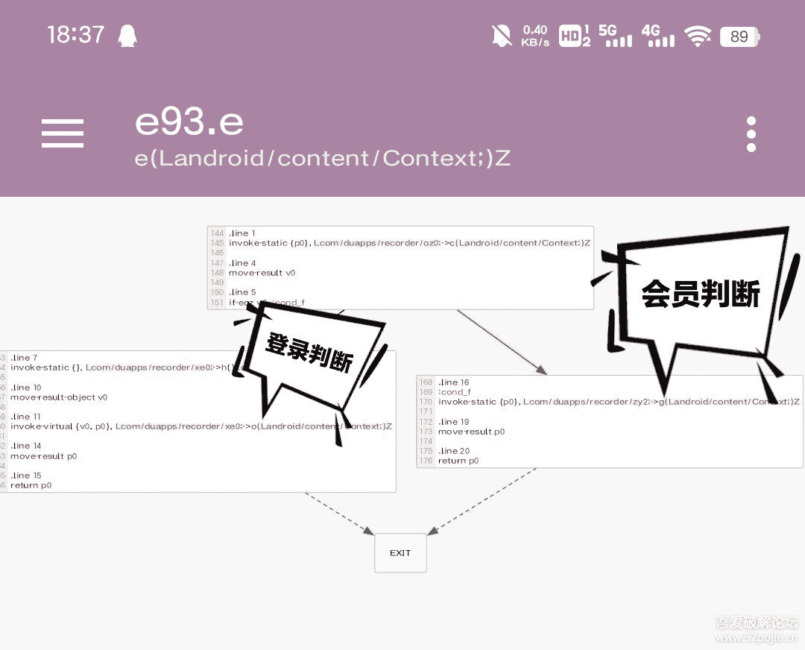

3. 经过上面的`c`判断后，才依次去执行判断登录`o`和判断会员`g`的操作。

    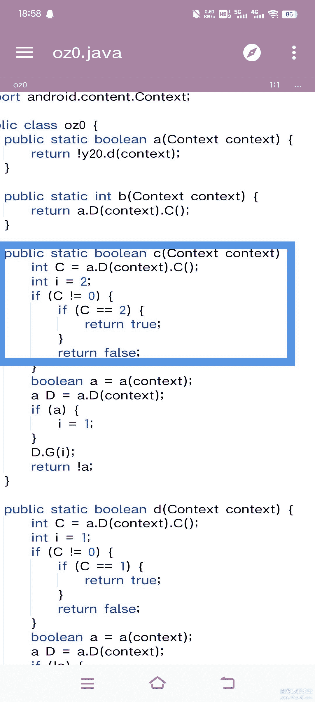

4. 而且只要让`c`等于0就可以结束循环，所以，直接清空代码。之后就退出保存签名安装即可。

    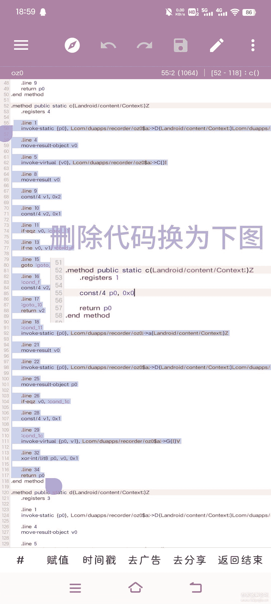

#### 方法二成品图

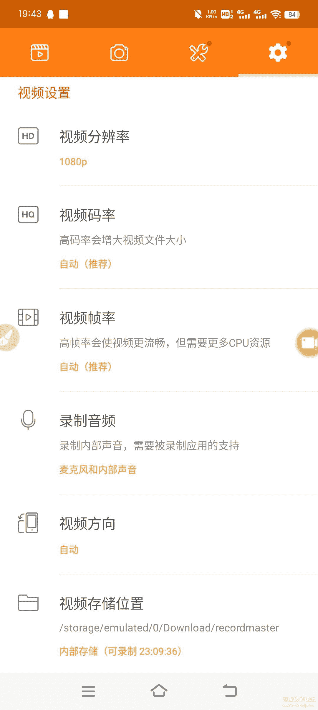

教程结束～
