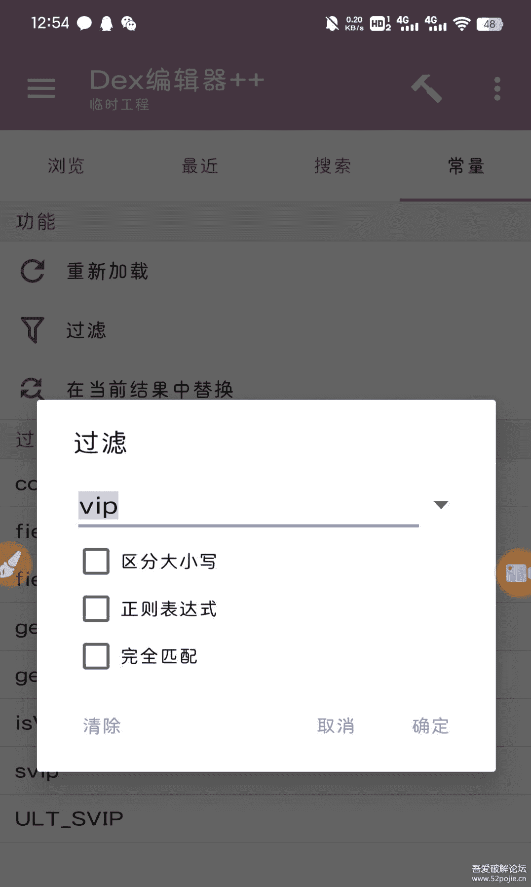
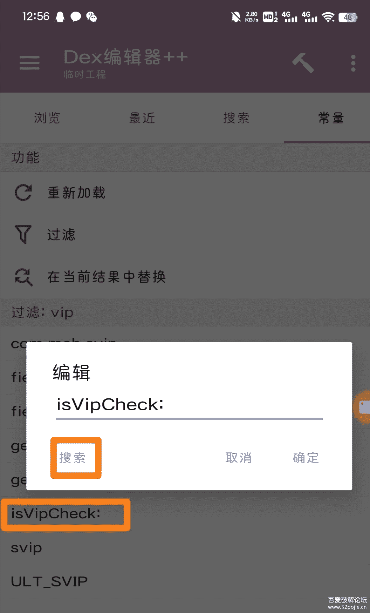
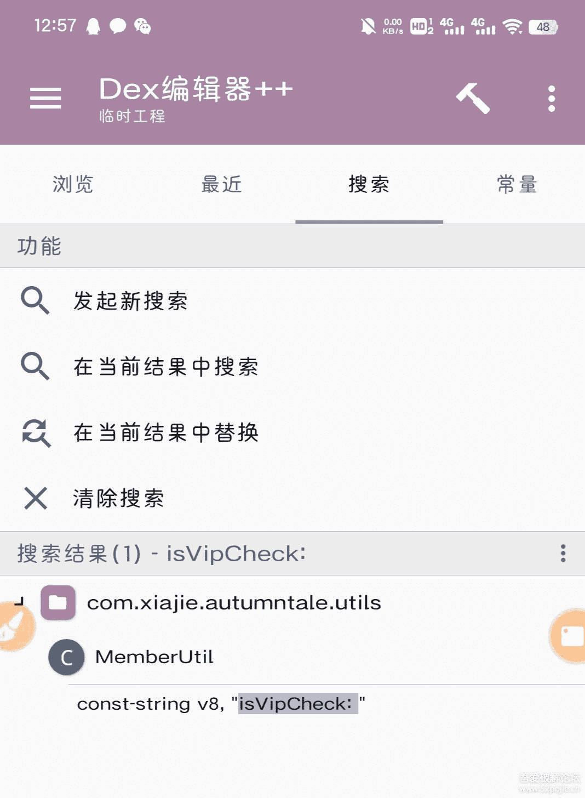
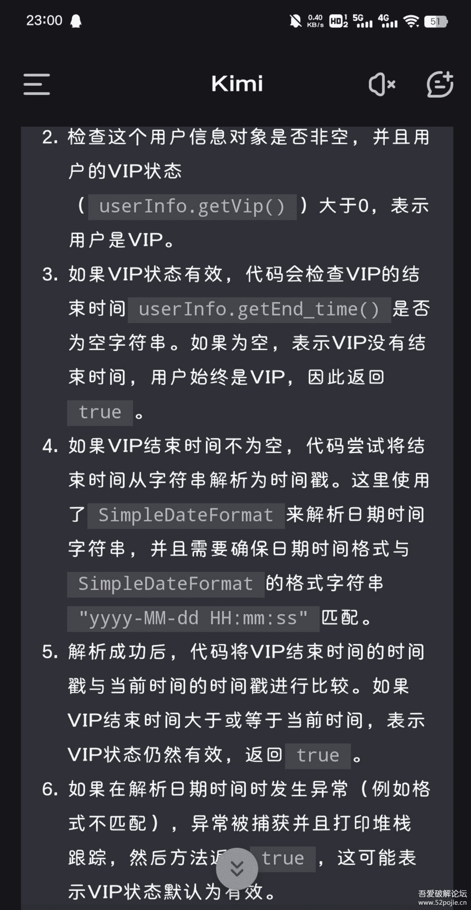
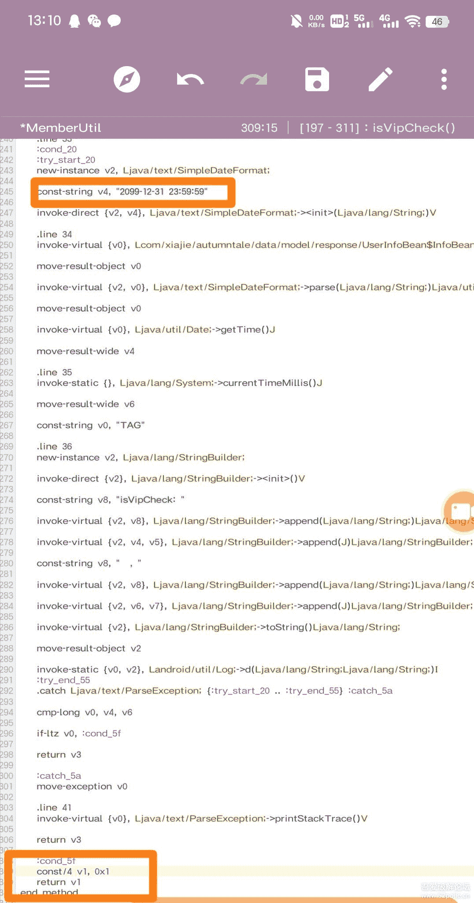
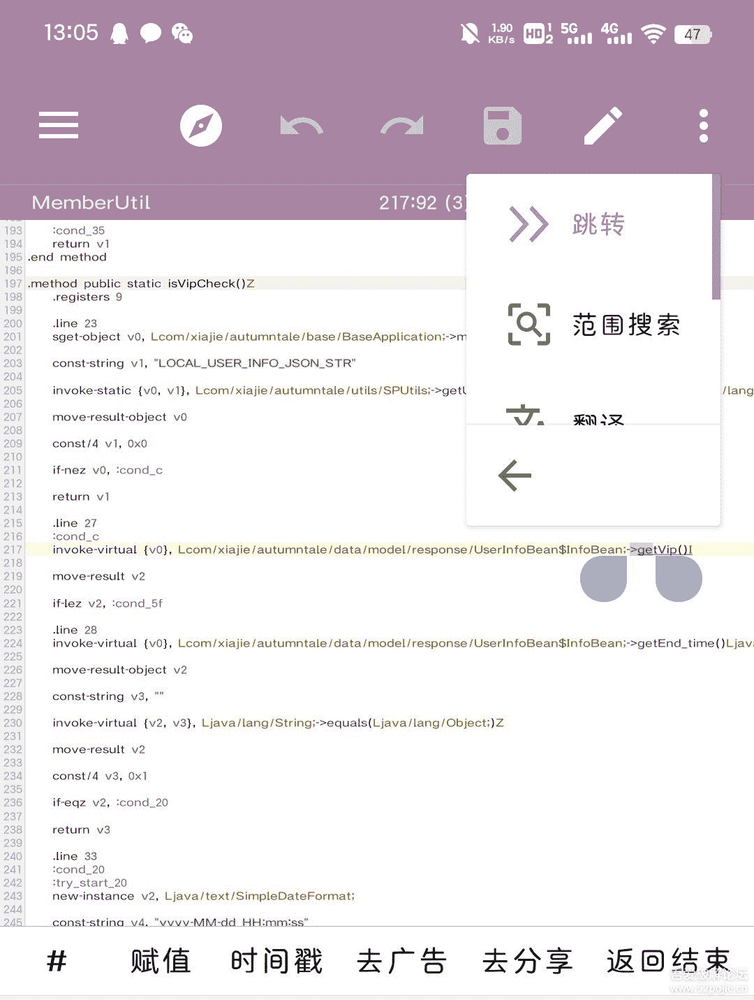
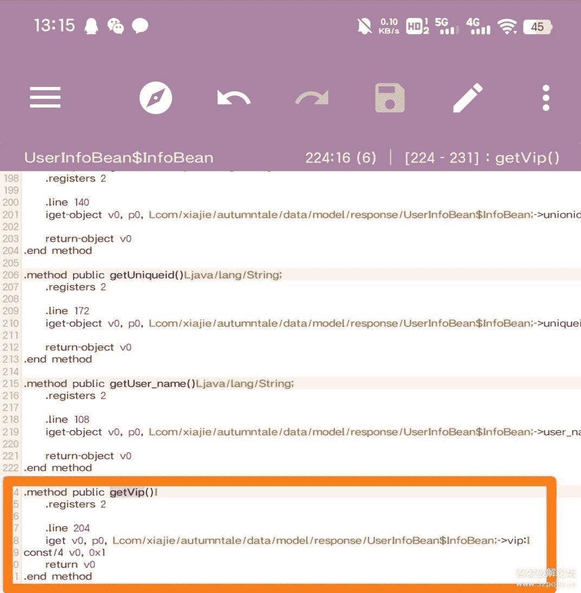
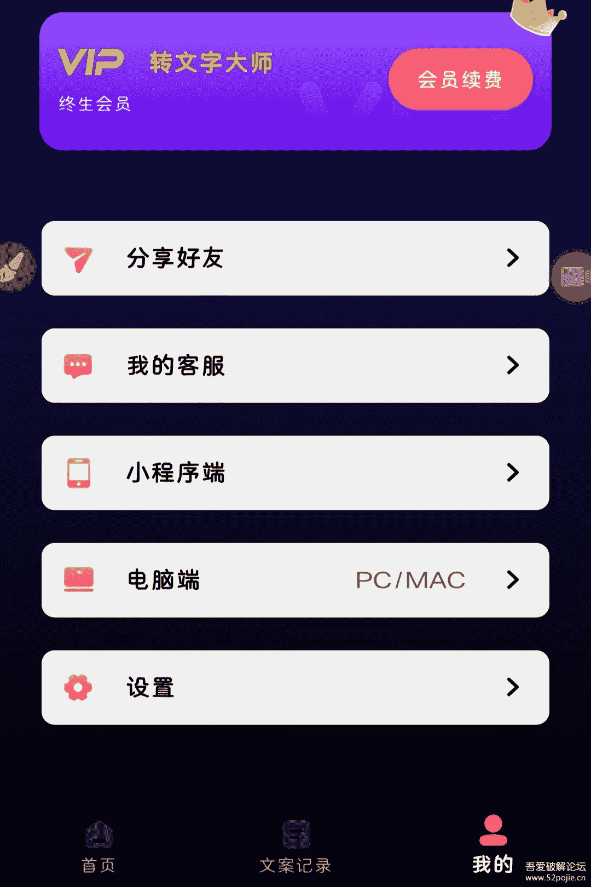
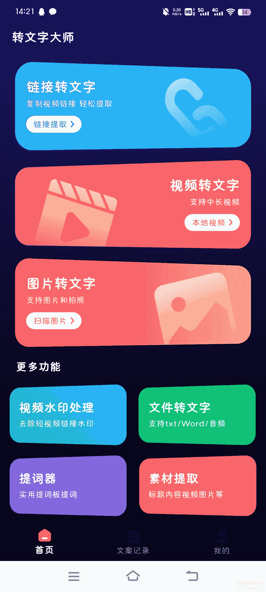
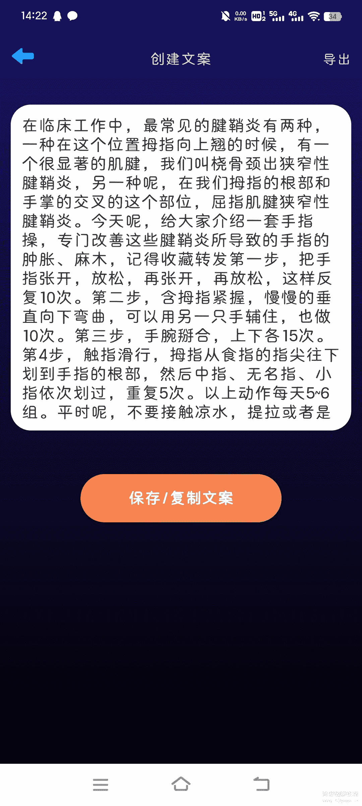

# [Android 分享] 转文字大师解锁会员功能

- 原帖：https://www.52pojie.cn/forum.php?mod=viewthread&tid=1947867
- 抓取时间：2026-11-01T16:54:13.700Z

简单介绍一下软件，支持“视频转文字、链接转文字、音频转文字、图片转文字、视频链接一键获取音视频文字”等多功能于一体的一站式转文字软件。

## 教程前准备工具

`转文字大师`、`mt管理器`、`np管理器`

## 教程开始

提取安装包，去签，打开`dex`文件，`dex++`，全选，常量过滤`会员`，啥都没有，那就换`vip`过滤，找到`isVipCheck`，搜索。

只有一个结果，点进去，上滑，可以看到这个是检查`vip`状态的方法，贴个`Ai`分析结果，可知改 3 个地方就可以了。

改一下时间，把 245 行的`const-string v4, "yyyy-MM-dd HH:mm:ss"`改为未来的一个时间`"2099-12-31 23:59:59"`，再在 309 行赋值`const/4 v1, 0x1`。

再上滑找到`invoke-virtual {v0}, Lcom/xiajie/autumntale/data/model/response/UserInfoBean$InfoBean;->getVip()I`，跳转进去，在 229 行，赋值`const/4 v0, 0x1`。

再保存退出签名安装打开软件看看，显示终生会员，功能也都可以正常使用了。

## 成品图

上图为测试的功能视频转文字。

## 说点儿遗憾

安装后进入页面就提醒登录，我常量搜索`登录`，找到`请您先登录！`，搜索，进去看到有个`checkIsLogin`，跳转进去看看，没啥可以修的，又复制`checkIsLogin`，发起新搜索，方法名，搜出两条结果。赋值了一通结果进软件点功能还是会跳出登录，有兴趣的可以自行修改看看能不能实现免登陆。欢迎大家在评论区讨论交流，感谢大家的支持～
