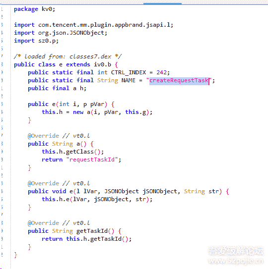

# [Android 原创] `Frida`实现对VX小程序的抓包

- 原帖: https://www.52pojie.cn/forum.php?mod=viewthread&tid=1948056
- 抓取时间: 2026-11-01T16:54:08.698Z

作为一个刚接触逆向不久的新手，知道`frida`的时候，惊为天人，居然有这么好用的东西~

因为之前用各种抓包软件都没有抓到过小程序的数据包，于是就尝试一下用`frida`获取vx小程序的包。下面进入正题，感谢这位大佬提供的思路

1. 首先用`Jadx`打开微信安装包，搜索字符串`createRequestTask`，这样可以找到两个类，分别用于创建同步任务和异步任务。



2. `this.h.e(lVar, jSONObject, str);`进入这个方法，可以看到`jVar.g(lVar, i, jSONObject, g, aVar2.q, bVar, str, "createRequestTask");`这个就是发起请求的地方。接下来就是用`frida`写代码hook了

3. 一开始的时候我陷入了一个误区，因为`Jadx`反编译出来的包名都不是完整的，比如这样的`package kv0;`。我一直在研究怎么拿到完整的包名。后面在论坛看到有大佬说了一句，这个是不影响hook的，那实际的拿到发送数据的代码就是这样的：

```javascript
var JSendClass = Java.use("sz0.j");
    if (JSendClass.g) {
      JSendClass.g.overload(
        "com.tencent.mm.plugin.appbrand.jsapi.l",
        "int",
        "org.json.JSONObject",
        "java.util.Map",
        "java.util.ArrayList",
        "sz0.o",
        "java.lang.String",
        "java.lang.String"
      ).implementation = function (lVar, i, jsonObject, map, arrayList, oVar, str, str2) {
        console.log("\n------------------ Sending Data ------------------");
        console.log("lVar:" + lVar.toString());
        console.log("jsonObject: " + jsonObject.toString());
        console.log("map: ");
        var keySet = map.keySet();
        var it = keySet.iterator();
        while (it.hasNext()) {
          var key = it.next();
          var value = map.get(key);
          console.log(key.toString() + " -> " + (value ? value.toString() : "null"));
        }
        console.log("str: " + str);
        console.log("str2: " + str2);
        return this.g(lVar, i, jsonObject, map, arrayList, oVar, str, str2);
      };
    } else {
      console.log("Method 'g' not found in the sending class.");
    }
```

运行脚本，就可以拿到发送的数据。注意`frida`的需要的`PID`应该是微信本体的`PID`，而不是小程序进程的`PID`。
