# [Android 分享] 每日冥想2.5.4解锁vip功能

- 原帖: https://www.52pojie.cn/forum.php?mod=viewthread&tid=1948390
- 抓取时间: 2026-11-01T16:54:03.695Z

## 软件介绍
简单介绍一下软件:一款冥想、睡眠、身心放松、专注力、情绪管理的健康类应用。

## 准备工具
每日冥想、`mt管理器`、`np管理器`、脱壳工具

ps:本来不想写加固脱壳这些的，但有些小伙伴不知道，所以写了，因为怕涉嫌引流所以脱壳网站网址就不发了，但是其他步骤都会写的清清楚楚的。拿到软件先去签安装看看，别一顿操作猛如虎，最后发现过不了签，那就尴尬了。

## 教程开始
### 注意
处理过程一定不要开启自动签名，也不要勾选自动签名

拿到软件先去签，这里用`np管理器`的测试签校强度，用最后一个`fancy`，配置如图。安装不闪退。

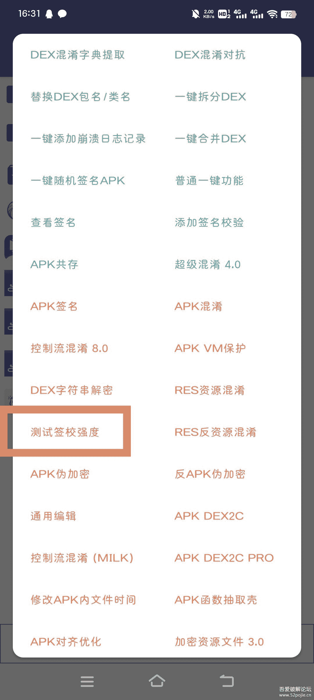
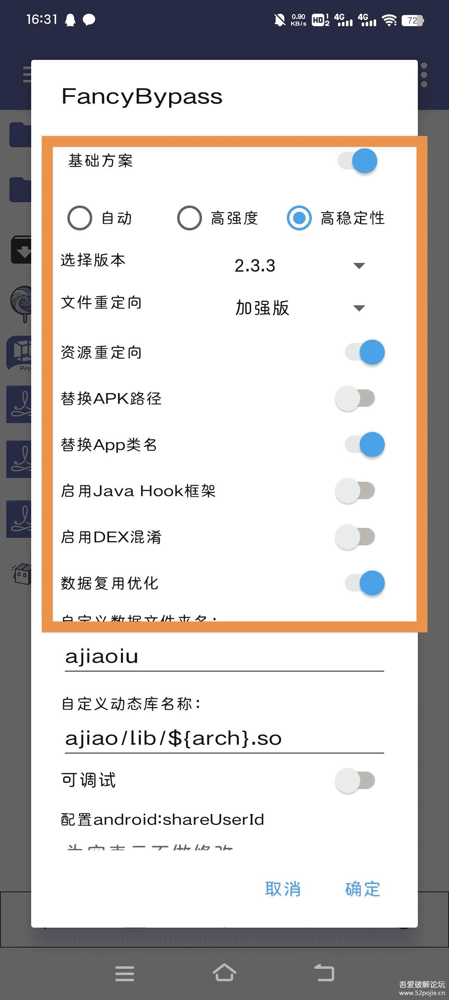

### 1. 脱壳
软件有加固，需要先脱壳，我用的是大佬的在线网站(`apk加固安全测试`)，用原包去脱壳，等待网站处理好，下载，用`MT`打开解压到本地，我的习惯是移动到 `MT2` 的 `apks` 。解压出一个`txt`文件，一些`dex`文件。`txt`文件是软件的原入口，也就是真实入口，复制下来。

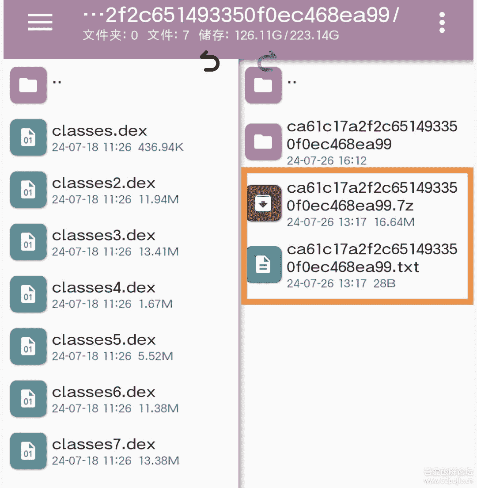
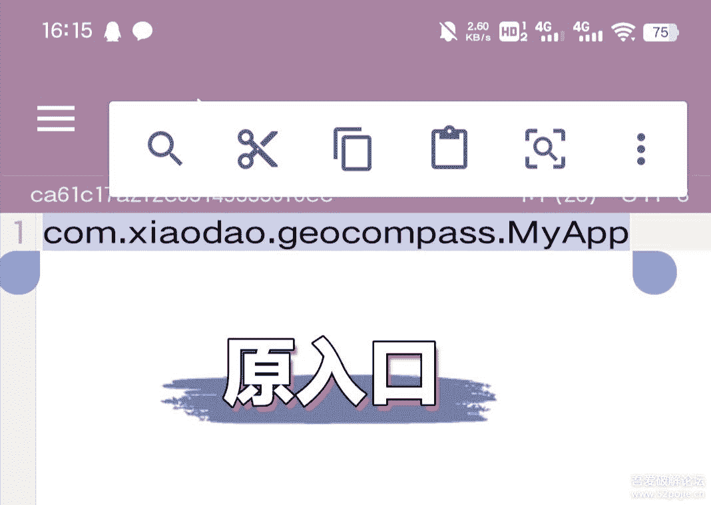

### 2. 替换入口
打开`AndroidManifest.xml`，反编译，查找`Application`，即154行，`fancybypass.component.FancyApplication`替换为刚复制的原入口`com.xiaodao.geocompass.MyApp`

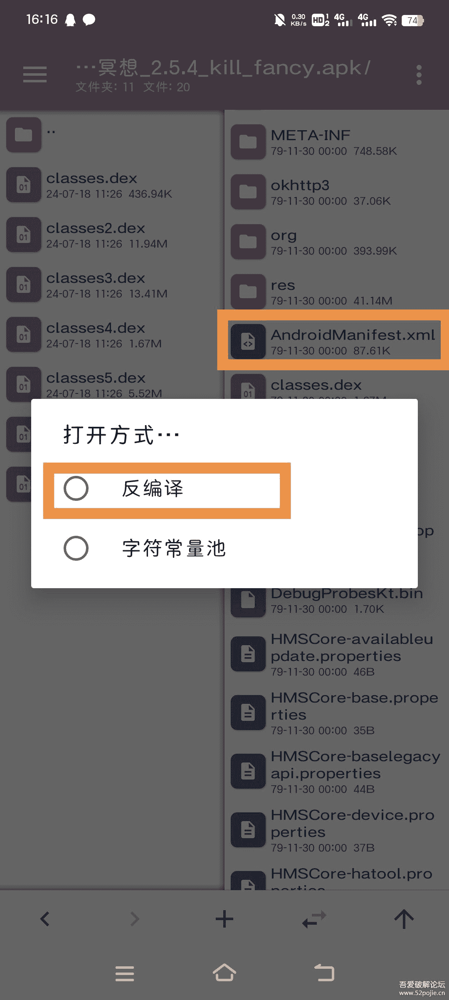
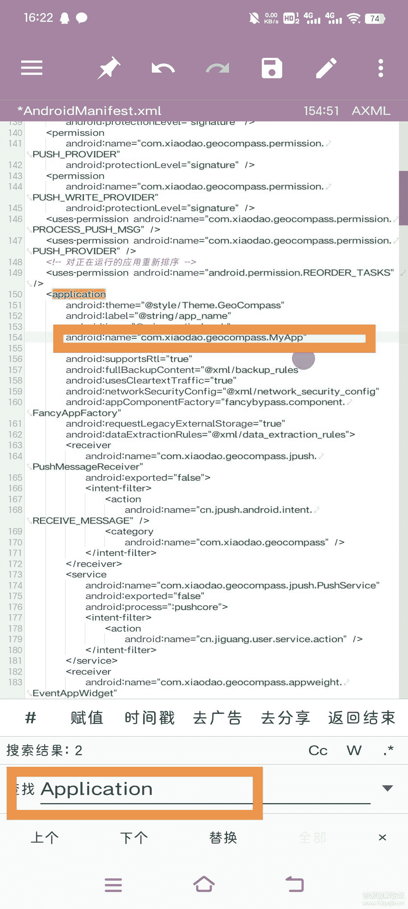

小知识点，没去签的原包一般查找`MyWrapperProxyApplication`，选中替换为刚复制的原入口，如果是处理其他软件遇到没有入口的，需要把`xml`内最下面一个`&#160;`

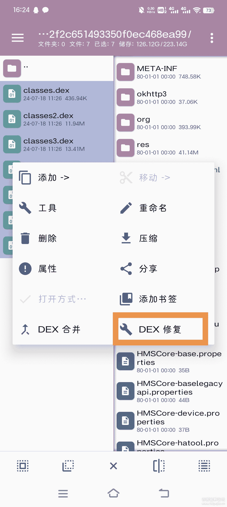
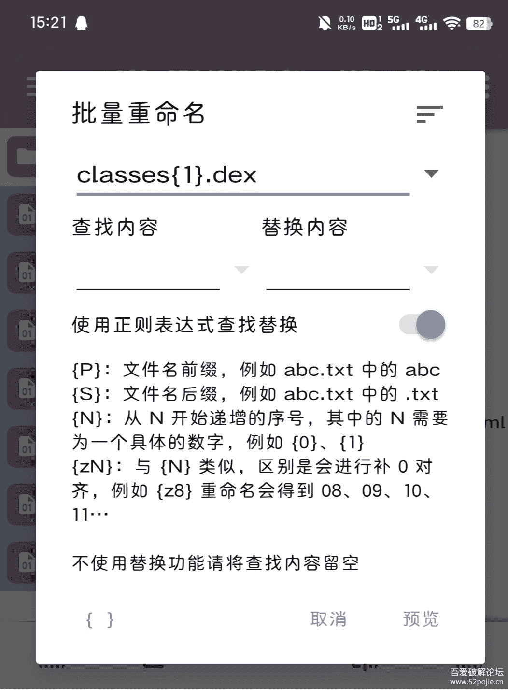

### 4. 添加 dex
打开软件，点查看，把脱出来的`dex`文件全部添加进去替换即可。

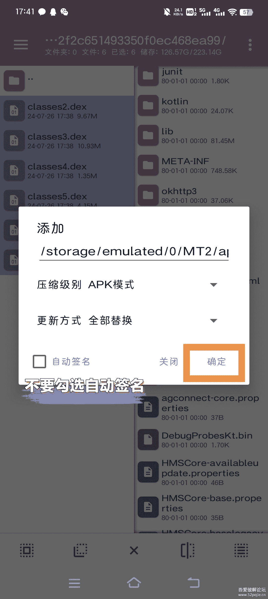

### 5. 删除残留文件
删除`assets`文件夹下无用加固残留文件
`assets/classes0.jar`

删除`lib`（包括其中所有的子文件夹）里的如下文件:
`libSecShell.so`
`libSecShell-x86.so`
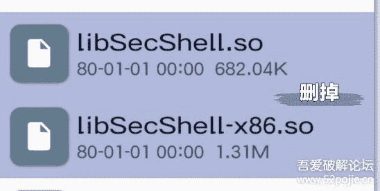

### 6. 签名安装
签名，安装，正常运行说明脱壳修复成功

## 解锁
提取安装包，去签，打开`dex`文件，`dex++`，全选，常量过滤会员，找到 会员有效期：永久，点击搜索

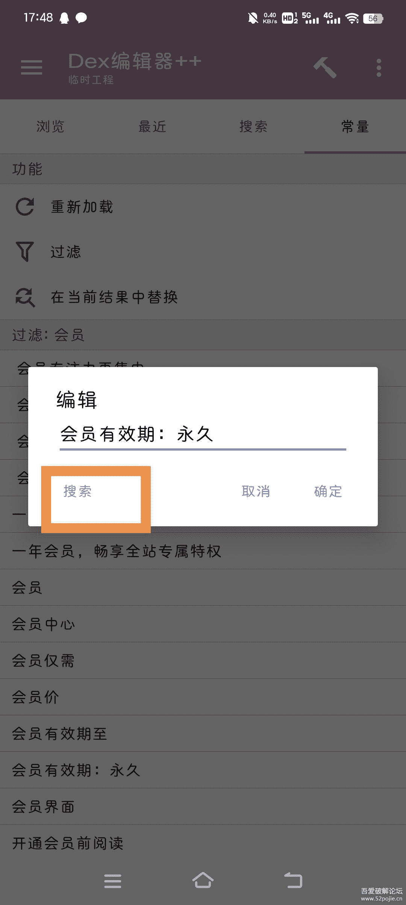
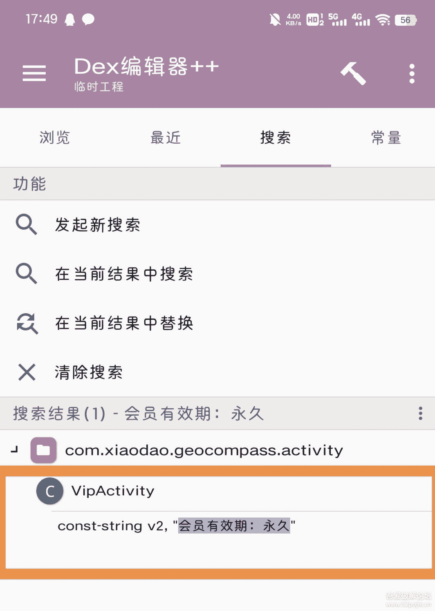

找到一条结果，点进去，上滑，找到第1326行`invoke-virtual {p1}, Lcom/xiaodao/geocompass/data/Member;->getEnd_time()J`跳转进入赋值`const-wide v0, 0x32d57bf5e8L`

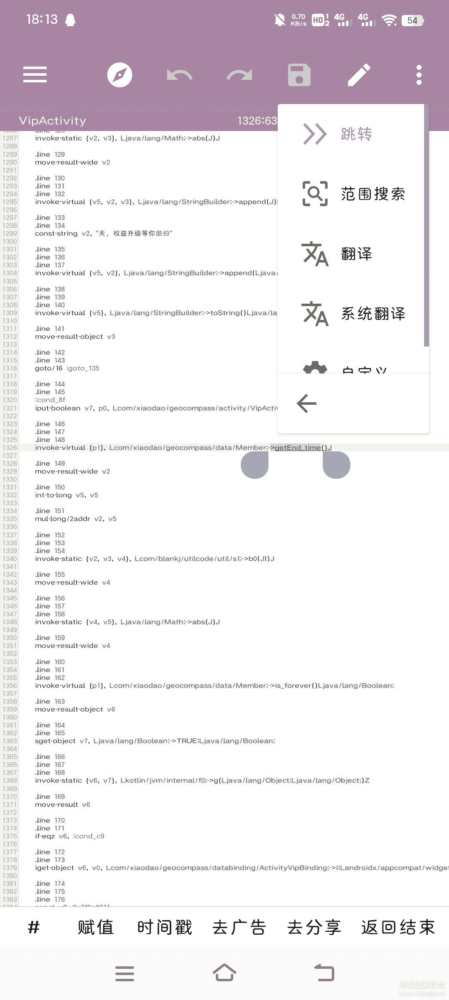
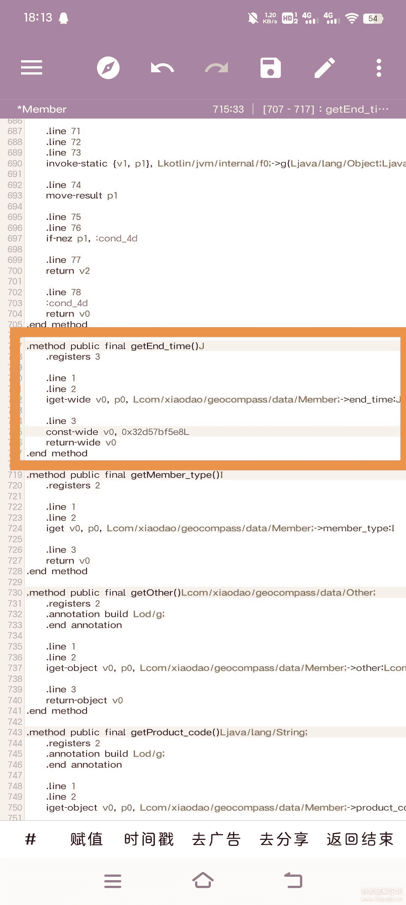

第1198行`invoke-virtual {p1}, Lcom/xiaodao/geocompass/data/Member;->getState()I`跳转进入赋值
`const/4 v0, 0x1`

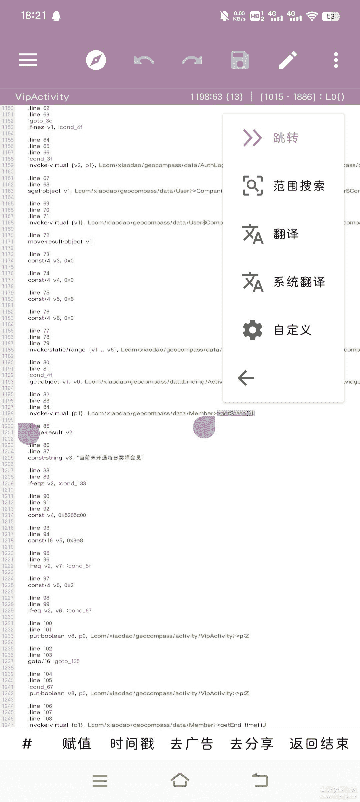
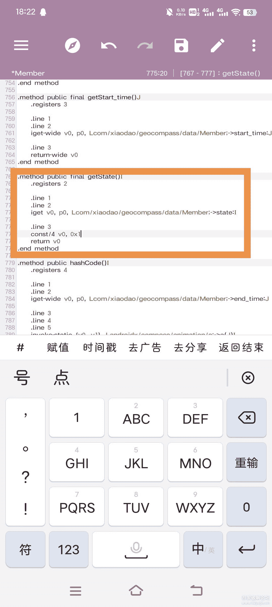

保存退出签名安装即可。

到这`vip`功能就解锁了。需要注意的是只解锁`vip`功能，而且页面`vip`未点亮，听会员专属时点第一次会弹续费提醒，关掉弹窗，再点播放即可。写的太多了，我就没去继续修改，也包括免登陆，所以需要登录。

## 成品图

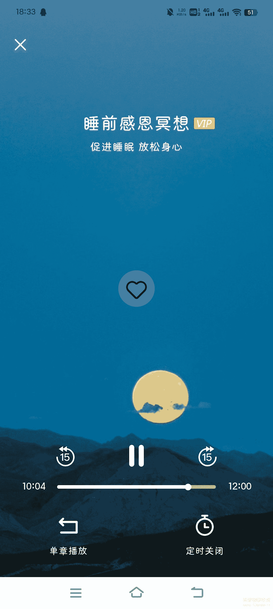

## 题外话
说个题外话，对小白来说或许会更有效率:软件下载后先签名安装试试，如果闪退就是有签名校验。
那就需要先去签，去签后安装完不闪退再用原包去脱壳，脱修后再安装看看，要是闪退就可能是没脱干净，如果脱修后不闪退，修改完闪退就是修改的问题...
