# [Android 分享] 小熊录屏2.4.7.1hook会员思路

- 原帖: https://www.52pojie.cn/forum.php?mod=viewthread&tid=1948441
- 抓取时间: 2026-11-01T16:53:54.692Z

软件：小熊录屏2.4.7.1（我是直接百度搜的安装包下载）

工具：雷电模拟器，`jadx`，`frIDA`

实现方法：hook 相关代码

app 主页：

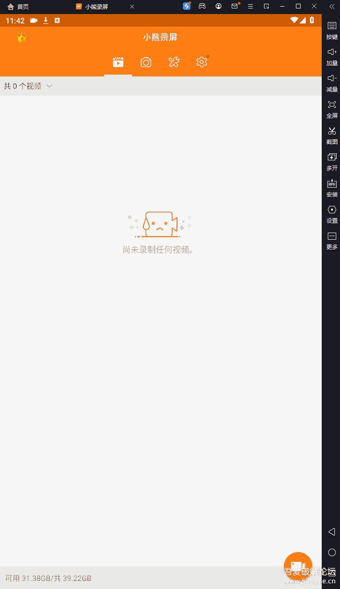

## 1. 打开 app，先上 `isvip` 大法

当我看到 `@SerializedName("isVip")`（通常与 `Gson` 或 `Jackson` 等库一起使用，用于 JSON 的序列化和反序列化）这个的时候，我就不想去分析了；其它的也差不多。

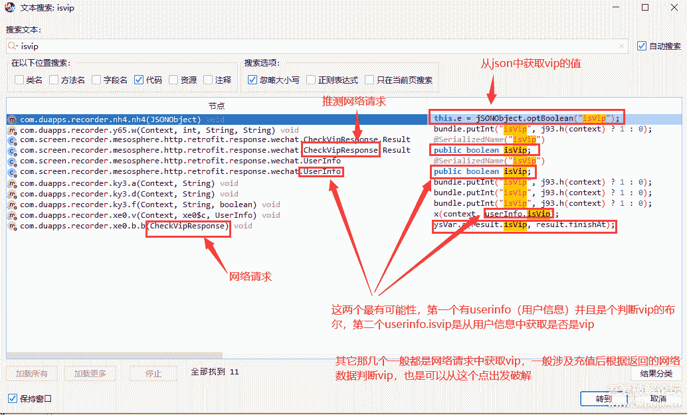
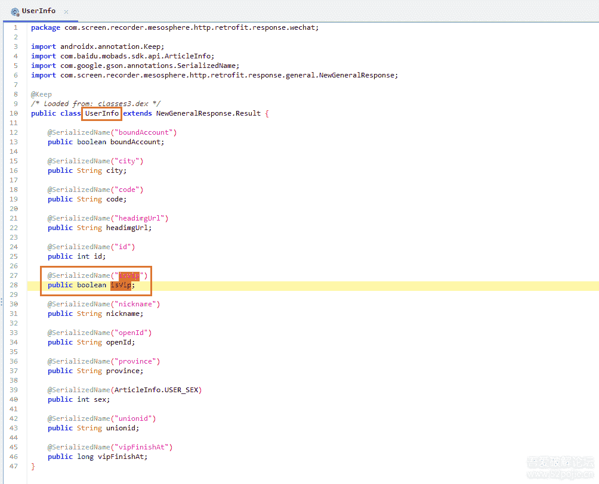
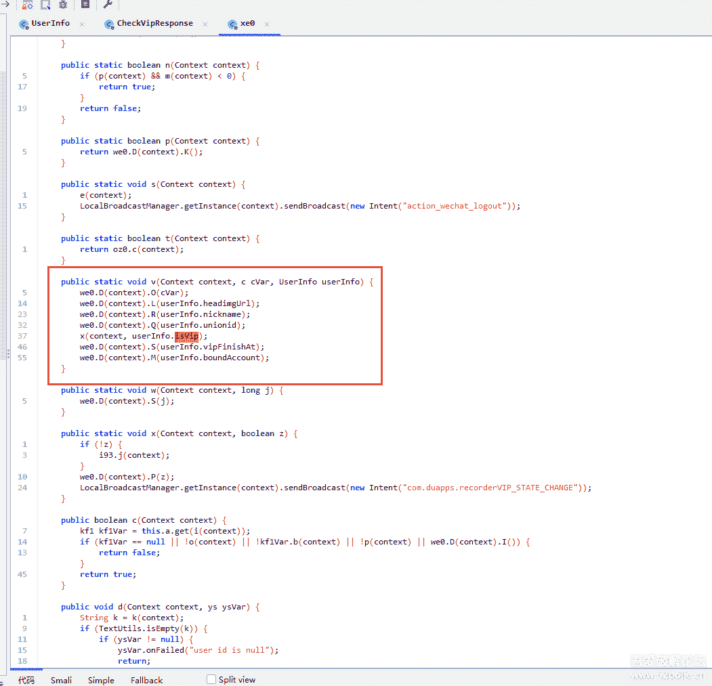
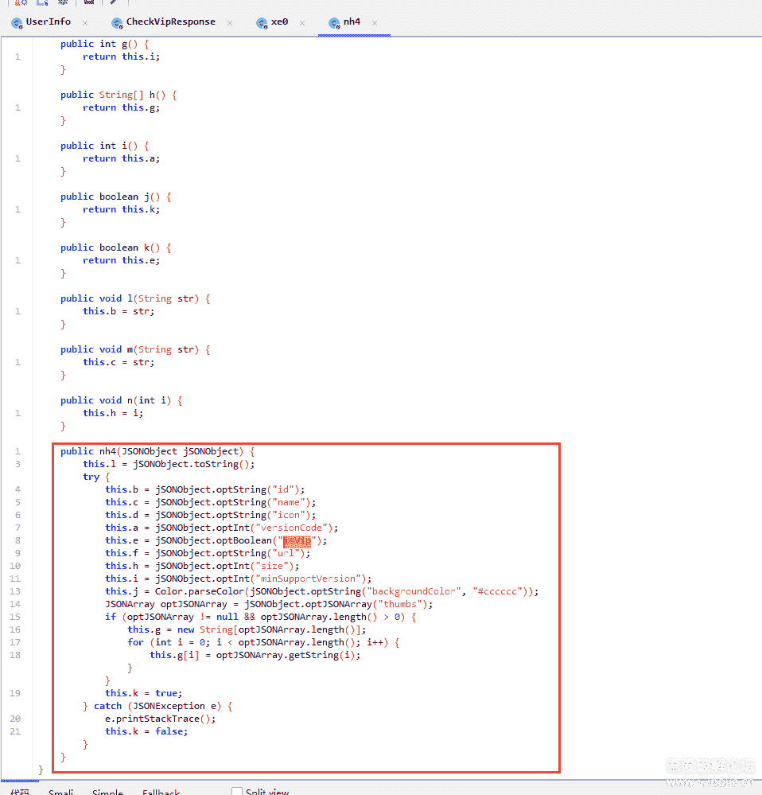

## 2. 定位 VIP 跳转界面

经观察，app 每次点击 vip 功能后都会跳到开通 vip 界面，说明每次点击肯定有东西调用开通界面，老办法 `adb shell dumpsys activity | findstr "mResumedActivity"` 获取当前界面信息。

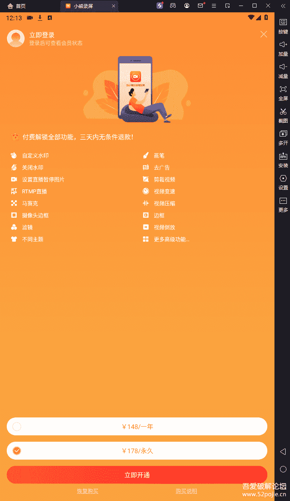
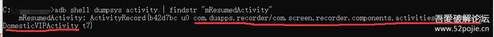

## 3. 查找 DomesticVIPActivity

找到 `DomesticVIPActivity` 所在位置，并查看是谁调用了它。

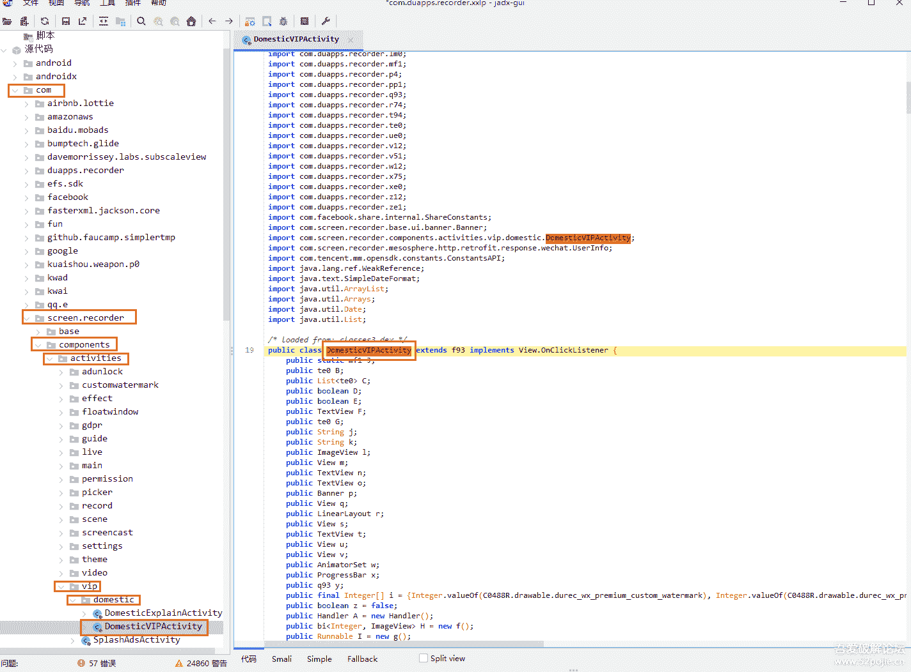

## 4. 分析调用来源

沃尼马，29 个，好多都是 `.this`，除去几个不像的，再除去 `.this` 的，就只剩 `.b1` 最像了；其实 `DomesticVIPActivity` 本来就是个类，如果要使用它一般都是调用它里面的方法，而其中一些方法就是开通界面；直接双击跟进。

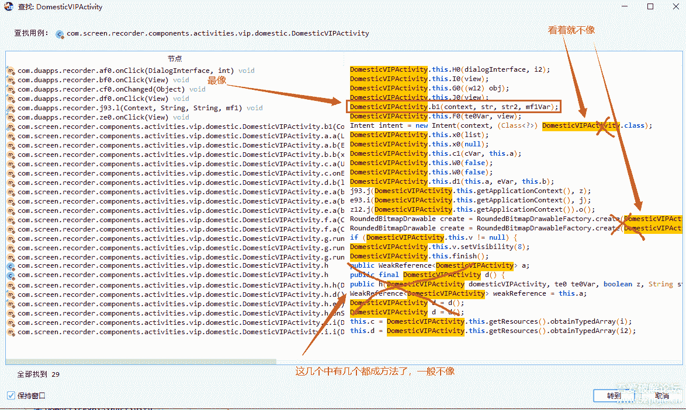

## 5. 分析 `l` 方法

仔细观察，可以看到 `l` 方法中对 `oz0.c(context)` 的返回值进行判断，如果为真则调用 `DomesticVIPActivity.b1`；我们直接 hook 它，看看这是不是就是调用了开通 vip 界面。

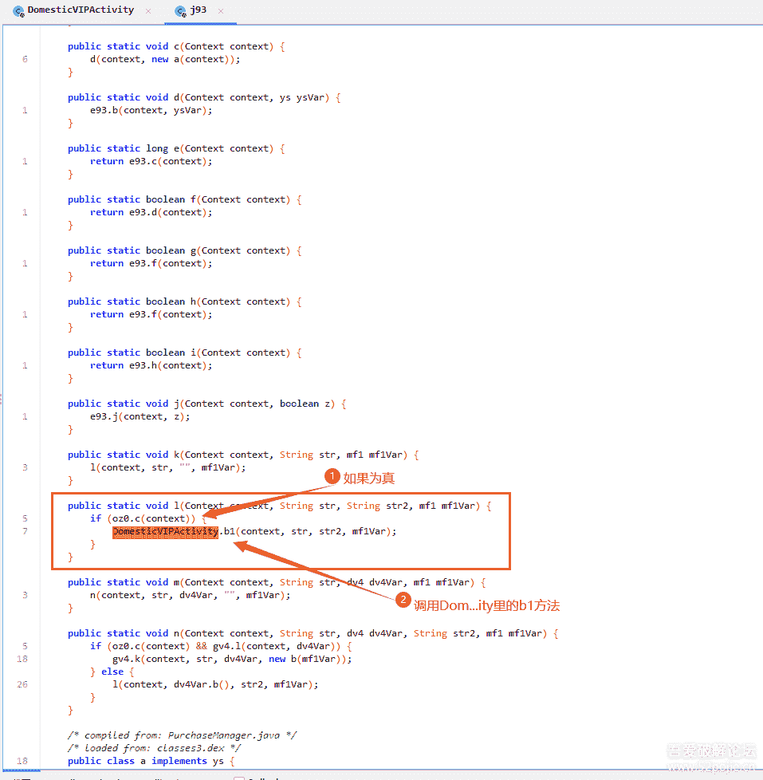

## 6. 编写 js 代码进行 hook

编写 js 代码进行 hook；分别点击去水印和主页中的会员功能后，发现正好就是调用了 `l` 方法，并且看 `b` 参数可以发现它是从哪里点击会员功能后调用开通会员界面。

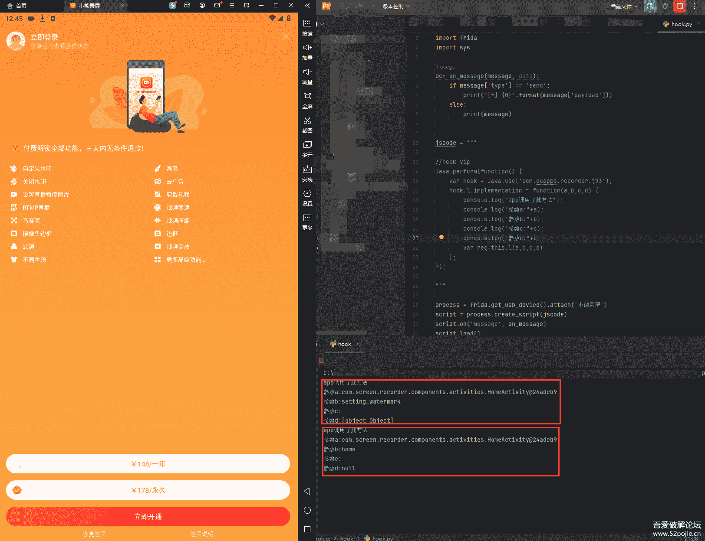

## 7. 查看 `c` 方法

查看 `oz0.c(context)` 中的 `c` 方法，爽了，看到布尔，综合前面，当 `c` 方法返回真时则调用开通 vip 界面，那么我们只要 hook 它让它永远返回假，那么不就可以了嘛。

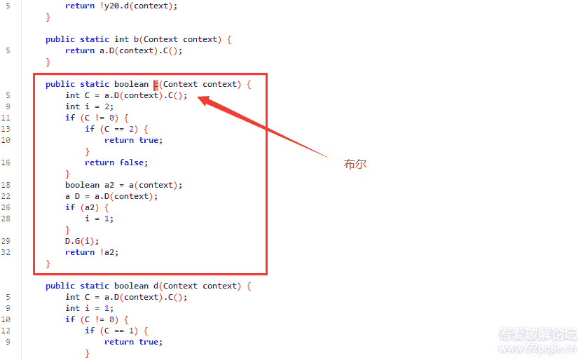

## 8. 编写代码进行 hook

编写 js 代码进行 hook，可以看到，成功用上了会员功能，但是不太美观。

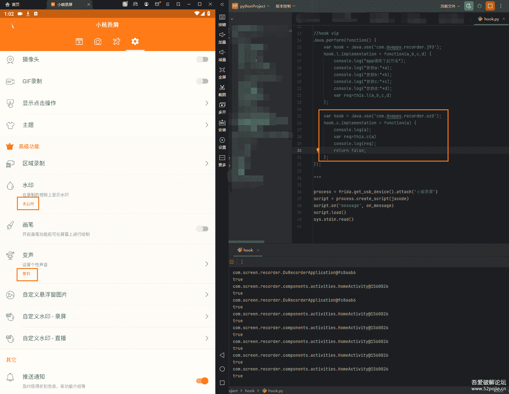

## 9. 使用 `spawn` 模式

编写代码用 `spawn` 模式（重新运行软件 hook）hook，Ok啊兄弟们，也是一整个干净整洁。

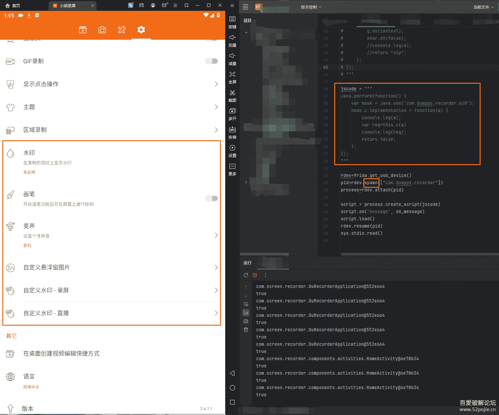

感谢支持，希望大家一起交流学习
