# [Android 原创] 【2024春节】解题之Android中级题 详细过程

- 原帖: https://www.52pojie.cn/forum.php?mod=viewthread&tid=1948736
- 抓取时间: 2026-11-01T16:53:50.689Z

## 0x01、前言

最近在学安卓逆向，正好把春节的Android中级题给做一做

## 0x02、过程

先把apk丢到`GDA`里面看一下

包名：`com.zj.wuaipojie2024_2` 入口：`com.zj.wuaipojie2024_2.MainActivity`

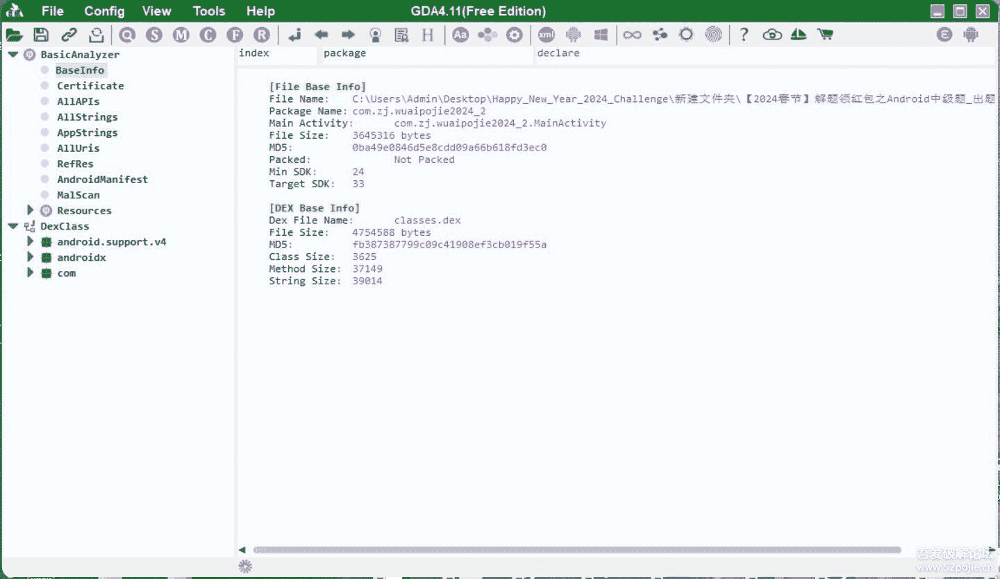

然后用`jadx`看下`MainActivity`下面有什么东西，发现有个叫`checkPassword`的方法

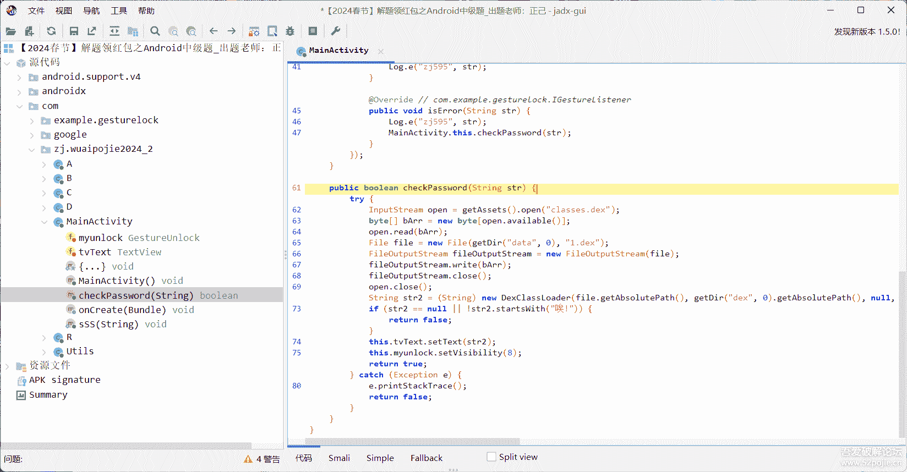

用`frida`来`hook`看一下

```
Java.perform(function () {
        let MainActivity = Java.use("com.zj.wuaipojie2024_2.MainActivity");
        MainActivity["checkPassword"].implementation = function (str) {
                let ret = this["checkPassword"](str);
                console.log(str,ret);
                return ret;
        };
});
```

随便滑一个密码，可以发现方法被调用了，手势的索引是

0 1 2

3 4 5

6 7 8

传入的`str`就是我们的密码

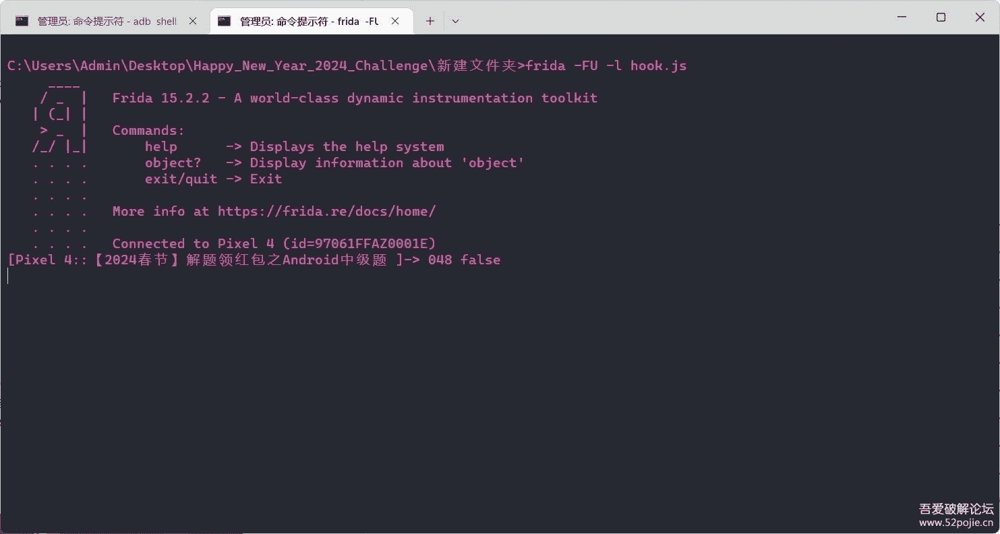

那么看一下`checkPassword`里面进行了哪些操作

`checkPassword`方法先是从apk的`assets`目录下拿到`classes.dex`，复制了一份到app内部空间的`data`目录下，命名为`1.dex`，然后加载这个`1.dex`，调用`com.zj.wuaipojie2024_2.C`类下的`isValidate`方法

这里看一下app的运行日志，`adb logcat | grep com.zj.wuaipojie2024_2.MainActivity`

这里用`cmder`来执行命令，因为`grep`是`linux`下的命令

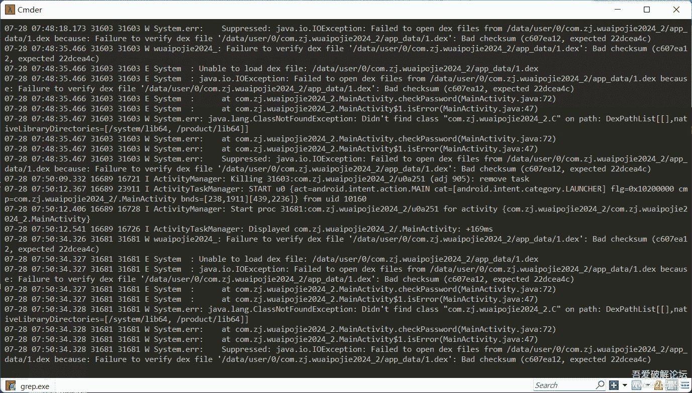

可以发现有这么一条日志

`Suppressed: java.io.IOException: Failed to open dex files from /data/user/0/com.zj.wuaipojie2024_2/app_data/1.dex because: Failure to verify dex file '/data/user/0/com.zj.wuaipojie2024_2/app_data/1.dex': Bad checksum (c607ea12, expected 22dcea4c)`

查一下关于`dex`的资料 https://source.android.com/docs/core/runtime/dex-format?hl=zh-cn

我们把这个`1.dex`下载来用`010 Editor`打开看看，模板选`dex`

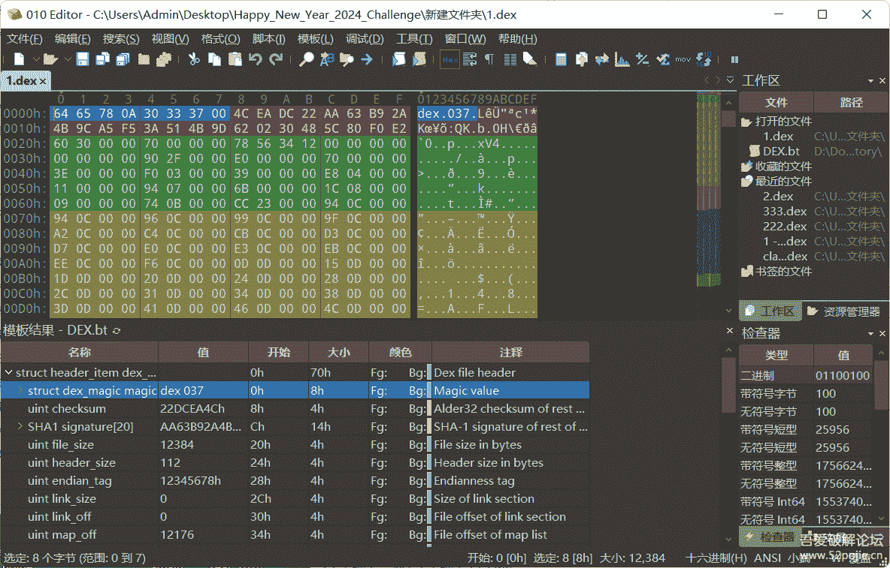

可以看到`checksum`和`signature`是红色的，也就是因为`checksum`的值错误让app以为文件损坏导致`1.dex`没有成功加载

写一份脚本修复一下

```
import hashlib,zlib

def repairChecksum(dex_file):

    self = open(dex_file, "rb+")

    self.seek(8)

    # checksum是uint32,小端存储

    sourceData = self.read(4)[::-1]

    self.seek(12)

    checkdata = self.read()

    checksum = format(zlib.adler32(checkdata), 'x')

    print ("头部原checksum:",sourceData.hex())

    print ("计算checksum:",checksum)

    if sourceData.hex() == checksum:

        print('checksum校验正常')

    else:

        self.seek(8)

        # 小端写入

        self.write(bytes.fromhex(checksum)[::-1])

        print('checksum效验异常,修复成功')

def repairSignature(dex_file):

    self = open(dex_file, "rb+")

    self.seek(12)

    sourceData = self.read(20)

    self.seek(32)

    sigdata = self.read()

    sha1 = hashlib.sha1()

    sha1.update(sigdata)

    sha0 = sha1.hexdigest()

    print ("计算signature:",sha0)

    print ("现在signature:",sourceData.hex())

    if sourceData.hex() == sha0:

        print('SHA1效验正常')

    else:

        self.seek(12)

        self.write(bytes.fromhex(sha0))

        print('SHA1效验异常,修复成功')

if __name__ == '__main__':

    repairSignature('1.dex')

    repairChecksum('1.dex')
```

查一下app的安装路径 `adb shell pm path com.zj.wuaipojie2024_2`

`package:/data/app/com.zj.wuaipojie2024_2-KFnHRFDetvCIbKXjR_4LTQ==/base.apk`

这里用`mt管理器`把修复后的`1.dex`替换到`base.apk`中`assets`目录下的`classes.dex`

因为调用`checkPassword`方法执行时会从这拿原来的`classes.dex`，复制一份到app内部空间的`data`目录下，不能直接替换`data`目录下的`1.dex`，不然又被没修复的`classes.dex`覆盖掉了

然后我们重新运行app看一下日志

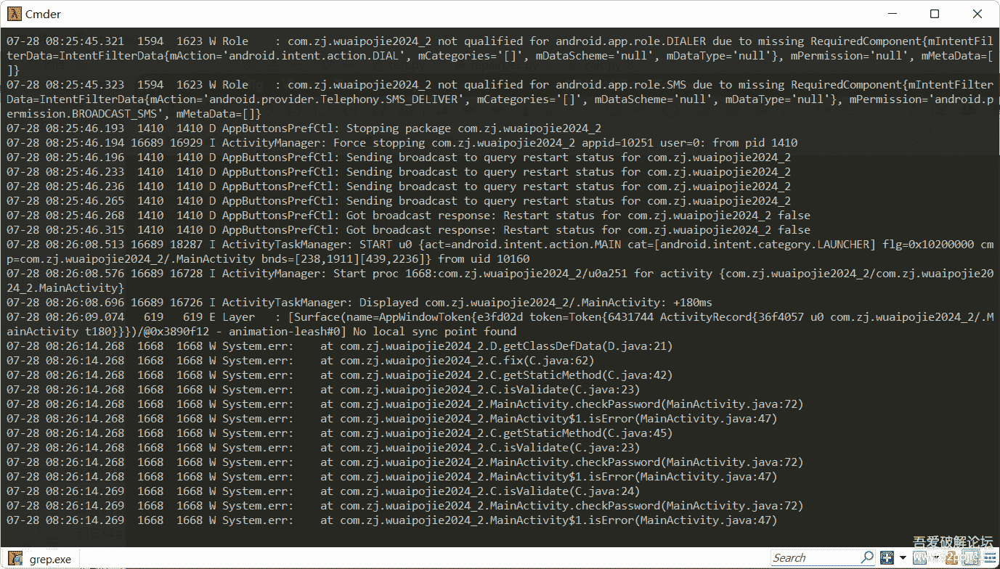

可以发现日志不一样了，没有之前那个加载`dex`的报错

分析一下`com.zj.wuaipojie2024_2`这个类下的执行过程

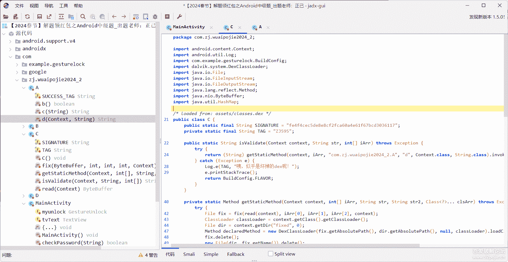

`isValidate`方法中调用了`getStaticMethod`方法，`getStaticMethod`方法中调用了`read`方法和`fix`方法

`getStaticMethod`中先用`read`方法中读入app运行目录`data`下的`decode.dex`，传入到`fix`方法后生成了`2.dex`，然后加载`2.dex`中`com.zj.wuaipojie2024_2.A`类下的`d`方法，最后再将`2.dex`删除

将修复后的`1.dex`复制一份到`data`目录下，命名为`decode.dex`

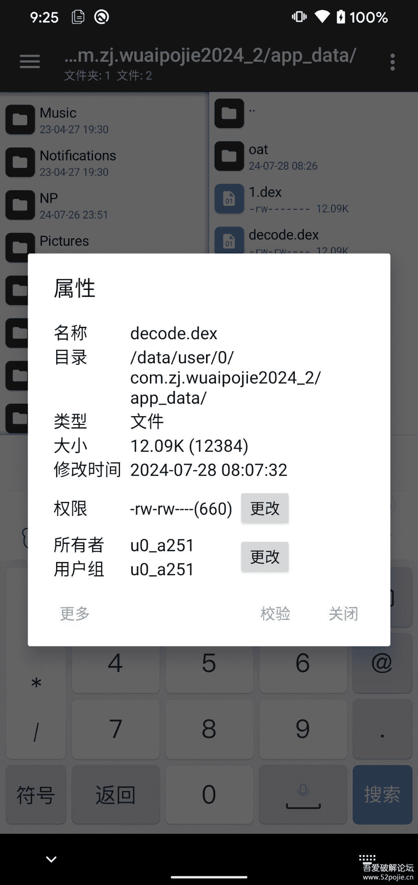

记得给文件权限

现在要想办法拿到`2.dex` 这里我通过`frida`来`hook`，阻止`2.dex`被删除

```
Java.perform(function () {
    var deleteFile = Java.use("java.io.File").delete;
        deleteFile.implementation = function () {
                console.log("delete file: " + this);
                return
        };
});
```

把`2.dex`丢到`jadx`里看一下

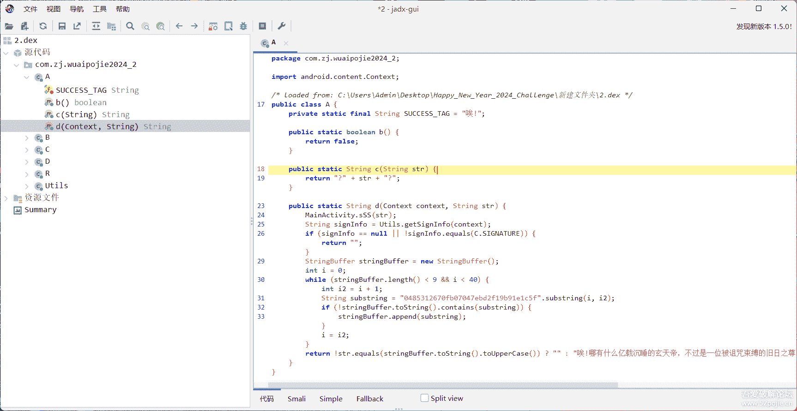

可以看到`d`方法已经正常了，转换成`python`代码执行得到密码为`048531267`

```
def calculate_str():

    stringBuffer = []

    i = 0

    fixed_string = "0485312670fb07047ebd2f19b91e1c5f"

    while len(stringBuffer) 
```

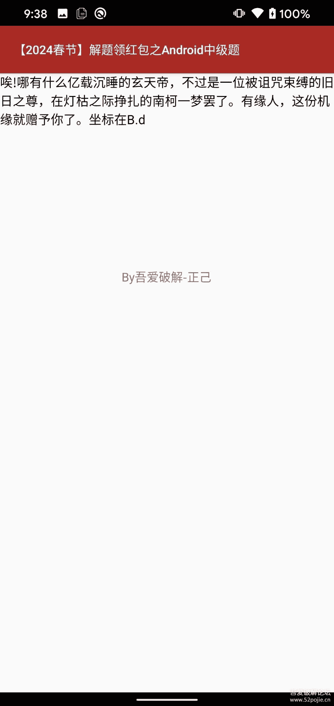

可以得到提示在`B.d`下

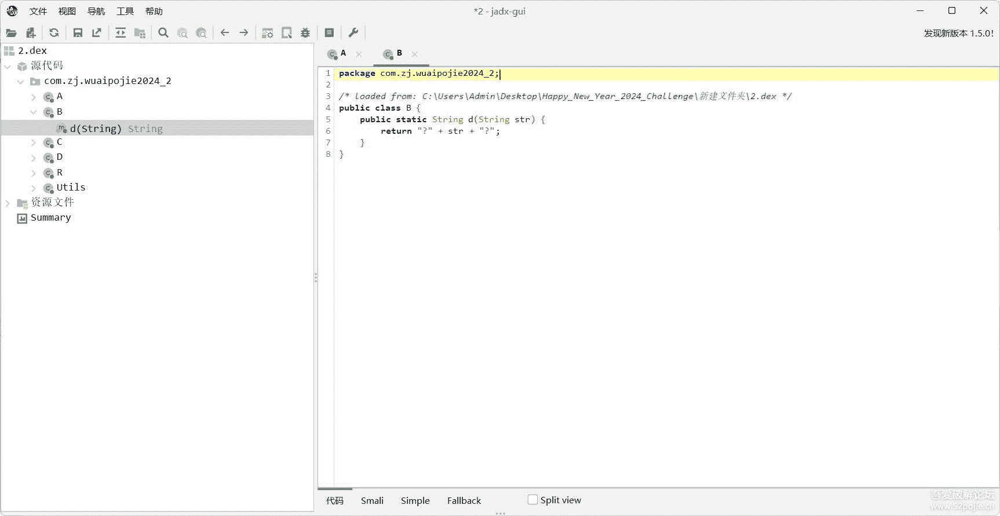

但是这个`B.d`显然还有问题，需要再修复

看一下`fix`方法需要的参数，是从`checkPassword`方法传过来的

`String str2 = (String) new DexClassLoader(file.getAbsolutePath(), getDir("dex", 0).getAbsolutePath(), null, getClass().getClassLoader()).loadClass("com.zj.wuaipojie2024_2.C").getDeclaredMethod("isValidate", Context.class, String.class, int[.class).invoke(null, this, str, getResources().getIntArray(R.array.A_offset));`

`getResources().getIntArray(R.array.A_offset)` 得到`fix`方法中的`int i`, `int i2`, `int i3`

`jadx`中点进去看一下`R.array.A_offset`

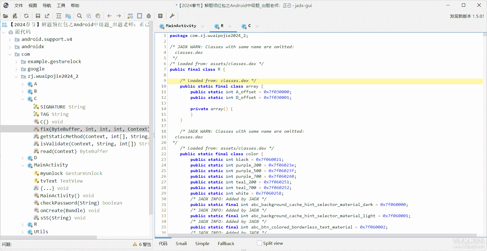

发现还有一个叫`R.array.D_offset`的，那我们把传入`fix`方法中的参数改成这个试试

```
Java.perform(function () {
        let AppCompatActivity = Java.use("androidx.appcompat.app.AppCompatActivity");
        AppCompatActivity["getResources"].implementation = function () {
                let resources = this["getResources"]();
                resources.getIntArray.implementation = function (resId) {
            let ret = this.getIntArray(resId);
                        console.log(resId,ret);
                        if(resId == 2130903040){
                                return this.getIntArray(0x7f030001);
                        }
                        return ret;
        };
                return resources;
        };
        
        var deleteFile = Java.use("java.io.File").delete;
        deleteFile.implementation = function () {
                console.log("delete file: " + this);
                return
        };
});
```

把修复后的`2.dex`下载来丢到`jadx`中看一下

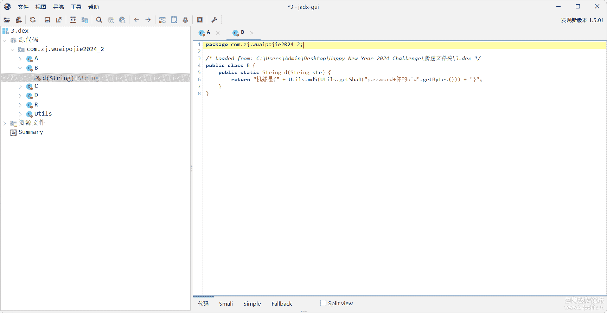

可以看到`B.d`已经显示正常

最后把`Utils`复制下来稍微修改下即可

```
import java.math.BigInteger;

import java.nio.ByteBuffer;

import java.security.MessageDigest;

import java.security.NoSuchAlgorithmException;

import java.util.ArrayList;

public class Utils {

    public static final String SHA1 = "SHA1";

    public static byte[] toULEB128(int i) {

        int i2 = i >> 28;

        if (i2 > 0) {

            return new byte[]{(byte) ((i & 127) | 128), (byte) (((i >> 7) & 127) | 128), (byte) (((i >> 14) & 127) | 128), (byte) (((i >> 21) & 127) | 128), (byte) (i2 & 15)};

        }

        int i3 = i >> 21;

        if (i3 > 0) {

            return new byte[]{(byte) ((i & 127) | 128), (byte) (((i >> 7) & 127) | 128), (byte) (((i >> 14) & 127) | 128), (byte) (i3 & 127)};

        }

        int i4 = i >> 14;

        if (i4 > 0) {

            return new byte[]{(byte) ((i & 127) | 128), (byte) (((i >> 7) & 127) | 128), (byte) (i4 & 127)};

        }

        int i5 = i >> 7;

        return i5 > 0 ? new byte[]{(byte) ((i & 127) | 128), (byte) (i5 & 127)} : new byte[]{(byte) (i & 127)};

    }

    public static byte[] getSha1(byte[] bArr) {

        try {

            return MessageDigest.getInstance("SHA").digest(bArr);

        } catch (Exception unused) {

            return null;

        }

    }

    public static String md5(byte[] bArr) {

        try {

            String bigInteger = new BigInteger(1, MessageDigest.getInstance("md5").digest(bArr)).toString(16);

            for (int i = 0; i  arrayList, int i, int i2) {

        int i3 = 0;

        while (i3  127) {

            int i3 = byteBuffer.get() & 255;

            i2 = (i2 & 127) | ((i3 & 127)  127) {

                int i4 = byteBuffer.get() & 255;

                i2 |= (i4 & 127)  127) {


```
int i5 = byteBuffer.get() & 255;

i2 |= (i5 & 127)  127) {

i2 |= (byteBuffer.get() & 255)
```

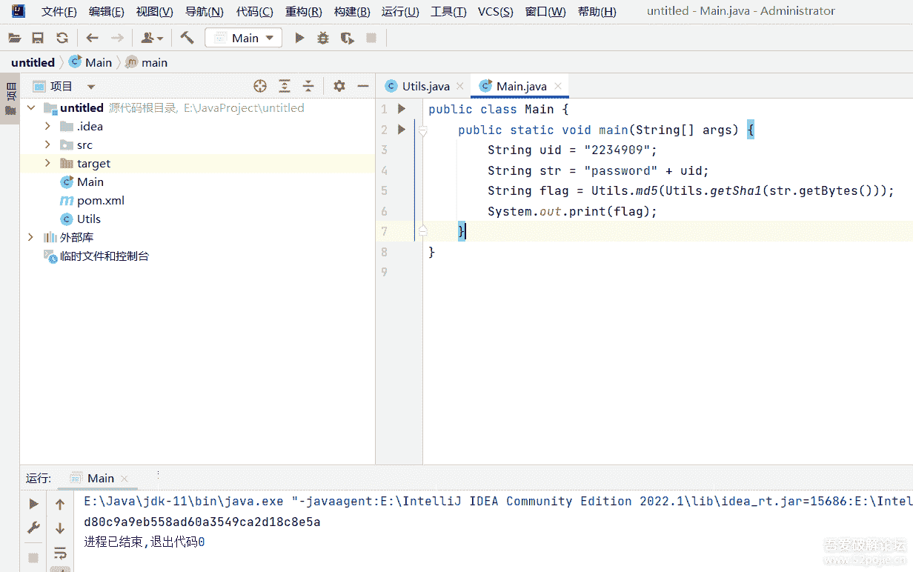
