# [Android 原创] 一木记账 深层代码逆向分析与实现免登录

- 原帖：`https://www.52pojie.cn/forum.php?mod=viewthread&tid=1948795`
- 抓取时间：2026-11-01T16:53:46.687Z

## 前言

大家好，我是安柯，看到上贴的教程大家不是太懂，我也讲的不细致，于是咱们再来一遍：会的复习一遍，不会的好好学习！

## 教程1：会员分析

先从会员开始分析，我们常量过滤会员，找到永久会员点进去。

代码分析：第一段和第二段是调用静态方法和调用实例方法储存，就不做过多解释。我们直接看第三段第一个 `if` 判断语句：如果 `v0`（`user`）为 `0` 或者 `null`，那么跳转到 `cond49`。

接下来根据调用 `getviptype` 获取 VIP 类型，根据类型设置不同的 `test` 文本（说白了就是根据赋值判断是否显示会员字样）。

看②处，如果 `viptype` 等于，如果为 `0` 则设置文本为普通会员，为 `2` 则设置文本为永久会员。

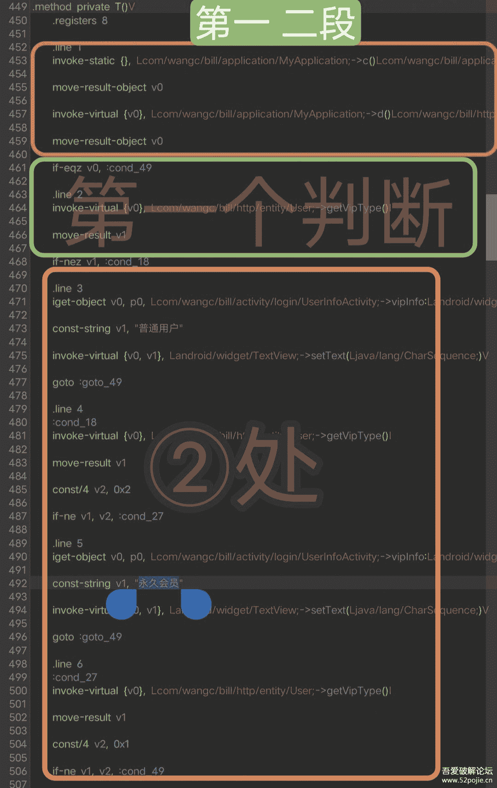

③处表示：在 `vip` 类型为 `1` 时，用 `0x7f1201a2` 获取字符串资源，用来插入 VIP 到期时间；后面就是调用 `getviptime` 获取 VIP 时间，然后格式化时间、设置文本。

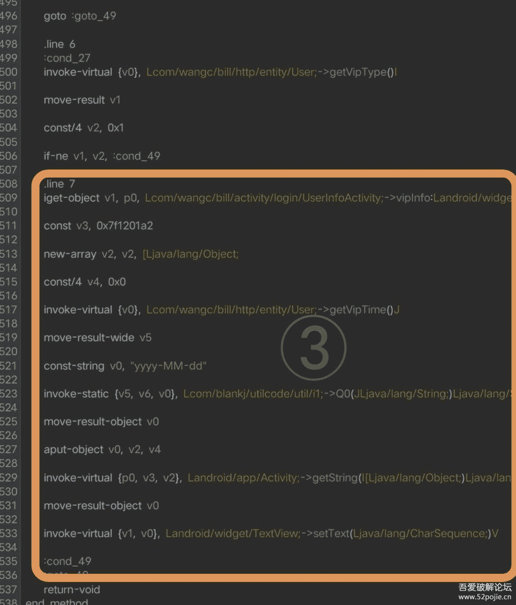

好的，这时候我们就明白为什么替换正则表达式时是 `v1 0×2` 了。

其实这段代码你转 `Java` 更好理解：`0=普通`，`2=永久`，`1=根据时间显示文本`。

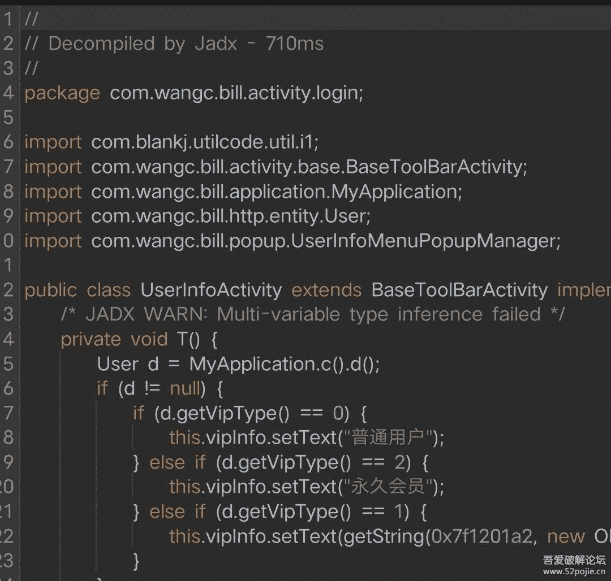

## 云功能

同样先解锁会员，我们进入软件，点击云端上传时下方会显示鉴权失败的字样，那我们就常量过滤一下，结果真的有，那我们进去看看。

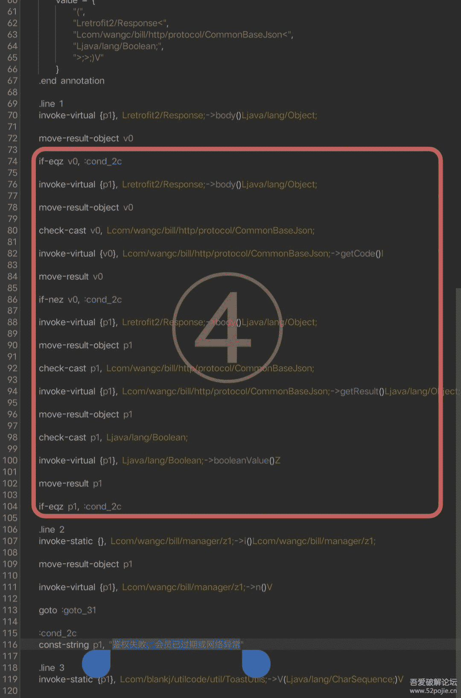

④处主要是根据 `body` 的返回值转换为 `json` 类型判断 `getcode` 是否不为 `0`，得出两种情况：（1）上传成功；（2）上传失败或异常。所以我们把①处删除即可解决上传失败问题。

然后我们再次测试发现会卡在这个页面。

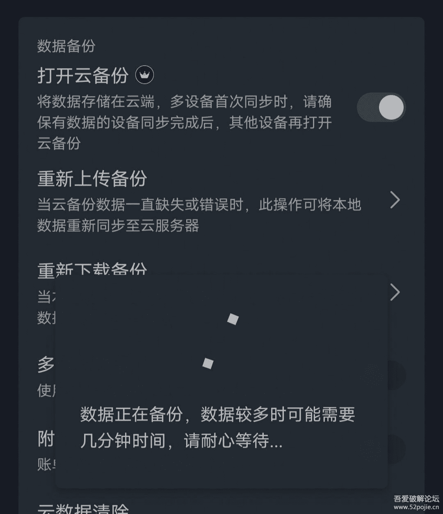

于是我们再次常量搜索关键字眼。

进入然后分析，其实这个和上面的有过之而无不及。

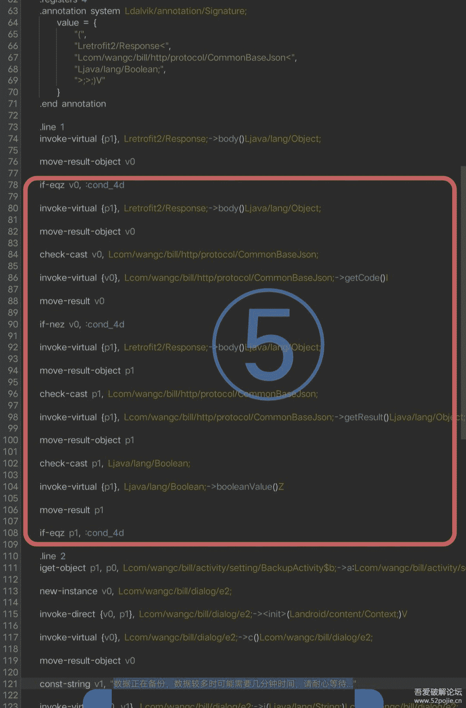

⑤处也同样是调用 `getcode` 获取响应码，然后判断是否不为 `0`；为 `0` 代表成功，就会显示“数据正在........”。所以我们直接把⑤处删除，代码的判断和响应会跳过，直接通过 `activity` 实例。

`BackupGuideActivity$c` 类，这里的也是同样的道理，就不在叙述了。

## 免登录

首先打开 APP 进入到登录界面，打开界面布局/开发助手获取密码的 `ID` 和当前界面的 `activity`。

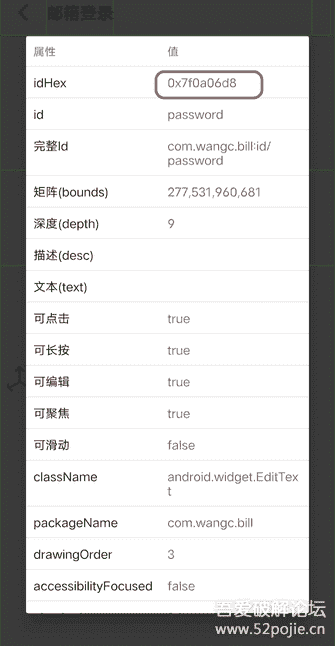

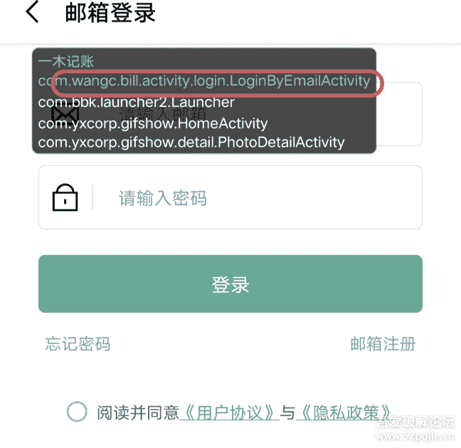

进入 `dex` 文件，类名搜索 `com.wangc.bill.activity.login.LoginByEmailActivity`。

接着在当前结果中搜索 `0x7f0a06d8`，搜索类型为整数。

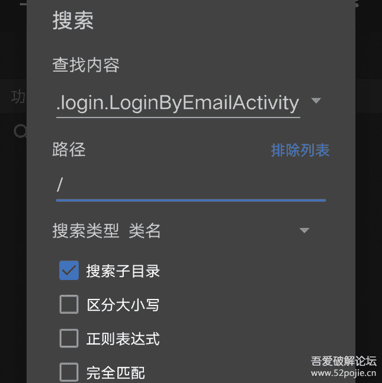

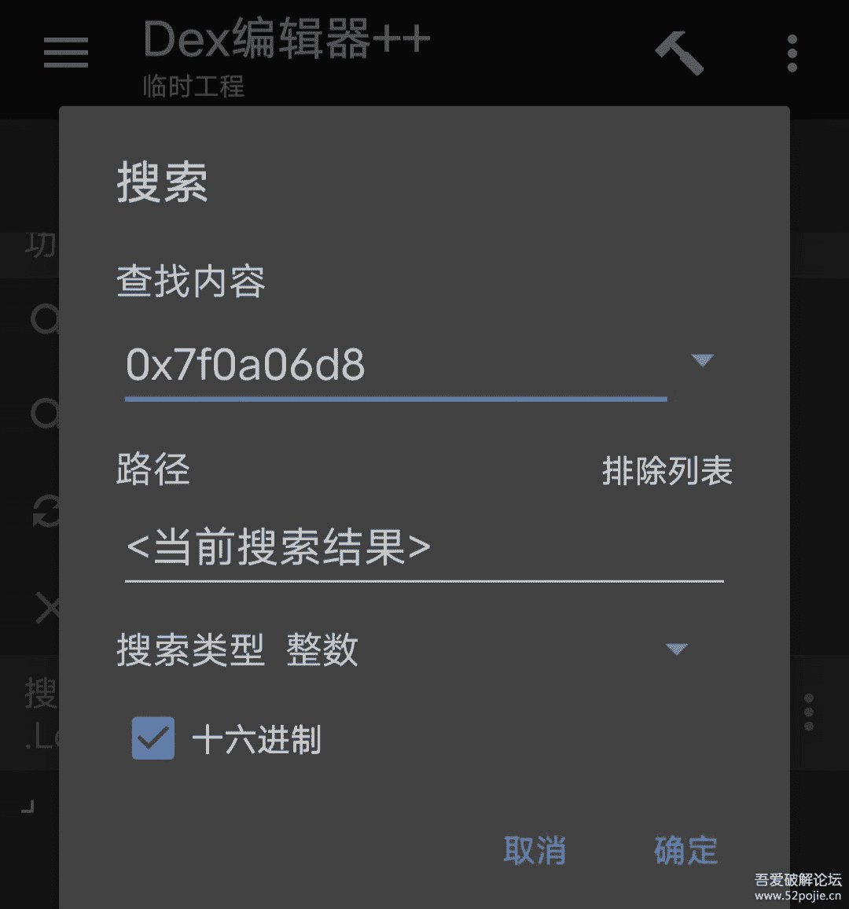

选择第一个进去，查找所有调用。

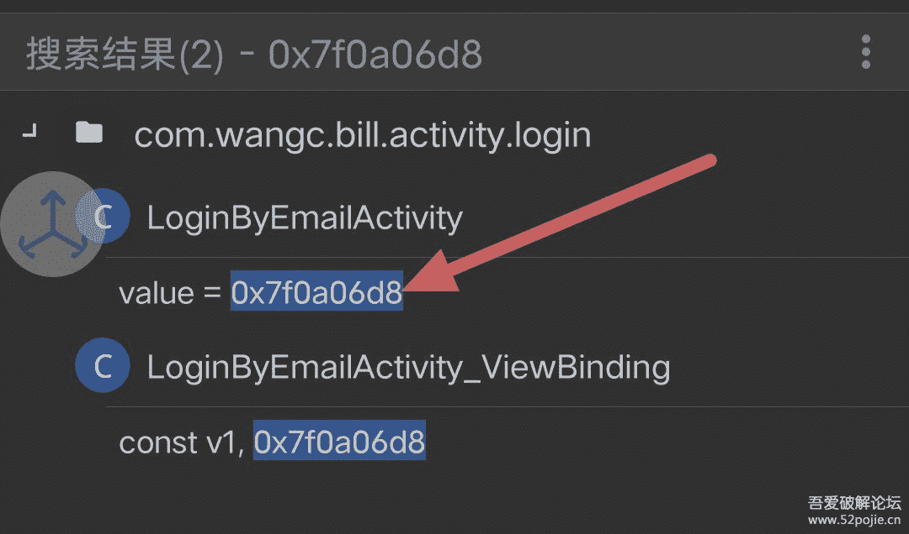

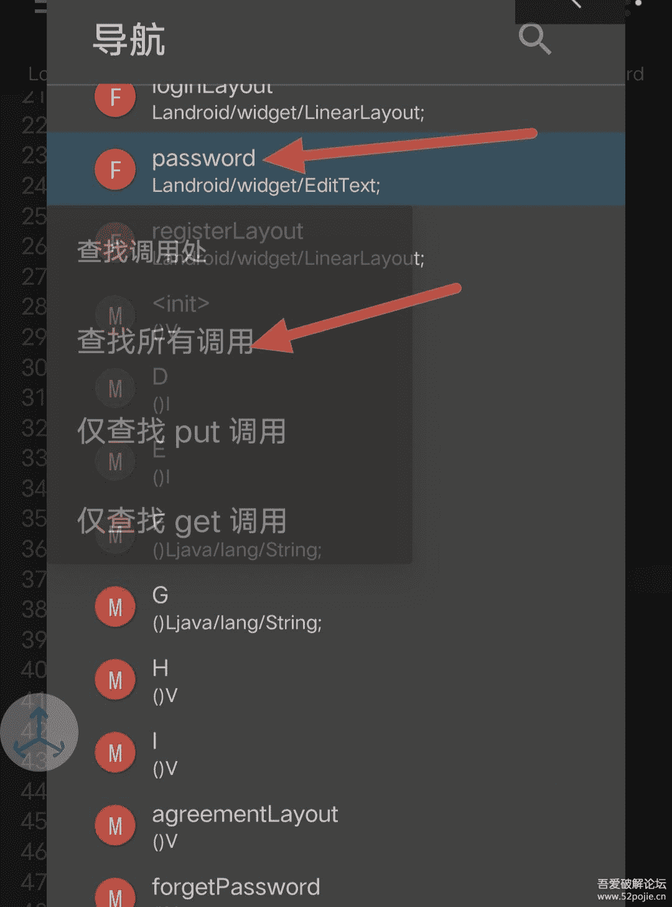

然后点击第一个进去，可以转 `Java` 分析，更简洁明了。

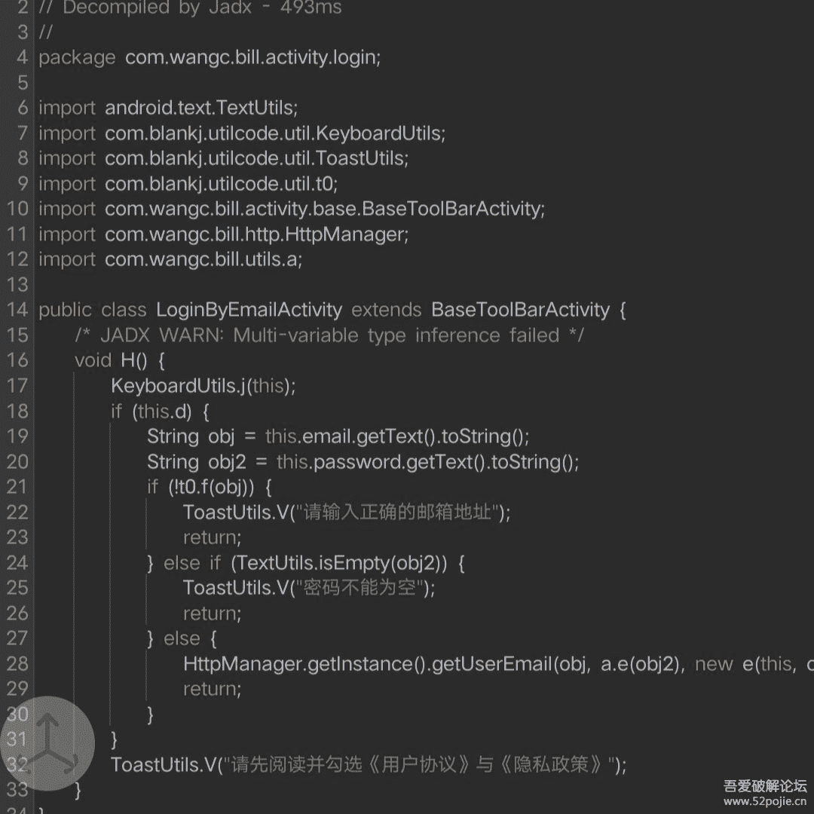

代码分析：如果 `checkbox` 被点击，那么两个编辑框里的内容传递给 `httpmanager` 类的 `getuseremail`，根据 `Java` 可得第一个是 `email` 值，第二个是 `password` 值。

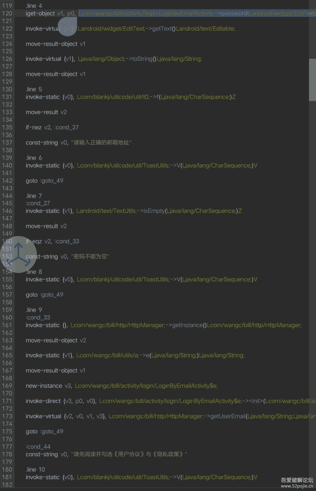

那咱们把 `email` 值和 `password` 值写明，不就可以实现免登录嘛。

于是我们只复制 159 行到 173 行的代码，其他的全都删除。

然后代码开头加上这两句即可：

tips：寄存器要改成 5 以上（`registers 5`）

```smali
const-string v0,"邮箱账号@qq.com"
const-string v1,"邮箱密码"
```

清空此方法名，然后复制下方代码：

```smali
.line 9
invoke-static {}, Lcom/wangc/bill/http/HttpManager;->getInstance()Lcom/wangc/bill/http/HttpManager;
move-result-object v2
invoke-static {v1}, Lcom/wangc/bill/utils/a;->e(Ljava/lang/String;)Ljava/lang/String;
move-result-object v1
new-instance v3, Lcom/wangc/bill/activity/login/LoginByEmailActivity$e;
invoke-direct {v3, p0, v0}, Lcom/wangc/bill/activity/login/LoginByEmailActivity$e;->(Lcom/wangc/bill/activity/login/LoginByEmailActivity;Ljava/lang/String;)V
invoke-virtual {v2, v0, v1, v3}, Lcom/wangc/bill/http/HttpManager;->getUserEmail(Ljava/lang/String;Ljava/lang/String;Lcom/wangc/bill/http/httpUtils/MyCallback;)V
```

这个是直接把代码写死了，点击登录直接把账号和密码自动读取，就不用咱们再输入了（不实用，但是不能不会）。

## 结尾

教程到此结束，谢谢大家支持，一起进步！
