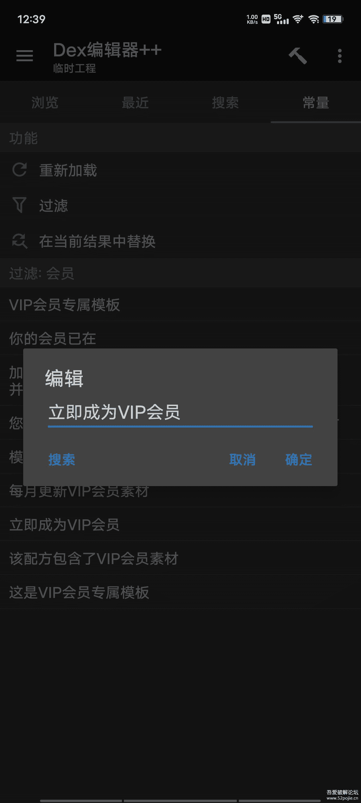
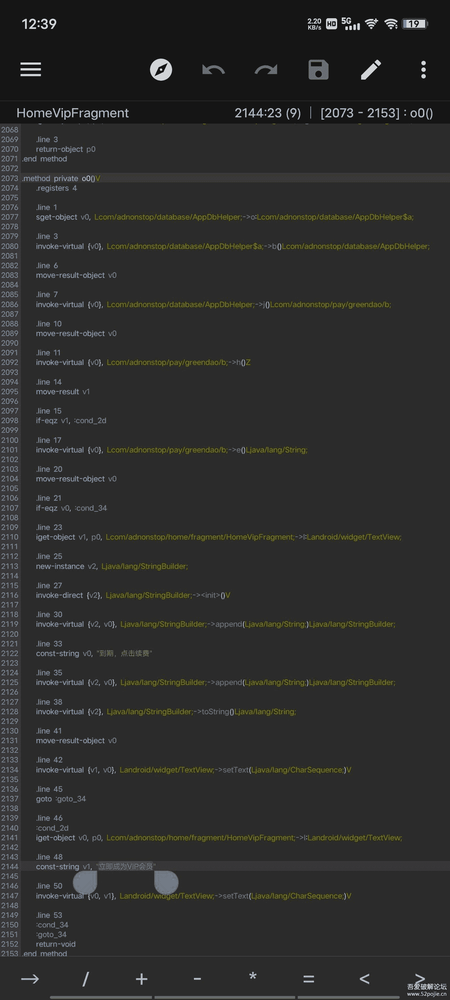
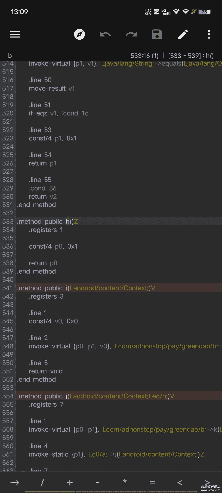
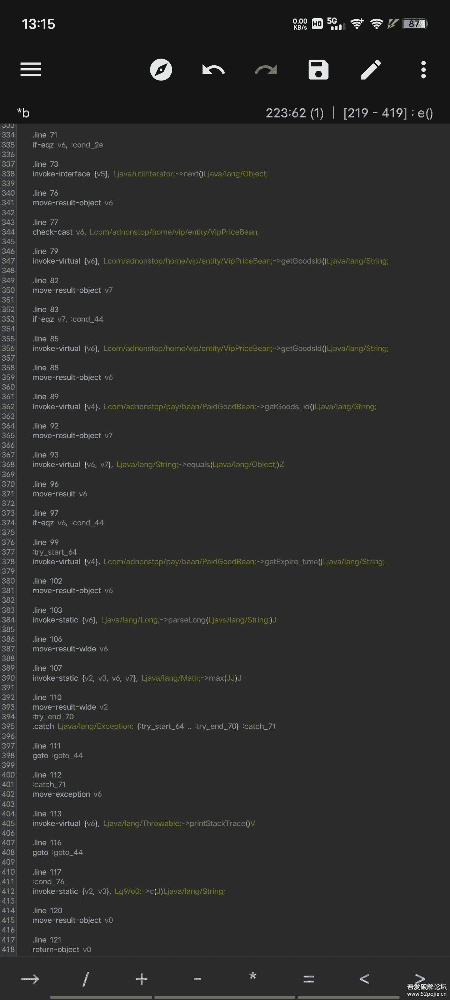
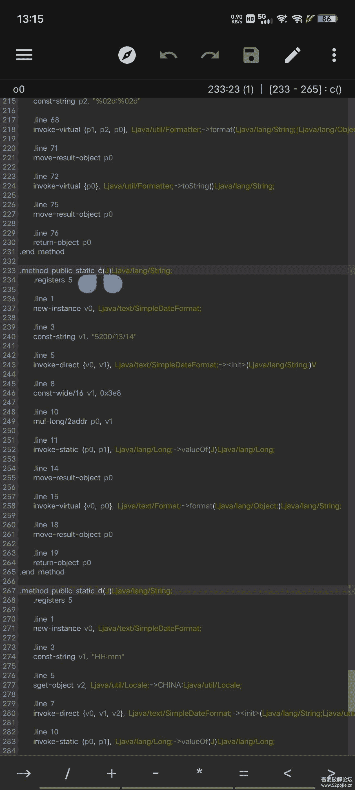

# [Android 分享] 型影解锁会员

- 原帖: `https://www.52pojie.cn/forum.php?mod=viewthread&tid=1949095`
- 抓取时间: 2026-11-01T16:53:37.518Z

## 脱壳与修复

这个软件在应用商店可以下，首先这个软件是tx御安全的壳，直接正常的[脱壳](https://www.52pojie.cn/forum-5-1.html)，修复`dex`回填，改入口，删特征，去签就好了，不演示了。

## 修改会员

`dex`常量过滤会员，然后找到立即成为会员

然后搜索查看到

通过`smali`简单的分析，如果`v1`等于零，就跳转到立即成为会员，那么只需要让`v1`不等于零，所以我们跳转到`h`方法，让它返回值为1就好了，如图所示

然后会员就可以用了。

### 美化到期时间

为了美化到期时间，可以在立即成为会员那里长按跳转到`e`方法，然后滑到下面

再长按跳转到`c`方法，修改`yyyy-mm-dd`即可。

例子：

## 显示会员图标

然后要显示会员图标的话，直接搜方法名`isvip`赋值就好了
