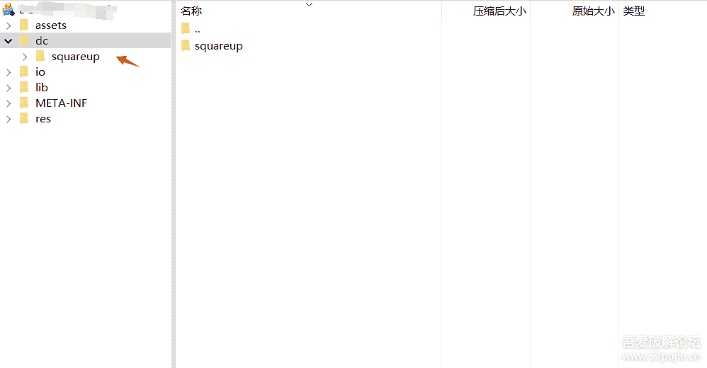
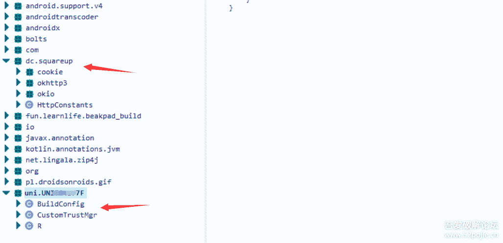
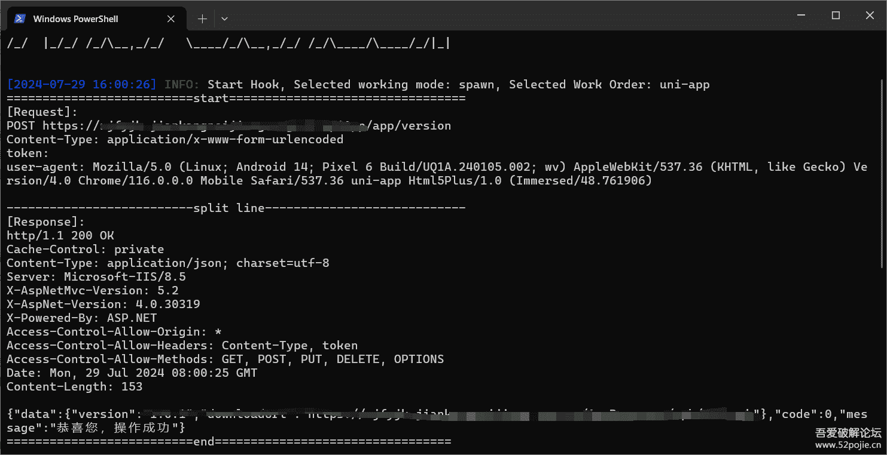
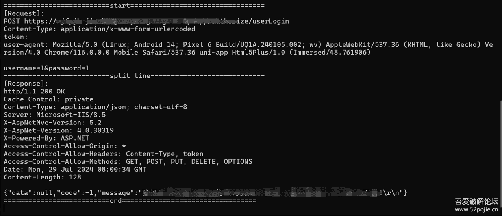
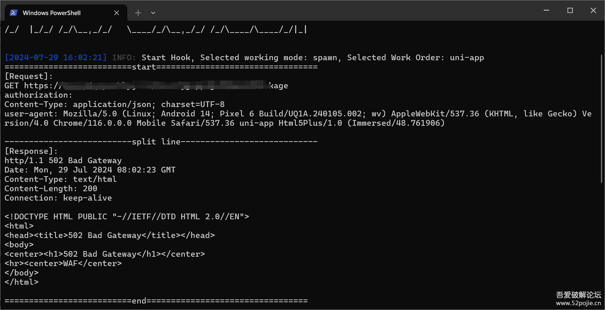
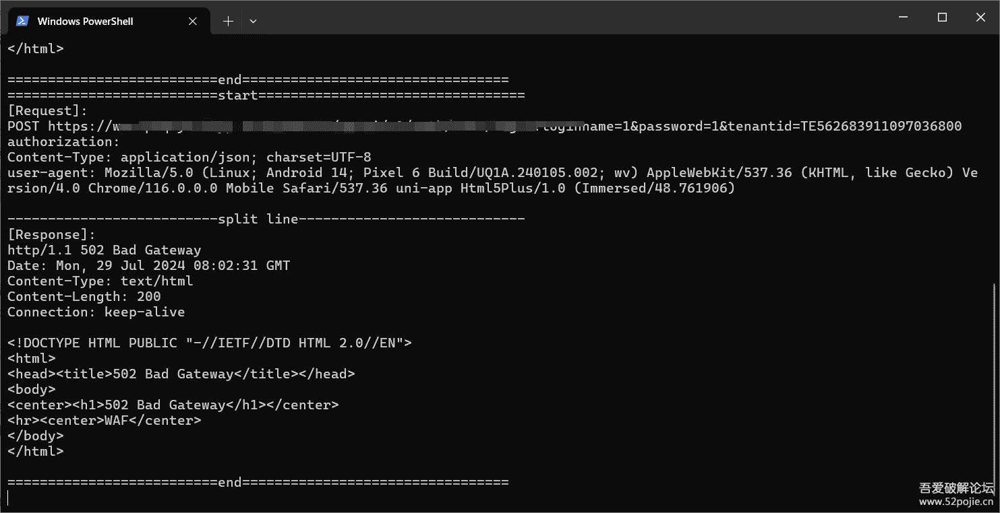

# [Android 原创] UNI-APP渗透测试-抓包

- 原帖：[https://www.52pojie.cn/forum.php?mod=viewthread&tid=1949190](https://www.52pojie.cn/forum.php?mod=viewthread&tid=1949190)
- 抓取时间：2026-11-01T23:59:41

## 一、前言

`uni-app` 是一个使用 `Vue.js` 开发所有前端应用的框架，开发者编写一套代码，可发布到iOS、Android、Web（响应式）、以及各种小程序（微信/支付宝/百度/头条/飞书/QQ/快手/钉钉/淘宝）、快应用等多个平台。

现在工作上遇到的`uni-app`越来越多了，需求主要集中在抓包上，简单记录一下。

## 二、特征识别

### 特征点一

最明显的特征点是在APK包解压缩之后，在根目录下存在`dc/squareup`目录，如下所示：

`1.png` (21.86 KB, 下载次数: 0)，2024-7-29 16:37 上传

### 特征点二

反编译之后，存在`dc/squareup`和`uni.UNIXXX`开头的包，如下图所示：

`2.png` (74.31 KB, 下载次数: 0)，2024-7-29 16:38 上传

有这两个特征基本就可以确认一个APP是否是`uni-app`开发的了，其他的没啥写的必要了。

## 三、抓包

app的抓包方法很多，挂代理、VPN、HOOK、`tcpdump`等，翻了一下`uni-app`的官方文档，发现它不仅有证书校验还有代理检查，挂代理抓麻烦，有时候还不知道为啥抓不到；VPN去抓复制麻烦；`tcpdump`去抓，不直观，用`ecapture`去抓倒是直观，但是遇到只走http的报文就抓瞎了；最后还是选择`frida`吧，但是网上找了半天，没找到现成的脚本，只好写了一个(原理很简单，`uni-app`底层还是走的`okhttp3`那一套，稍微改了一下，但核心基本没变，这里直接选用`getResponseWithInterceptorChain()`函数取得`request`和`response`对象即可)。

脚本链接：[//github.com/windy-purple/uni_app-Packet-capture](https://github.com/windy-purple/uni_app-Packet-capture)

拿工作中遇到的两款APP展示一下效果。

`3.png` (101.07 KB, 下载次数: 0)，2024-7-29 16:39 上传

`4.png` (222.73 KB, 下载次数: 0)，2024-7-29 16:39 上传

`5.png` (86.21 KB, 下载次数: 0)，2024-7-29 16:39 上传

`6.png` (82.8 KB, 下载次数: 0)，2024-7-29 16:39 上传

## 四、参考链接

[//bbs.kanxue.com/thread-252129.htm](https://bbs.kanxue.com/thread-252129.htm)
