# [Android 原创] 瞬译v6.9.0解锁高级版（翻译软件）

- 原帖：https://www.52pojie.cn/forum.php?mod=viewthread&tid=1949292
- 抓取时间：2026-11-01T16:42:22.271Z

app：瞬译v6.9.0(百度搜索下载)

工具：`jadx`、`frida`、雷电模拟器

方法：`hook`相关代码

app界面：

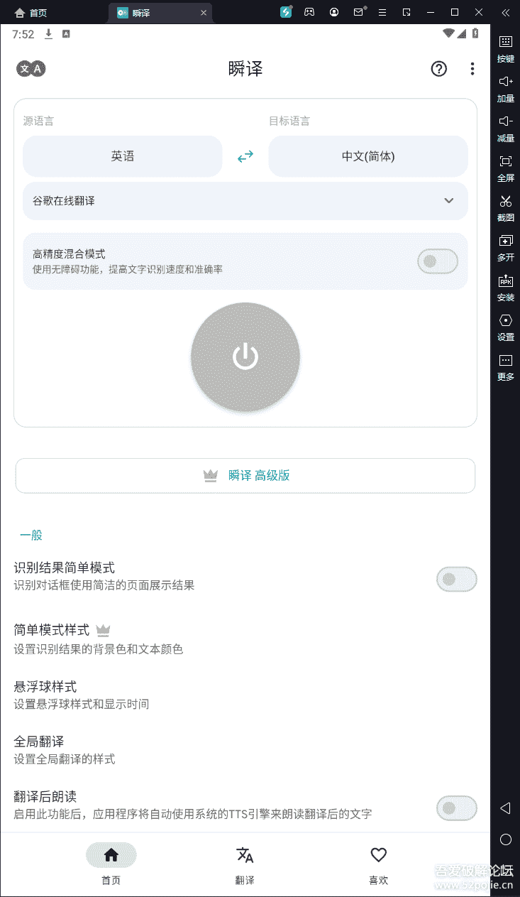

## 步骤一：寻找下手点

1. 直接`isvip`，不好意思一个都没，天杀的连vip都没（不然人家为啥叫高级版），观察app，发现每次点击会员功能就会跳出开通界面。

   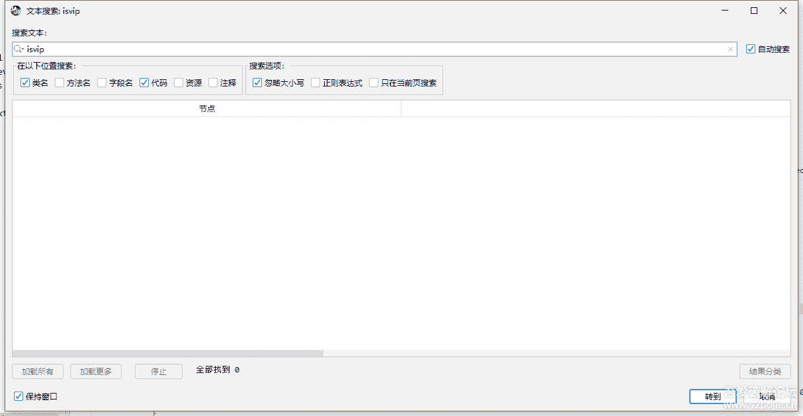

   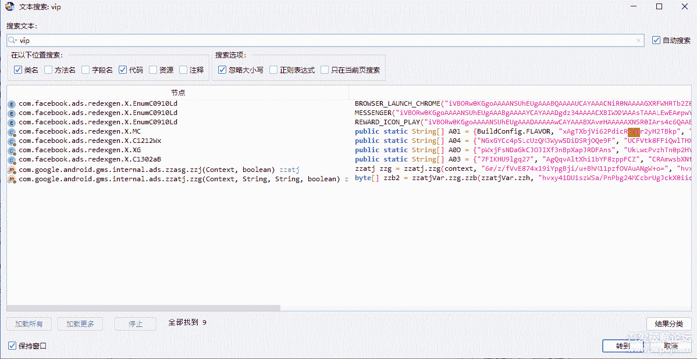

2. 那么我们就可以利用这点去回溯谁调用了它，直接 `adb shell dumpsys activity | findstr "mResumedActivity"` 定位开通界面。

   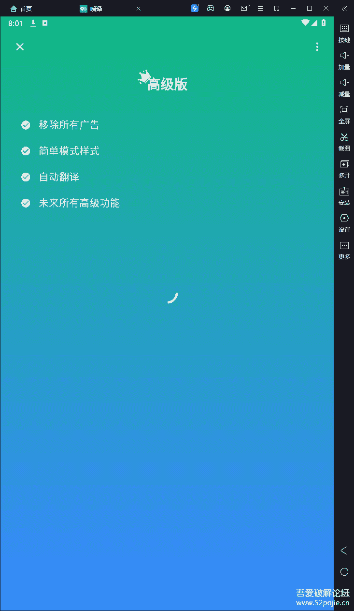

   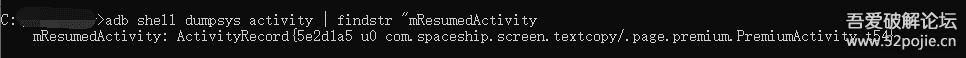

   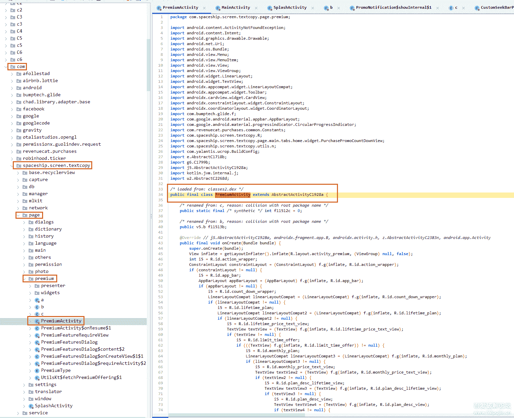

## 步骤二：回溯开通界面

1. 查看是谁调用了`PremiumActivity`这个类，我尼玛36个，还好一眼就能发现有三个最像，然后就是一个个`hook`查看是不是调用了。

   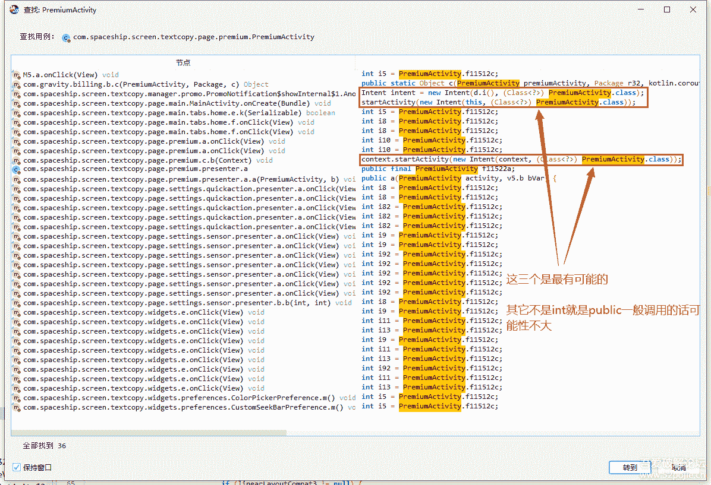

2. 尝试后发现是最后一个调用了开通界面，当我点击会员功能后，就会跳到开通界面，`hook`显示调用了。

   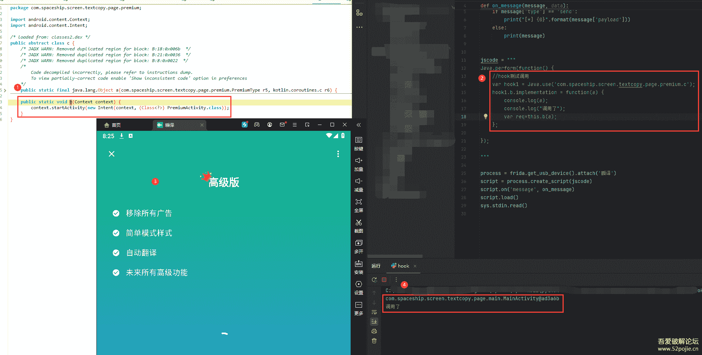

3. 继续回溯看是谁调用了它，发现有30个，但是根据`com.spaceship.screen.textcopy.page.main.MainActivity@ad3a6b`可以判断基本就是那三个了，直接`hook`判断哪个才是对的。

   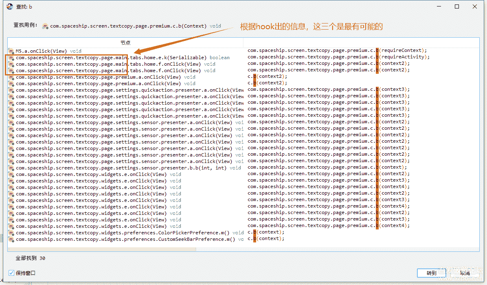

4. 这里有个坑，我`hook`这三个后，发现点主页那个高级版都没有调用，最后在我点击“隐藏原始文字”这个会员功能后，第一个居然调用了。

   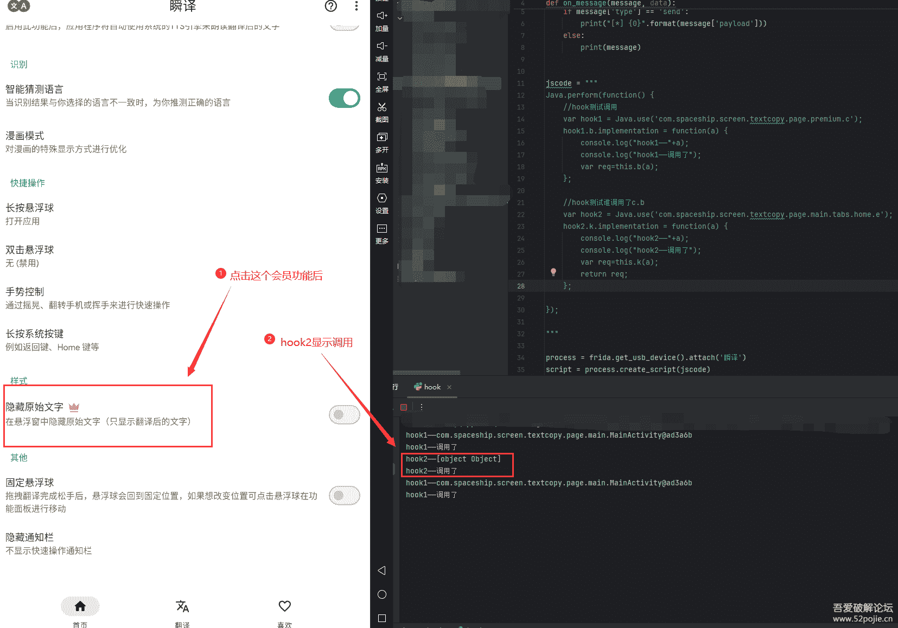

5. 因为这是个布尔类型，我尝试`hook`让它返回`true`，结果发现直接可以用了，也不跳开通界面了吗，所以这个`k()`就是用来单独判断“隐藏原始文字”这个功能的；那么就说明`k()`方法中肯定有判断你是不是会员的代码。

   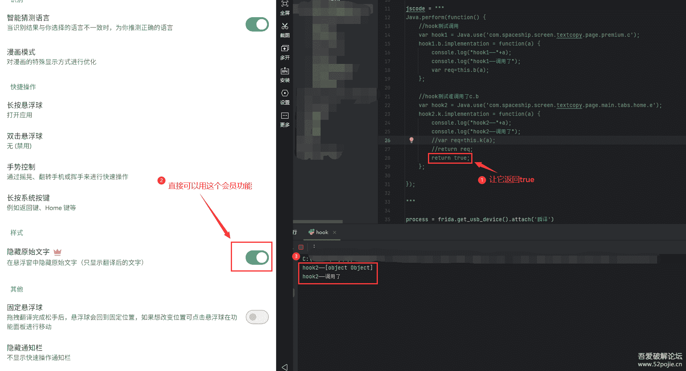

## 步骤三：寻找判断会员代码

1. 仔细观察`k()`方法，我们只要让它们其中一个为真，那么`k()`就返回`true`，我们重点观察右边的，直接跟进看看。

   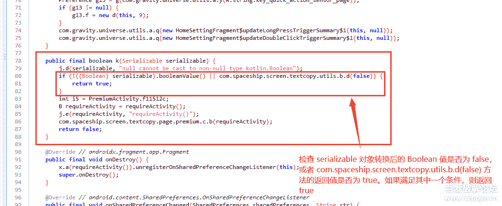

2. 我们发现`d()`也是一个布尔方法；直接`hook`测试看看。

   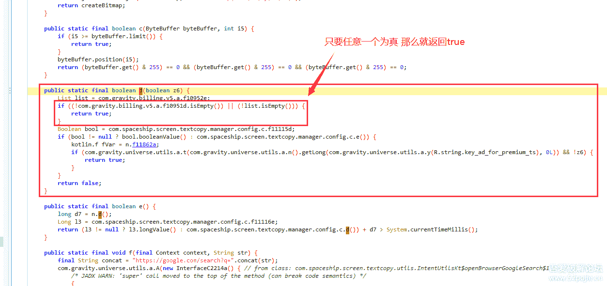

3. 哦吼，一不小心就成功了，直接拿下高级版，说明`d()`这个方法就是用来判断是否为会员的地方，只要让它返回`true`，那么app就会判断你是会员。

   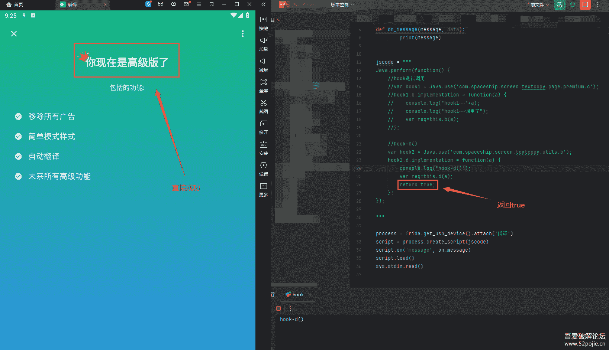

   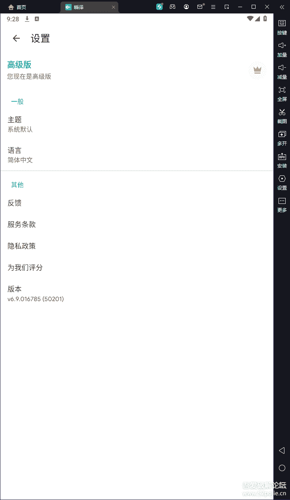

## 步骤四：研究会员具体代码

我们双击`com.gravity.billing.v5.a`跟进后就到了会员信息的具体代码；总结就是它是用来管理用户购买和订阅的，而我们`hook`的`d()`方法就是判断`f10951d`或`f10952e`是否为空，因为它们里面存放了会员相关信息，app就是判断是否有购买或者订阅信息来判断你是不是高级版。

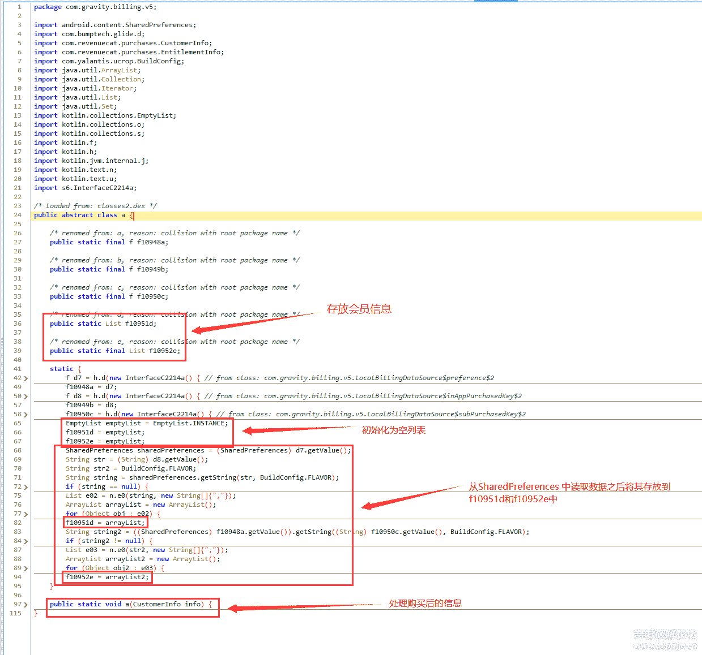

## 总结

分析得有可能不是很准，但是整体逻辑就是app判断某个里面是否存放有购买信息，有，那你就是高级版，没有，那你就是普通版，这软件还是挺不错的，用来看国外电影、小说、漫画翻译还是挺好用的，感谢支持，大家一起交流学习

