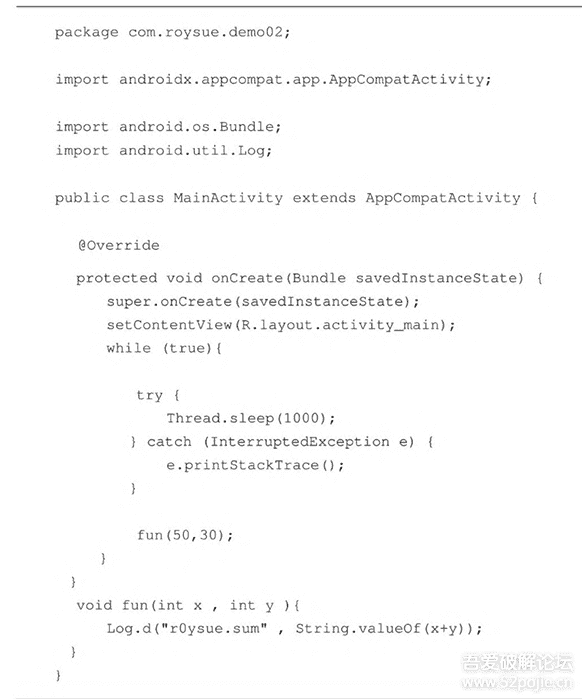
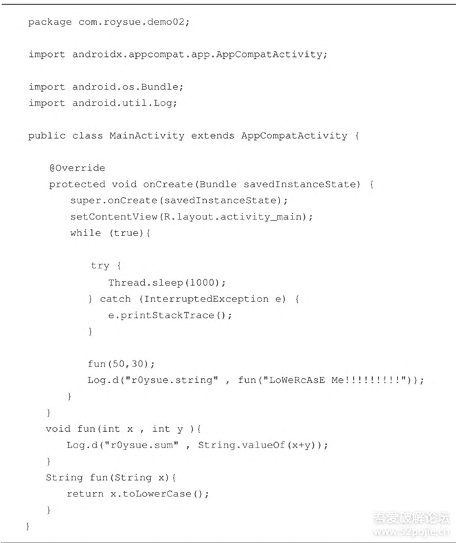
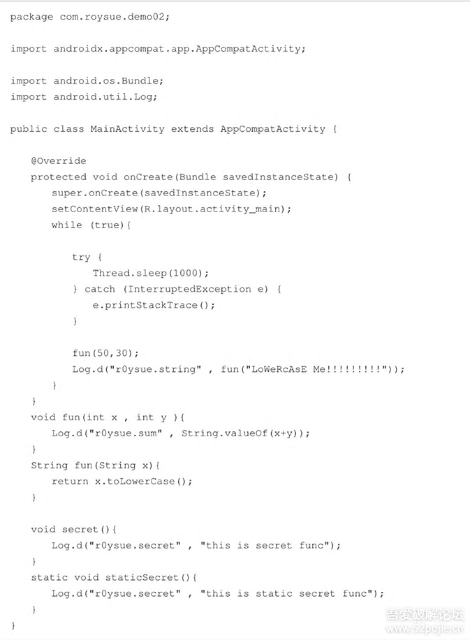

# [Android 分享] 安卓逆向学习1-hook脚本学习

- 原帖：https://www.52pojie.cn/forum.php?mod=viewthread&tid=1949842
- 抓取时间：2026-11-01T16:42:17.269Z

## 1.1 `helloworld.js`

基本的 Frida 的 API 函数，Frida 版本的 `helloworld`。

```javascript
setTimeout(
        //将function这个匿名函数作为参数传递给setTimeout()函数   
        //注册到js的运行库     
        function(){
        //匿名函数function
                Java.perform(function(){
                //Java.perform()方法将函数注册到APPJava运行库中 执行函数打印log
                        console.log("hello world!")
                })
        }
)
```

## 1.2 `MainActivity.java`

main1



```javascript
//1.js

function main(){

        //存放hook脚本

        console.log("Script loaded successfully")

        Java.perform(function(){

        //Java.perform()API函数，注入脚本内容

        //参数是匿名函数

                console.log("Inside java perform function")

                var MainActivity = Java.use('com.roysue.demo02.MainActivity')

                //调用API函数的Java.use()函数 

                //参数是hook函数所在的类的全名

                console.log("Java.Use.Successfully!")//类定位成功

                MainActivity.fun.implementation=function(x,y){

                //implementation实现MainActivity对象中的fun函数

                //定义到function这个匿名函数 来作为Java.perform()的参数

                        console.log("x=>",x,"y=>",y)

                        var ret_value=this.fun(x,y)

                        return ret_value

                }

        })

}

setImmediate(main)

//被执行函数 main参数传递  类似setTimeout()函数--延时注入

//针对于MainActivity对象的fun函数

//Frida注入app之后立即执行main函数
```

```javascript
//修改参数的change_args()函数
function change_args(){

        console.log("Scripts loaded successfully")
        
        Java.perform(function(){
        
        
                console.log("Inside java perform function")
                
                var MainActivity = Java.use('com.roysue.demo02.MainActivity')
                
                
                console.log("Java.Use.Successfully!")
                                
                MainActivity.fun.implementation=function(x,y){
                                
                        console.log("orignal args:x=>",x,",y=>",y)
                        var ret_value=this.fun(2,5);
                        //函数参数修改为(2,5)
                        return ret_value
                }
        })
}
```

使用 `attach` 模式注入 App

```shell
frida -U -l 1.js com.roysue.demo02

# -U USB设备

# -l 指定注入脚本所在的路径 后面是要注入的脚本
```

Tips:

- hook 函数不修改被 hook 函数的返回值
- 调用原函数返回原函数的返回值

## 1.3 `MainActivity2.java`

main2



加入了 `fun()` 函数的重载

```javascript
//void fun(int x,int y)
function main(){
        console.log("Script loaded successfully")
        Java.perform(function(){
                console.log("Inside java perform function")
                var MainActivity=Java.use("com.roysue.demo02.MainActivity")
                console.log("Java.Use.Successfully")//定位类成功
                
                //hook重载函数
                MainActivity.fun.overload('int','int').implementation=
                function(x,y){
                        console.log("x=>",x,"y=>",y)
                        var ret_value=this.fun(2,5);
                        return ret_value
                }
        })
}
setImmediate(main)
```

```javascript
//String fun(String x)

function main(){

        console.log("Script loaded successfully")

        Java.perform(function(){

                console.log("Inside java perform function")

                var MainActivity=Java.use("com.roysue.demo02.MainActivity")

                console.log("Java.Use.Successfully")

                MainActivity.fun.overload('java.lang.String').implementation=function(x){

                        console.log("x=>",x)

                        var ret_value=this.fun("I")

                        return ret_value

                }

        })

}

setImmediate(main)
```

## 1.4 Java层主动调用

main3



```javascript
//3.2.3 Java层主动调用
function main(){
        console.log("script loaded successfully")

        Java.perform(function(){
                console.log("inside java perform function")

                //静态函数
                //API Java.use()获取类 
                var MainActivity = Java.use('com.roysue.demo02.MainActivity')
                MainActivity.staticSecret()

                //动态函数
                //API Java.choose()从内存中获取类的实例对象
                Java.choose('com.roysue.demo02.MainActivity',{
                        //？API回调onMatch
                        onMatch:function(instance){
                                console.log('instance found',instance)
                                instance.secret()
                        },
                        onComplete:function(){
                                console.log('search complete')
                        }
                })
        })
}
setImmediate(main)
```

使用 `Java.choose()` 函数

- `onMatch:function(instance){…}` 和 `onComplete(){}` -> 事件处理或回调函数。
- `onMatch:function(instance){…}` -> 某模式匹配成功时执行的操作。
- `onComplete(){}` -> 某个操作或任务完成时执行的操作。【异步编程】

做区分：Objection 是基于 Frida 的注入工具，开个坑！

## Objection 命令

```shell
objection

pip install -U objection

android hooking list classes

android hooking search classes XXX

android hooking search methods XXX

android hooking list class_methods

android hooking list activities

android hooking list services

android hooking watch class_method XXX

android hooking watch class_method XXX.File.$init --dump-args --dump-backtrace --dump-return

jobs list

jobs kill job_ID

android hooking watch class

android heap search instances

android heap execute

android heap execute 0x3606 setExecutable True

android heap evaluate
```

参考资料：陈佳林《安卓逆向与抓包实战》
