# [Android 原创] 某宙工具箱VIP逆向教程及发现漏洞

- 原帖：[https://www.52pojie.cn/forum.php?mod=viewthread&tid=1950909](https://www.52pojie.cn/forum.php?mod=viewthread&tid=1950909)
- 抓取时间：2026-11-01T16:41:50.253Z

## 前言

声明：本文仅供学习交流使用，所涉及的APP不提供下载渠道。所涉及的技术请勿用于非法活动，否则所带来的一切后果自负。假如你看到这篇文章或者有作者的联系方式请及时联系作者进行漏洞处理。

## 事件起因

在B站刷到一个视频，破解思路是使用替换字符串的值达到破解VIP的目的，但是发现一个严重漏洞，如果你是该工具的功能提交者之一，请及时修改你的常用密码，该功能查询返回了功能提交者的隐私信息手机号和明文密码。

## 使用工具

- `Jadx`
- `vscode`
- MT管理器
- 雷电模拟器

## 破解教程

- MT打开受害者对象

  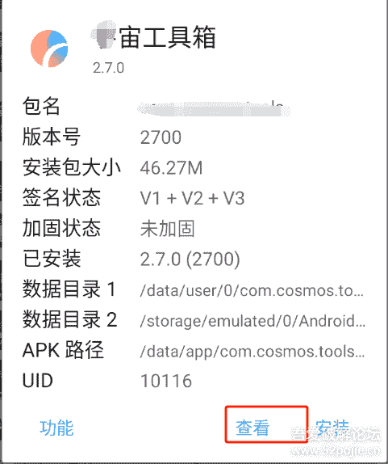

- 选中`dex`

  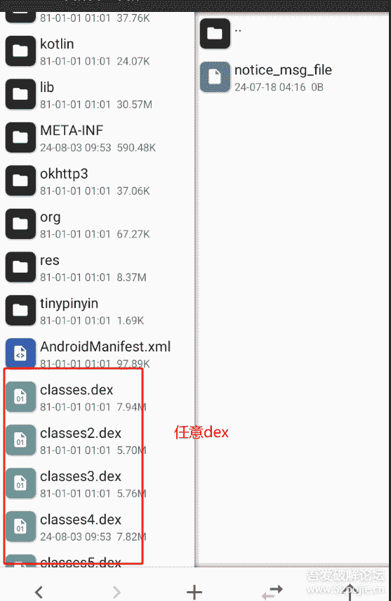

- 打开`dex++`编辑

  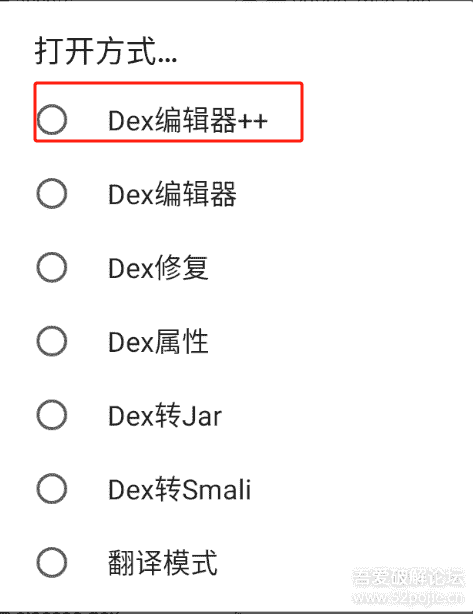

- 全选`dex`

  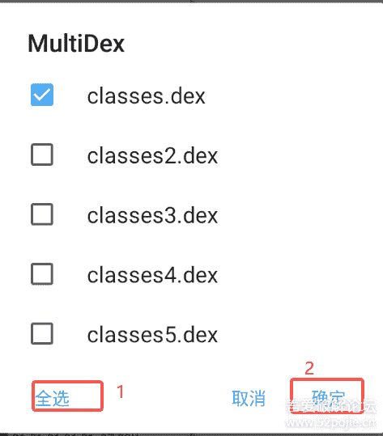

- 转到搜索

  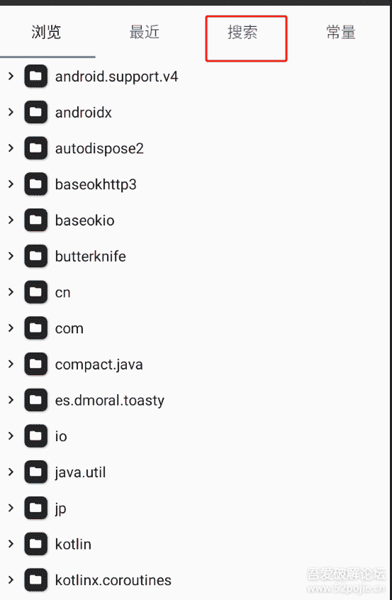

```smali
const-string v0, "\"isVip\":0"

const-string v2, "\"isVip\":1"

invoke-virtual {v1, v0, v2}, Ljava/lang/String;->replace(Ljava/lang/CharSequence;Ljava/lang/CharSequence;)Ljava/lang/String;

move-result-object v1
```

- 发起新搜索

  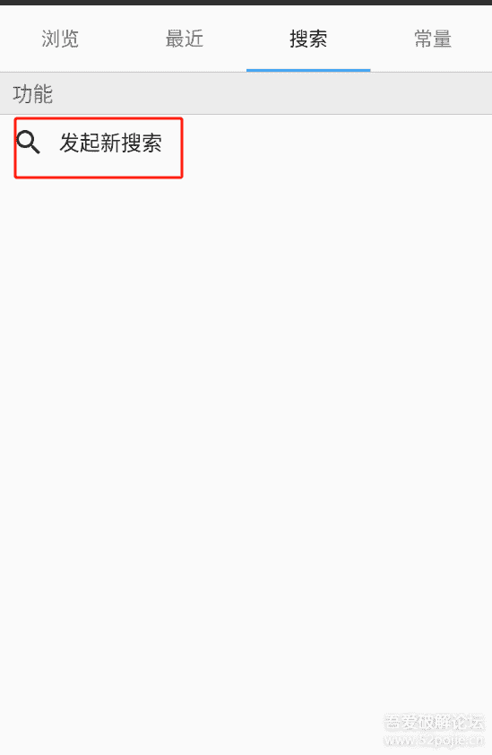

- 设置搜索条件开始搜索

  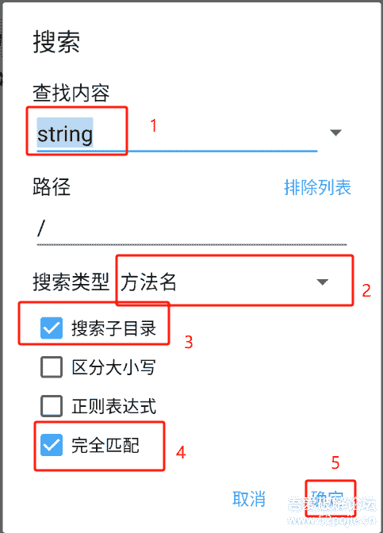

- 搜索结果

  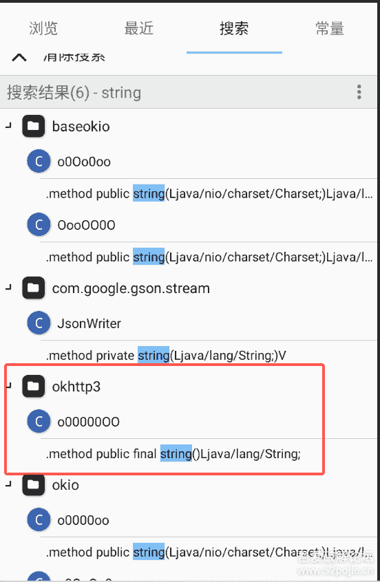

- 进入`smali`

  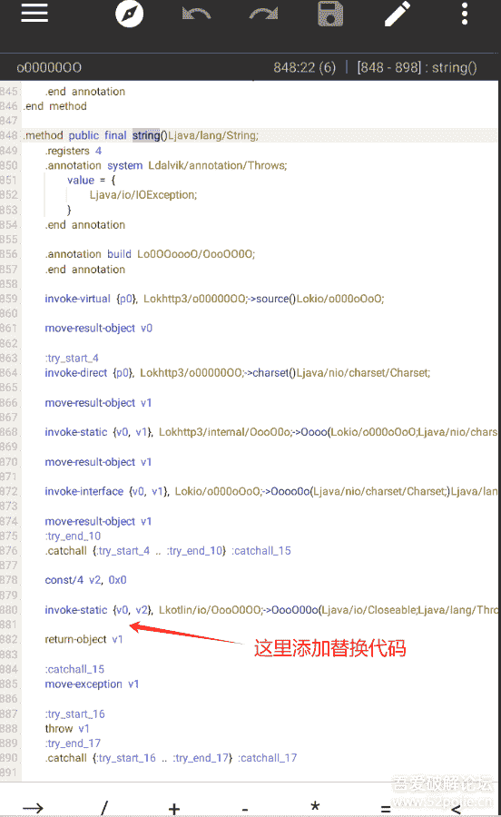

- 需要添加以下代码

```smali
const-string v0, "\"isVip\":0"

const-string v2, "\"isVip\":1"

invoke-virtual {v1, v0, v2}, Ljava/lang/String;->replace(Ljava/lang/CharSequence;Ljava/lang/CharSequence;)Ljava/lang/String;

move-result-object v1
```

- `smali`添加代码

  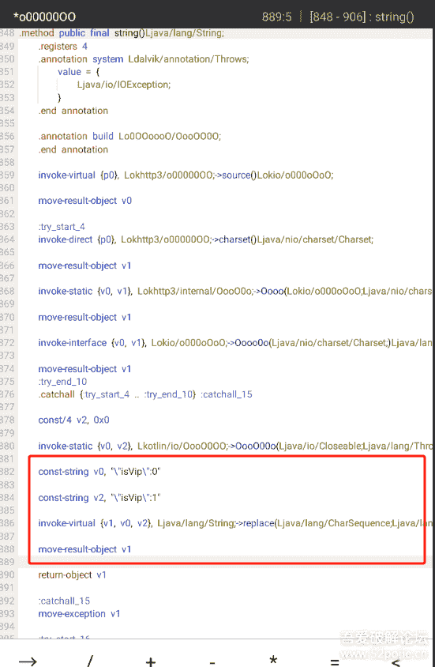

- 替换源码代码分析

```java
public static void main(String[] args) {
//模拟服务器返回的json字符串
String json = "{\"code\":200,\"msg\":\"\u6210\u529f\",\"data\":{\"id\":10000,\"user\":\"123456@qq.com\"," +
"\"nick\":\"\u4e00\u53ea\u5c0f\u8001\u864e\",\"email\":null,\"phone\":null,\"create_time\":1720083587," +
"\"token\":\"2131uqgequgeu124141h414i14\",\"isVip\":0}}";
//替换后的json字符串
String result = json.replace("\"isVip\":0", "\"isVip\":1");
}
```

- 替换后的`json`

```json
{
"code":200,
"msg":"成功",
"data":{
"id":10000,
"user":"123456@qq.com",
"nick":"一只小老虎",
"email":null,
"phone":null,
"create_time":1720083587,
"token":"2131uqgequgeu124141h414i14",
"isVip":1
}
}
```

- 保存代码

  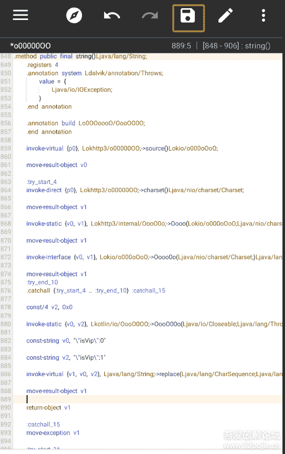

- 保存退出，签名APK

  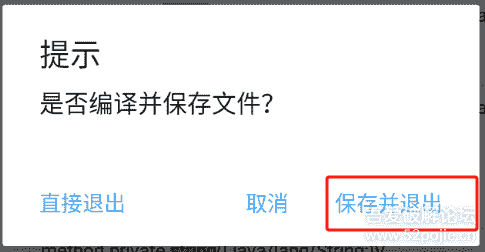

- 卸载原版安装登录

  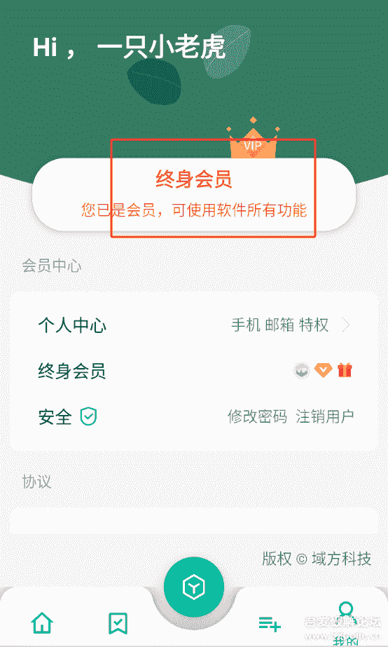

## 拓展

### `frida` hook该方法

```javascript
function main() {
Java.perform(function () {
let o00000OO = Java.use("okhttp3.o00000OO");
o00000OO["string"].implementation = function () {
console.log(o00000OO.string is called);
let result = this["string"]();
console.log(o00000OO.string result=${result});
return result;
};
});
}

setImmediate(main, 0);
```

### 发现一个很严重的漏洞

功能查询页调用了该方法。

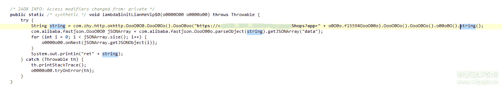

这些功能大多数是由用户提交上去的，但是返回信息里居然查询了用户的隐私信息，包括手机号和密码，而且密码还是明文，示例如下：

```json
{
"id":69789,
"uid":69789,
"url":"[//share.com/recv](https://share.com/recv:https)",
"title":"快传",
"description":"文件传输",
"create_time":1673863664,
"status":1,
"star":1,
"stars":",69789,66939,142262,2333,128915,93497,174103,176173",
"user":"123456@qq.com",
"nick":"凌凌漆007",
"pass":"123456789",
"email":"123456789@qq.com",
"phone":"13800138000",
"token":"123115536432242dasad1a7517",
"isVip":1,
"skillId":1737
}
```
