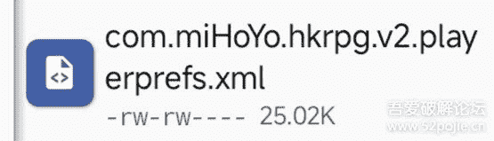
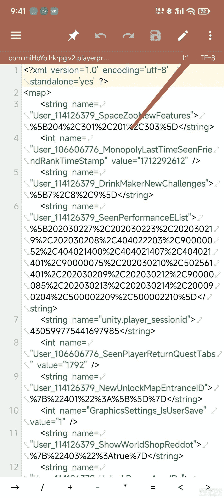
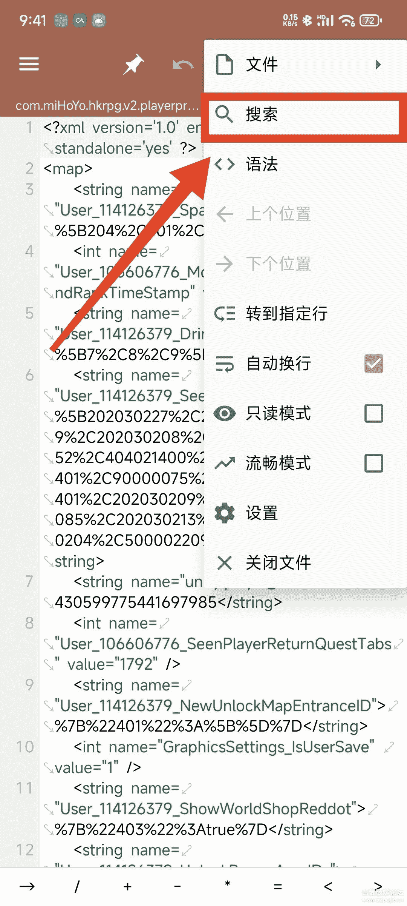
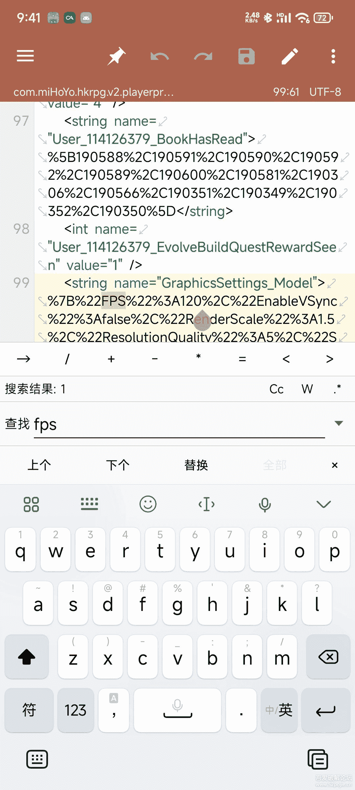
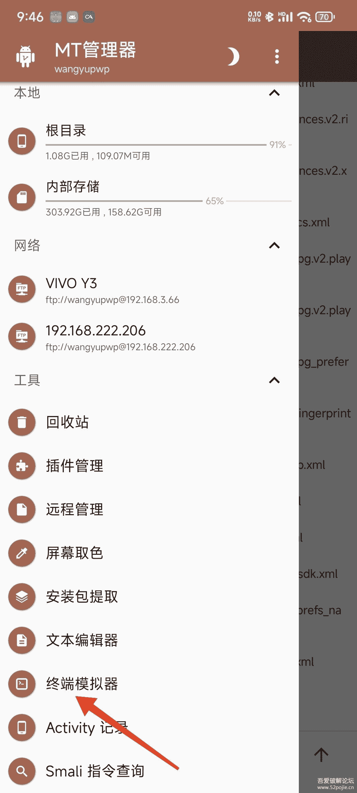
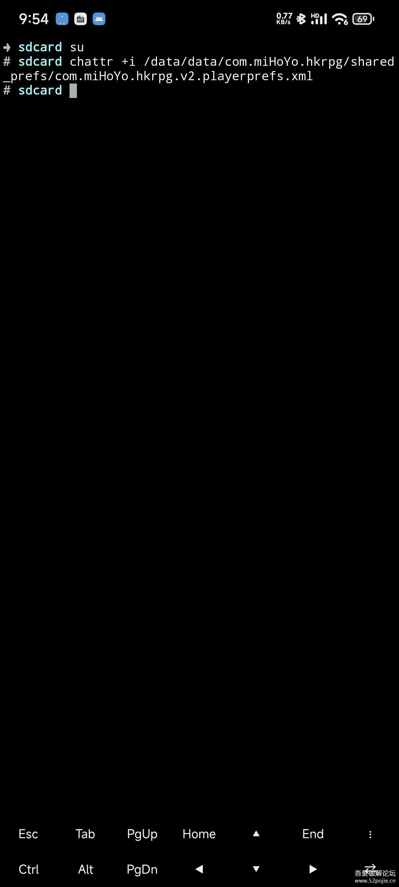

# [Android 分享] 【root】崩坏 星穹铁道改120帧高分辨率教程

- 原帖: https://www.52pojie.cn/forum.php?mod=viewthread&tid=1951160
- 抓取时间: 2026-11-01T16:41:45.251Z

开篇提示，此帖子非原创，转载于:https://www.coolapk.com/feed/54459295?shareKey=MGIyZGU3MTE0ZTVkNjZhZWQ4ZDA~&shareUid=7176597&shareFrom=com.coolapk.market_14.0.2

本人对原帖子做了一定修改

-----------------------------------------------------------------------------------------------------------------------------------------------------

请务必看到最后!

高帧率高画质会极大增加负载，请各位配合背夹使用。

无需机型限制，root就能玩。

工具需要：冰箱(https://neverselect.lanzoul.com/iOzj30y1webi)，mt管理器(mt2.cn)，崩铁(https://sr.mihoyo.com/)

————————————————————-------------------------------------------------------------------------------------------------

解bl，root设备，这个就不说了，网上教程一大堆

打开mt管理器，点击路径（就是文件夹：0上面的一大串文件名），直接跳转到`/data/data/com.miHoYo.hkrpg/shared_prefs/`，找到`com.miHoYo.hkrpg.v2.playerprefs.xml`这个文件

进入文件，点击右上角三点，搜索fps，点击下个

此代码中，第一行`3A**`中的`**`为帧率，第二行的`3A**`为渲染精度

将第一行的`3A60`改为`3A120`，即为120帧

第二行的`3A1.0`改为`3A1.5`，即为1080p分辨率

慎改，目前也不知道能不能随便乱改...

改完之后，保存返回文件夹，复制文件名和路径（这个上面有）点击左上角，进入终端模拟器

第一行输入`su`，回车

第二行输入`chattr +i /data/data/com.miHoYo.hkrpg/shared_prefs/com.miHoYo.hkrpg.v2.playerprefs.xml`，回车

这个步骤是对文件进行上锁，不让他自己把自己改回去了

最后一步，打开冰箱，把joyose和电量与性能冻结，这俩会让我们前功尽弃，如果你要玩原生原神2k，那么可以只禁用电量与性能，如果不生效，那么只能崩铁原神2选1了...

最后，崩铁，启动！好好吃德芙去吧你＼(`Δ’)／！

———————————————————————----———————————————————————————————————————————

改动后问题

`chattr +i`是对文件进行上锁，即便root用户也无法进行修改，所以如果你不执行`chattr -i`，就算你把崩铁删了，都无法操作这个文件

你不解锁文件就把崩铁删了的话，重新下回崩铁就会因为文件有锁导致闪退！！！╭(°A°`)╮

想重新修改或者卸载文件

请务必执行

`chattr -i /data/data/com.miHoYo.hkrpg/shared_prefs/com.miHoYo.hkrpg.v2.playerprefs.xml`
