# [Android 原创] 开发助手v7.6.0专业版破解

- 原帖：https://www.52pojie.cn/forum.php?mod=viewthread&tid=1951290
- 抓取时间：2026-11-01T16:41:41.249Z

APP：开发助手v7.6.0（百度搜索下载）

工具：`jadx`、`burp`、`frIDA`、雷电模拟器、算法助手

方法：`hook`修改相关代码

难点：加壳、代码混淆

## APP界面

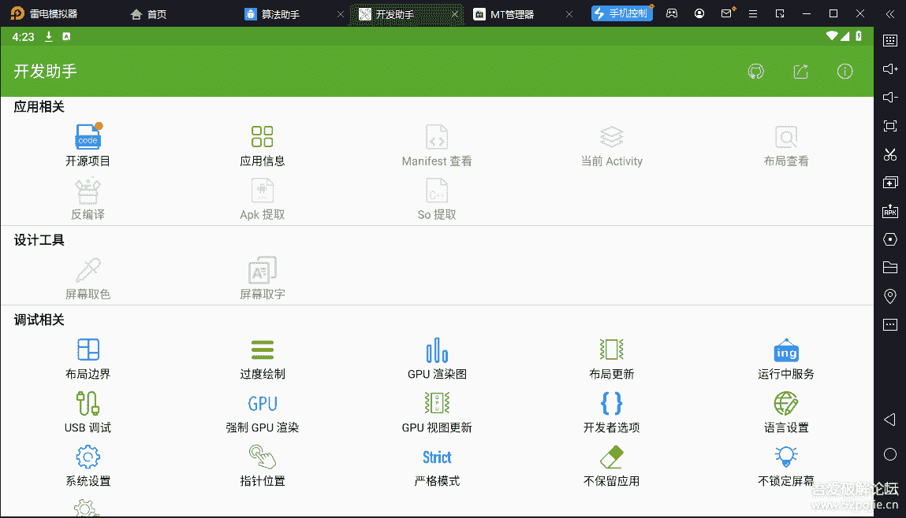

## 前提

把壳先脱了（数字壳）

> 注：我也不会[脱壳](https://www.52pojie.cn/forum-5-1.html)，只能借助一些工具进行脱壳

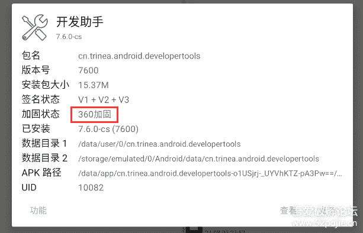

## 失败：通过点击会员功能显示的弹窗追到付费判断代码修改

### 1. 软件点击相关付费功能会弹出购买提示，用算法助手追

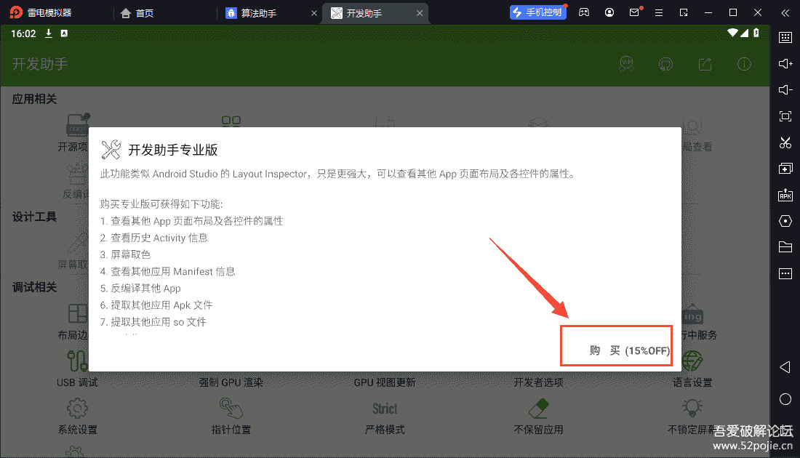

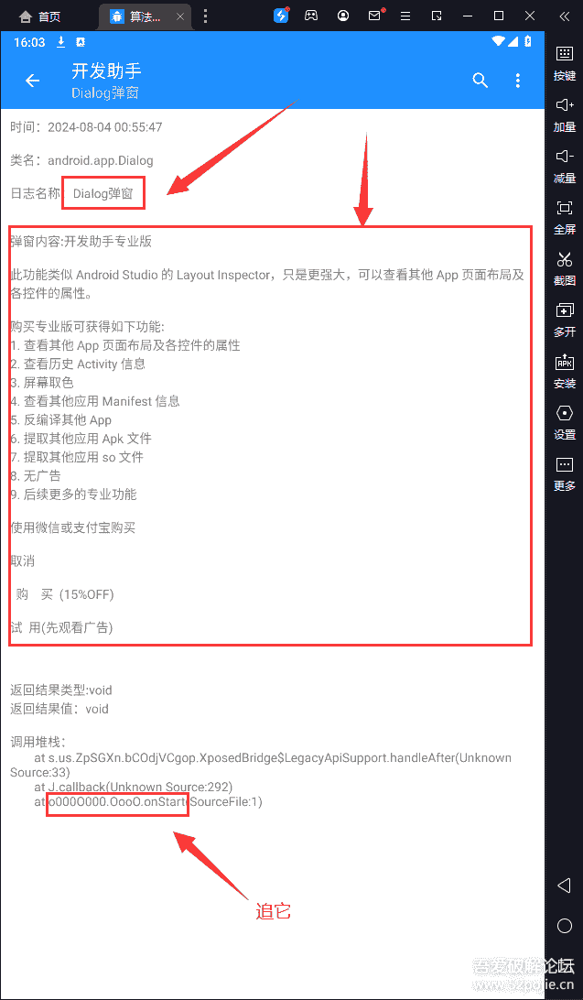

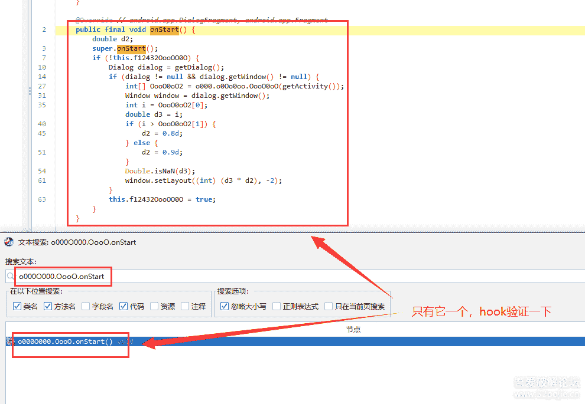

### 2. 编写代码验证是否调用；发现确实被调用了，而且用非付费功能时也被调用了，说明这个方法是用来处理弹窗的，我们往上追看是谁调用了它

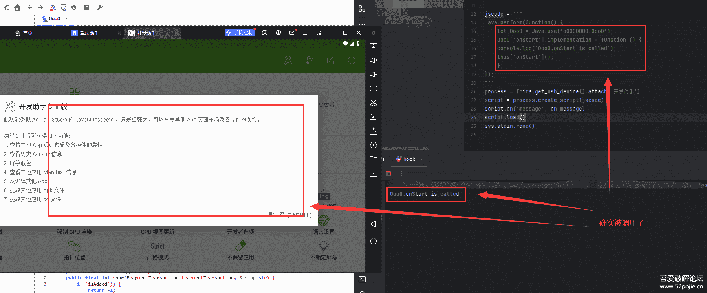

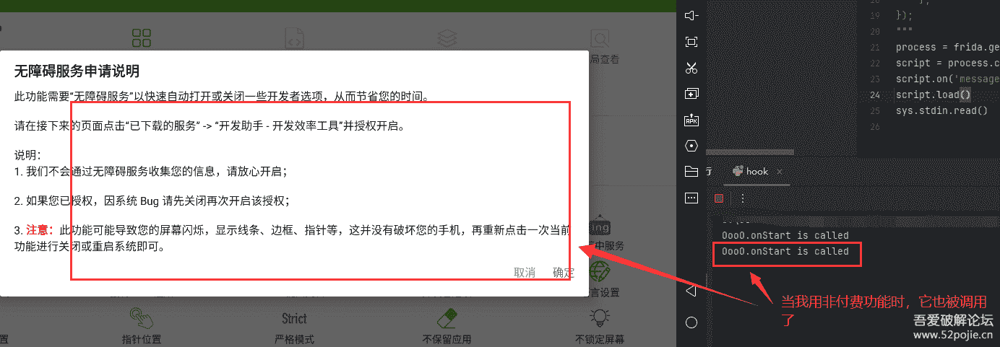

### 3. 会发现并没有人调用它；其实它是系统自动调用的，这是一个生命周期方法，直接放弃

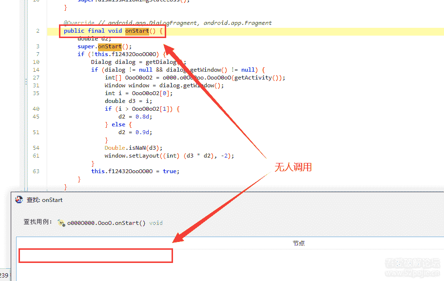

## 成功：抓包分析追代码，修改判断付费的值

### 1. 软件通过激活码激活，那么它一定会发送数据到服务器进行判断是否正确，当我们输入激活码时，它会判断长度是否大于9，当我们输入超过9位后，发现购买失败，直接抓包看看

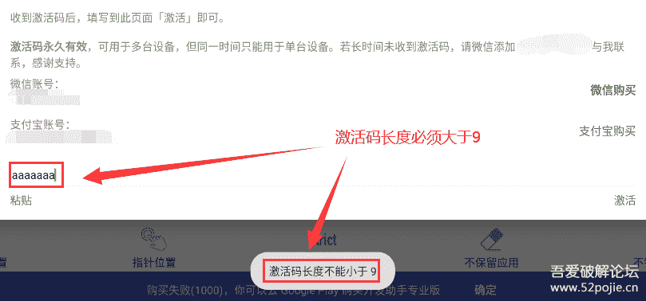

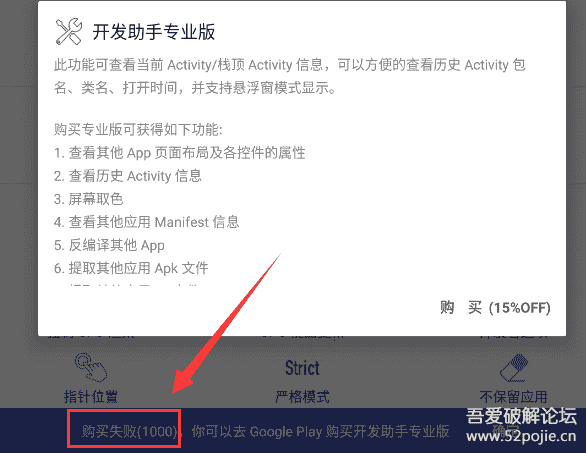

### 2. 成功抓到，并且请求上面能清楚地看到我们输入`aaaaaaaaaa`的卡密；仔细观察它的返回值，`activationCode length is illegal`，翻译成中文就是“激活码长度不合法”，既然如此，那我们就慢慢加长度给它试出来

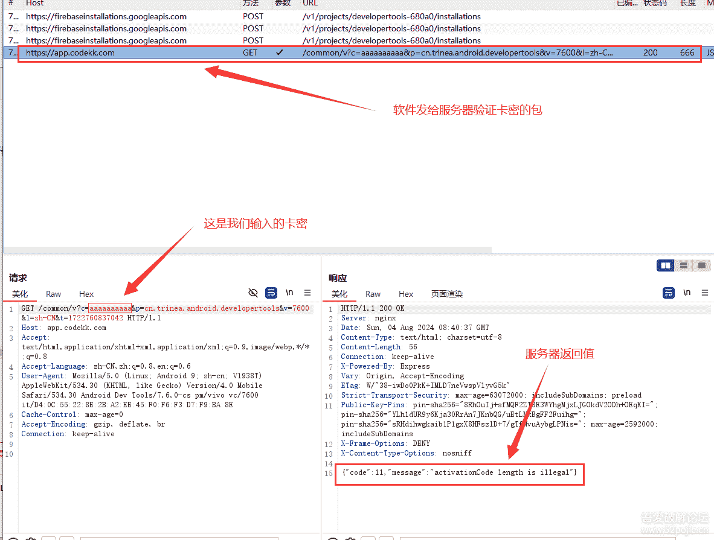

### 3. 直接将它放到重放器发送，直到卡密为32位时，不再提示卡密长度不合法，说明此app的卡密长度为32

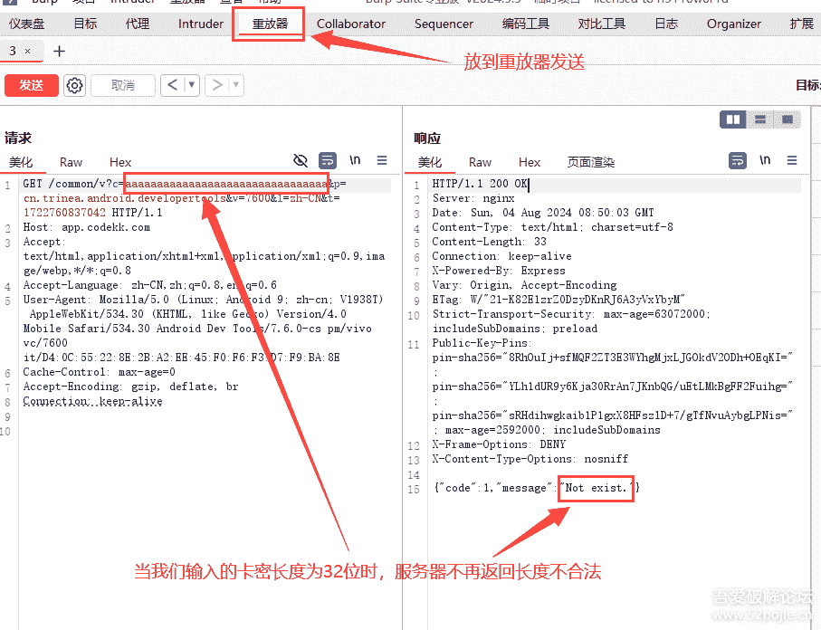

### 4. 搜索数据包相关的关键词，定位到包的位置，我们直接搜`common/v`，当然你也可以搜其它的，比如`app.codekk`等等，只要能帮你定位到相关代码的位置，运气非常好，直接找到，全部对上，而且这是一个接口方法，它的返回就是`taOooOO0O>`，我们直接跟进去看看

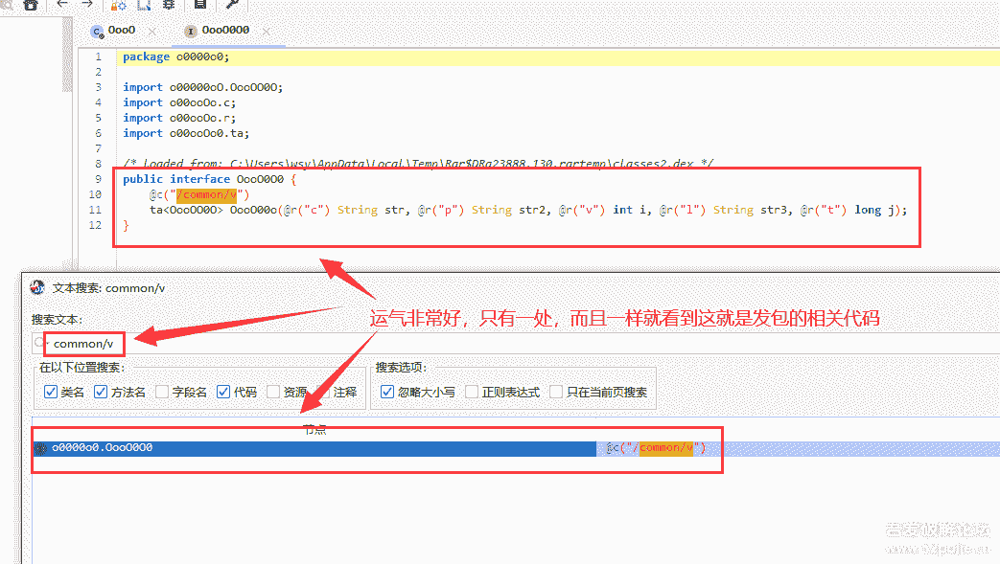

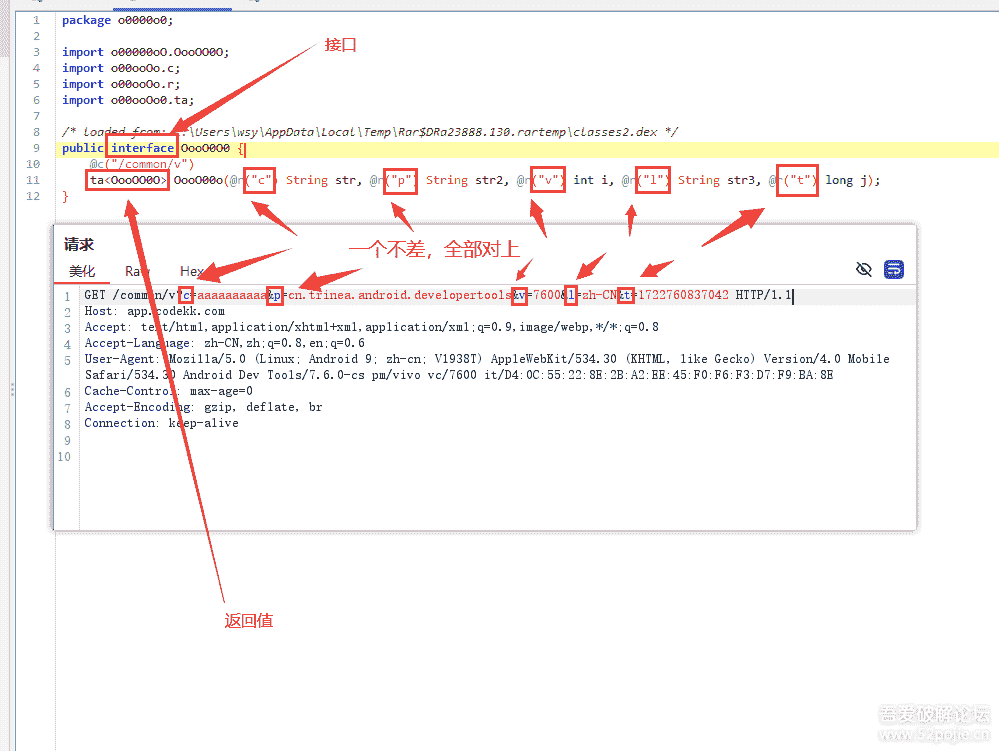

### 5. 一眼就能看到`code`（逆向一定要对这些关键词敏感），并且这段代码就是获取服务器返回的值，以便后续代码使用；正常来说，app发送网络请求到服务器，然后再获取服务器的返回值，之后再对服务器的返回值进行提取判断，那么我们就可以去更改app从服务器获取的值，实现相关的[破解](https://www.52pojie.cn/)

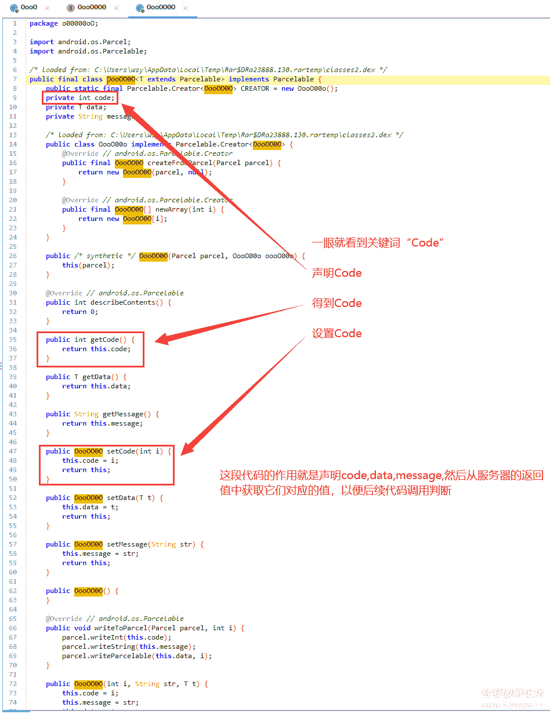

### 6. 我们编写代码直接`hook getCode()`（你也可以`hook setCode()`，都是可以的）更改它的返回值为200试试；可以发现并没有成功，回过头看抓包的数据，当我们输入正确长度时，服务器返回的`code`值为1；如果1代表失败，那么0就代表成功（正常来说，判断真假，对错，不是1就0）

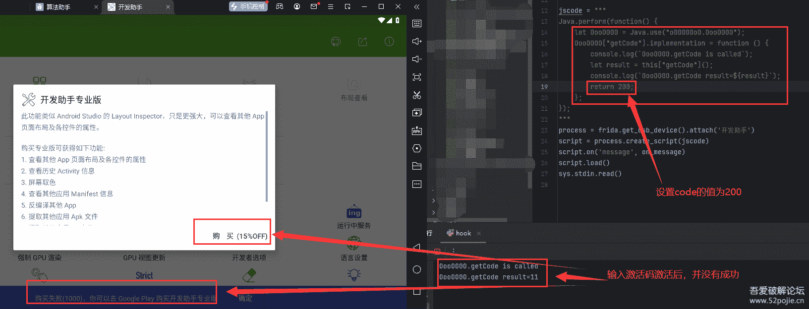

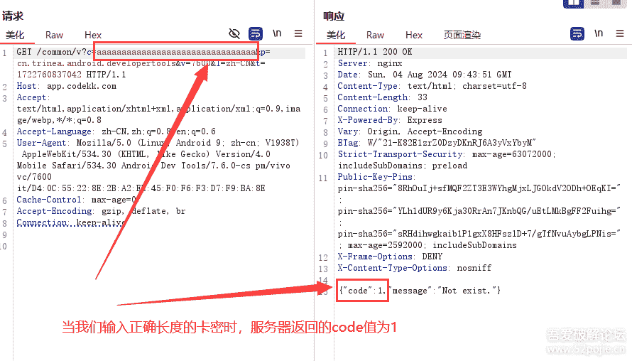

### 7. 重新设置`getCode()`的返回值为0试试；输入任意长度超过9的卡密后，成功激活专业版！！！并且所有功能正常使用

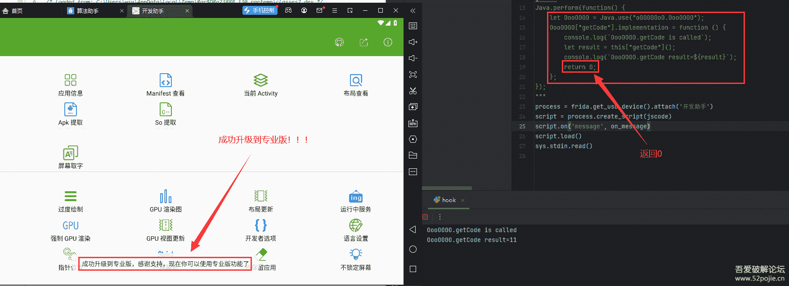

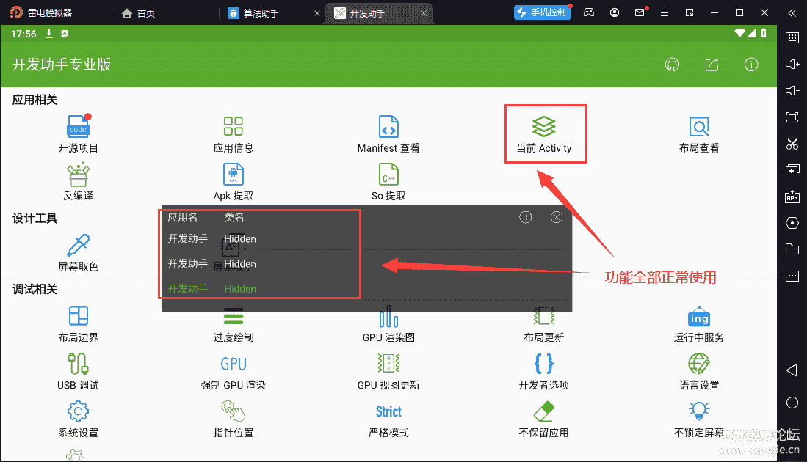

### 8. 其实如果你查找`getCode()`方法的用例就会发现，它们都是用`code`与0进行判断，只要`code`的值为0，那么就是激活成功；感兴趣的可以继续追上去看看

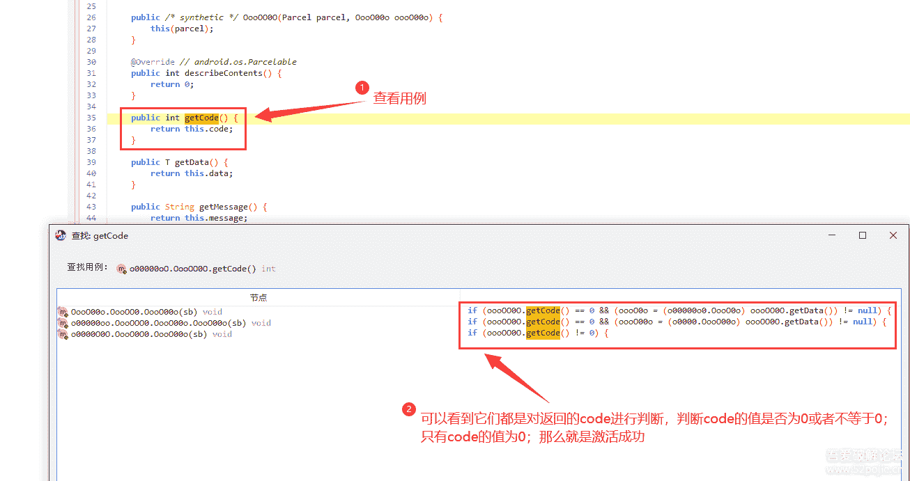

## 总结

相较于之前的软件，这种加壳了的软件脱壳后的代码复杂度是完全小于没加壳的，就相当于一个穿了盔甲的瘦子和一个胖子打架，脱了盔甲肯定是打不过胖子的，当然也不乏有没穿盔甲的瘦子和穿了盔甲的胖子；另外本人发的所有帖子都是给大家分享一下每次逆向软件的思路，方法，步骤和经验等等，不提供任何破解成品，让想学的朋友能从中学到东西，因为我从论坛中那些萌新、大佬发的帖子中学到了很多东西，如果不是大家的那些好帖子以及论坛中各位热心大牛的帮助，我可能还是个啥都不会的小辣鸡；感谢吾爱，希望吾爱越来越好，感谢支持，大家互相交流学习学习

