# [Android 原创] 奇迹免费小说 精简布局和去广告代码分析以及教学

- 原帖: https://www.52pojie.cn/forum.php?mod=viewthread&tid=1951314
- 抓取时间: 2026-11-01T16:41:36.245Z

大家好，很久没发帖子了，今天在逛应用商店时发现了这个喜马拉雅出品的APP，一看没有加固，那就直接开搞！

## 准备工具
`奇迹免费小说` `mt`/`np`/各种逆向软件 界面分析/开发助手 `LibChecker`

## 教程

### 1. 首先用最简单的方法测试是否有签名校验
`mt`签名然后打开，发现果然闪退，用`mt`加强版签名就可以了

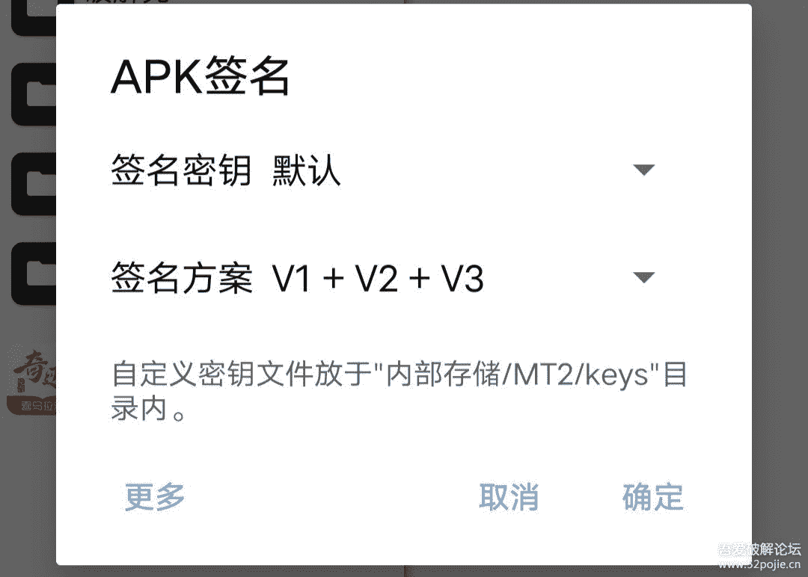
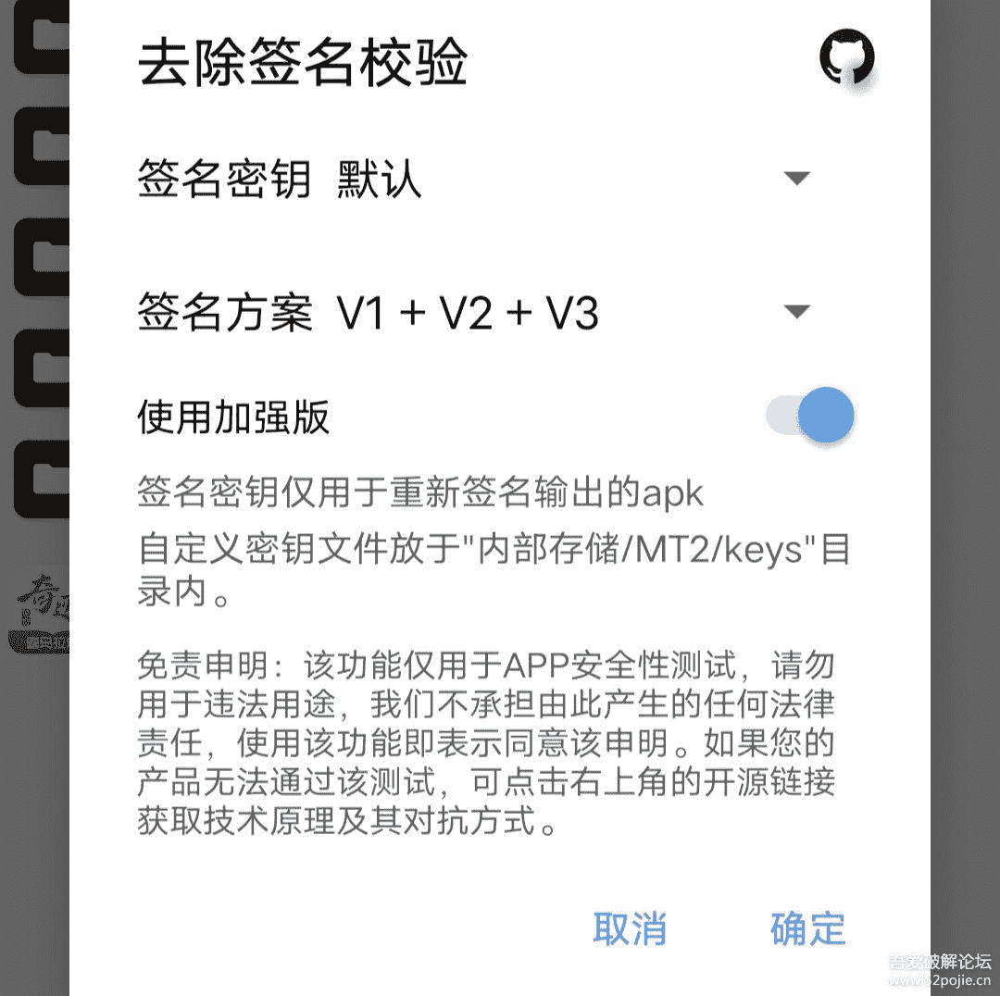

### 2. 打开我们界面分析的软件，我这里开发助手和界面分析结合起来分析
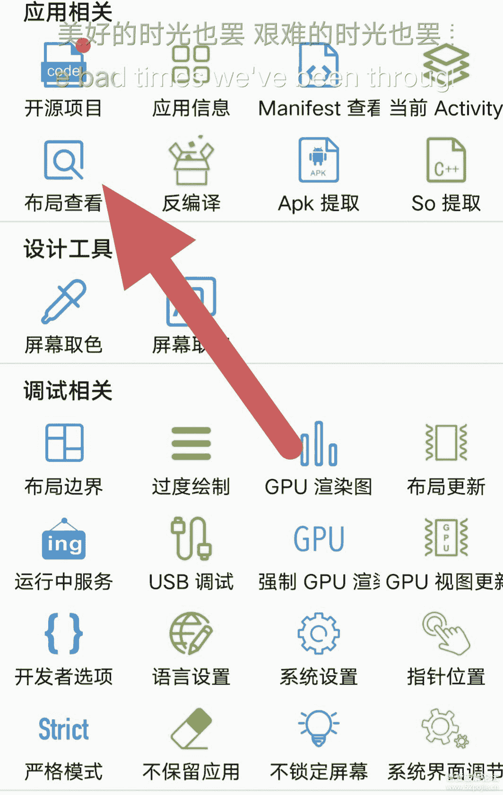

在此之前我怕有人不明白操作流程在这里先举一个例子
我们在获取到ID和ID name之后，打开安装包右上角三个点，点击后看到`xml`搜索，以下我们所有的资源ID都得勾选16进制
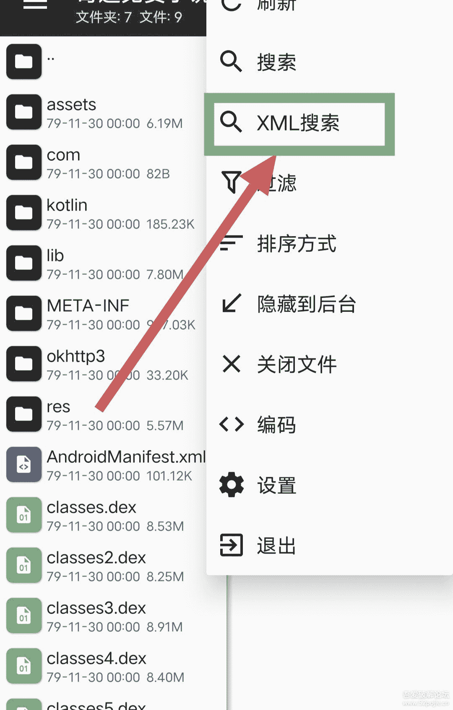
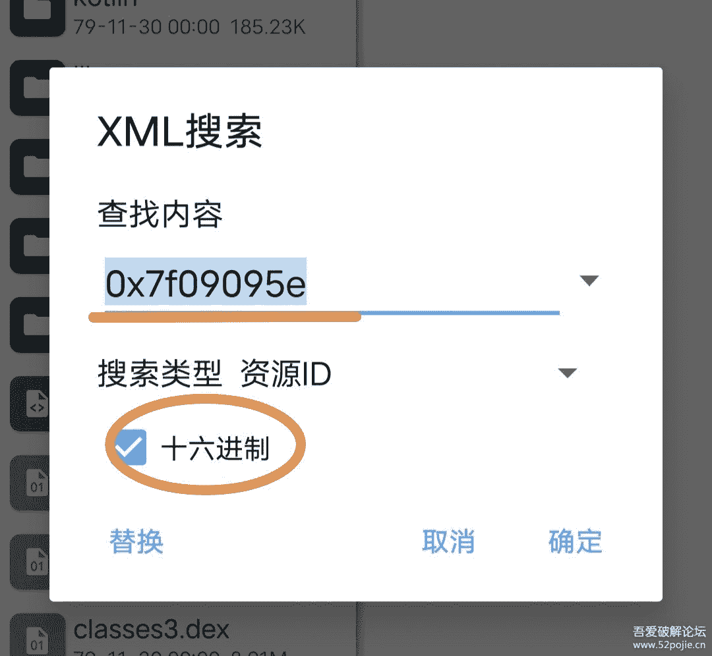

#### （1）去除首页签到和红包提示
`xml`搜索`0x7f09095e`然后会出现一个或多个文件【没有特别的情况`xml`文件都选第一个】
方法：文件内搜索`v_web_earn_read_package`然后找到`v_web_earn_read_package`下的`width`和`height`引号内的都改成`0dp`
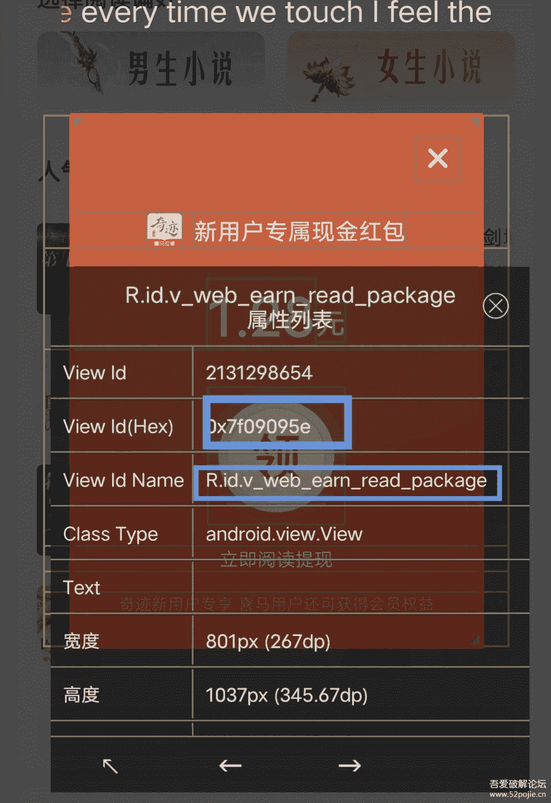
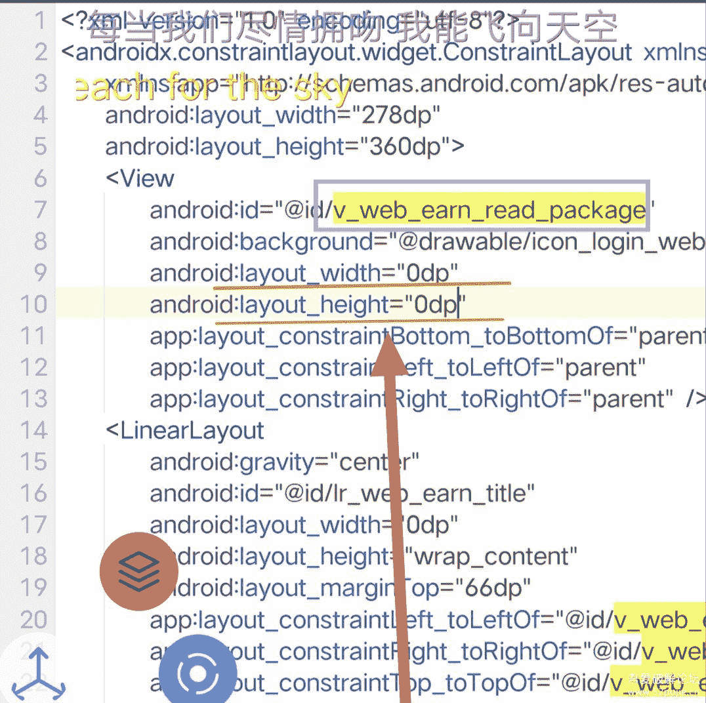

#### （2）去除首页右上角的福利标志
`xml`搜索`0x7f090473`选第一个进去
方法：文件内搜索`main_search_right_res_icon`长宽改成`0`
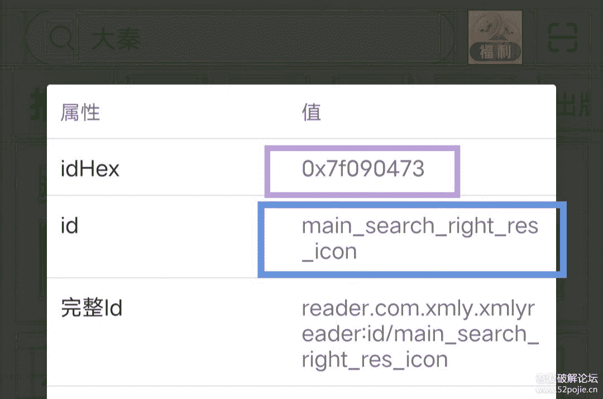

#### （3）去除阅读页面的红包标志和右上角的阅读倒计时
记录这两个资源 ID 然后分别`xml`搜索 ID ，看下图修改即可

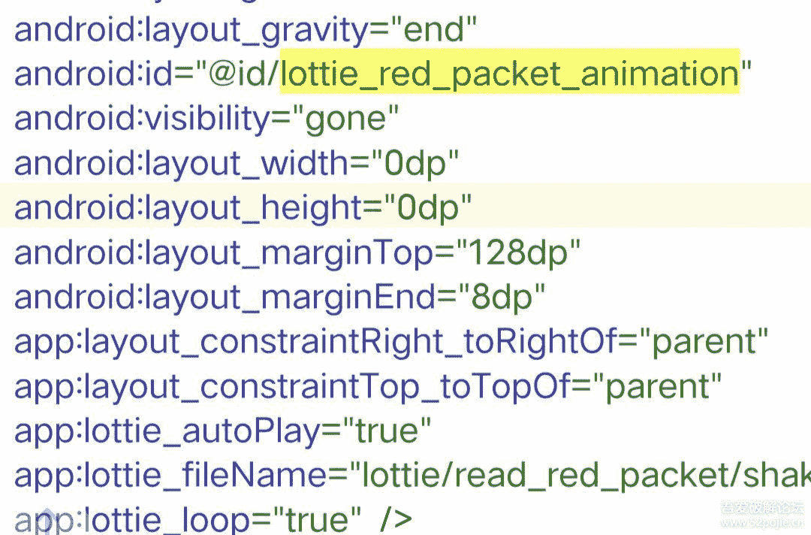
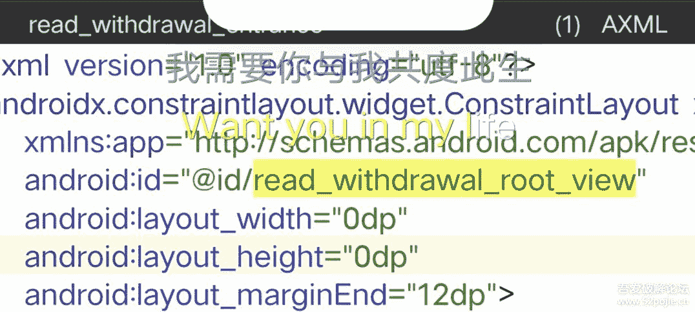

#### （4）去除书籍内的投票和红包提示
这个红包的需要改两次，都在同一个`xml`里，看下图。这个投票的也是一样的套路哈

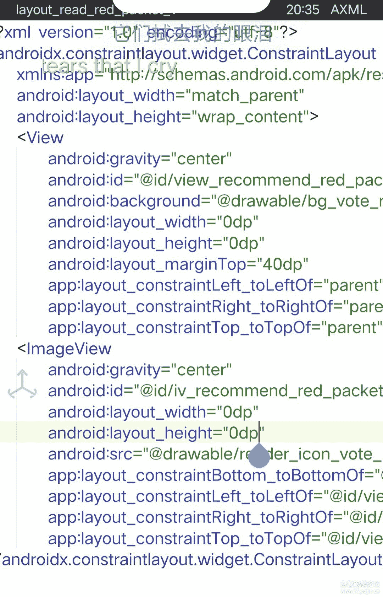

#### （5）去广告
打开`dex`文件，分别过滤 `qq.e` `com.getui` `com.igexin` `com.vivo` `com.xiaomi` `com.oppo` `com.huawei` 然后替换为`#`即可，最后保存修改
【不提供修改包，不要问】

## 效果图

