# [Android 分享] Apk反编译报错的7个解决方法

- 原帖: https://www.52pojie.cn/forum.php?mod=viewthread&tid=1951700
- 抓取时间: 2026-11-01T16:41:27.242Z

## 一、`Exception in thread "main" brut.androlib.AndrolibException: Multiple res specs: anim/abc_fade_in`

报错提示：多种资源规范。

同一个类型的资源里，有多个同名称的资源。比如`anim`类型的资源里，有2个名称都为`abc_fade_in`的资源，这就意味着`res/anim`目录下有2个`abc_fade_in.xml`文件，名称相同，`arsc`解析器无法处理这种情况。

用010 Editor查看文件的`ResTable_entry`，这是类型资源，其中`key`为类型的名称字符串`abc_fade_in`，`index`为类型字符串池的索引，看到有多个索引都为0。

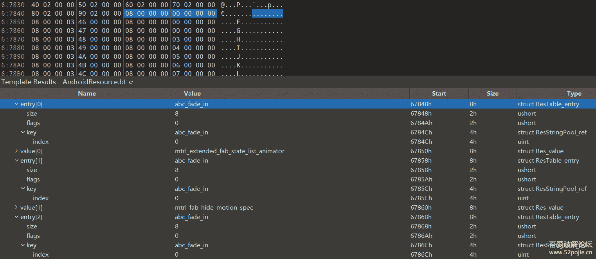

对应找到类型字符串池，索引为0的位置放着`anim`，所以这几个索引都指向`anim`，

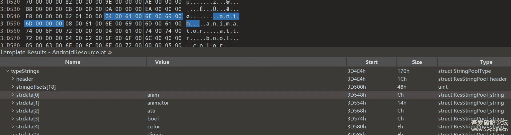

意味着有多个`anim`资源名称都为`abc_fade_in.xml`，按索引顺序修改回来即可反编译成功

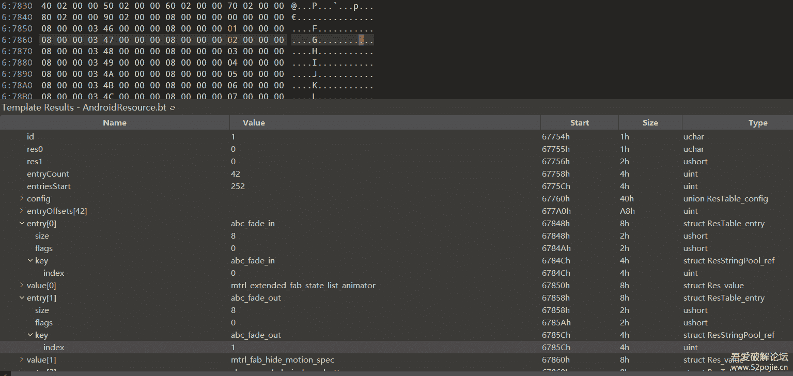

## 二、`Could not decode file, replacing by FALSE value: attr/abc_grow_fade_in_from_bottom`

报错提示：无法解码`anim/abc_grow_fade_in_from_bottom.xml`文件，用值`false`替代`abc_fade_in`这个值

查看文件，定位到名称字符串池处，发现名称字符串是`abc_grow_fade_in_from_bottom`没错，再定位到`ResTable_entry`类型资源处，查看发现有2个索引都指向2，类型字符串池索引为2的值为`attr`

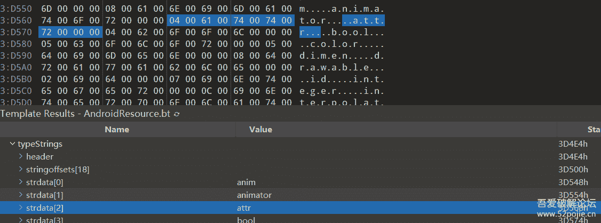

也就是第2个指向的值没法解析，因为不允许有相同的`id`，把第二项的索引改回1即可

## 三、`Exception in thread "main" brut.androlib.AndrolibException: Could not decode arsc file`

报错提示：无法解码`resource.arsc`文件，这个报错是比较早的，还没开始解析`arsc`文件内部，应该是`arsc`文件头部附近字段被修改过了，

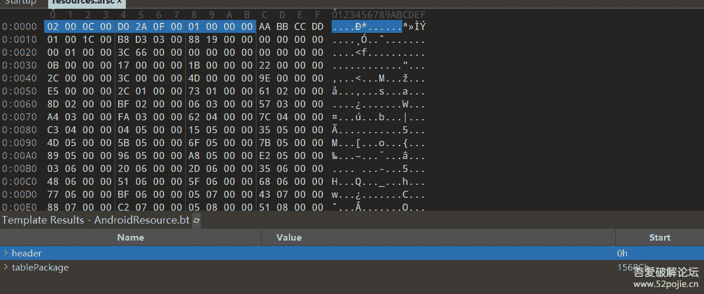

只解析了一部分，字符串池没有解析出来，格式被破坏了，看第2行的`01 00 1C 00`，这是正常字符串池的固定文件头标识，解析器通过这4个字节来判断字符串池从哪里开始读取，很明显`AA BB CC DD`是插入的混淆字节，删除即可反编译通过

## 四、`Exception in thread "main" brut.androlib.AndrolibException: Could not decode XML`

报错提示：无法解码`Androidmanifest.xml`文件，很早之前的防护，文件头字段被修改，

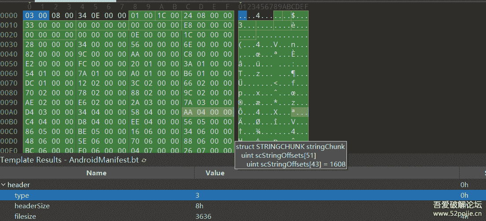

改回来`03 00`，解码成功

## 五、`Unknown chunk type at: (0x00000e38) skipping..`

这个提示相关的防护是截止目前为止依然可以作对抗的，而且对抗手段多样化的

### 1.基于`scStylePoolOffset`字段

报错提示：解析`Androidmanifest.xml`遇到未知的数据块类型，这个数据块位于文件的偏移位置`0x00000e38`处，该偏移处之后的数据块无法解析，准备跳过这个数据块解析文件，

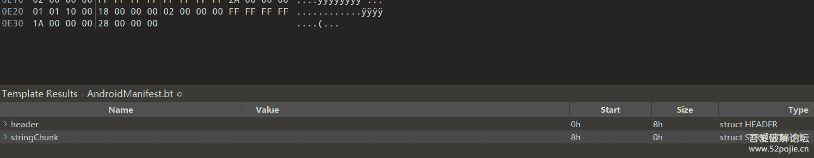

`e38`处是文件的结尾部分，可是只解析到了`stringChunk`出来了，说明这个字段被修改了，从字段头看起，发现`scStylePoolOffset`异常，正常应该是4个字节都为0，（ps：实际的分析过程要对文件格式非常熟练，又得算偏移，还得结合010 Editor报错信息，动态调试，写起来太麻烦，所以后面的定位过程都是写了基于哪个字段修改，分析过程省略一点）

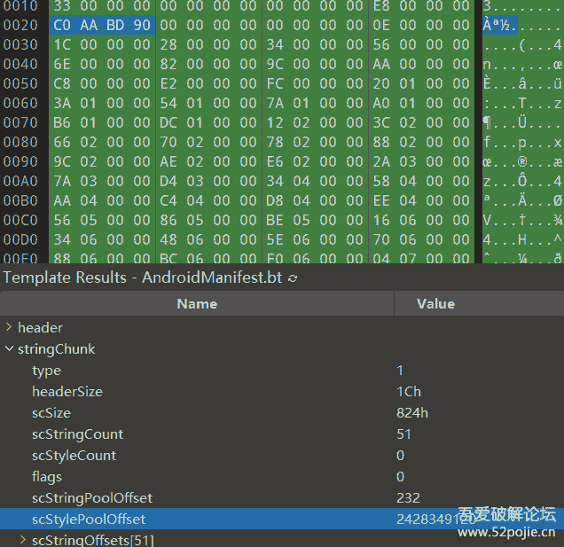

将`scStylePoolOffset`字段，4个字节全部改为`00`即可

### 2.基于`startTagChunk`字段

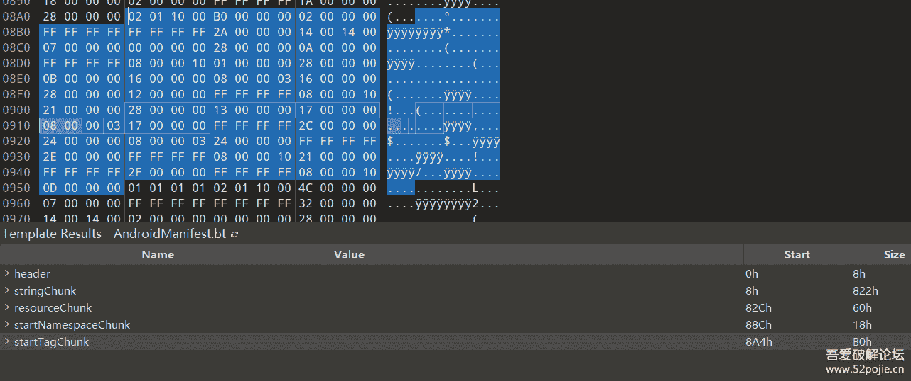

文件解析到`startTagChunk`，这个数据块是一块接一块的，正常后面应该紧跟着`02 01 10 00`字节的，可是看到中间明显隔了4个`01`字节，删除这4个字节即可编译通过

### 2.基于Apk的`frCompression`字段

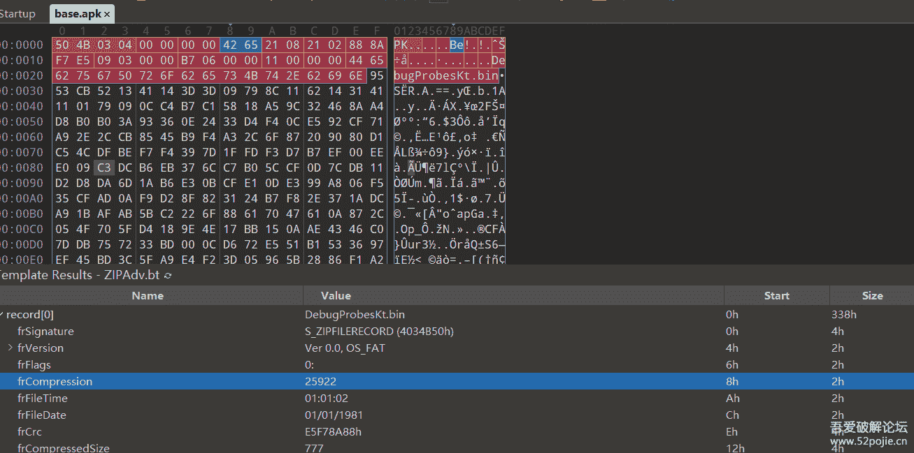

`frCompression`字段修改，也会报同样的错误，改回`08 00`即可

### 3.基于通用标记位

原理都是一样的，只要熟悉文件格式，都能[破解](https://www.52pojie.cn/)，就不放图了

### 4.基于磁盘编号

### 5.基于目录数的

其他字段也可以作防护，有不少

## 六、`W: Bad string block: string entry is at 240, past end at 240`

报错提示：解析到错误的字符串块，这个数据块位于文件的偏移位置240（转换为16进制是`0xf0`）处，这个位置以后（包括这个位置）的字符串无法解析，定位到`0xf0`的位置查看

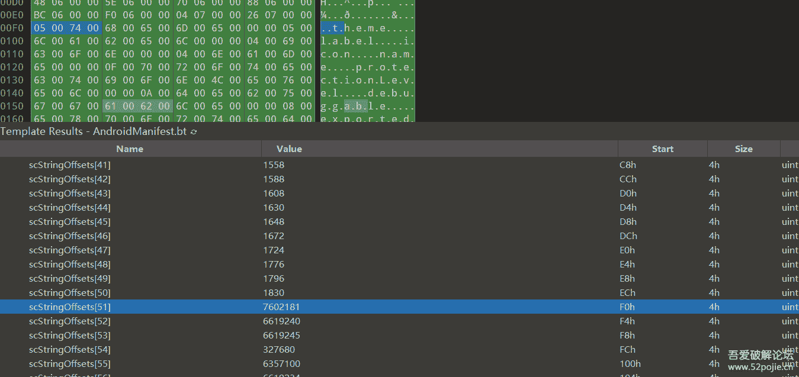

看到字符串的偏移值突然变得很大，比文件还长，肯定是有问题的，既然是从`0xf0`的位置，字符串解析出现异常，那正常的字符串偏移也就是到索引50的地方，字符串个数是51个才对，将`scStringCount`的值修改为51，

反编译通过

## 七、`Exception in thread "main" java.lang.ArrayIndexOutOfBoundsException: Index 20603 out of bounds for length 1980`

报错提示：`ArrayIndexOutOfBounds`线程出现异常，索引值20603超出长度1980的界限

基于`scStringOffsets`字段造成的，定位到报错处

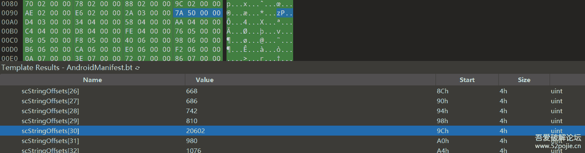

介于810和981之间得值，修改第2个字节`50`为`03`即可

## 总结

总结：上述有些对抗已经被修复，有些还存在，哪些字段可以修改做对抗，哪些字段不能，是基于Android源码和反编译工具之间的检测差异，所以APK层面的攻防会随着Android系统升级和不同Apk反编译工具原理的修改而改变。

