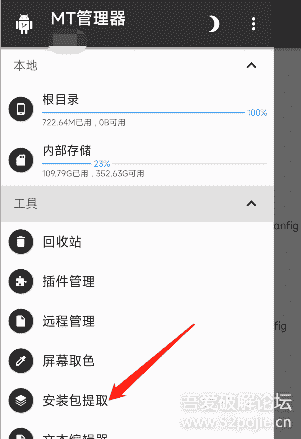
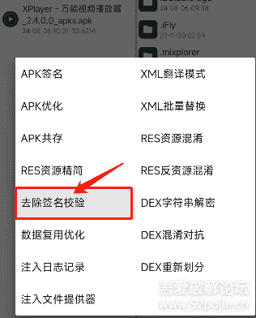
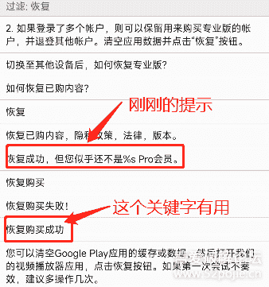
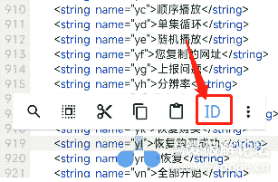
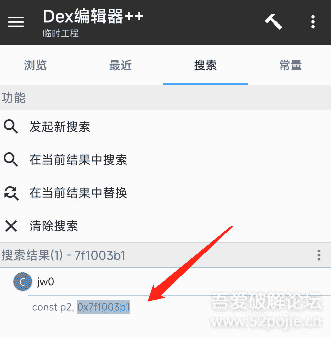
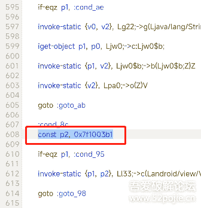
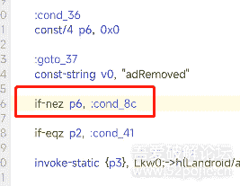
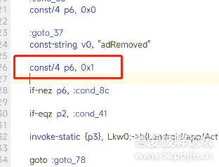
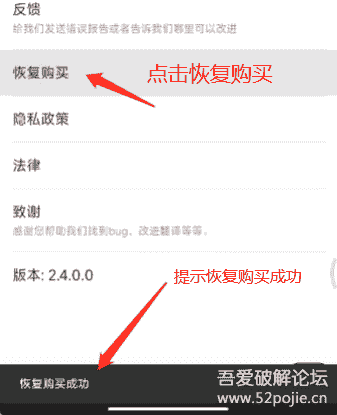

# [Android 原创] 安卓逆向之破解XPlayer-万能视频播放器

- 原帖: https://www.52pojie.cn/forum.php?mod=viewthread&tid=1951890
- 抓取时间: 2026-11-01T16:41:23.239Z

## 勿求成品，支持正版

只用于学习交流，如有侵权，请联系本人删除

### 一.Google商店下载万能视频播放器

万能视频播放器-XPlayer

### 二.打开APP找线索🔍

设置→通用中有一个恢复购买选项，点击后提示“恢复成功，但您似乎还不是XXXX会员”。

### 三.开始逆向操作

#### 1.打开MT管理器并提取安装包

#### 2.去除签名校验

#### 3.Arsc资源文件中搜索常量关键字

#### 4.看到有一个恢复购买成功的关键字，点进详情，点击复制字符串的ID值

#### 5.Dex编辑器++中搜索ID值并点击进入汇编区域

#### 6.分析逻辑

上方应该会有一个判断，符合某个条件跳转到“恢复购买成功”，否则跳转到“恢复购买失败”

#### 7.找到判断语句

- 长按`const p2,0x7f1003b1`上方的`:cond_8c`，跳转到调用处。

- 这里有一个判断，如果`P6`≠0则跳转到刚刚这个位置。

- 试着在判断语句上方将`p6`赋为非0的值并保存、编译

#### 8.打包安装后打开设置再次点击恢复购买，下方提示恢复购买成功😏

