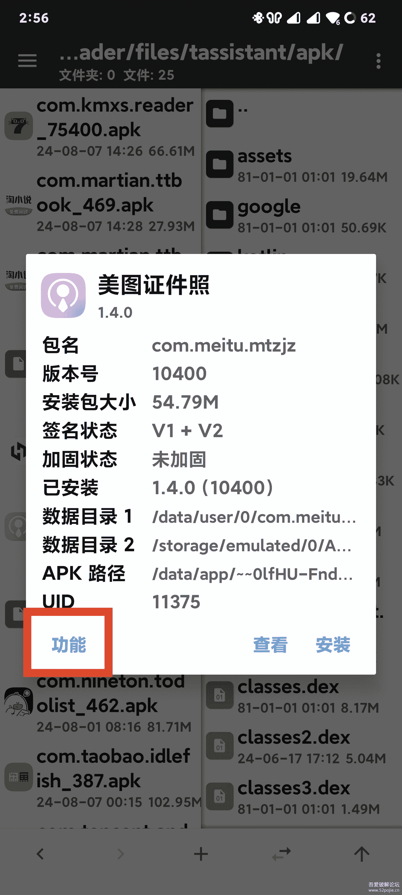
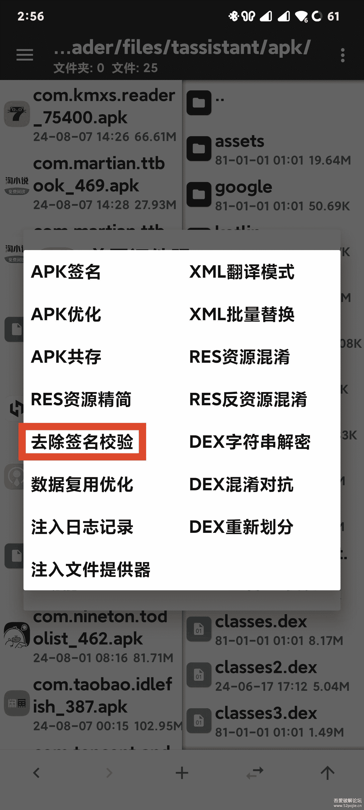
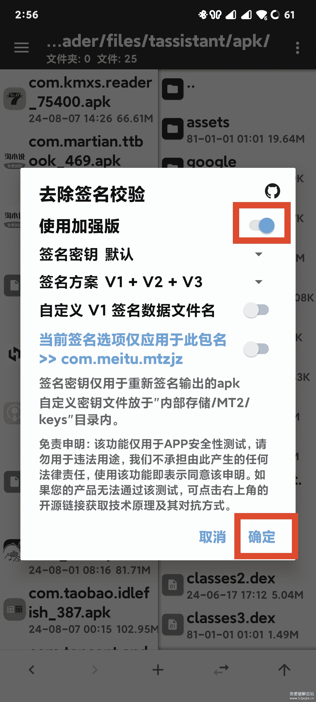
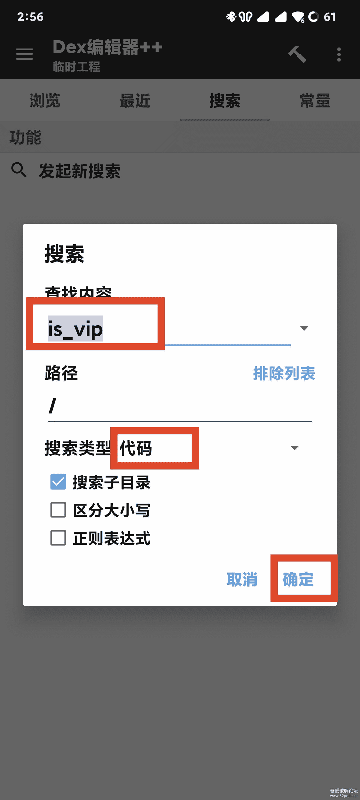
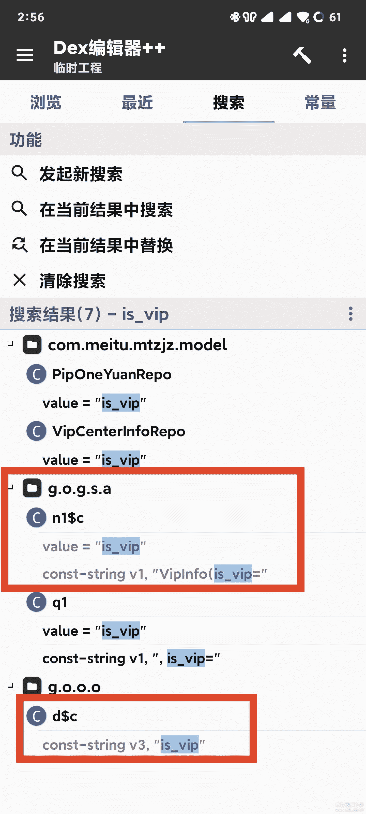
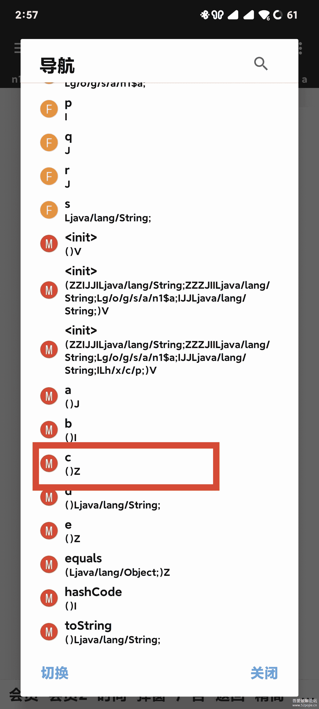
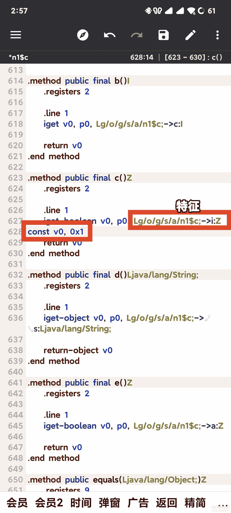
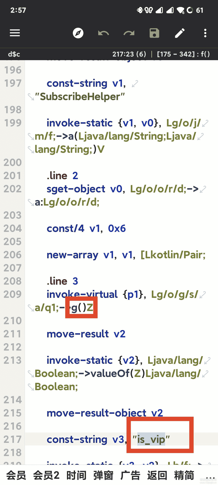
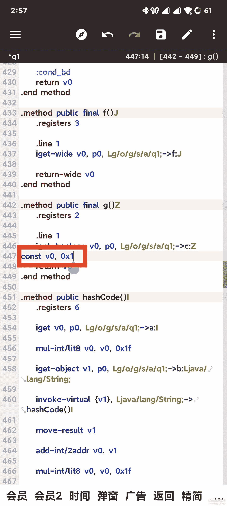

# [Android 分享] 美图证件照1.4.0教程

- 原帖: https://www.52pojie.cn/forum.php?mod=viewthread&tid=1952282
- 抓取时间: 2026-11-01T16:41:13.235Z

1.3.9还没有隐藏

1.4.0就隐藏了

## 教程开始

### 第一步过签

### 第二步搜索代码 `is_vip`

先进入以 `g.o.g` 开头的类名

然后进入指南针

找到下方小字为 `()Z` 的（有俩，选第一个）

赋值 `const v0 0x1`

返回进入以 `g.o.o` 开头的

上方 `()Z` 后缀的跳转

赋值 `const v0 0x1`

最后附上成功图

