# [Android 原创] 逆向分析uni-app伪装外挂诈骗套路

- 原帖: https://www.52pojie.cn/forum.php?mod=viewthread&tid=1952738
- 抓取时间: 2026-11-01T16:40:57.218Z

## 前言

声明：本文仅供学习交流使用，所涉及的APP破解版不提供下载渠道。所涉及的技术请勿用于非法活动，否则所带来的一切后果自负。

## 软件界面

该软件是伪装成一款棋牌外挂，需要找客服购买激活码进行激活，APP功能就是一个UI进行展示而已，没激活按钮默认是不可选中状态。

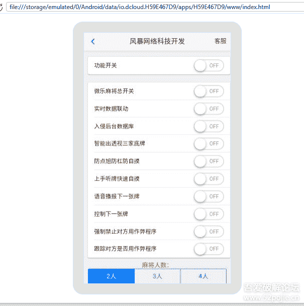

## 使用工具

● Goole Chrome / Mocrosoft Edge
● SimpleHook / 算法助手Pro
● 雷电模拟器
● HttpCanary

## 软件分析

数字加固，不影响分析，我们使用开发者工具动态调试

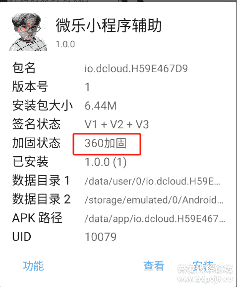

源码其实都在`assets/apps/{$ID}/www/`这个文件夹

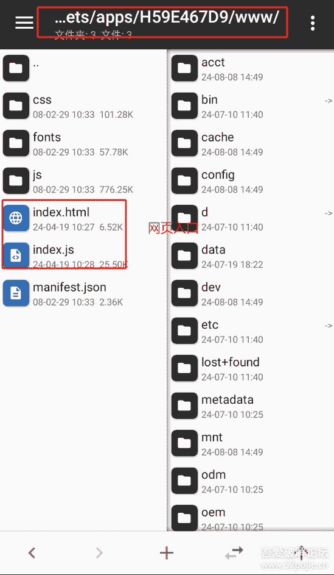

SimpleHook中打开WebViewDebug

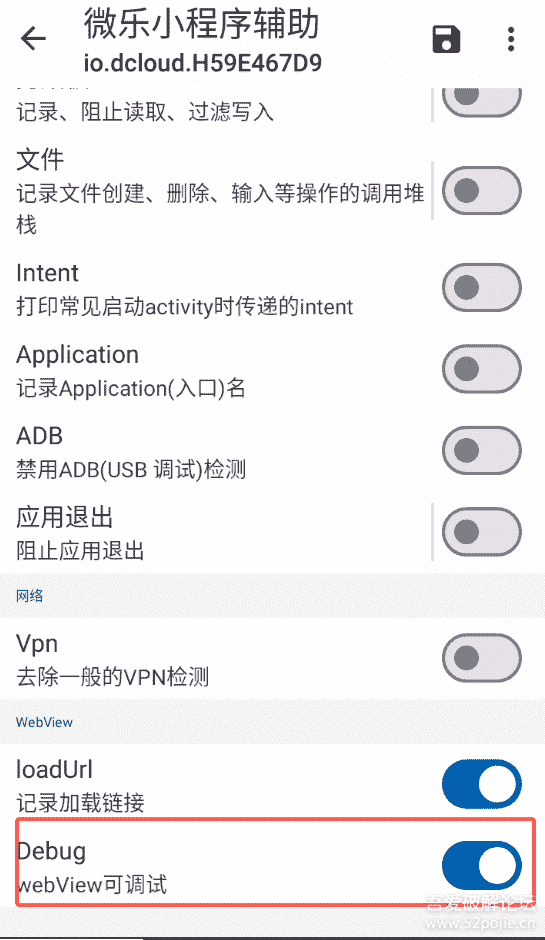

算法助手中打开WebViewDebug

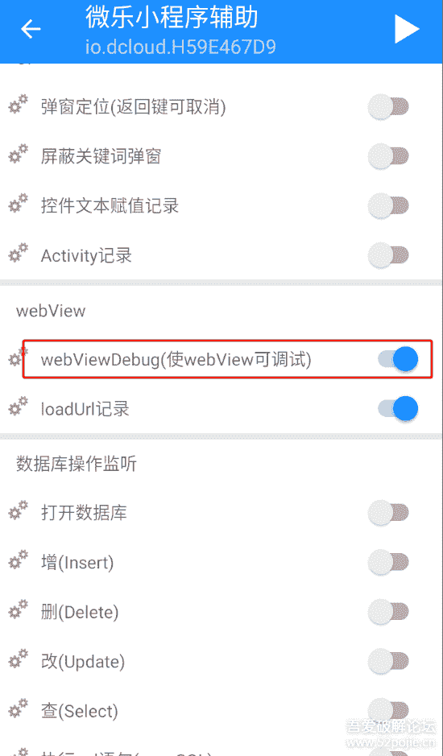

浏览器动态调试，搜索框输入

Chrome：`chrome://inspect/#devices`

Edge：`edge://inspect/#devices`

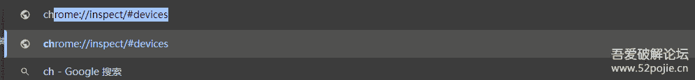

开发者模式adb连接模拟器

`adb connect 127.0.0.1:7555`

每个模拟器使用的默认端口不一样，Android11以及以下版本是默认5555端口号

以后版本是随机6位数端口号，但是这个是可以在编译系统镜像时就修改的，不细说。

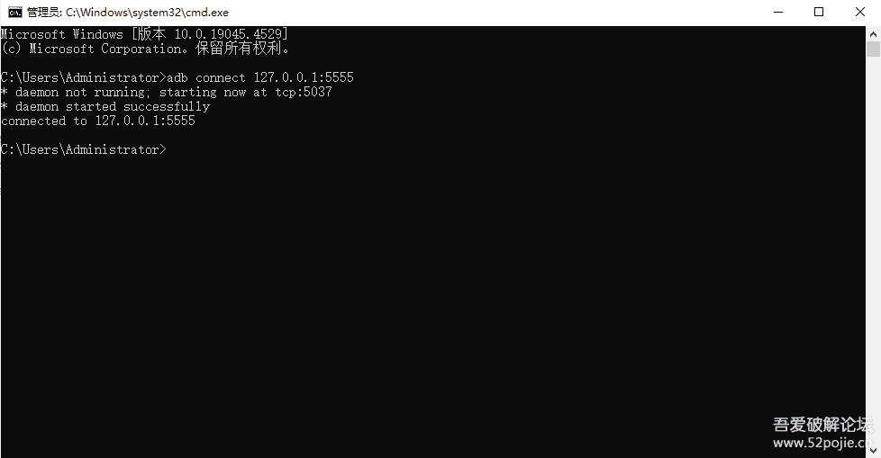

连接成功即可看到正在运行的uni-app，无法访问到资源，需使用梯子，被墙拦截

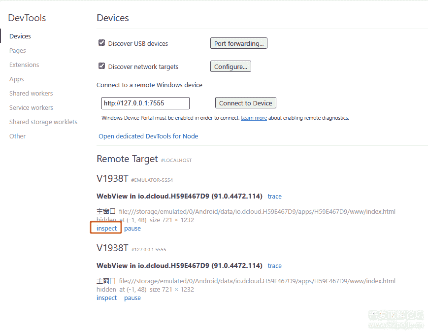

直接连接会无法访问到资源，也有可能是因为本地浏览器使用的WebVeiw版本小于uni-app使用的版本

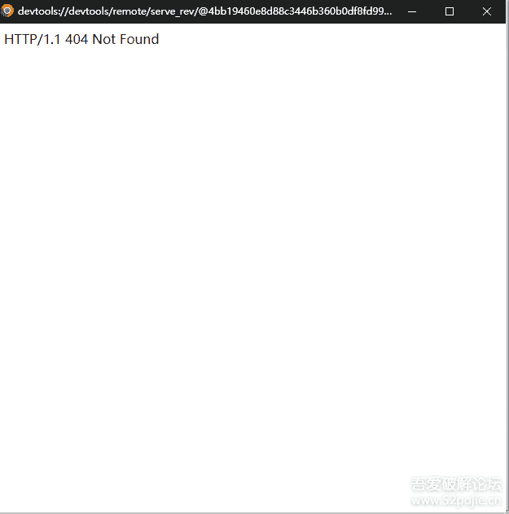

正确连接后即可显示

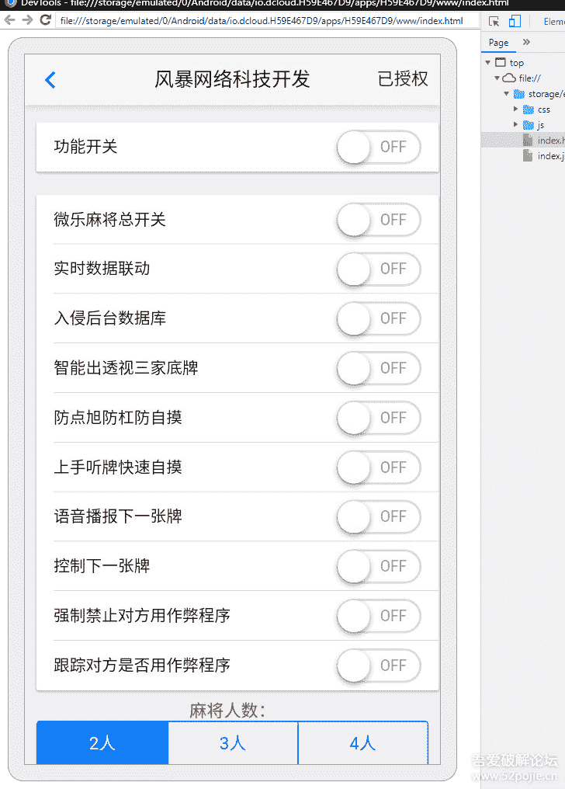

使用Devtools Source下分析源码

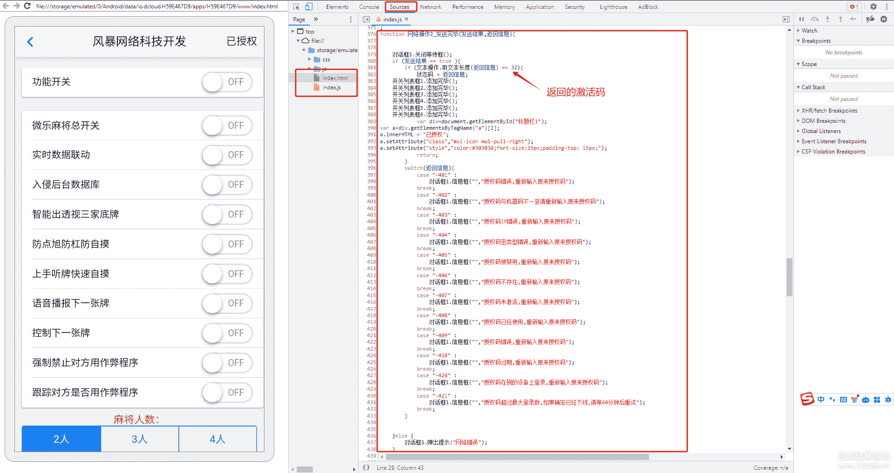

而破解可以直接修改如下，发送成功就授权

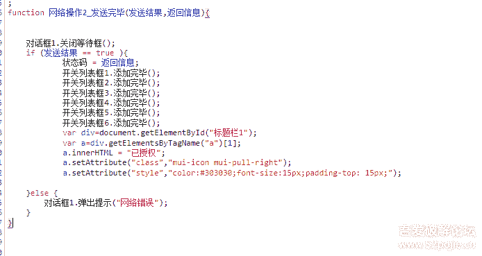

直接修改动态调试源码，此方法不会同步到实际源码中

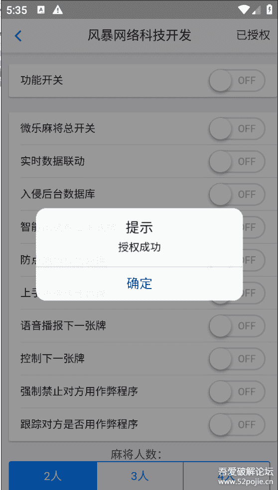

配合HttpCanary注入修改响应体为长度32的字符串

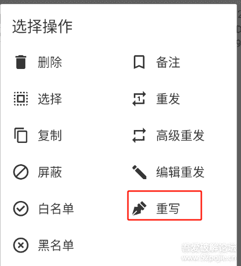

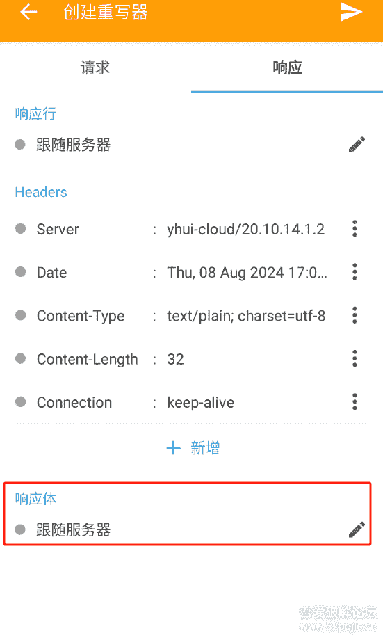

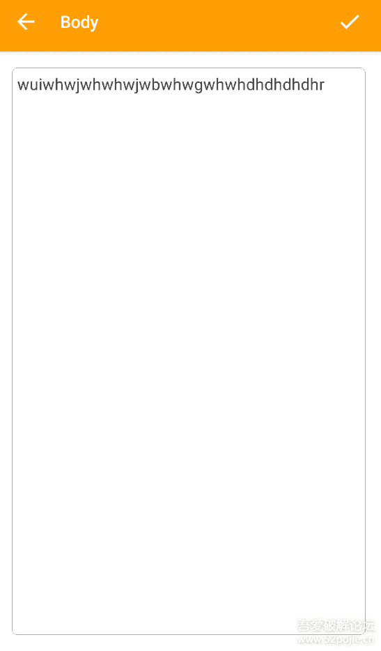

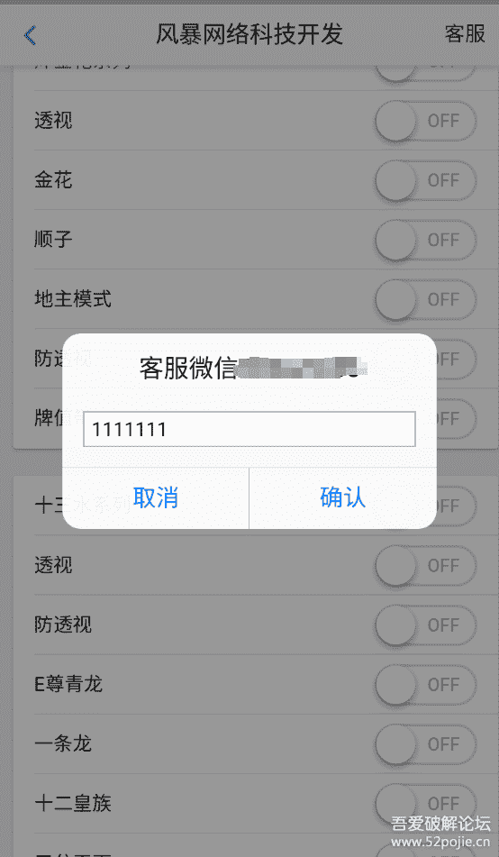

授权成功可以直接点击

点击开始加载后显示修改成功

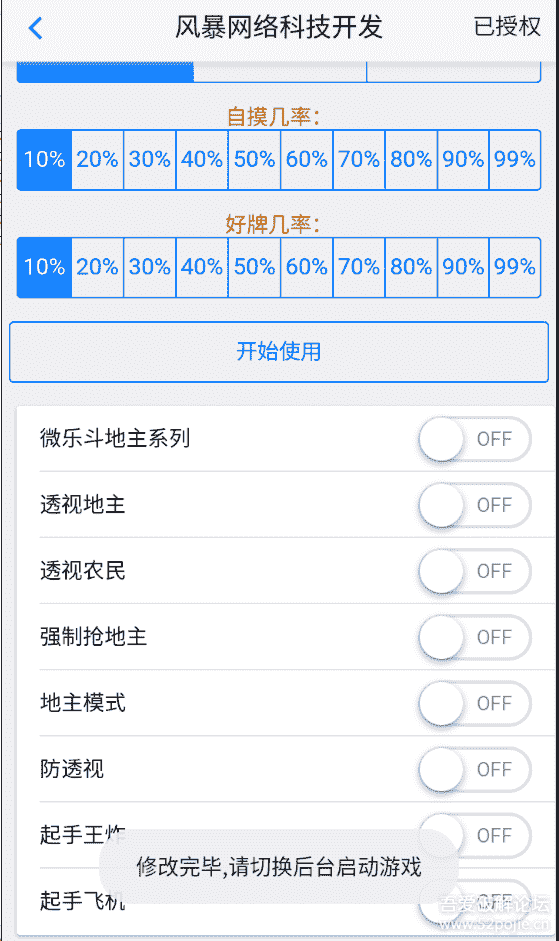

判断基本逻辑就在这里，点击开始就显示个UI效果，Root权限也没获取，内存也没注入，它拿什么去透视。

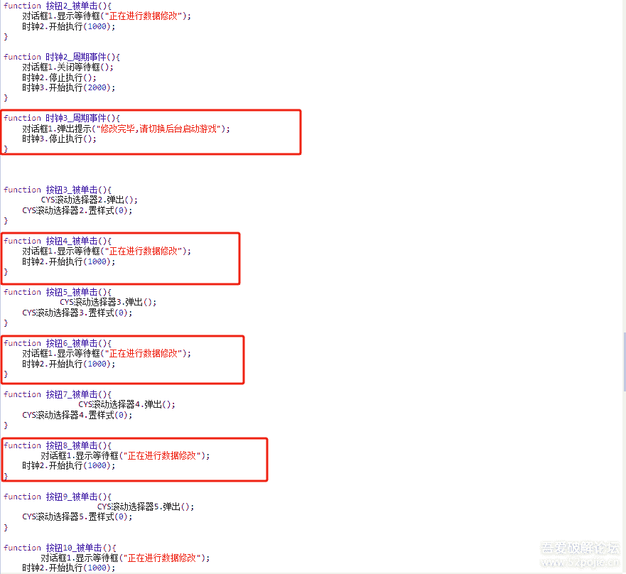
