# [Android 原创] 弱网APP-实战修复某邦加固去除Arm弹窗

- 原帖：https://www.52pojie.cn/forum.php?mod=viewthread&tid=1953144
- 抓取时间：2026-11-01T16:31:57.861Z

## 前言

声明：本文仅供学习交流使用，所涉及的APP破解版不提供下载渠道。所涉及的技术请勿用于非法活动，否则所带来的一切后果自负。

## 使用工具

- [练手包](https://www.123pan.com/s/y2B0Vv-6I7W3)
- MT管理器
- NP管理器
- 脱壳机

## 下载地址

## 软件界面

打开软件就是经典的arm弹窗

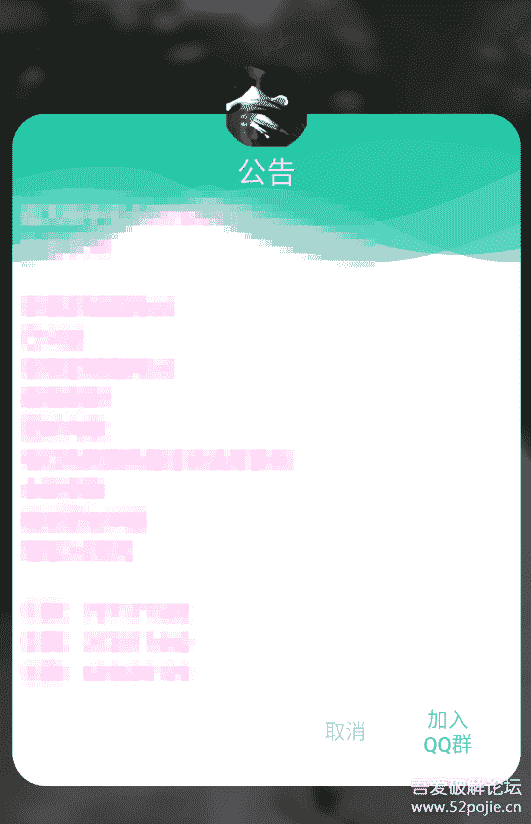

## 脱壳修复

### 脱壳

脱壳就不细说了，还是很容易的，脱壳机网上一抓一大把

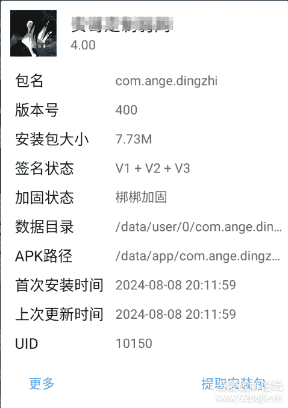

### 修复dex

全选脱壳后的dex

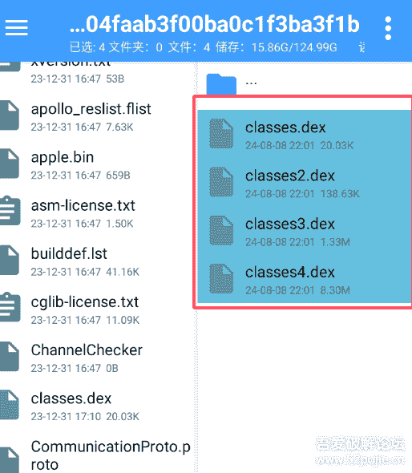

选择修复

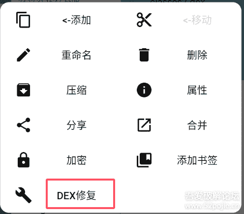

修复下头部就可以，MT管理器也可以修复

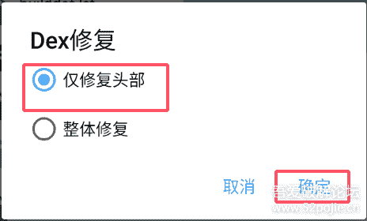

### 添加dex到apk

需套把修复后的dex添加到apk中

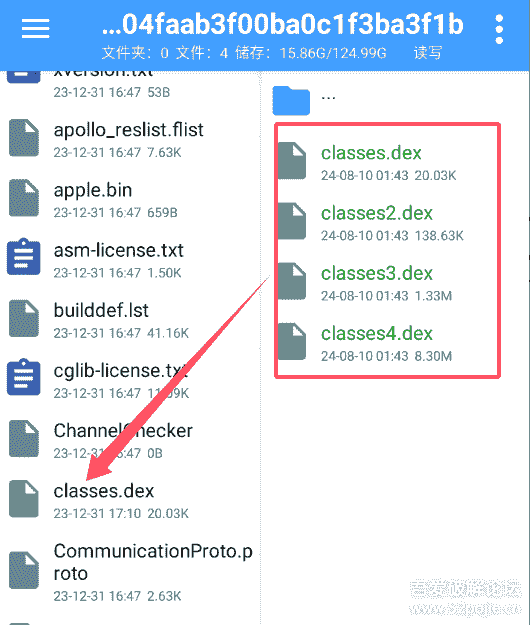

已将修复后的dex添加到apk中

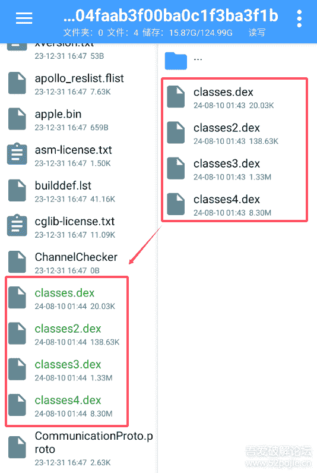

### 替换原入口

代码中搜索`APPNAME`

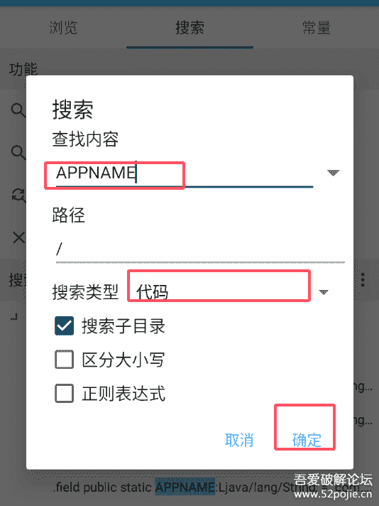

找到类`H`

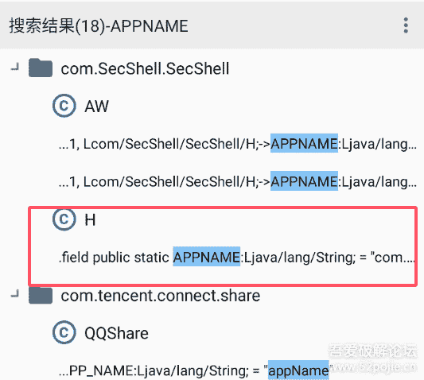

`com.tencent.qnet.global.QnetApplication`就是原入口`Application`实例

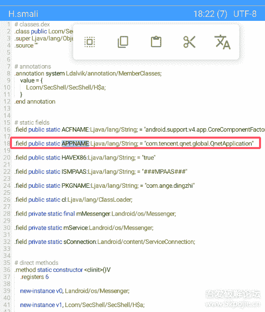

找到`AndroidManifest.xml`文件

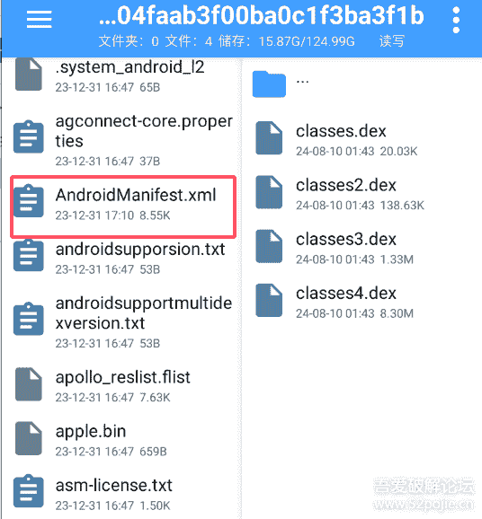

查找`application`节点`android:name="入口Application"`

删除加固特征`android:appComponentFactory`

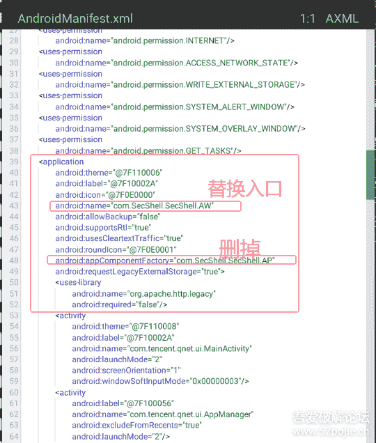

替换为原来的入口

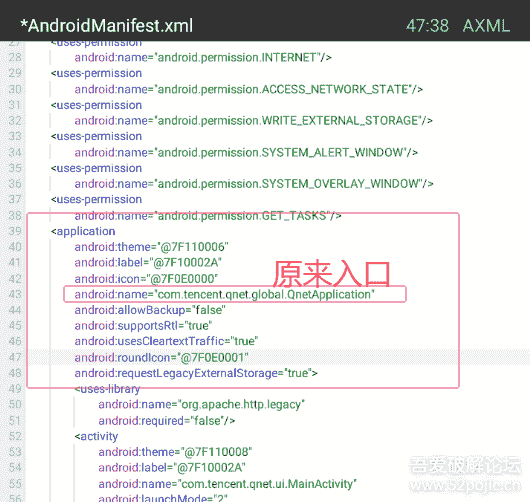

### 删除加固残留特征文件

删除后就没有arm弹窗了

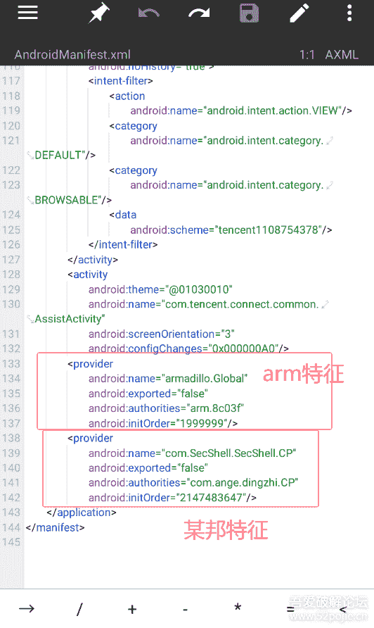

删除`assets`目录下`meta-data`文件夹和`classes0.jar`加固特征文件

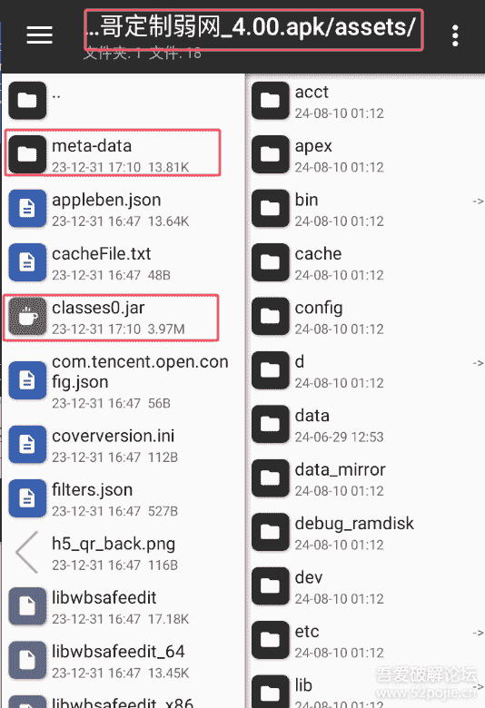

依次在所有的`lib`子目录下查找加固特征并删除

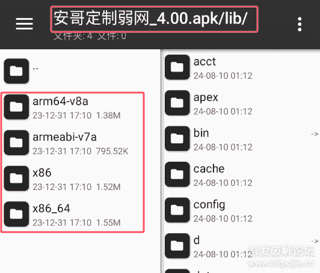

删除`libSecShell.so`

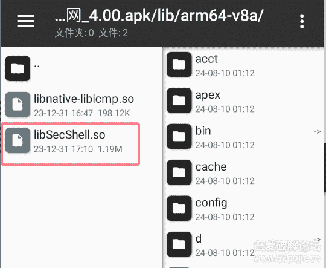

### 签名apk

签名apk，不签名无法安装

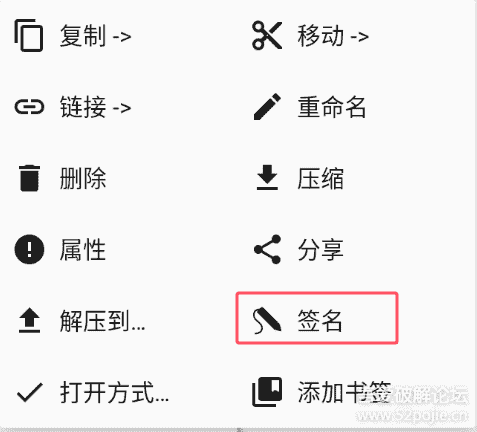

去除加固完成了，不显示加固

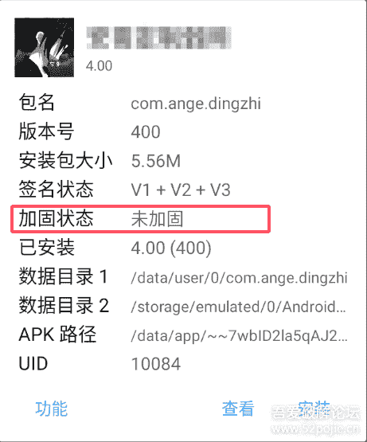

### 安装验证脱修成功

打开后就只有原来app的弹窗了

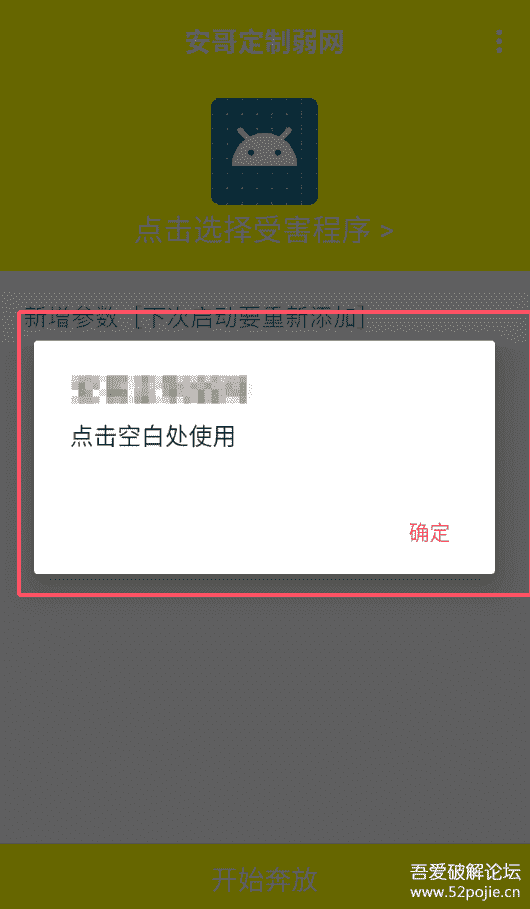

到这一步基本已经完成arm类弹窗的破解，以下为拓展知识

## 去除原APP弹窗

回到dex中搜索`MainActivity`，然后转Java代码分析找到如下两个弹窗：

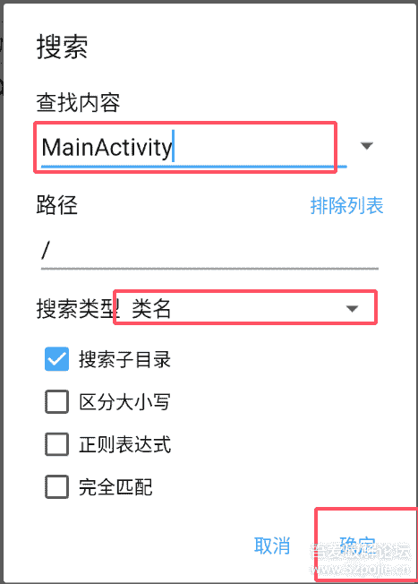

### 更新类弹窗

`showCheckVersionDialog`平常强制版本更新

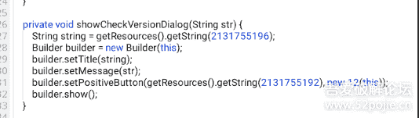

### 公告弹窗

`showNormalDialog`

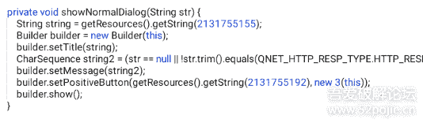

### 导航查找定位方法

导航搜索`show`

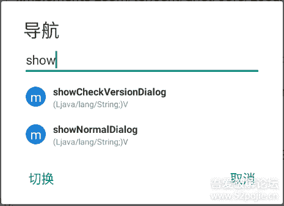

### 删除show调用

删除`builder.show`方法的调用

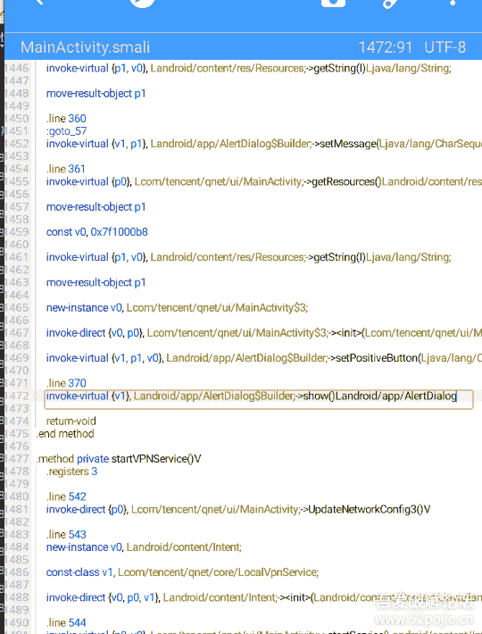

删除`builder.show`方法的调用

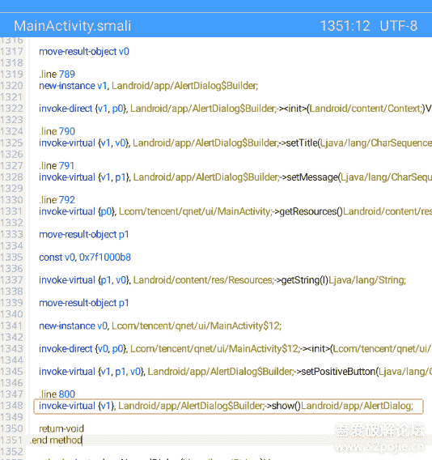

重新反编译验证下修改结果，`show`方法没有了

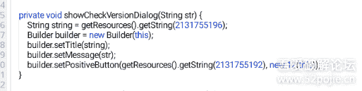

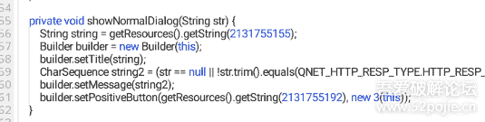

### 保存代码

保存修改后的代码，签名apk文件

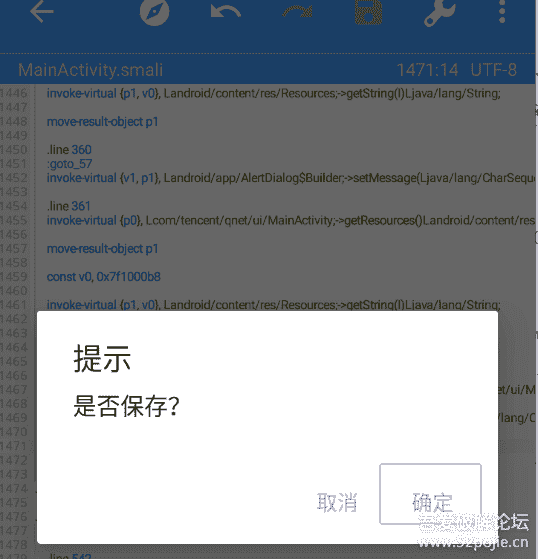

### 验证弹窗

安装打开就没有弹窗了

