# [Android 原创] 实战教学-某APP 反Root环境检测

- 原帖: https://www.52pojie.cn/forum.php?mod=viewthread&tid=1953146
- 抓取时间: 2026-11-01T16:40:47.212Z

## 前言

声明：本文仅供学习交流使用，所涉及的APP破解版不提供下载渠道。所涉及的技术请勿用于非法活动，否则所带来的一切后果自负。

## 使用工具

● `NP管理器`

## 开始实战

打开APP就有环境检测


管理器打开受害者


查看apk信息

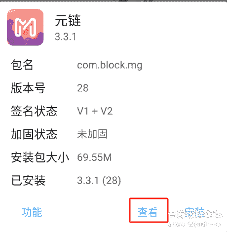

选择`resources`文件

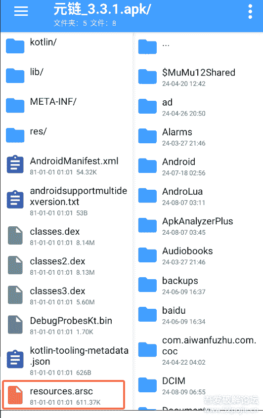

`Arsc`编辑

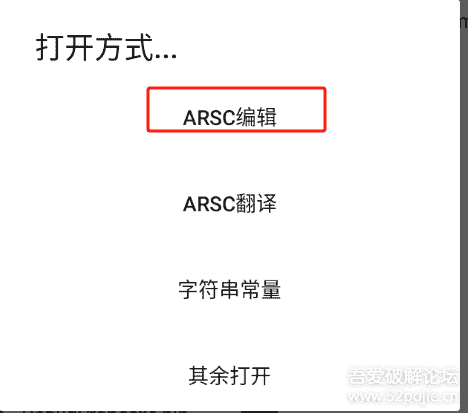

常量搜索

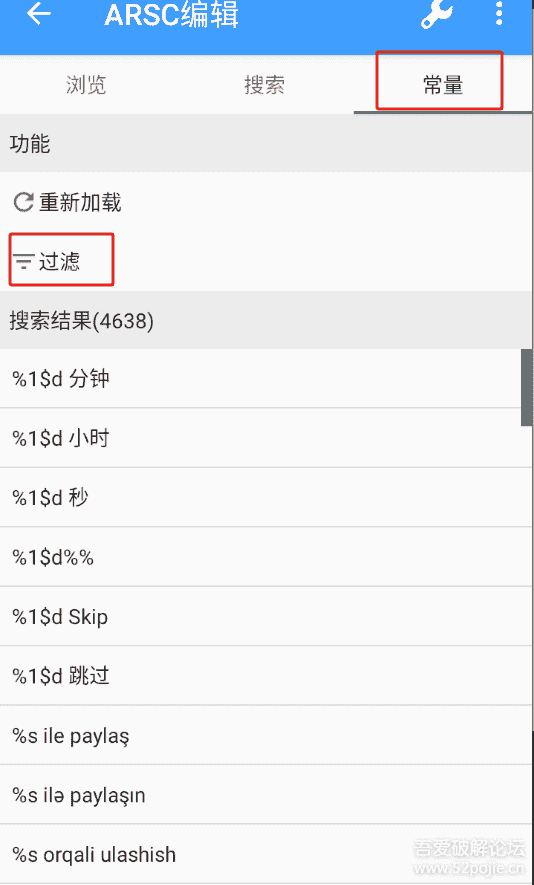

搜索“环境”

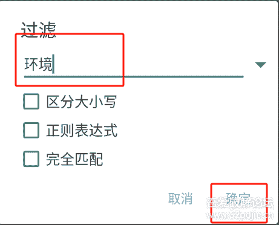

搜索结果，后面发现是`flutter`和原生Android混合开发


复制`toast_app_fail`

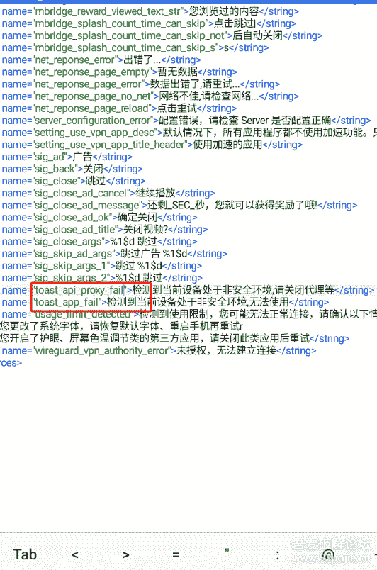

返回`resource`搜索代码`toast_app_fail`

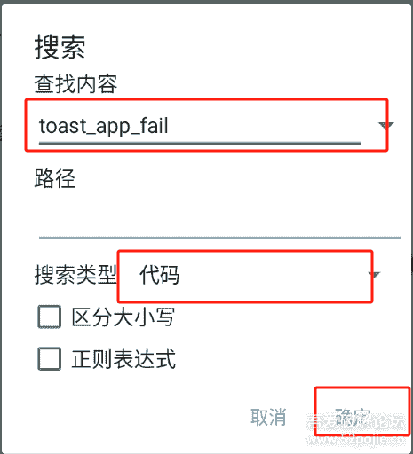

搜索到`0x7f0f00d7`

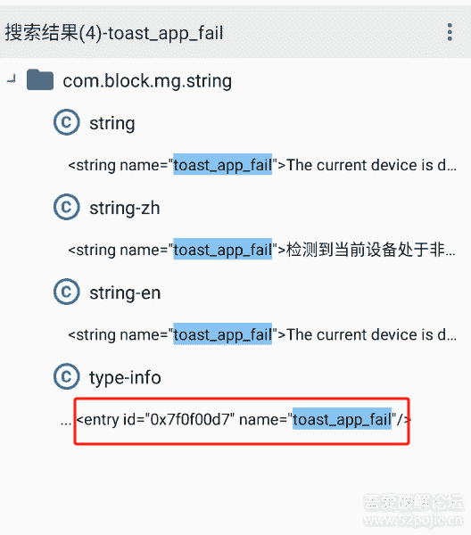

返回`dex`

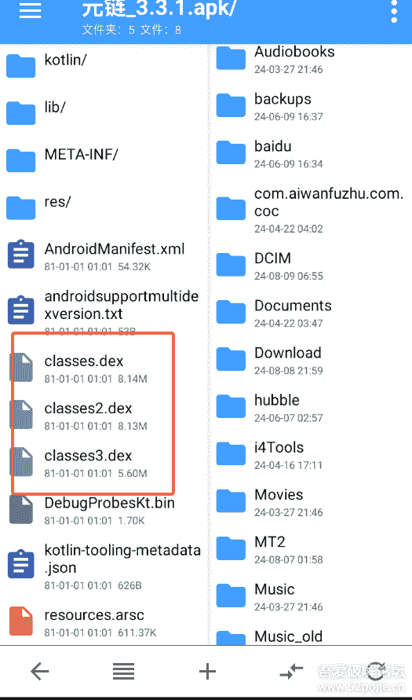

`dex++`编辑

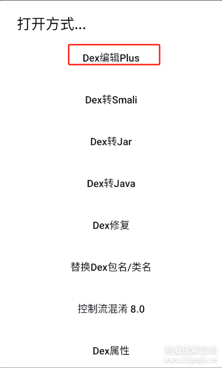

全选`dex`

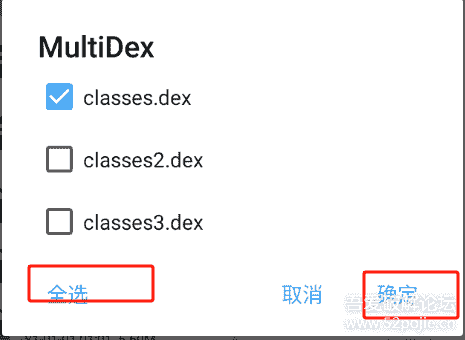

搜索十六进制`0x7f0f00d7`

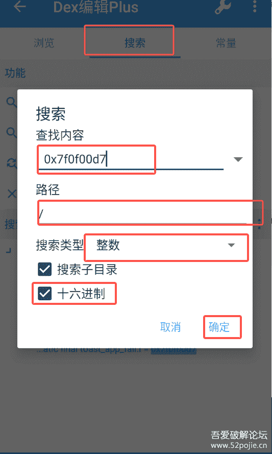

搜到结果`0x7f0f00d7`的使用

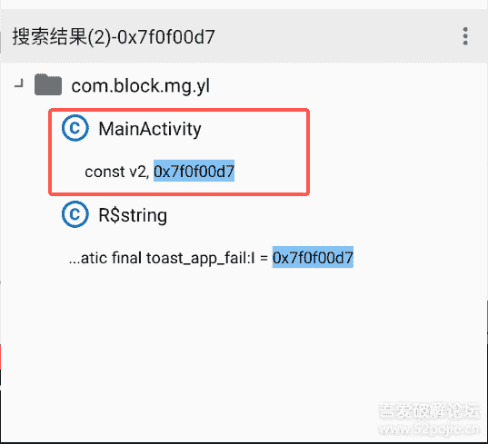

进入`MainActivity`并定位到`g()`方法

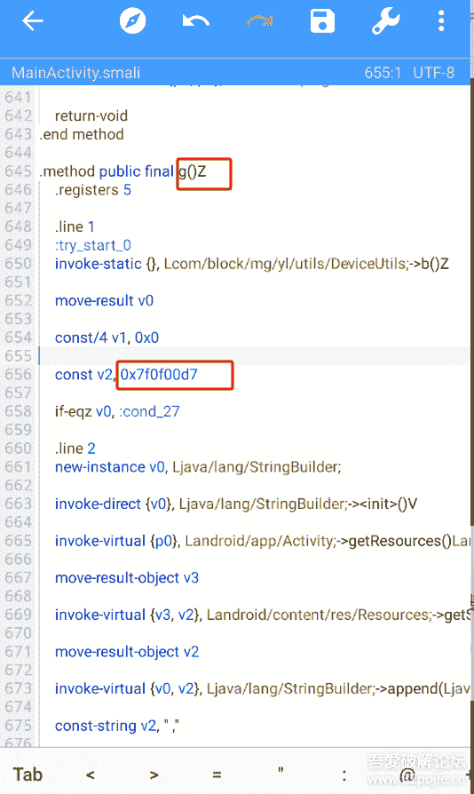

反编译为Java代码分析逻辑

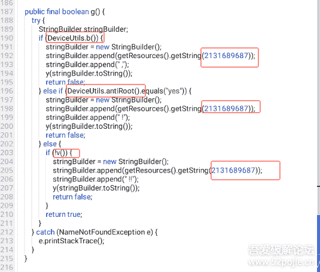

```
public final boolean v() {
//该方法检测签名信息
PackageManager packageManager = getPackageManager();
m.d(packageManager, "this.packageManager");
Signature[] signatureArr = packageManager.getPackageInfo(getPackageName(), 64).signatures;
m.d(signatureArr, "packageInfo.signatures");
return signatureArr[zxsq-anti-bbcode-0].hashCode() == 574540939;
}
```

搜索类`DeviceUtils`

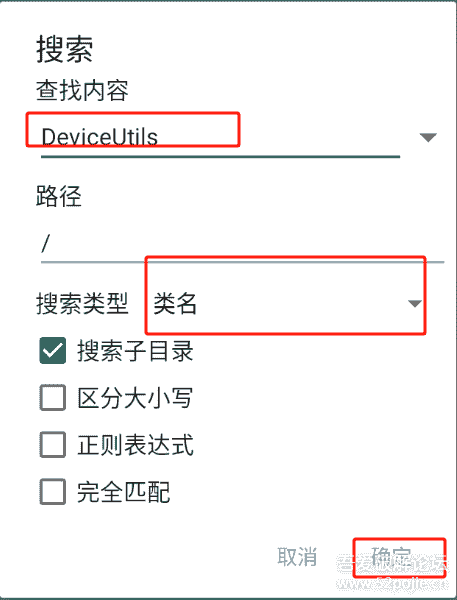

搜索到`DeviceUtils`

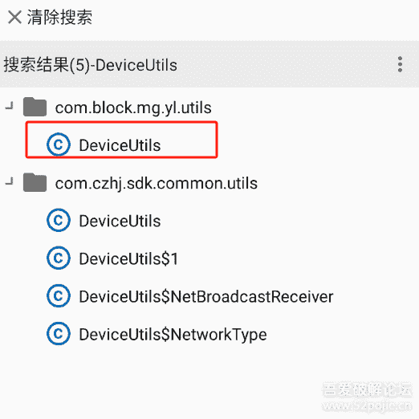

反编译`DeviceUtils`类代码，`b()`方法检测文件中是否存在Root，`antiToot`是个`native`方法，调用`so`库

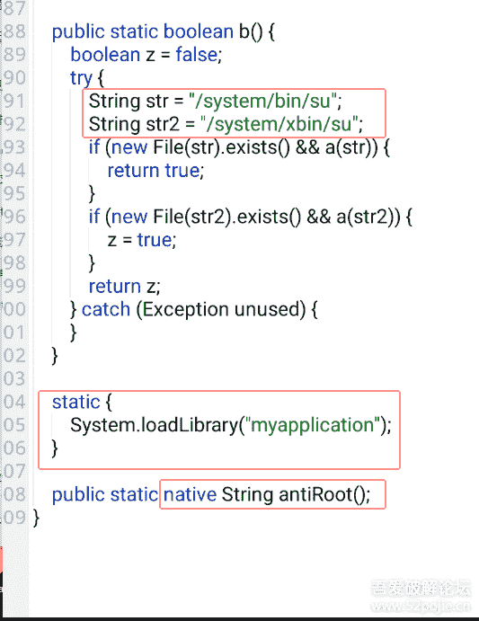

依次搜索方法查看调用处是否只有一处

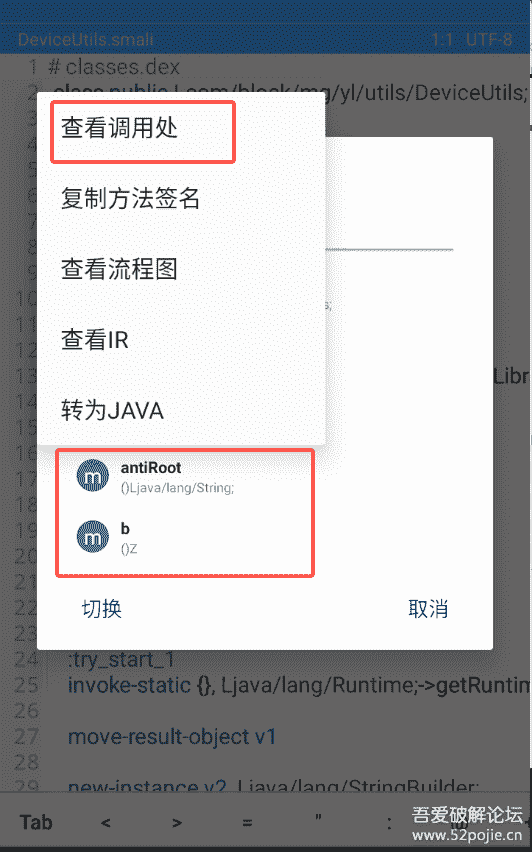

确认`DeviceUtils`的两个方法只有`MainActivity`一处调用

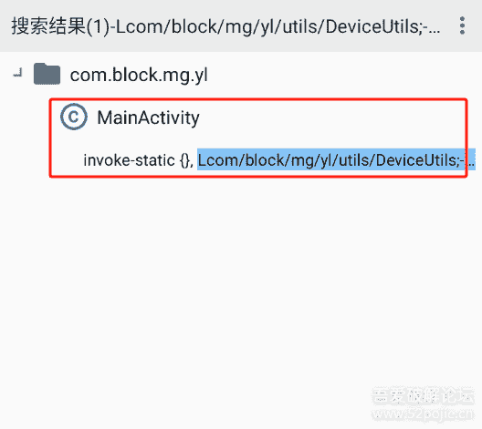

回到`MainActivity`分析，所有`return false`都调用`v1`寄存器，所以将`v1`寄存器的值修改为`true`，即`const v1, 0x1`

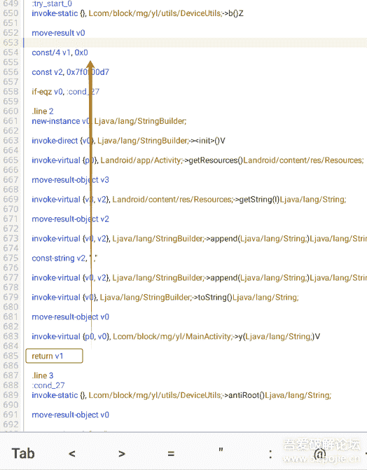

保存代码

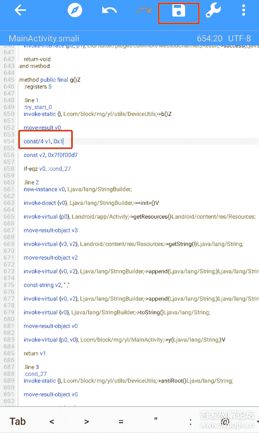

反编译回Java可以验证修改结果

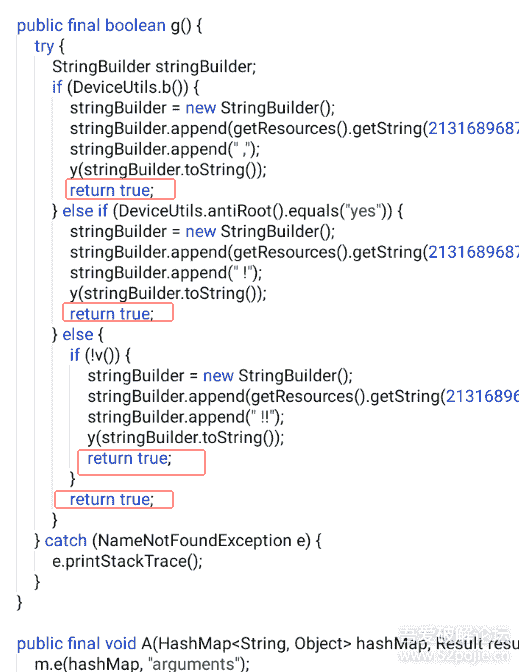

退出修改并保存代码

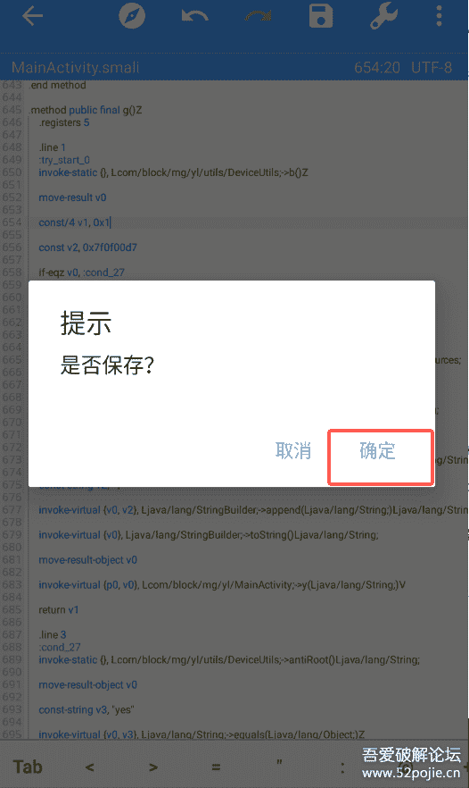

保存并编译文件


打开功能

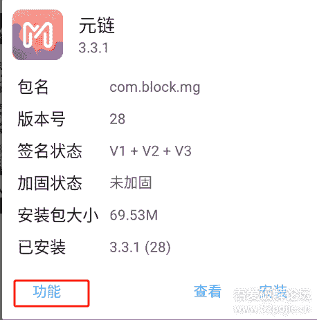

使用APK签名

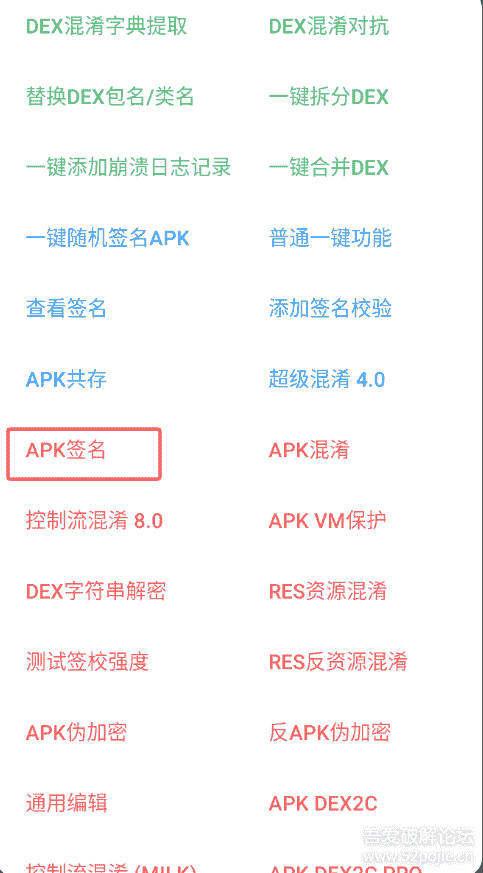

签名并重新安装APK

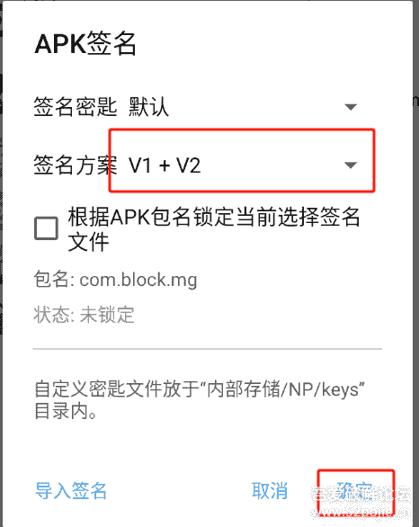

修改完成可以打开

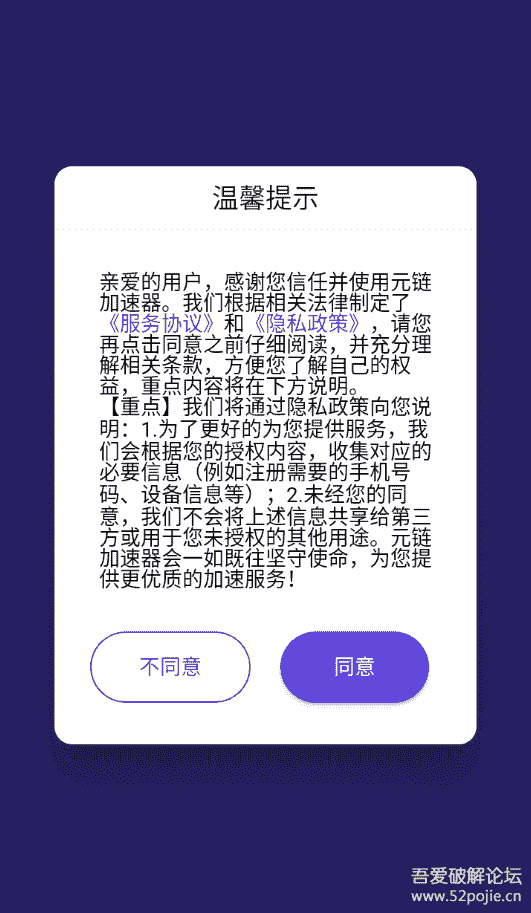
