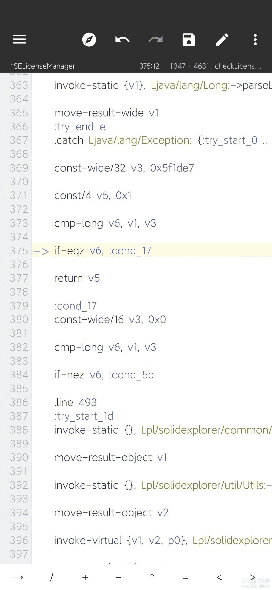
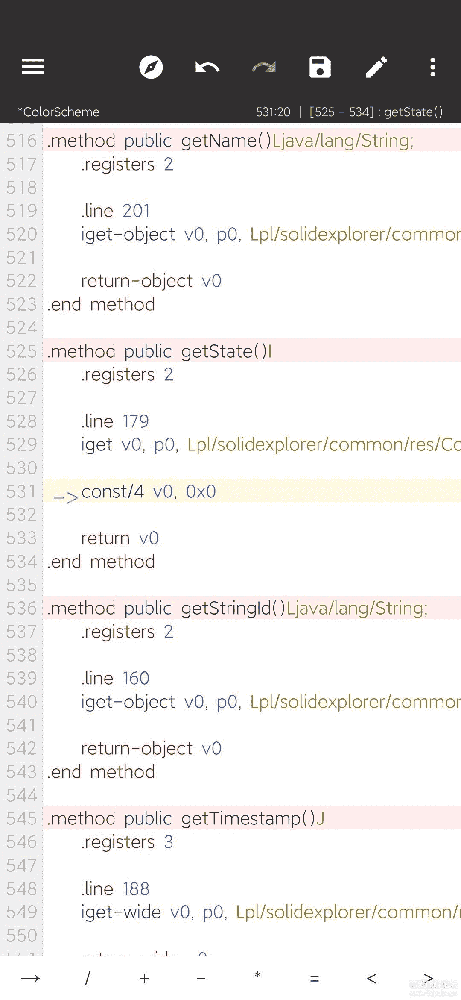

# [Android 原创] Solid Explorer 会员解锁

- 原帖: https://www.52pojie.cn/forum.php?mod=viewthread&tid=1955166
- 抓取时间: 2026-11-01T16:40:23.197Z

mt论坛发布相同内容的也是我, 不完全是原创, 这个方法是来自mt论坛, 但是最新版本`checkLicenseOnBackend`方法变了, 原来的方法用不了了, 更新一下, `getState`方法还是原来的方法

类: `pl.solidexplorer.licensing.SELicenseManager`

方法: `checkLicenseOnBackend`

`if-nez v6, :cond_17` 改为 `if-eqz v6, :cond_17`

类: `pl.solidexplorer.common.res.ColorScheme`

方法: `getState`

`v0`, 赋值0 (`const/4 v0, 0x0`)

