# [Android 原创] Fake Location 1.3.2.2专业版破解分析

- 原帖: https://www.52pojie.cn/forum.php?mod=viewthread&tid=1955462
- 抓取时间: 2026-11-01T23:59:39

## 前言

app：Fake Location 1.3.2.2（[//" target="_blank" rel="noopener noreferrer nofollow"](http://:rel="nofollow noopener" href="http)）
工具：`jadx`、`burp`、`frida`、`pycharm`、`ida`、雷电模拟器、算法助手
方法：hook相关代码
难点：加壳、代码混淆、双向证书校验、so层加解密

### app界面

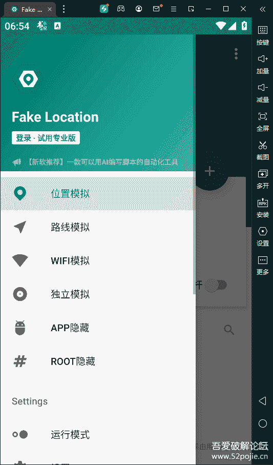
image.png (97.22 KB, 下载次数: 1)
[href="forum.php?mod=attachment&aid=MjcxODI0NHw1MzZjOTQzOXwxNzkzNTc3NTc3fDE2ODA4NnwxOTU1NDYy&nothumb=yes" target="_blank"](https://www.52pojie.cn/forum.php?mod=attachment&aid=MjcxODI0NHw1MzZjOTQzOXwxNzkzNTc3NTc3fDE2ODA4NnwxOTU1NDYy&nothumb=yes)
-
2024-8-17 18:03 上传

## 正文

注：软件为360加固，需要先脱壳

### 1. 观察app，发现切换专业版功能后会出现一个“试用专业版”弹窗，我们直接用算法助手定位

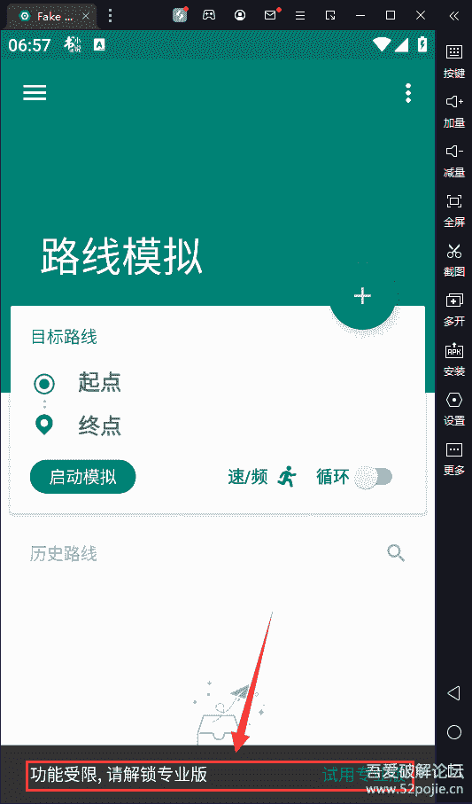
image.png (75.52 KB, 下载次数: 1)
[href="forum.php?mod=attachment&aid=MjcxODI0NXwyZTFmMmZkZXwxNzkzNTc3NTc3fDE2ODA4NnwxOTU1NDYy&nothumb=yes" target="_blank"](https://www.52pojie.cn/forum.php?mod=attachment&aid=MjcxODI0NXwyZTFmMmZkZXwxNzkzNTc3NTc3fDE2ODA4NnwxOTU1NDYy&nothumb=yes)
-
2024-8-17 18:06 上传

### 2. 勾选“控件文本赋值记录”后重新打开app，可以发现算法助手已经捕捉到“试用专业版”的相关信息

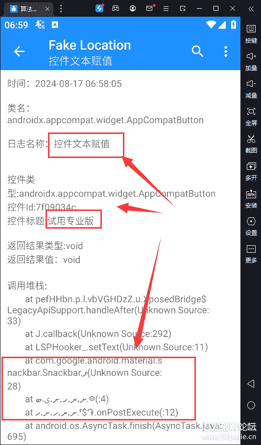
image.png (133.46 KB, 下载次数: 2)
[href="forum.php?mod=attachment&aid=MjcxODI0NnwzNWU4NDdkYXwxNzkzNTc3NTc3fDE2ODA4NnwxOTU1NDYy&nothumb=yes" target="_blank"](https://www.52pojie.cn/forum.php?mod=attachment&aid=MjcxODI0NnwzNWU4NDdkYXwxNzkzNTc3NTc3fDE2ODA4NnwxOTU1NDYy&nothumb=yes)
-
2024-8-17 18:11 上传

### 3. 我们直接将脱壳后的dex文件全部放入`jadx`中反编译，然后搜索堆栈

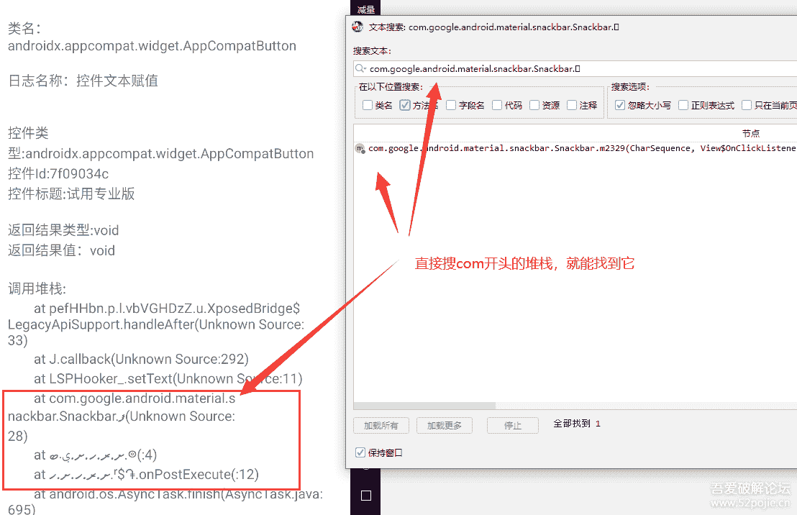
image.png (142.49 KB, 下载次数: 0)
[href="forum.php?mod=attachment&aid=MjcxODI1N3w3OGI1MTQ4MnwxNzkzNTc3NTc3fDE2ODA4NnwxOTU1NDYy&nothumb=yes" target="_blank"](https://www.52pojie.cn/forum.php?mod=attachment&aid=MjcxODI1N3w3OGI1MTQ4MnwxNzkzNTc3NTc3fDE2ODA4NnwxOTU1NDYy&nothumb=yes)
-
2024-8-17 18:14 上传

### 4. 直接hook该方法，发现确实被调用，而且第一个参数就是“试用专业版”，仔细观察代码，就会发现这是一个配置按钮的方法

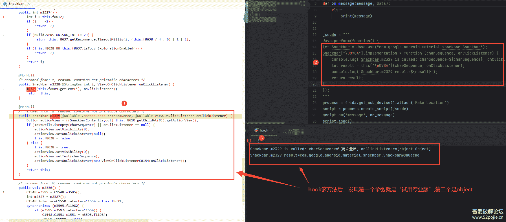
image.png (154.38 KB, 下载次数: 0)
[href="forum.php?mod=attachment&aid=MjcxODI2MHw2NjAzMmRkMnwxNzkzNTc3NTc3fDE2ODA4NnwxOTU1NDYy&nothumb=yes" target="_blank"](https://www.52pojie.cn/forum.php?mod=attachment&aid=MjcxODI2MHw2NjAzMmRkMnwxNzkzNTc3NTc3fDE2ODA4NnwxOTU1NDYy&nothumb=yes)
-
2024-8-17 18:20 上传

### 5. 我们要找的是判断是否为专业版的地方，软件肯定是先判断是否为专业版，然后再根据判断结果执行是否显示“试用专业版”，因此我们得往上继续追

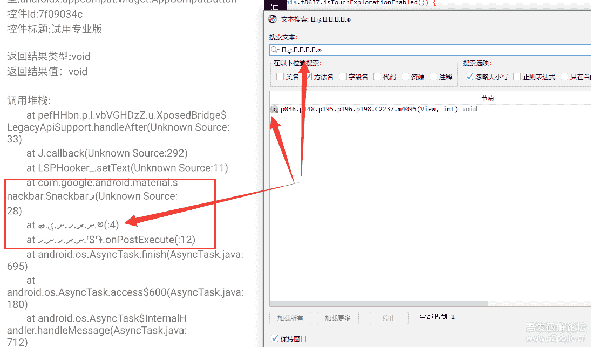
image.png (140.62 KB, 下载次数: 0)
[href="forum.php?mod=attachment&aid=MjcxODI2OHxlODI4Yjg1MXwxNzkzNTc3NTc3fDE2ODA4NnwxOTU1NDYy&nothumb=yes" target="_blank"](https://www.52pojie.cn/forum.php?mod=attachment&aid=MjcxODI2OHxlODI4Yjg1MXwxNzkzNTc3NTc3fDE2ODA4NnwxOTU1NDYy&nothumb=yes)
-
2024-8-17 18:25 上传

### 6. 定位到方法后，我们可以看到刚才的`m2329`，仔细观察，可以发现这个方法也还是一个配置方法，根据不同的判断，来配置视图，继续往上追

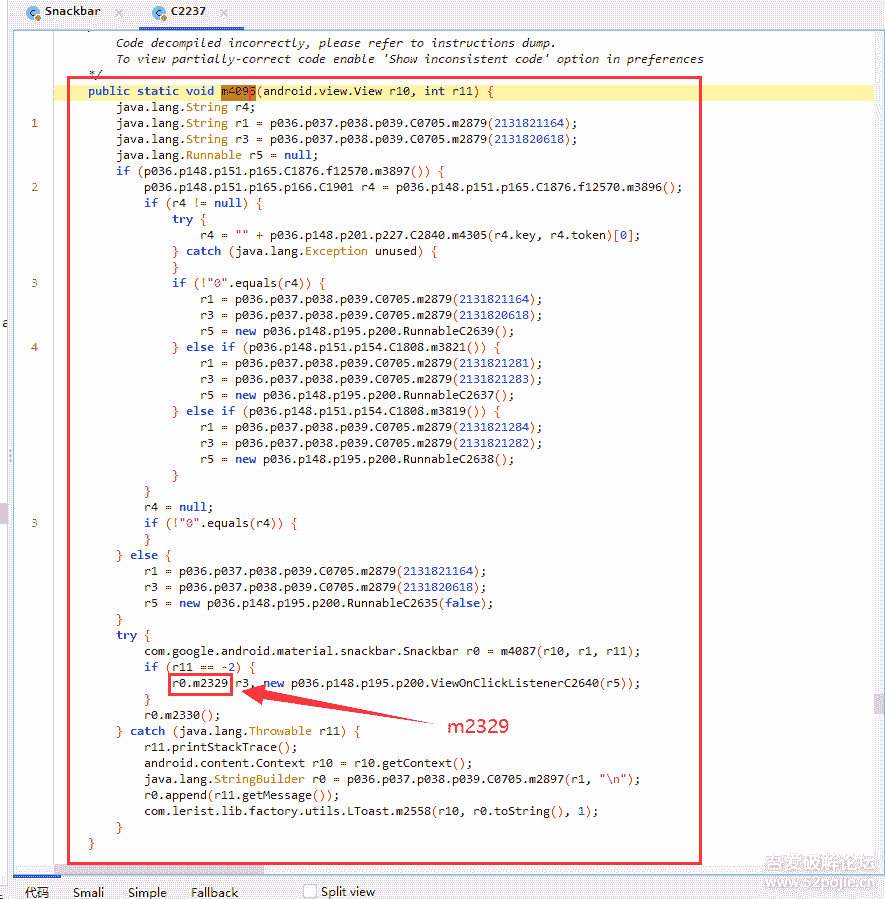
image.png (87.84 KB, 下载次数: 0)
[href="forum.php?mod=attachment&aid=MjcxODI2OXw1NjU0NTgwMnwxNzkzNTc3NTc3fDE2ODA4NnwxOTU1NDYy&nothumb=yes" target="_blank"](https://www.52pojie.cn/forum.php?mod=attachment&aid=MjcxODI2OXw1NjU0NTgwMnwxNzkzNTc3NTc3fDE2ODA4NnwxOTU1NDYy&nothumb=yes)
-
2024-8-17 19:19 上传

### 7. 我们追第三个，这个是双类中的方法，因此要先搜类，然后再去里面找方法

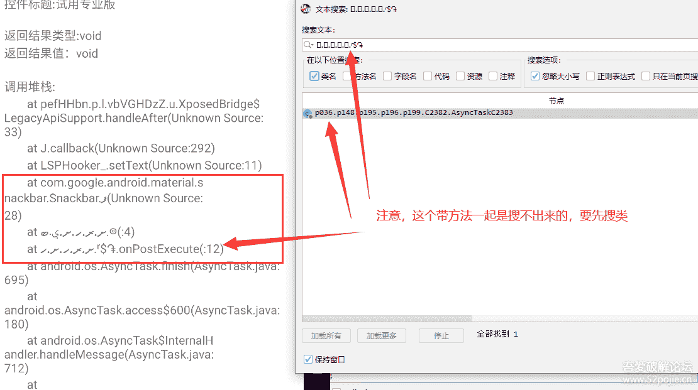
image.png (136.3 KB, 下载次数: 0)
[href="forum.php?mod=attachment&aid=MjcxODI3MnwyYTYxNjYyY3wxNzkzNTc3NTc3fDE2ODA4NnwxOTU1NDYy&nothumb=yes" target="_blank"](https://www.52pojie.cn/forum.php?mod=attachment&aid=MjcxODI3MnwyYTYxNjYyY3wxNzkzNTc3NTc3fDE2ODA4NnwxOTU1NDYy&nothumb=yes)
-
2024-8-17 19:30 上传

### 8. 定位到类后，直接找里面的`onPostExecute`方法，在此方法里，我们看到了熟悉的`m4095`，而且它是在一个判断条件里，如果`!C1808.m3820()`为真，那么就执行它并直接返回，而`m4095`又是一个视图配置方法，那么我们是不是就可以猜测，`!C1808.m3820()`就是一个判断是否为专业版的地方，如果为真，则执行弹出"试用专业版"，如果为假,则执行其它

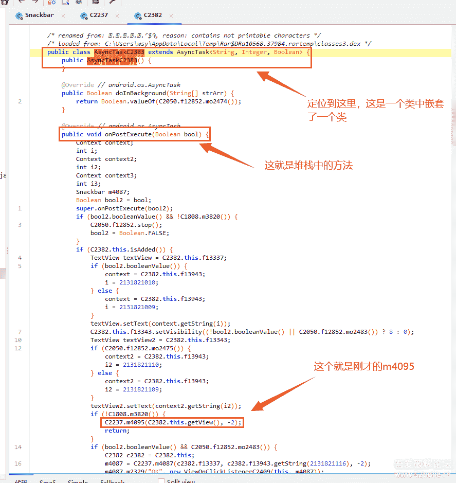
image.png (93.87 KB, 下载次数: 0)
[href="forum.php?mod=attachment&aid=MjcxODI3M3xlMTVhNGJhZHwxNzkzNTc3NTc3fDE2ODA4NnwxOTU1NDYy&nothumb=yes" target="_blank"](https://www.52pojie.cn/forum.php?mod=attachment&aid=MjcxODI3M3xlMTVhNGJhZHwxNzkzNTc3NTc3fDE2ODA4NnwxOTU1NDYy&nothumb=yes)
-
2024-8-17 19:35 上传

### 9. 我们直接双击`m3820`追上该方法，直接hook它让它返回true，这样`!C1808.m3820()`就会为假，就能跳过`m4095`

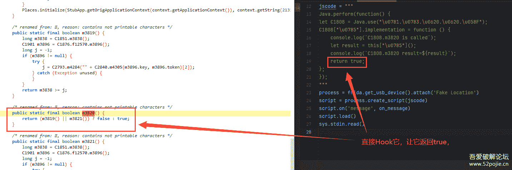
image.png (97.09 KB, 下载次数: 0)
[href="forum.php?mod=attachment&aid=MjcxODI3Nnw0NmQ1MTYwNXwxNzkzNTc3NTc3fDE2ODA4NnwxOTU1NDYy&nothumb=yes" target="_blank"](https://www.52pojie.cn/forum.php?mod=attachment&aid=MjcxODI3Nnw0NmQ1MTYwNXwxNzkzNTc3NTc3fDE2ODA4NnwxOTU1NDYy&nothumb=yes)
-
2024-8-17 19:54 上传

### 10. 运行代码，成功完成破解，所有功能全部正常使用

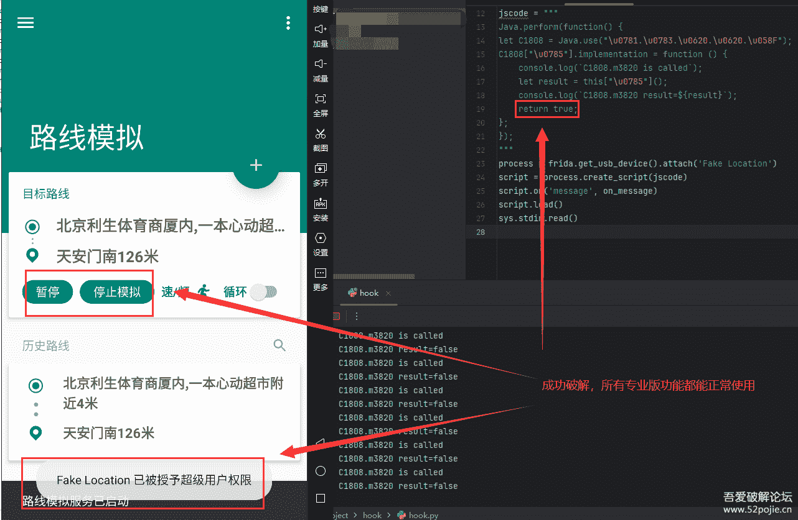
image.png (194.18 KB, 下载次数: 0)
[href="forum.php?mod=attachment&aid=MjcxODI3OHw0YzA4YzQyNXwxNzkzNTc3NTc3fDE2ODA4NnwxOTU1NDYy&nothumb=yes" target="_blank"](https://www.52pojie.cn/forum.php?mod=attachment&aid=MjcxODI3OHw0YzA4YzQyNXwxNzkzNTc3NTc3fDE2ODA4NnwxOTU1NDYy&nothumb=yes)
-
2024-8-17 20:01 上传

## 拓展

### 绕过双向证书校验

#### 1. 我们深入研究软件判断专业版的原理，观察`m3820`可以发现只有当`m3819`和`m3821`都为假时，它才会返回真，而`m3819`和`m3821`都是获取时间戳，然后用`J`去比较大小，只要`J`大于时间戳，那么它们就都会返回假，从而实现专业版功能

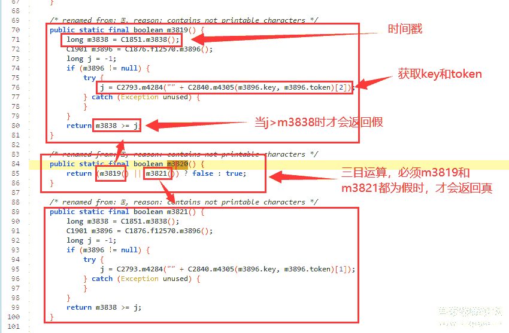
image.png (61.63 KB, 下载次数: 0)
[href="forum.php?mod=attachment&aid=MjcxODI4NnxhMzU3Yjk4MnwxNzkzNTc3NTc3fDE2ODA4NnwxOTU1NDYy&nothumb=yes" target="_blank"](https://www.52pojie.cn/forum.php?mod=attachment&aid=MjcxODI4NnxhMzU3Yjk4MnwxNzkzNTc3NTc3fDE2ODA4NnwxOTU1NDYy&nothumb=yes)
-
2024-8-17 21:29 上传

#### 2. 直接追`key`和`token`看看里面是啥，在这个类中，我们能看到很多跟登录信息相关的东西，可以推测这就是从服务器获取相关信息，重点是`key`和`token`的值

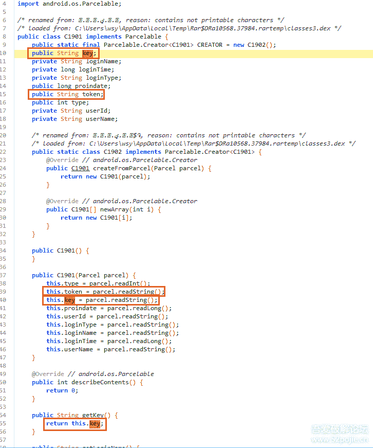
image.png (77.48 KB, 下载次数: 0)
[href="forum.php?mod=attachment&aid=MjcxODI4N3xmYzQzNTM2YnwxNzkzNTc3NTc3fDE2ODA4NnwxOTU1NDYy&nothumb=yes" target="_blank"](https://www.52pojie.cn/forum.php?mod=attachment&aid=MjcxODI4N3xmYzQzNTM2YnwxNzkzNTc3NTc3fDE2ODA4NnwxOTU1NDYy&nothumb=yes)
2
2024-8-17 21:40 上传

#### 3. 设置`burp`代{过}{滤}理抓包后，发现抓不了包，而且app显示”Trust anchor for certification path not found.找不到证书路径的信任密钥。“，显然是app做了证书校验，我们直接用算法助手的”`justTrustMe`“过证书校验

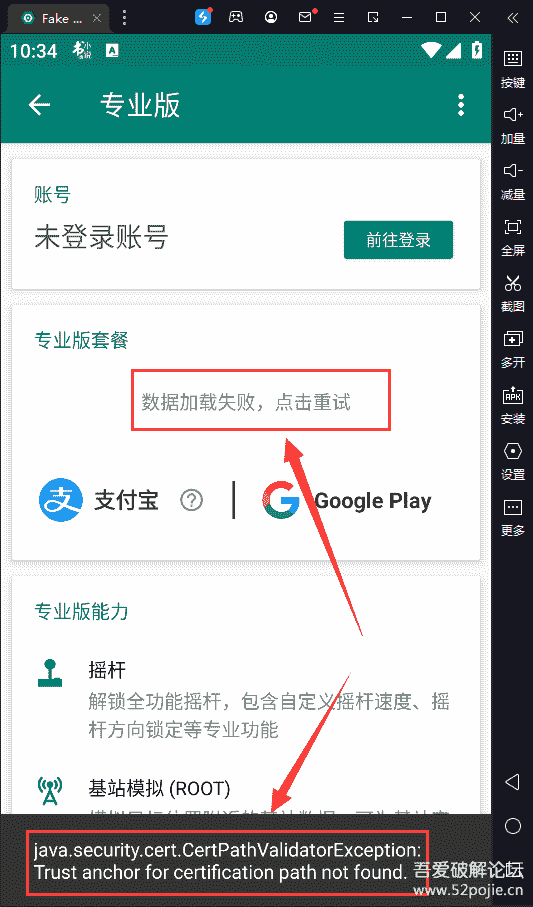
image.png (94.89 KB, 下载次数: 0)
[href="forum.php?mod=attachment&aid=MjcxODI5NXxjMGNhZTliZHwxNzkzNTc3NTc3fDE2ODA4NnwxOTU1NDYy&nothumb=yes" target="_blank"](https://www.52pojie.cn/forum.php?mod=attachment&aid=MjcxODI5NXxjMGNhZTliZHwxNzkzNTc3NTc3fDE2ODA4NnwxOTU1NDYy&nothumb=yes)
3
2024-8-17 21:52 上传

#### 4. 可以发现，软件显示400，并且能抓到app的包，但是显示”400 No required SSL certificate was sent“，因为这是双向证书校验，”`justTrustMe`“只能过掉单向校验，双向证书校验需要客户端提供证书发给服务器并由服务器进行验证；而这个证书一般都放在软件里面，因此我们需要去找到该证书和密钥然后将它导入到`burp`才能实现抓包

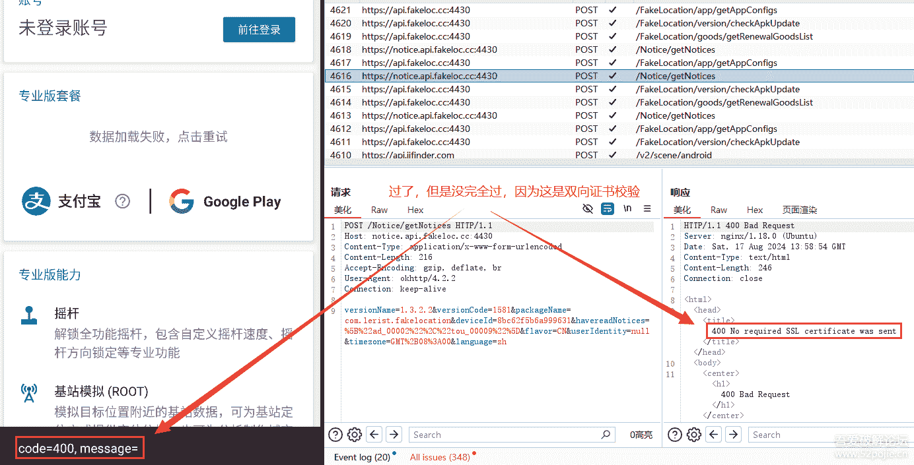
image.png (188.49 KB, 下载次数: 0)
[href="forum.php?mod=attachment&aid=MjcxODI5NnxmODRhMTk4MHwxNzkzNTc3NTc3fDE2ODA4NnwxOTU1NDYy&nothumb=yes" target="_blank"](https://www.52pojie.cn/forum.php?mod=attachment&aid=MjcxODI5NnxmODRhMTk4MHwxNzkzNTc3NTc3fDE2ODA4NnwxOTU1NDYy&nothumb=yes)
4
2024-8-17 22:00 上传

#### 5. 将app后缀修改为zip后全部解压出来；正常来说，证书一般都是存放在`assets`或者`res`中，并且证书格式一般为`.crt`、`.cer`或者`.p12`等等；但是这个app狡猾的一点就是你用常规方法找不到它证书，无论你在文件中搜啥，你都搜不到；这种情况只能去代码中找线索了

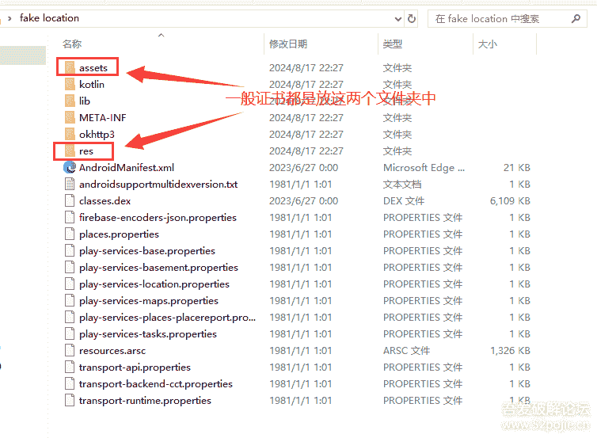
image.png (71.78 KB, 下载次数: 0)
[href="forum.php?mod=attachment&aid=MjcxODI5OXxhOTg4ZDBlNHwxNzkzNTc3NTc3fDE2ODA4NnwxOTU1NDYy&nothumb=yes" target="_blank"](https://www.52pojie.cn/forum.php?mod=attachment&aid=MjcxODI5OXxhOTg4ZDBlNHwxNzkzNTc3NTc3fDE2ODA4NnwxOTU1NDYy&nothumb=yes)
5
2024-8-17 22:29 上传

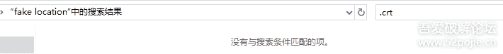
image.png (10.48 KB, 下载次数: 0)

[href="forum.php?mod=attachment&aid=MjcxODMwMHxkYzI3MTY0M3wxNzkzNTc3NTc3fDE2ODA4NnwxOTU1NDYy&nothumb=yes" target="_blank"](https://www.52pojie.cn/forum.php?mod=attachment&aid=MjcxODMwMHxkYzI3MTY0M3wxNzkzNTc3NTc3fDE2ODA4NnwxOTU1NDYy&nothumb=yes)

6
2024-8-17 22:33 上传
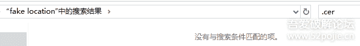
image.png (10.45 KB, 下载次数: 0)

[href="forum.php?mod=attachment&aid=MjcxODMwMXxmYTYwMmU0Y3wxNzkzNTc3NTc3fDE2ODA4NnwxOTU1NDYy&nothumb=yes" target="_blank"](https://www.52pojie.cn/forum.php?mod=attachment&aid=MjcxODMwMXxmYTYwMmU0Y3wxNzkzNTc3NTc3fDE2ODA4NnwxOTU1NDYy&nothumb=yes)

7
2024-8-17 22:33 上传
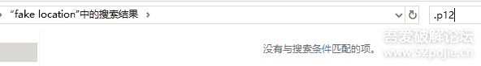
image.png (10.68 KB, 下载次数: 0)

[href="forum.php?mod=attachment&aid=MjcxODMwMnxhMjk0MjRlY3wxNzkzNTc3NTc3fDE2ODA4NnwxOTU1NDYy&nothumb=yes" target="_blank"](https://www.52pojie.cn/forum.php?mod=attachment&aid=MjcxODMwMnxhMjk0MjRlY3wxNzkzNTc3NTc3fDE2ODA4NnwxOTU1NDYy&nothumb=yes)

--
2024-8-17 22:33 上传

### 6.正常来说，有证书那就有对应的密钥，而“`KeyStore`”就是密钥库，存储了密钥和证书；直接搜关键词“`KeyStore`”，直接进第一个，可以发现这个方法就是用来配置证书连接的；它会创建两个密钥库并指定为`BKS`格式，一个放客户端证书密钥，还有一个放服务器端证书密钥，并用密钥保护各自证书；因为“`justTrustMe`”已经帮我们解决了服务器端的证书，我们只要看客户端的就行；重点观察`r2`，可以发现它证书居然伪造成.png格式，怪不得怎么搜都搜不到，这个作者真是大大的坏啊；然后我们直接双击"`f14125`"去看密钥，可以发现密钥就是：“`lerist.key.2021`”

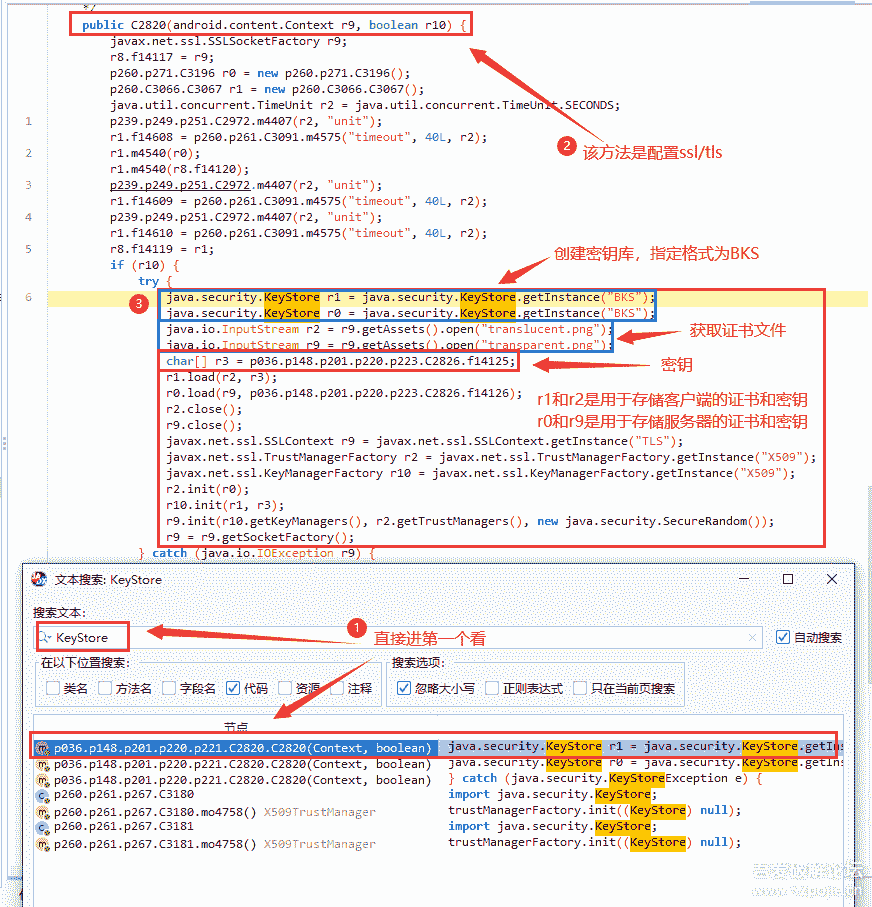
image.png (126.41 KB, 下载次数: 0)

[href="forum.php?mod=attachment&aid=MjcxODMxMXwwYzIzMGU1MXwxNzkzNTc3NTc3fDE2ODA4NnwxOTU1NDYy&nothumb=yes" target="_blank"](https://www.52pojie.cn/forum.php?mod=attachment&aid=MjcxODMxMXwwYzIzMGU1MXwxNzkzNTc3NTc3fDE2ODA4NnwxOTU1NDYy&nothumb=yes)

6
2024-8-17 23:13 上传
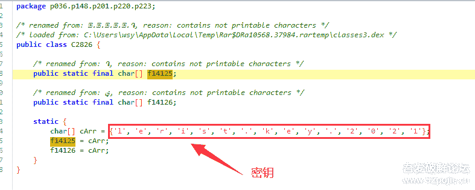
image.png (29.75 KB, 下载次数: 0)

[href="forum.php?mod=attachment&aid=MjcxODMxMnw2N2I2NmU5NnwxNzkzNTc3NTc3fDE2ODA4NnwxOTU1NDYy&nothumb=yes" target="_blank"](https://www.52pojie.cn/forum.php?mod=attachment&aid=MjcxODMxMnw2N2I2NmU5NnwxNzkzNTc3NTc3fDE2ODA4NnwxOTU1NDYy&nothumb=yes)

7
2024-8-17 23:24 上传

### 7.现在密钥有了，证书也有了，但是证书是.png格式，必须将它转换为正常的证书;在代码中我们可以看到密钥库格式为`BKS`，因此我们也要使用同样的格式将其转换为正常的证书格式；在这里我使用“`BouncyCastle`”对其进行转换；转换后的证书命名为“`keystore.p12`”

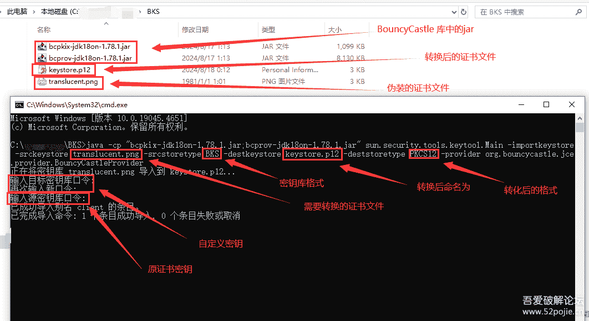
image.png (68.26 KB, 下载次数: 0)

[href="forum.php?mod=attachment&aid=MjcxODMxN3w4Y2Q3ODc2NnwxNzkzNTc3NTc3fDE2ODA4NnwxOTU1NDYy&nothumb=yes" target="_blank"](https://www.52pojie.cn/forum.php?mod=attachment&aid=MjcxODMxN3w4Y2Q3ODc2NnwxNzkzNTc3NTc3fDE2ODA4NnwxOTU1NDYy&nothumb=yes)

7
2024-8-18 00:22 上传

### 8.将证书导入到`burp`中

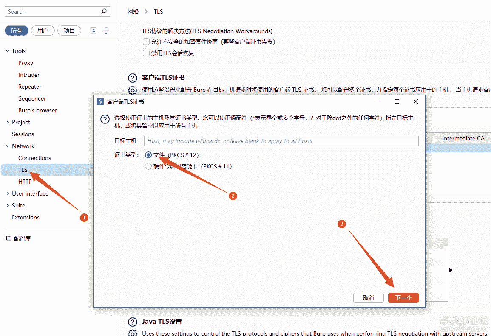
image.png (86.7 KB, 下载次数: 0)

[href="forum.php?mod=attachment&aid=MjcxODMxOHw1YThjODMyY3wxNzkzNTc3NTc3fDE2ODA4NnwxOTU1NDYy&nothumb=yes" target="_blank"](https://www.52pojie.cn/forum.php?mod=attachment&aid=MjcxODMxOHw1YThjODMyY3wxNzkzNTc3NTc3fDE2ODA4NnwxOTU1NDYy&nothumb=yes)

8
2024-8-18 00:27 上传
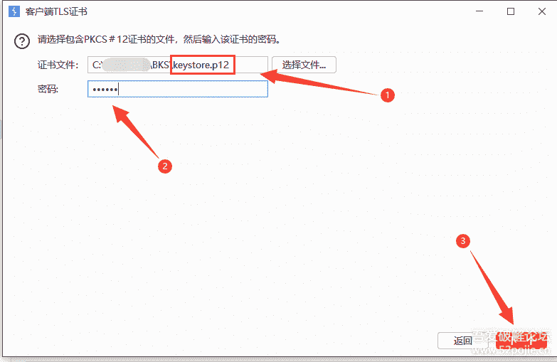
image.png (26.38 KB, 下载次数: 0)

[href="forum.php?mod=attachment&aid=MjcxODMxOXxjNjk3ZDZkOXwxNzkzNTc3NTc3fDE2ODA4NnwxOTU1NDYy&nothumb=yes" target="_blank"](https://www.52pojie.cn/forum.php?mod=attachment&aid=MjcxODMxOXxjNjk3ZDZkOXwxNzkzNTc3NTc3fDE2ODA4NnwxOTU1NDYy&nothumb=yes)

9
2024-8-18 00:29 上传
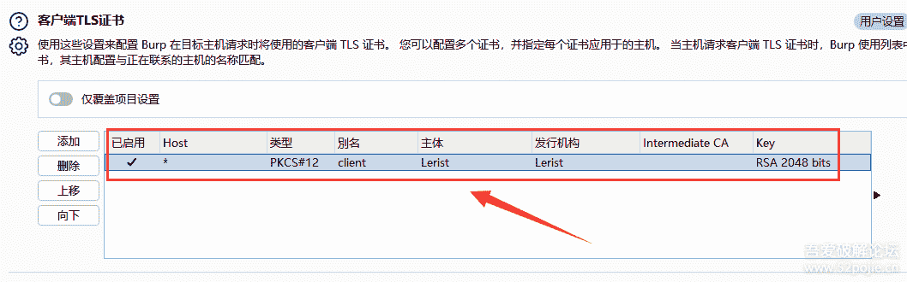
image.png (33.65 KB, 下载次数: 0)

[href="forum.php?mod=attachment&aid=MjcxODMyMHw5MzYwNDhjNXwxNzkzNTc3NTc3fDE2ODA4NnwxOTU1NDYy&nothumb=yes" target="_blank"](https://www.52pojie.cn/forum.php?mod=attachment&aid=MjcxODMyMHw5MzYwNDhjNXwxNzkzNTc3NTc3fDE2ODA4NnwxOTU1NDYy&nothumb=yes)

2024-8-18 00:30 上传

### 9.重新打开软件开始抓包（算法助手中的“`justTrustMe`”勾选后打开），可以看到成功绕过双向认证实现抓包

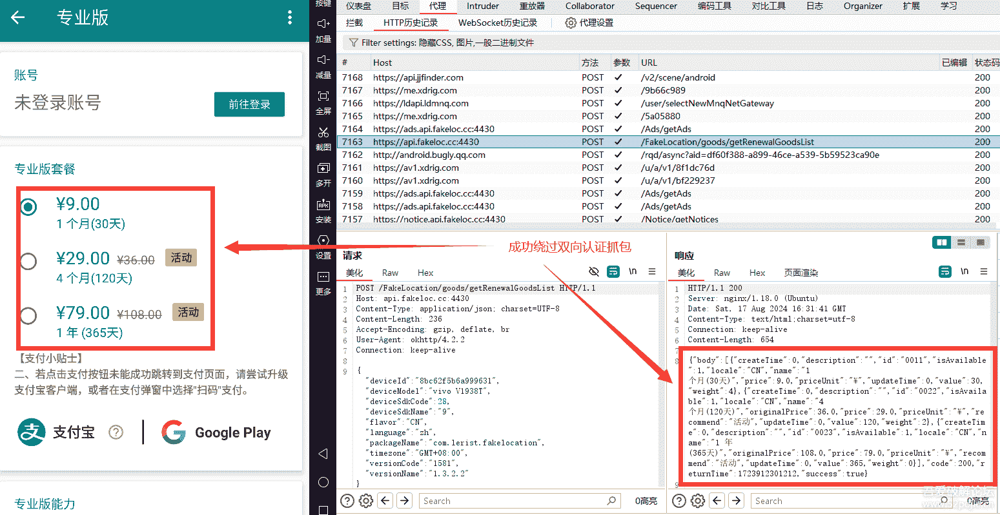
image.png (242.89 KB, 下载次数: 0)

[href="forum.php?mod=attachment&aid=MjcxODMyMnwyNDY5ZjYxZnwxNzkzNTc3NTc3fDE2ODA4NnwxOTU1NDYy&nothumb=yes" target="_blank"](https://www.52pojie.cn/forum.php?mod=attachment&aid=MjcxODMyMnwyNDY5ZjYxZnwxNzkzNTc3NTc3fDE2ODA4NnwxOTU1NDYy&nothumb=yes)

a
2024-8-18 00:37 上传

## 破解so层加密

### 10.我们登录软件后抓包看看，可以清楚的看到登录包的相关信息，以及服务器返回的响应，在响应中我们能看到`key`和`token`，并且是被加密了的，有加密必有解密，软件肯定是要解密服务器的信息然后再拿去比较的

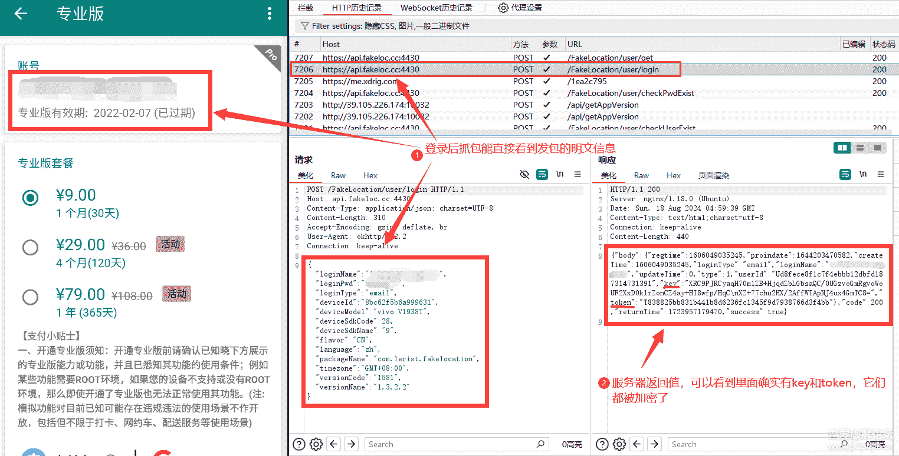
image.png (250.35 KB, 下载次数: 0)

[href="forum.php?mod=attachment&aid=MjcxODM3Nnw3NzFiMDI4MHwxNzkzNTc3NTc3fDE2ODA4NnwxOTU1NDYy&nothumb=yes" target="_blank"](https://www.52pojie.cn/forum.php?mod=attachment&aid=MjcxODM3Nnw3NzFiMDI4MHwxNzkzNTc3NTc3fDE2ODA4NnwxOTU1NDYy&nothumb=yes)

10
2024-8-18 13:07 上传

### 11.我们回到代码查看；`j`最终是要跟`m3838`这个时间戳比较，那么`j`肯定是要被解密后才能去跟一个时间戳作比较，而`m4305`就是解密的关键

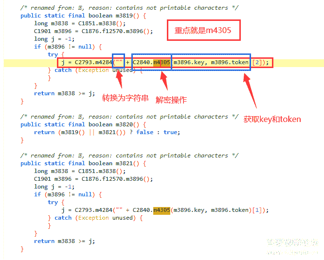
image.png (46.28 KB, 下载次数: 0)

[href="forum.php?mod=attachment&aid=MjcxODM3N3xjZDUyMGJkMHwxNzkzNTc3NTc3fDE2ODA4NnwxOTU1NDYy&nothumb=yes" target="_blank"](https://www.52pojie.cn/forum.php?mod=attachment&aid=MjcxODM3N3xjZDUyMGJkMHwxNzkzNTc3NTc3fDE2ODA4NnwxOTU1NDYy&nothumb=yes)

11
2024-8-18 13:15 上传

### 12.直接hook `m4305`看看它的参数和返回值，参数就是`key`和`token`，确实是这个方法解密了，解密后的数据是一个数组，其中第一个时间戳为专业版过期时间，另一个为距今七天后的时间；那么我们就知道这个软件的验证原理了——它从服务器获取两个时间戳，然后分别跟现在的时间戳进行比较，只要从服务器获取的两个时间戳都大于现在的时间戳，那么判断你就是专业版；而它解密的关键就是“`LSafety.getObjs`”，直接双击跟进看看

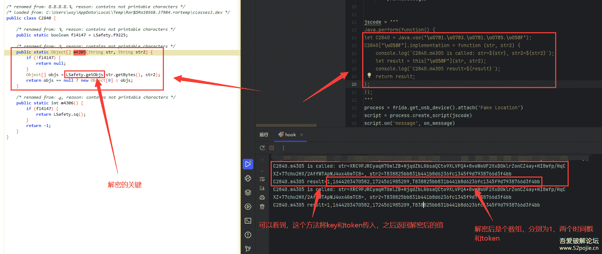
image.png (163.33 KB, 下载次数: 0)

[href="forum.php?mod=attachment&aid=MjcxODM4MXxkYzc4ODJhY3wxNzkzNTc3NTc3fDE2ODA4NnwxOTU1NDYy&nothumb=yes" target="_blank"](https://www.52pojie.cn/forum.php?mod=attachment&aid=MjcxODM4MXxkYzc4ODJhY3wxNzkzNTc3NTc3fDE2ODA4NnwxOTU1NDYy&nothumb=yes)

12
2024-8-18 13:30 上传

### 13.可以发现它是本地方法，在so层进行解密操作；因此，我们得去找到`libsafety.so`文件，然后将它拖到`ida`中查看

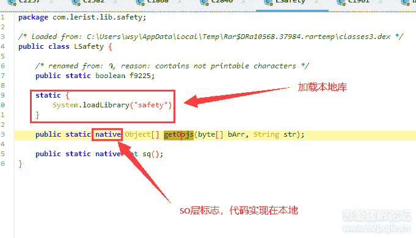
image.png (32.96 KB, 下载次数: 0)

[href="forum.php?mod=attachment&aid=MjcxODM5M3w2ZGMxZjA0NXwxNzkzNTc3NTc3fDE2ODA4NnwxOTU1NDYy&nothumb=yes" target="_blank"](https://www.52pojie.cn/forum.php?mod=attachment&aid=MjcxODM5M3w2ZGMxZjA0NXwxNzkzNTc3NTc3fDE2ODA4NnwxOTU1NDYy&nothumb=yes)

13
2024-8-18 13:45 上传

### 14.直接搜"`getobjs`" ，双击跟进查看，`f5`将其转换为伪代码便于查看；可以发现返回的是一个函数；我们继续跟进查看

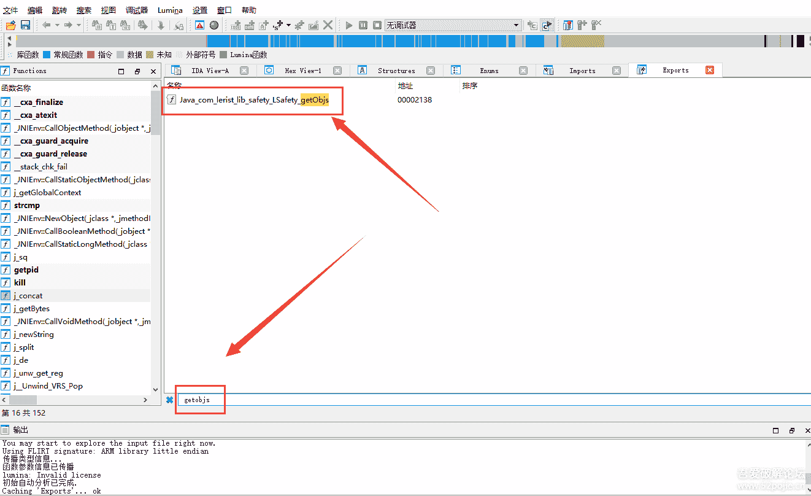
image.png (80.44 KB, 下载次数: 0)

[href="forum.php?mod=attachment&aid=MjcxODM5NHwyYjA1NDYyY3wxNzkzNTc3NTc3fDE2ODA4NnwxOTU1NDYy&nothumb=yes" target="_blank"](https://www.52pojie.cn/forum.php?mod=attachment&aid=MjcxODM5NHwyYjA1NDYyY3wxNzkzNTc3NTc3fDE2ODA4NnwxOTU1NDYy&nothumb=yes)

14
2024-8-18 14:23 上传
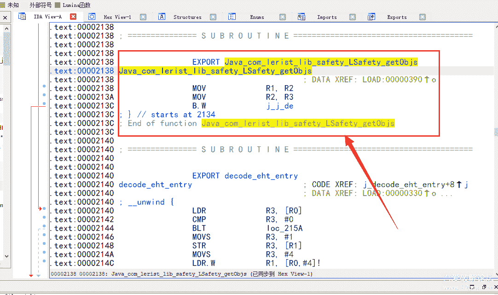
image.png (98.7 KB, 下载次数: 0)

[href="forum.php?mod=attachment&aid=MjcxODM5NXw3YTg0NTQ1NHwxNzkzNTc3NTc3fDE2ODA4NnwxOTU1NDYy&nothumb=yes" target="_blank"](https://www.52pojie.cn/forum.php?mod=attachment&aid=MjcxODM5NXw3YTg0NTQ1NHwxNzkzNTc3NTc3fDE2ODA4NnwxOTU1NDYy&nothumb=yes)

14
2024-8-18 14:24 上传
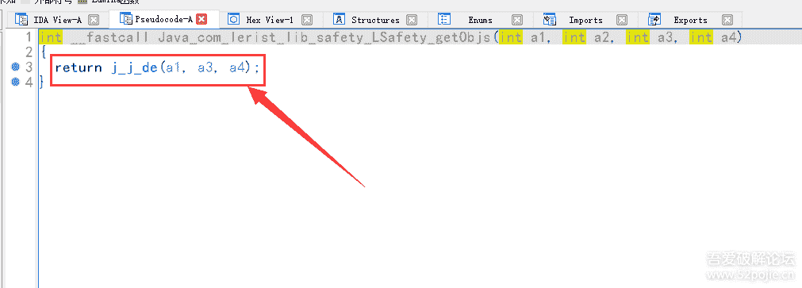
image.png (24.5 KB, 下载次数: 0)

[href="forum.php?mod=attachment&aid=MjcxODM5Nnw0MmEzYWMzYXwxNzkzNTc3NTc3fDE2ODA4NnwxOTU1NDYy&nothumb=yes" target="_blank"](https://www.52pojie.cn/forum.php?mod=attachment&aid=MjcxODM5Nnw0MmEzYWMzYXwxNzkzNTc3NTc3fDE2ODA4NnwxOTU1NDYy&nothumb=yes)

14
2024-8-18 14:26 上传

### 15.跟进后还是返回一个函数，继续跟进；还是函数，接着跟进；最终我们在`de()`函数中定位到最终解密的地方，并且`a2`和`a3`就是传入的`key`和`token`

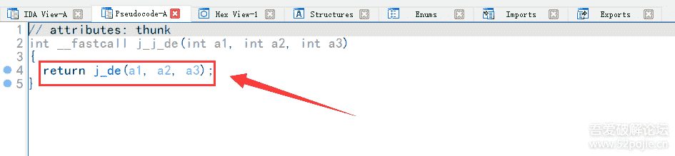
image.png (21.5 KB, 下载次数: 0)

[href="forum.php?mod=attachment&aid=MjcxODM5N3xjZDg2NWZhYXwxNzkzNTc3NTc3fDE2ODA4NnwxOTU1NDYy&nothumb=yes" target="_blank"](https://www.52pojie.cn/forum.php?mod=attachment&aid=MjcxODM5N3xjZDg2NWZhYXwxNzkzNTc3NTc3fDE2ODA4NnwxOTU1NDYy&nothumb=yes)

15
2024-8-18 14:27 上传
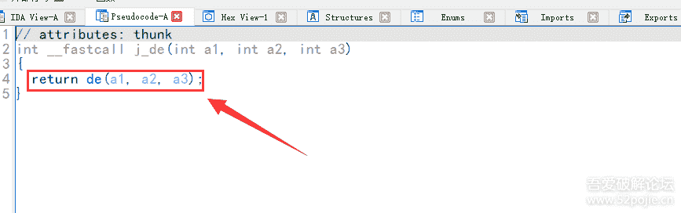
image.png (21.19 KB, 下载次数: 0)

<https://www.52pojie.cn/forum.php?mod=attachment&aid=MjcxODM5OHw0YzEzNDQwNHwxNzkzNTc3NTc3fDE2ODA4NnwxOTU1NDYy&nothumb=yes>

15

2024-8-18 14:28 上传

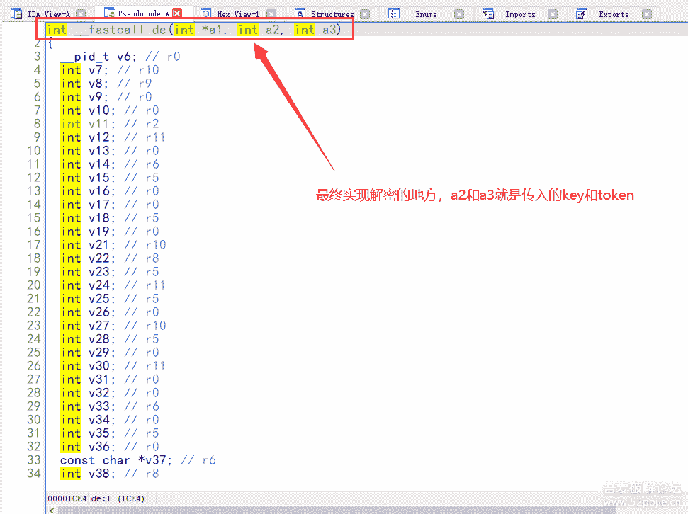

`image.png` (76.62 KB, 下载次数: 0)

<https://www.52pojie.cn/forum.php?mod=attachment&aid=MjcxODM5OXxiMzc1YjI5ZHwxNzkzNTc3NTc3fDE2ODA4NnwxOTU1NDYy&nothumb=yes>

15

2024-8-18 14:29 上传

## 16.它是静态注册，我们直接改参数；然后查看解密的具体代码

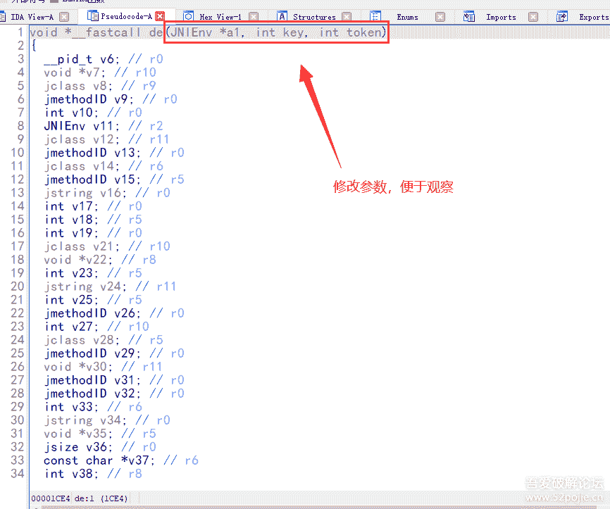

`image.png` (80.98 KB, 下载次数: 0)

<https://www.52pojie.cn/forum.php?mod=attachment&aid=MjcxODQwMHw4MGE3YjU4ZXwxNzkzNTc3NTc3fDE2ODA4NnwxOTU1NDYy&nothumb=yes>

16

2024-8-18 14:39 上传

## 17.仔细研究后可得——（函数先对`key`进行`base64`解码——>获取`K_PREFIX`和`token`进行拼接转换生成密钥——>使用`DES`算法用密钥对`key`进行解密）；整个流程知道了，现在就差`K_PREFIX`的值了，跟进看看它的值是啥

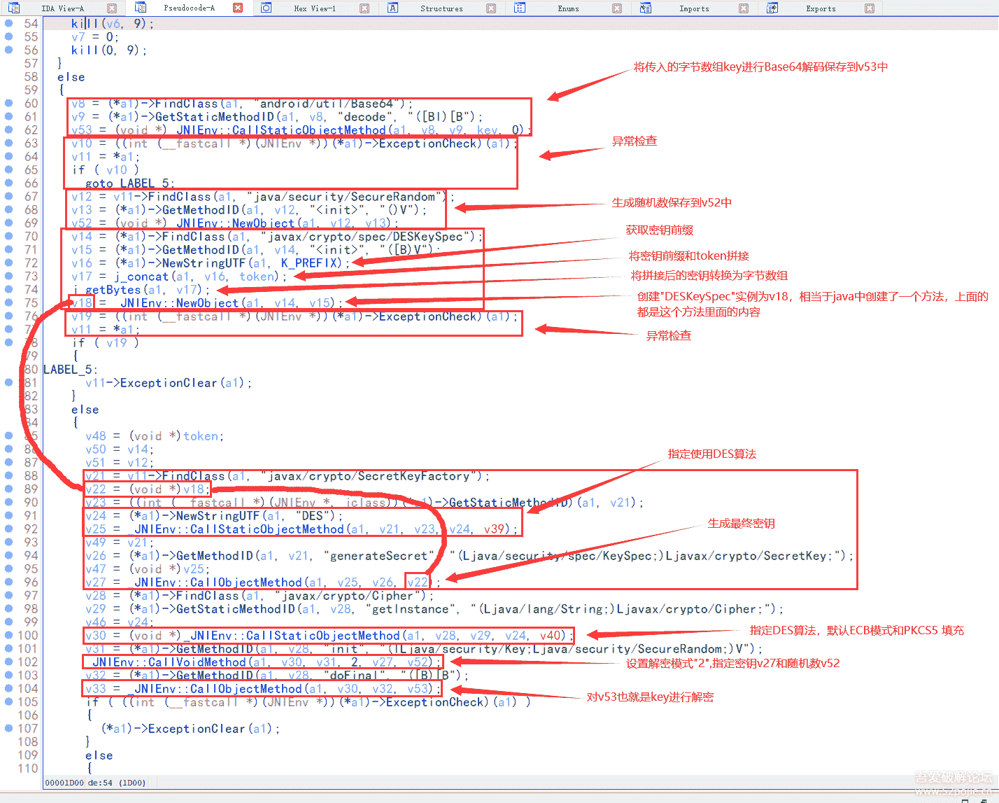

`image.png` (259.32 KB, 下载次数: 0)

<https://www.52pojie.cn/forum.php?mod=attachment&aid=MjcxODQxMXwzNGI4ZTc4YXwxNzkzNTc3NTc3fDE2ODA4NnwxOTU1NDYy&nothumb=yes>

2024-8-18 16:03 上传

## 18.直接一眼就看到了`K_PREFIX`的值为`"Lerist."`，万事具备，只欠东风；直接用`py`编写解密代码，并进行验证

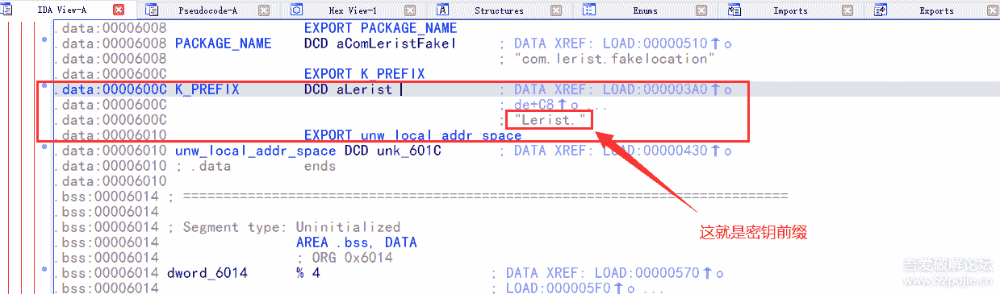

`image.png` (70.34 KB, 下载次数: 0)

<https://www.52pojie.cn/forum.php?mod=attachment&aid=MjcxODQxM3wyN2JkNmRiMXwxNzkzNTc3NTc3fDE2ODA4NnwxOTU1NDYy&nothumb=yes>

18

2024-8-18 16:12 上传

## 19.可以看到，成功解密出`key`的值

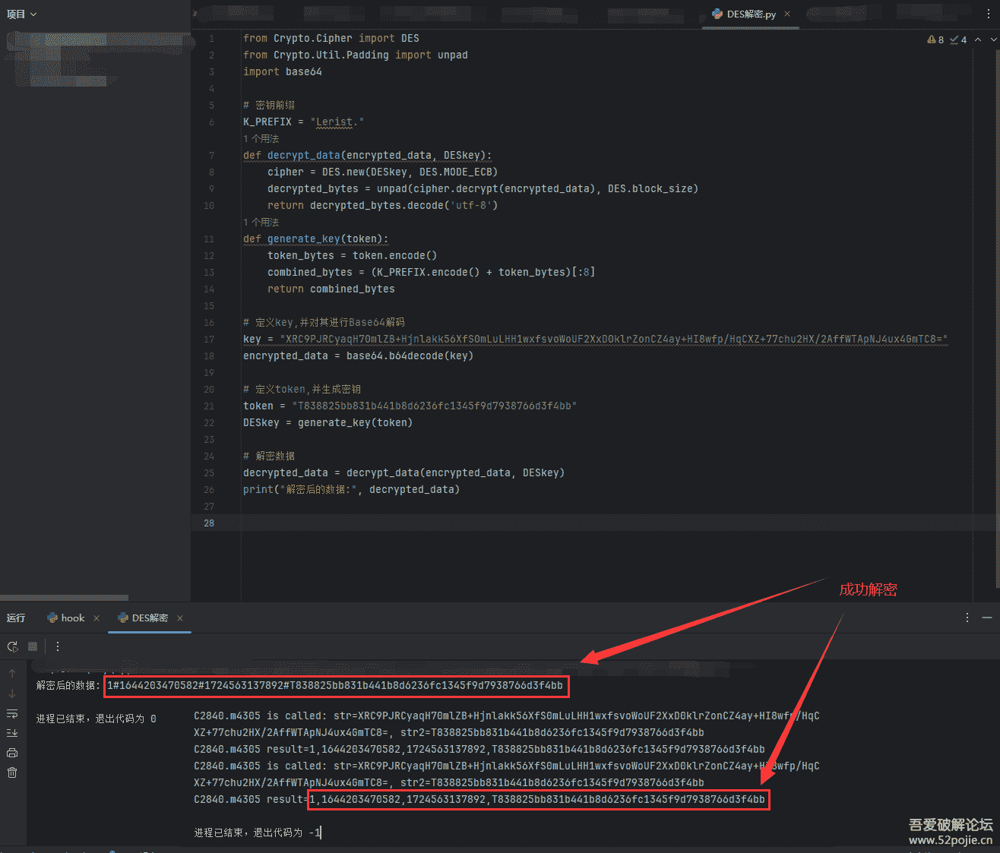

`image.png` (164.31 KB, 下载次数: 0)

<https://www.52pojie.cn/forum.php?mod=attachment&aid=MjcxODQyMXw2NDA5NzU5YXwxNzkzNTc3NTc3fDE2ODA4NnwxOTU1NDYy&nothumb=yes>

19

2024-8-18 16:48 上传

## 20.当然，你也可以编写对应的加密，通过拦截获取`token`的值，然后修改两个时间戳让其大于现在的时间戳，再对其进行加密，然后发包给软件同样实现破解；破解的方法有很多，不同思路有不同的破解方案

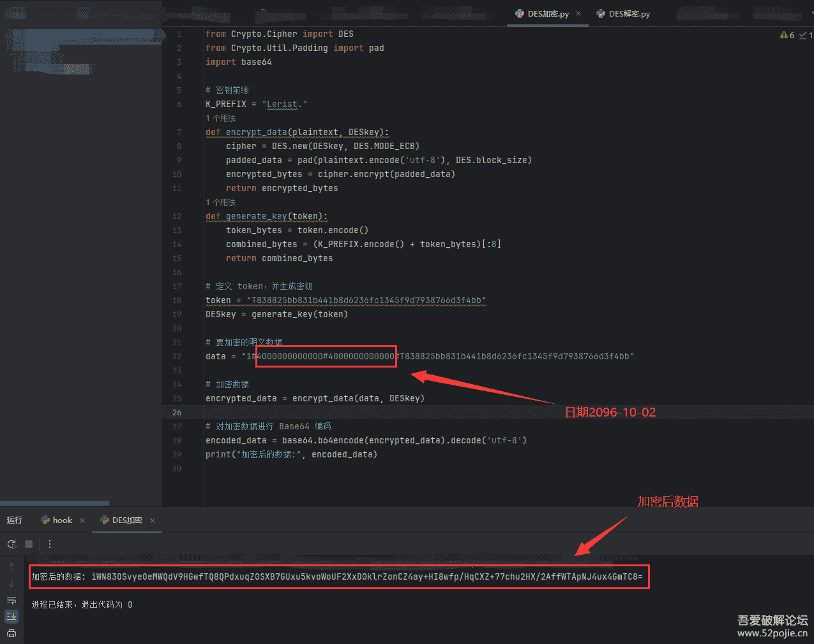

`image.png` (122.19 KB, 下载次数: 0)

<https://www.52pojie.cn/forum.php?mod=attachment&aid=MjcxODQzMnw2ZDQ4NDhmOHwxNzkzNTc3NTc3fDE2ODA4NnwxOTU1NDYy&nothumb=yes>

2024-8-18 17:06 上传

## 总结：

通过研究此款app，我学到了不少东西，无论是双向客户端验证还是`so`层解密等等，都让我受益匪浅，怎么说呢，逆向的道路永无止境，只有不断学习；此款app是一款非常经典的虚拟定位软件，可以说是同类中的佼佼者，我之前因为步道乐跑还付费用过好几次，确实不错，支持正版，此内容仅供交流学习，不提供任何破解成品；感谢大家支持，一起交流学习
