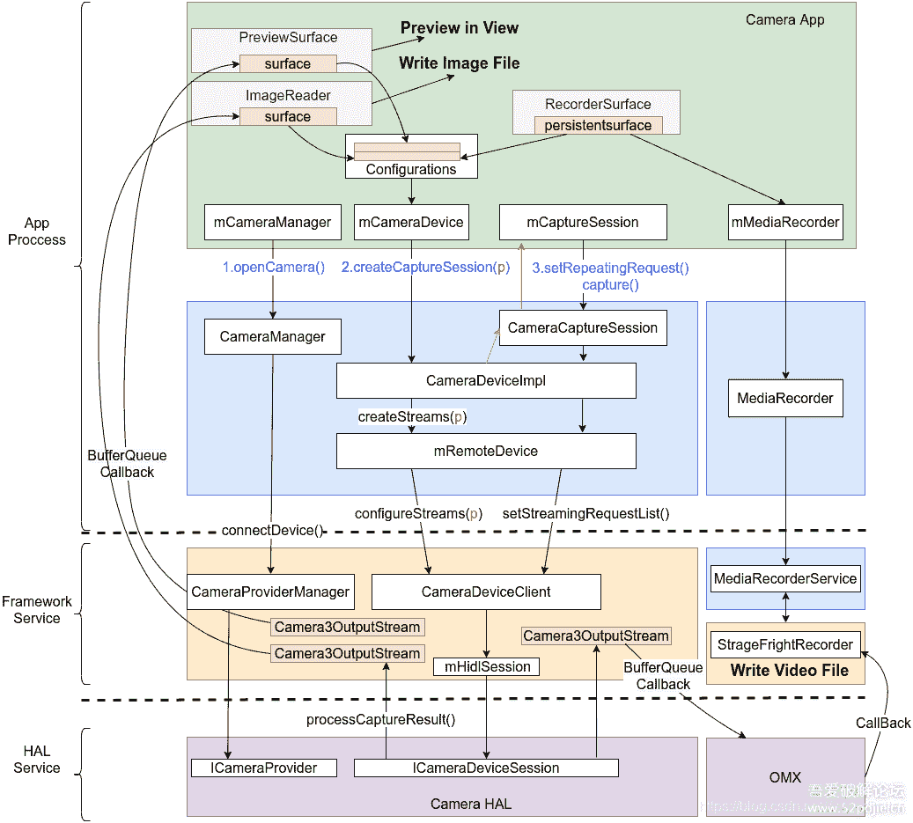
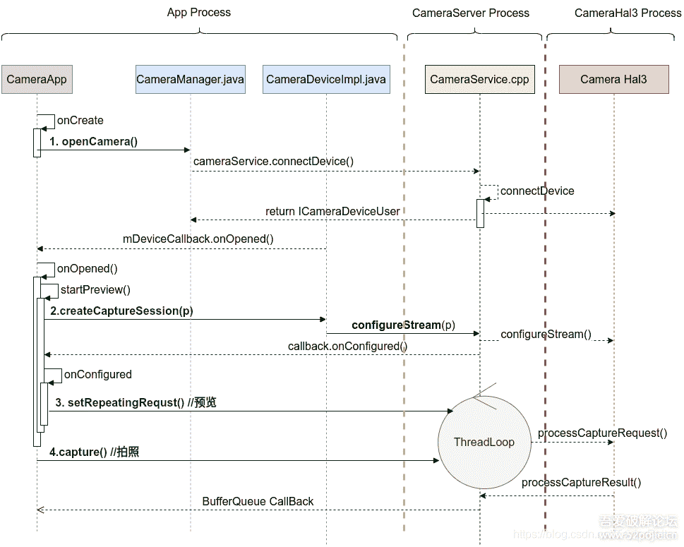

# [Android 原创] Camera Preview the overall flow 预览整体流程

- 原帖: https://www.52pojie.cn/forum.php?mod=viewthread&tid=1955574
- 抓取时间: 2026-11-01T16:40:19.194Z

## Preview the overall flow 预览整体流程




App在`MainActivity`中使用一些预览控件，它们都包含一个`surface`作为取相机数据的容器。在`openCamera`之前：
- 首先需要获取系统的 `CameraManager`实例，通过`getSystemService(Context.CAMERA_SERVICE)`方法获取。
- 选择相机设备：使用 `CameraManager` 的 `getCameraIdList()`方法获取可用的相机设备列表，选择需要的相机设备的 `ID`

对于`MainActivity`在`onCreat`的时候，调用API通知Framework Native Service-- `CameraServer`去 connect HAL ，打开硬件sensor

### 相关函数、方法

```
CameraManager.openCamera(String cameraId,  CameraDevice.StateCallback callback, @Nullable Handler handler)
/*
接口打开相机设备。
@ String  cameraId：相机设备编号
@ CameraDevice.StateCallback  callback：相机设备打开状态监听(判断相机打开是否成功)的回调对象(调用openCamera()时必须传入该回调对象，才能打开相机设备)
@ Handler handler：指定执行回调方法的线程(可以是主线程，也可以后台线程)。
*/
        --> ...
                --> private CameraDevice openCameraDeviceUserAsync(String cameraId,
            CameraDevice.StateCallback callback, Executor executor, final int uid)
            throws CameraAccessException
```

对于 `CameraDevice.StateCallback` 须实现方法：
- `onOpened`：相机设备打开完成时调用的方法（相机设备已就绪，可以调用 `CameraDevice.createCaptureSession()` 来创建 `CameraCaptureSession` 对象）。
- `onClosed`：关闭相机设备时调用。
- `onDisconnected`：相机设备不可再调用时调用（该回调内可调用 `CameraDevice.close` 方法关闭相机设备）。
- `onError`：相机设备不可再调用时调用（该回调内可调用 `CameraDevice.close` 方法关闭相机设备）。

对于 `openCameraDeviceUserAsync` 方法，主要做了下面几件事：
- 获取当前 `cameraId` 指定相机的设备信息。（获取 `ICameraService` 代理，调用其 `getCameraInfo` 方法获取当前设备的属性）
- 利用获取相机的设备信息创建 `CameraDeviceImpl` 实例。（并将来自App的 `CameraDevice.StateCallback` 接口存入该实例中）
- 调用远程 `CameraService` 获取当前相机的远程服务。（再将 `CameraDeviceImpl` 中的内部类 `CameraDeviceCallback` 作为参数通过 `ICameraService` 的 `connectDevice` 方法传入 `Camera Service` 去打开并获取一个 `ICameraDeviceUser` 代理）
- 将获取的远程服务设置到 `CameraDeviceImpl` 实例中（并将该代理存入 `CameraDeviceImpl` 中进行管理。）
- 返回 `CameraDeviceImpl` 实例


`OpenCamera` 成功的话，回调从 `CameraServer` 通知到 APP，在 `onOpened()` 中调用 `preview` 的操作，在此时创建会话 `CameraCaptureSession` 。创建过程中调用 `configStream(p)` --参数中包含 `Surface` 的引用，也就是说，`cameraServer` 包装了来自 App 的 `sureface` 容器为 `stream`，再通过 `HIDL` 传给 `HAL`，再由 `HAL` 继续 `configStream`

### 相关函数、方法

```
CameraDevice.StateCallback.onOpened()// 回调方法，

        --> CameraDevice.createCaptureSession(SessionConfiguration config)

        /* @ SessionConfiguration  config： 会话配置参数（聚合类参数，包含创建CameraCaptureSession的所有参数）

                在打开相机设备之后便需要去创建一个相机会话，用于传输图像请求，其最终实现是调用该方法来进行实现的，

                而该方法会去调用到Camera Framework中的createCaptureSessionInternal方法，该方法主要做了两件事：

                首先调用configureStreamsChecked方法来配置数据流。

                其次实例化了一个CameraCaptureImpl对象，并通过传入CameraCaptureSession.StateCallback回调类将该对象发送至至App中。        

                        --> 而在configureStreamsChecked方法中会去调用ICameraDeviceUser代理的一系列方法进行数据流配置，

                                        其中调用cancelRequest方法停掉当前的的预览流程，调用deleteStream方法删除之前的数据流，调用createStream创建新的数据流，

                                        最后调用endConfigure来进行数据流的配置工作，针对性的配置便在最后这个endConfigure方法中。

        */

        --> CameraCaptureSession.setRepeatingRequest(CaptureRequest request,  CameraCaptureSession.CaptureCallback callback,Handler handler)

                /*

                 @ CaptureRequest request：无限期重复的CaptureRequest。

                    向Camera底层送一个CaptureRequest，底层不停重复送这一个CaptureRequest，不能为null

                 @ CameraCaptureSession.CaptureCallback callback:  CaptureRequest处理状态监听的回调。

                    当一个CaptureRequest发送给相机设备，使用这个监听器跟踪该CaptureRequest的处理进度，CaptureRequest完成处理时会通知该回调对象。

                    该回调对象的所有方法都有默认的空实现，也可根据需求重写相应方法。

                 @ Handler handler：

                    CaptureRequest回调方法执行的线程。如果为null，表示使用当前线程的looper

                 */

                         --> submitCaptureRequest

                         // Framework 层的方法。将此次Request下发到CameraService中。
```

`SessionConfiguration` 需配置参数：
- session type：会话类型。常用普通预览使用 `SessionConfiguration.SESSION_REGULAR`，高速预览使用 `SessionConfiguration.SESSION_HIGH_SPEED`
- `List outputs`：`CameraCaptureSession` 的输出配置列表。根据不同的场景选择需要的 `surface`，创建 `OutputConfiguration` 列表，以拍照模式为例，选择相机预览、拍照所需的 `surface` 作为相机图像数据最终输出对象，创建 `OutputConfiguration` 列表参数。
- `Executor executor`：指定回调执行的线程。通常，建议不要在主（UI）线程上执行相机操作。
- `CameraCaptureSession.StateCallback cb`：监听 `CameraCaptureSession` 创建状态的回调对象。`onConfigured` 和 `onConfigureFailed` 两个抽象方法必须重写。
- `CaptureRequest` 参数： `SessionConfiguration` 类对象实例化后，调用该类 `setSessionParameters` 接口，设置创建 `CameraCaptureSession` 时所需要的 `CaptureRequest` 参数。根据场景，利用 `CaptureRequest.Builder` 创建所需的 `CaptureRequest` 参数，例如，预览时，创建 `CameraDevice.TEMPLATE_PREVIEW` 类型的 `CaptureRequest`，并将预览用的 `surface` 添加到该 `CaptureRequest`，作为预览输出目标; 拍照时，创建 `CameraDevice.TEMPLATE_STILL_CAPTURE` 类型 `CaptureRequest`，并将拍照用的 `surface` 添加到该 `CaptureRequest`，作为拍照输出目标

而对于 `CameraCaptureSession.StateCallback` 回调对象需实现方法：
- `onConfigured`：会话配置完成， `CameraCaptureSession` 创建成功（在该回调方法中可获取到 `CameraCaptureSession` 实例，然后调用 `CameraCaptureSession.setRepeatingRequest` 方法发送重复 `CaptureRequest`，开启预览）。
- `onConfigureFailed`： `CameraCaptureSession` 创建失败时调用，可能配置的 `Surface` size 不支持，或者 `Surface` 数量配置太多。
- `onActive`：在 `onConfigured` 后执行，即开始真的处理 `CaptureRequest`。
- `onReady`：当 `CameraCaptureSession` 没有 `CaptureRequest` 可处理时调用。
- `onCaptureQueueEmpty`：相机设备的输入 `CaptureRequest` 队列为空时回调。
- `onClosed`： `CameraCaptureSession` 关闭时调用。

以上 `onConfigured` 和 `onConfigureFailed` 两个抽象方法必须实现，其余的可以空实现

`CameraCaptureSession`

[//developer.android.google.cn/reference/android/hardware/camera2/CameraCaptureSession](https://developer.android.google.cn/reference/android/hardware/camera2/CameraCaptureSession:https)

Nested classes | 
 | 
class | 
[//developer.android.google.cn/reference/android/hardware/camera2/CameraCaptureSession.CaptureCallback](https://developer.android.google.cn/reference/android/hardware/camera2/CameraCaptureSession.CaptureCallback:https) | 
A callback object for tracking the progress of a [//developer.android.google.cn/reference/android/hardware/camera2/CaptureRequest](https://developer.android.google.cn/reference/android/hardware/camera2/CaptureRequest:https) submitted to the camera device. |
| class | [//developer.android.google.cn/reference/android/hardware/camera2/CameraCaptureSession.StateCallback](https://developer.android.google.cn/reference/android/hardware/camera2/CameraCaptureSession.StateCallback:https)
A callback object for receiving updates about the state of a camera capture session. |

`configStream` 成功后，`CameraServer` 回调通知 App，然后 App 调 `setRepeatingRequest` 给 `CameraServer` 。`CameraServer` 初始化时便起来了一个死循环线程等待来接收 `Request`。

### 相关函数、方法

`configureStreamsChecked`

在 `configureStreamsChecked` 方法中会去调用 `ICameraDeviceUser` 代理的一系列方法进行数据流配置，其中调用 `cancelRequest` 方法停掉当前的的预览流程，调用 `deleteStream` 方法删除之前的数据流，调用 `createStream` 创建新的数据流，最后调用 `endConfigure` 来进行数据流的配置工作，针对性的配置便在最后这个 `endConfigure` 方法中。

`CameraCaptureSession.CaptureCallback` 回调对象需实现方法
- `onCaptureStarted`：当相机设备开始处理 `CaptureRequest`，捕捉输出图时调用。
- `onCaptureProgressed`：相机设备部分模块完成 `CaptureRequest` 处理，有 `Partial Result` 上报时调用。
- `onCaptureCompleted`： `CaptureRequest` 完全处理完成，处理结果可用，有 `TotalCaptureResult` 上报时调用。
- `onCaptureBufferLost`： `CaptureRequest` 处理后的 `Buffer` 没有被送到目标 `Surface` 时调用（通常原因是底层处理这路 `Stream` 发生错误或因 `Flush` 而主动丢帧）。
- `onCaptureFailed`：整个 `CaptureRequest` 处理失败，未生成 `TotalCaptureResult` 时调用。
- `onCaptureSequenceAborted`：整个序列的 `CaptureRequest` 放弃继续处理时调用（通常是由于调用了 `stopRepeating` 或 `abortCaptures`）。
- `onCaptureSequenceCompleted`：整个序列的 `CaptureRequest` 处理完后调用，sequence id 等于调用发送捕捉请求的方法(ex. `capture`) 的返回值。

`CameraServer` 将 `request` 交给 `HAL` 得到处理结果后，取出处理结果中的 `Buffer` 填到 App 给的容器中。
- `SetRepeatingRequest` 为了预览,则交给 `Preview` 的 `Surface` 容器
- `Capture Request` 则将收到的 `Buffer` 交给 `ImageReader` 的 `Surface` 容器

之后由 `BufferQueue` 机制回调对应 `Surface` 控件的 `callback`

结束，关闭相机。

关闭 `CameraCaptureSession`
- `CameraCaptureSession` 对象调用 `abortCaptures()` 接口，通知停止向相机设备发送 `CaptureRequest`，并通知相机设备放弃还未处理完成的 `CaptureRequest`。
- `CameraCaptureSession` 对象调用 `close()` 接口，关闭 `CameraCaptureSession`。

关闭相机设备
`CameraDevice` 对象调用 `close()` 接口，关闭相机设备。

释放资源
- 关闭捕捉会话后，`cameraCaptureSession` 对象置 `null`。


- 关闭相机设备后，`cameraDevice`对象置null。
- 创建捕捉会话时使用的`surface`对象，置为null。


`Camera Service`主程序，是随着系统启动而运行，主要目的是向外暴露`AIDL`接口给`Framework`进行调用，同时通过调用`Camera Provider`的`HIDL`接口，建立与`Provider`的通信，并且在内部维护从`Framework`以及`Provider`获取到的资源，并且按照一定的框架结构保持整个`Service`在稳定高效的状态下运行。

#### 整体函数调用流程



https%3A//prod-files-secure.s3.us-west-2.amazonaws.com/46b3bb36-cf7d-4e54-86d6-dc9da8d2134a/0846a736-96bd-4016-9ee0-29afb7982478/image.png" alt="函数调用流程.png" target="_blank" rel="noopener noreferrer nofollow" />

### 预览详细流程

#### App

[Camera 入门第一篇 - 程序员Android的博客 - 博客园](https://www.cnblogs.com/programandriod/p/13868580.html)

#### Service

[//deepinout.com/android-camera/android-camera-service-intro.html](https://deepinout.com/android-camera/android-camera-service-intro.html:https)

由于在`Camera Service`启动初始化的时候已经获取了相应相机设备的属性配置，并存储在`DeviceInfo3`中，所以该方法就是从对应的 `DeviceInfo3`中取出属性返回即可。参见2.4前面链接 🔗

- 在`connectDevice`完毕，`App`获取到一个设备之后，为了采集图像，执行`CameraDevice`的`createCaptureSession`操作，到达`Framework`，再通过`ICameraDeviceUser`代{过}{滤}理进行了一系列操作，分别包含了`cancelRequest`/`beginConfigure`/`deleteStream`/`createStream`以及`endConfigure`方法来进行数据流的配置。
- `cancelRequest`方法，在该方法中会去通知`Camera3Device`将`RequestThread`中的`Request`队列清空，停止`Request`的继续下发。
- `beginConfigure`方法是空实现
- `deleteStream` / `createStream`分别是用于删除之前的数据流以及为新的操作创建数据流，紧接着调用位于整个调用流程的末尾– `endConfigure`
- `endConfigure`方法，该方法对应着`CameraDeviceClient`的`endConfigure`方法，其逻辑比较简单，在该方法中会调用`Camera3Device`的`configureStreams`的方法，而该方法又会去通过`ICameraDeviceSession`的`configureStreams_3_4`的方法最终将需求传递给`Provider`。

数据流的配置完成后，并且`App`也获取了`Framework`中的`CameraCaptureSession`对象，之后便可下发图像请求了。在下发之前需要先创建。而`App`通过`createCaptureRequest`实现，该方法在`Framework`中实现，内部会再去调用`Camera Service`中的`AIDL`接口`createDefaultRequest`，在其内部又会去调用`Camera3Device`的`createDefaultRequest`方法，最后通过 `ICameraDeviceSession`代{过}{滤}理的 `constructDefaultRequestSettings`方法将需求下发到`Provider`端去创建一个默认的`Request`配置，一旦操作完成，`Provider`会将配置上传至`Service`，进而给到`App`中。

```
createCaptureRequest // 在Framework中实现
// 调用该方法，最终会调用到 Camera Service 中 ICameraDeviceUser 的 createDefaultRequest 方法来创建一个默认配置的CameraMetadataNative
// 然后实例化一个CaptureRequest.Builder对象，并将刚才获取的CameraMetadataNative传入其中，之后返回该CaptureRequest.Builder对象，在App中，直接通过调用该Buidler对象的build方法，获取一个CaptureRequest对象
        --> createDefaultRequest // Camera Service中的AIDL接口
                --> Camera3Device::createDefaultRequest
                        --> constructDefaultRequestSettings
```

创建`request`完成后，调用`CameraCaptureSession`的`setRepeatingRequest`方法下发`Request`到`Camera Service`中，在这个过程中会调用`Camera3Device`的`setStreamingRequestList`方法，将需求发送到`Camera3Device`中，到`RequestThread`中的`RequestQueue`中，并唤醒`RequestThread`线程，会从`RequestQueue`中取出`Request`，通过之前获取的`ICameraDeviceSession`代{过}{滤}理的`processCaptureRequest_3_4`方法将需求发送至`Provider`中，一旦发送成功，便立即返回，在`App`端便等待这结果的回传。

`setRepeatingRequest`做了以下几件事

`App`调用该方法开始预览流程，通过层层调用最终会调用到`Framework`中的`submitCaptureRequest`方法，该方法主要做了两件事：

- 首先调用`CameraService`层`CameraDeviceUser`的`submitRequestList`方法，将此次`Request`下发到`CameraService`中。
- 其次将`App`通过参数传入的`CameraCaptureSession.CaptureCallback`对象存到`CameraDeviceImpI`对象中。

#### HAL

[//source.android.google.cn/docs/core/camera/camera3](https://source.android.google.cn/docs/core/camera/camera3:https)

The API models the camera subsystem as a pipeline that converts incoming requests for frame captures into frames, on a 1:1 basis. The requests encapsulate all configuration information about the capture and processing of a frame. This includes resolution and pixel format; manual sensor, lens and flash control; 3A operating modes; RAW->YUV processing control; statistics generation; and so on.

In simple terms, the application framework requests a frame from the camera subsystem, and the camera subsystem returns results to an output stream. In addition, metadata that contains information such as color spaces and lens shading is generated for each set of results. You can think of camera version 3 as a pipeline to camera version 1's one-way stream. It converts each capture request into one image captured by the sensor, which is processed into:

- A result object with metadata about the capture.
- One to N buffers of image data, each into its own destination surface.

The set of possible output surfaces is preconfigured:

- Each surface is a destination for a stream of image buffers of a fixed resolution.
- Only a small number of surfaces can be configured as outputs at once (~3).

以高通为例：两部分组成

- 运行在系统中的主程序通过提供了标准的`HIDL`接口保持了与`Camera Service`的跨进程通讯
- 为了进一步扩展其功能，通过`dlopen`方式加载了一系列`So`库，而其中就包括了实现了`Camera HAL3`接口的`So`库。


而`HAL3`接口主要定义了主要用于实现图像控制的功能，其实现主要交由平台厂商或者开发者来完成，所以`Camera HAL3 So`库的实现各式各样，例如在高通平台上需要分析的`CamX-CHI`框架

初始化：相机打开后，

```
openCarema()  // App调用

        --> CameraService::connectDevice

                --> ICameraDevice::open() // HIDL接口，通知Provider
```

在`Provider`内部又通过调用之前获取的 `camera_module_t`中 `open`方法来获取一个`Camera` 设备，对应于`HAL`中的 `camera3_device_t`结构体，紧接着，在`Provider`中会继续调用获取到的 `camera3_device_t`的 `initialize`方法进行初始化动作。

configstream

`App`在获取并打开相机设备之后，会调用`CameraDevice.createCaptureSession`来获取`CameraDeviceSession`，并且通过`Camera api v2`标准接口，通知`Camera Service`，调用其`CameraDeviceClient.endConfigure`方法，在该方法内部又会去通过`HIDL`接口`ICameraDeviceSession::configureStreams_3_4`通知`Provider`开始处理此次配置需求，在`Provider`内部，会去通过在调用`open`流程中获取的`camera3_device_t`结构体的`configure_streams`方法来将数据流的配置传入`CamX-CHI`中，之后由`CamX-CHI`完成对数据流的配置工作

威力

- 处理请求：`Provider`收到请求之后，会调用`camera3_device_t`结构体的`process_capture_request`开始了`HAL`针对此次`Request`的处理

上传结果：在用户开启了相机应用，相机框架收到某次`Request`请求之后会开始对其进行处理，一旦有图像数据产生便会通过层层回调最终返回到应用层进行显示：

`Session`内部完成图像数据的处理，将结果发送至`Usecase`中

`Usecase`接收到来自`Session`的数据，并将其上传至`Provider`

对于通用`HAL`，参看https://source.android.google.cn/docs/core/camera/camera3_requests_hal?hl=zh-cn

HAL operation summary

- Asynchronous requests for captures come from the framework.
- HAL device must process requests in order. And for each request, produce output result metadata, and one or more output image buffers.
- First-in, first-out for requests and results, and for streams referenced by subsequent requests.
- Timestamps must be identical for all outputs from a given request, so that the framework can match them together if needed.
- All capture configuration and state (except for the 3A routines) is encapsulated in the requests and results.


### 拍照流程

实现拍照的流程的前半部分与预览基本相同，不同之处：

- 在创建`session`之前，会先初始化`ImagrReader`，用于捕获可用的图片，从而调用`ImageSaver`保存图片
- 其次是除了预览的`previewSurface`，又创建了一个`ImageReader`获取的`Surface`
- 拍照前设置自动对焦在照片后取消自动对焦，因为这会导致相机不断触发对焦的操作，拍摄成功后回到相机的预览模式

### 附录

相关实现说明和其它介绍参看

[//deepinout.com/android-camera/android-camera-app-fw-intro.html](https://deepinout.com/android-camera/android-camera-app-fw-intro.html:https)

[Android Camera App Framework简介](https://www.notion.so/Android-Camera-App-Framework-fffbafcb1e7f80d9b0d6e640ee7ed5bf?pvs=21)

关于请求API

[//source.android.google.cn/docs/core/camera/camera3_requests_methods?hl=zh-cn](https://source.android.google.cn/docs/core/camera/camera3_requests_methods?hl=zh-cn:https)

关于回调

[//deepinout.com/android-camera/a-callback-mechanism-for-camera-api2.html](https://deepinout.com/android-camera/a-callback-mechanism-for-camera-api2.html:https)

原始位置https://catkin-serpent-d8d.notion.site/Camera-Preview-bdad5a7541d743fdbba0d2d7b58d0bf5?pvs=4
