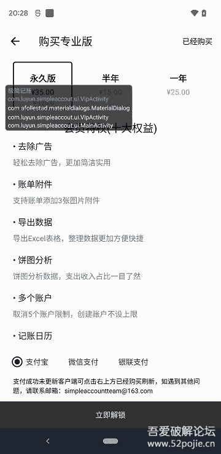
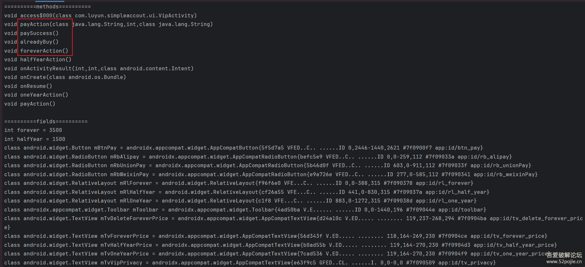
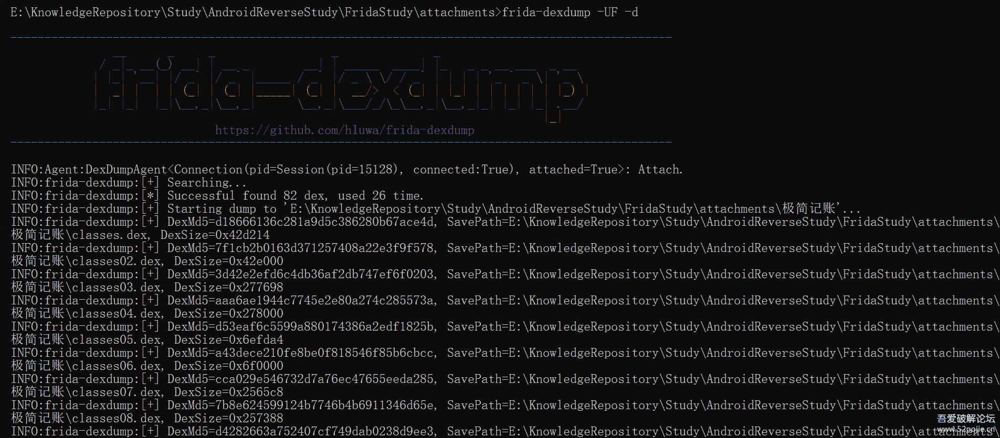
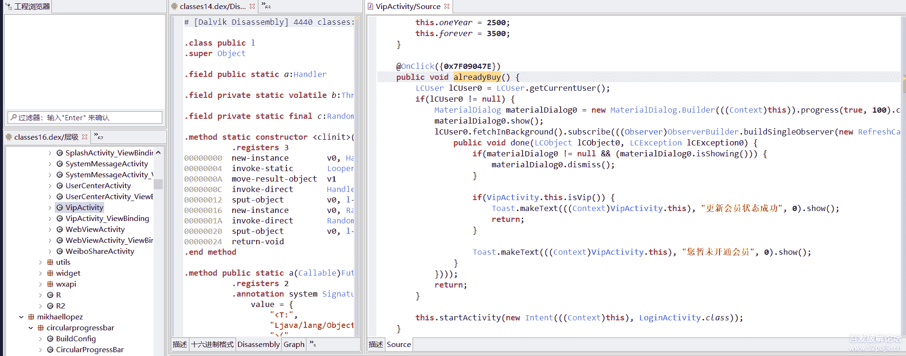
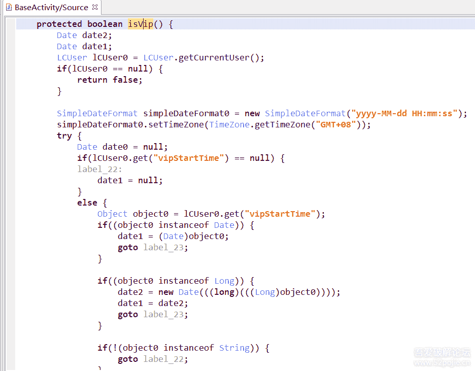
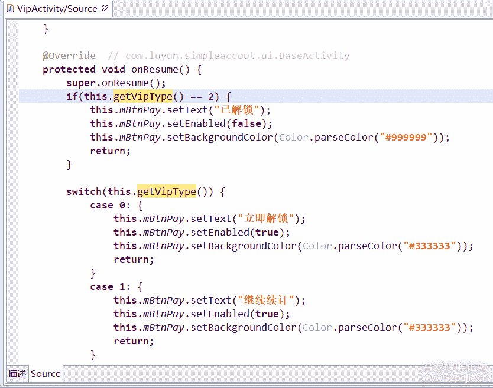
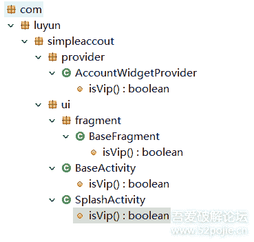
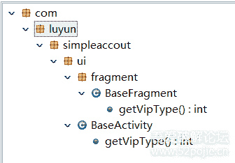
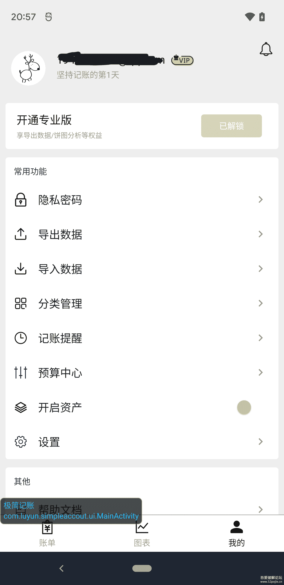
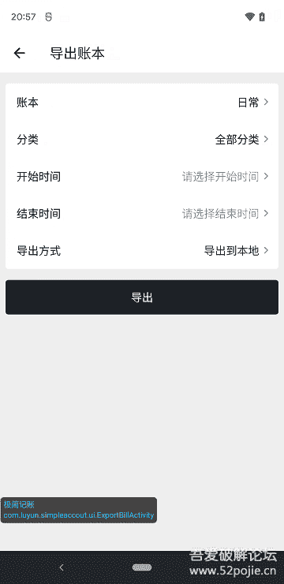

# [Android 原创] Android逆向实战-FridaHook破解极简记账VIP

- 原帖: https://www.52pojie.cn/forum.php?mod=viewthread&tid=1956141
- 抓取时间: 2026-11-01T16:40:10.190Z

[toc]

## 前言

本文中所有内容仅供研究与学习使用，请勿用于任何商业用途和非法用途，后果自负！

最近在学习frida,平常用极简记账记录日常流水,正好实战一波VIP破解

样本使用了360加固,但java代码没有混淆,总体难度不大适合新手上路

基本思路:

- 通过vip相关组件定位关键代码所在类
- frida打印关键代码所在类信息
- dump dex文件,分析关键代码
- hook vip判断逻辑

## 一. 相关环境

测试机: Pixel 3XL Android12

主机环境: Windows10 frida-16.0.19 python3.10 Java8

相关工具: MT管理器 Jeb4.32

App版本: 2.4.4 (360加固)

## 二. VIP代码定位

使用MT管理器记录活动,点击已经购买,定位vip检测的相关类

可以发现关键类为`com.luyun.simpleaccout.ui.VipActivity`



使用frida hook打印`VipActivity`相关信息

```javascript
function main(){
    Java.perform(function (){
        Java.choose("com.luyun.simpleaccout.ui.VipActivity",{
            onMatch:function(instance){
                console.log("instance:",instance);
                var methods=instance.class.getDeclaredMethods();            //方法
                var fields=instance.class.getDeclaredFields();              //字段
                console.log("\n==========methods==========");
                for(let i=0;i
```

发现和支付/vip相关的几个方法



## 三. DumpDex

使用`frida-dexdump` 拉取dex文件



将所有dex文件拖进jeb工具分析(jadx无法正确反编译`VipActivity`相关部分代码)

## 四. 代码分析

反编译完成后搜索`VipActivity`,发现`alreadyBuy()`方法,该方法即为点击"已经购买"后的检测方法

内部主要通过调用`isVip()`判断是否为vip用户



跟进发现`isVip()`方法是继承自`BaseActivity`

该方法内部目测是向服务器拉取vip的起始和终止时间判断是否为有效vip,最终返回值为bool类型



`VipActivity`中还能看到`getVipType()`不同返回值对应的vip类型

`type=0`时未解锁,`type=1`时可续订,`type=2`时是永久vip



最初hook了`VipActivity`的`isVip()`和`getVipType()`方法,发现ui显示为永久会员但是仍然需要解锁

于是搜索所有`isVip()`和`getVipType()`方法实现





## 五. Hook脚本

将以上所有类的`isVip()`和`getVipType()`方法实现全部hook

```javascript
function main(){

    Java.perform(function (){

        var baseActivity=Java.use("com.luyun.simpleaccout.ui.BaseActivity")

        baseActivity.isVip.implementation=function(){

            console.log("Hook isVip() method!Origin result=",this.isVip())

            return true;

        }

        baseActivity.getVipType.implementation=function(){

            console.log("Hook getVipType() method!Origin result=",this.getVipType())

            return 2;

        }

        var baseFragment=Java.use("com.luyun.simpleaccout.ui.fragment.BaseFragment")

        baseFragment.isVip.implementation=function(){

            console.log("Hook BaseFragment isVip() Succeeded!Origin result=",this.isVip());

            return true;

        }

        baseFragment.getVipType.implementation=function(){

            console.log("Hook BaseFragment getVipType() Succeeded!Origin result=",this.getVipType())

            return 2;

        }

        var splashActivity=Java.use("com.luyun.simpleaccout.ui.SplashActivity");

        splashActivity.isVip.implementation=function(){

            console.log("Hook SplashActivity isVip() Succeeded!Origin result=",this.isVip());

            return true;

        }

        var accountWidgetProvider=Java.use("com.luyun.simpleaccout.provider.AccountWidgetProvider")

        accountWidgetProvider.isVip.implementation=function(){

            console.log("Hook AccountWidgetProvider isVip() Succeeded!Origin result=",this.isVip());

            return true;

        }

    })

}

setTimeout(main,500)
```

## 六. 效果演示

Hook成功,并且是永久会员



vip的导出账本功能正常使用


