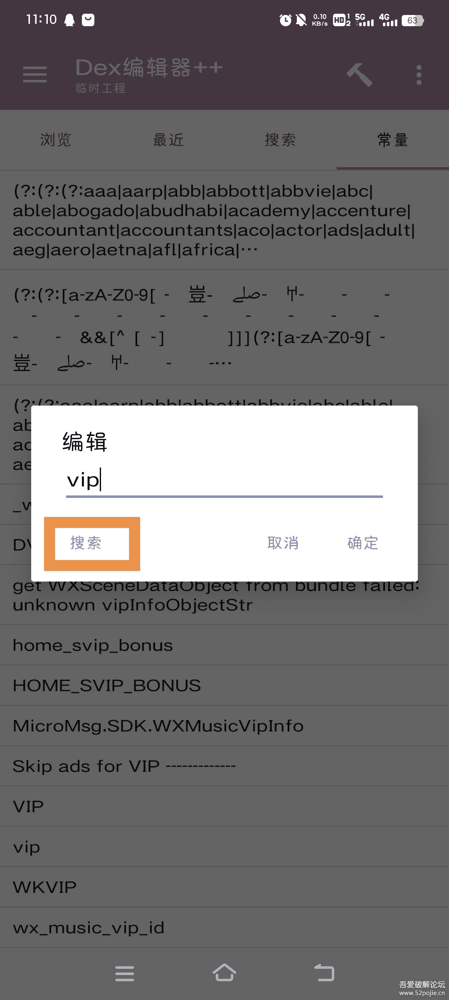
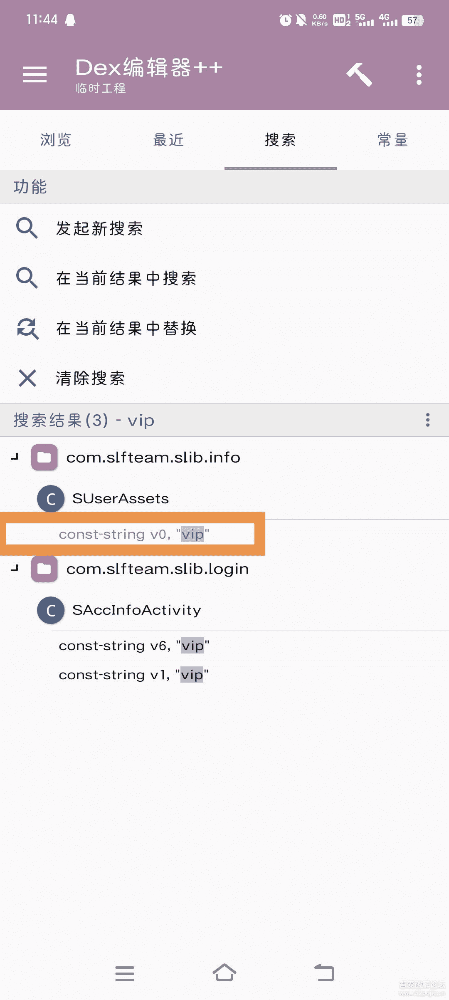
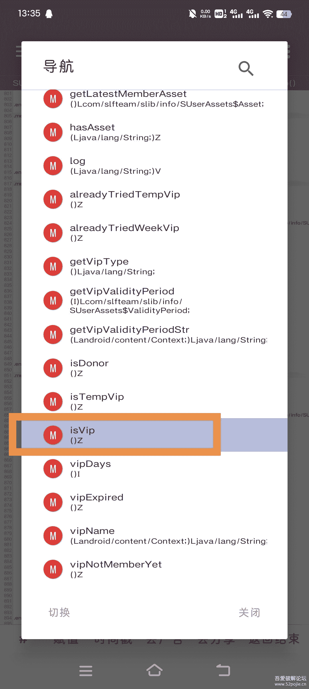
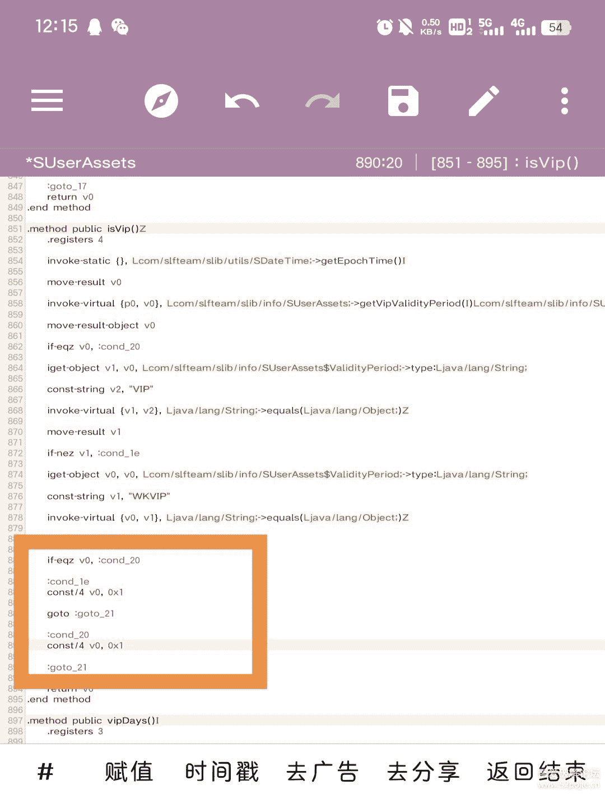
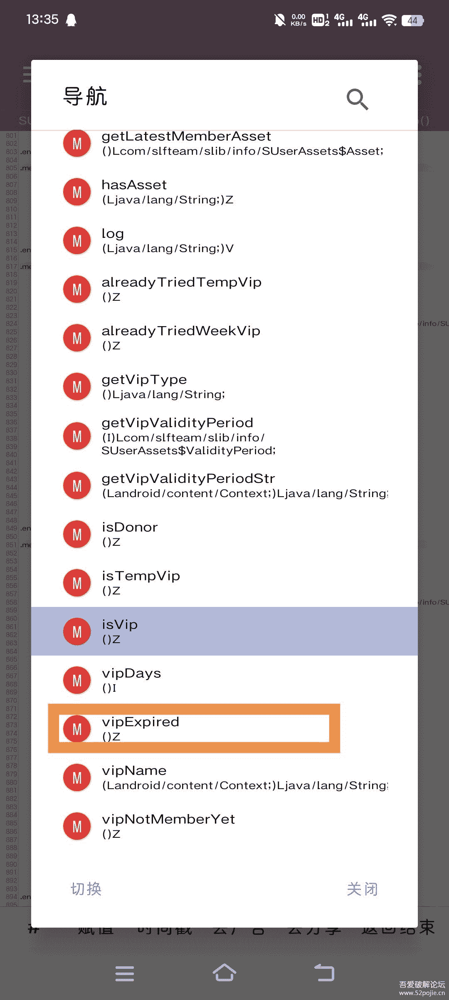
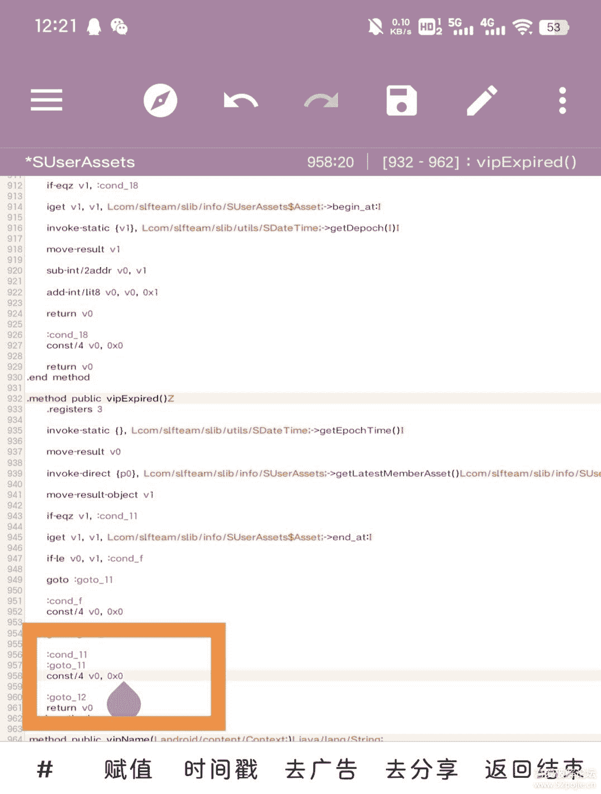
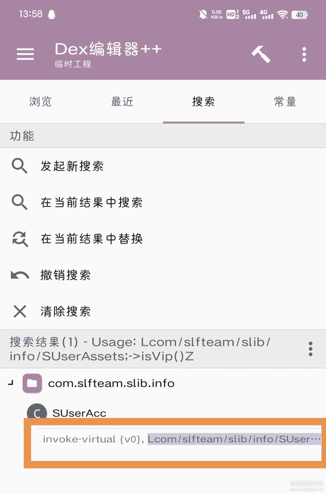
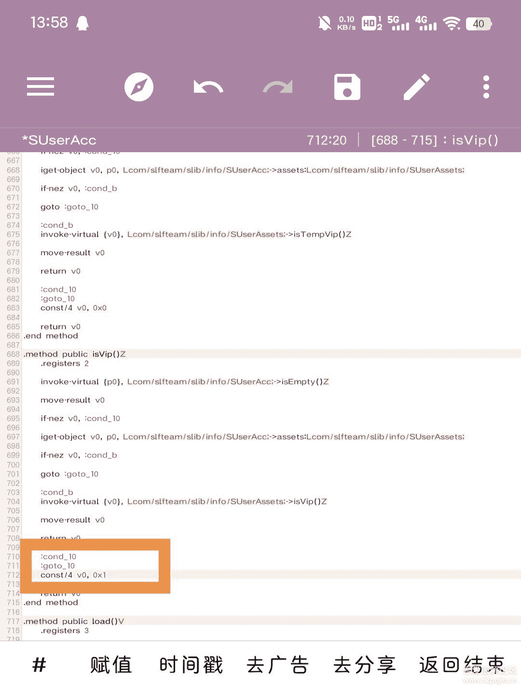

# [Android 分享] Q日记V1.7.70解锁会员

- 原帖：https://www.52pojie.cn/forum.php?mod=viewthread&tid=1956377
- 抓取时间：2026-11-01T16:39:57.183Z

## 简单介绍一下软件

MBE插画风格，简单、可爱、萌；日记列表随着时间延展，方便预览和查看；写日记方便快捷，随手便能记录。

## 准备工具

`Q日记`、`MT管理器`、`NP管理器`

## 教程开始

提取安装包，点击功能，用`MT`的“去除签名校验”去签，`v3`签名，打开`dex`文件，`dex++`，全选，常量过滤`vip`，搜索到的结果点进去。





```
method public getVipType()Ljava/lang/String;
```

可以看到是会员类型的判断。

点击上方的导航，看到`isvip`点进去，赋值1。





导航栏还有个`vipExpired()Z`检查`vip`是否过期的，点进去将`v0`赋值0即可。





在导航栏再查一下`isvip`调用，`Lcom/slfteam/slib/info/SUserAssets;->isVip()Z`再进去赋值1即可。





或者也可以简单粗暴一些，直接搜索`isvip`方法名，点进去进行赋值。

### 成品图


