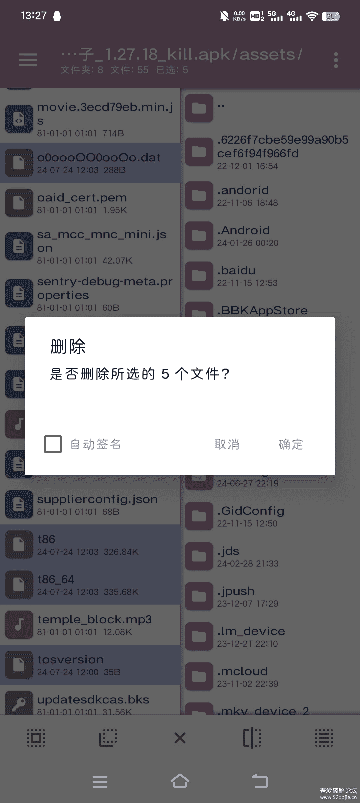
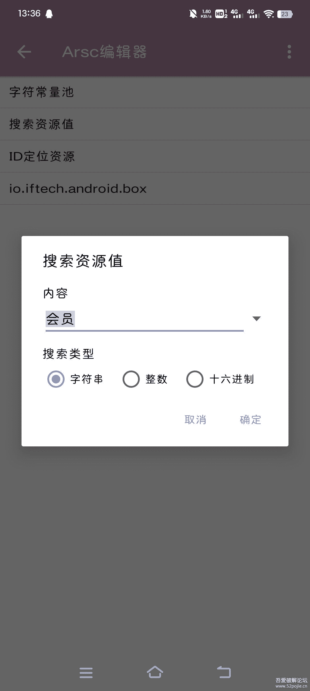
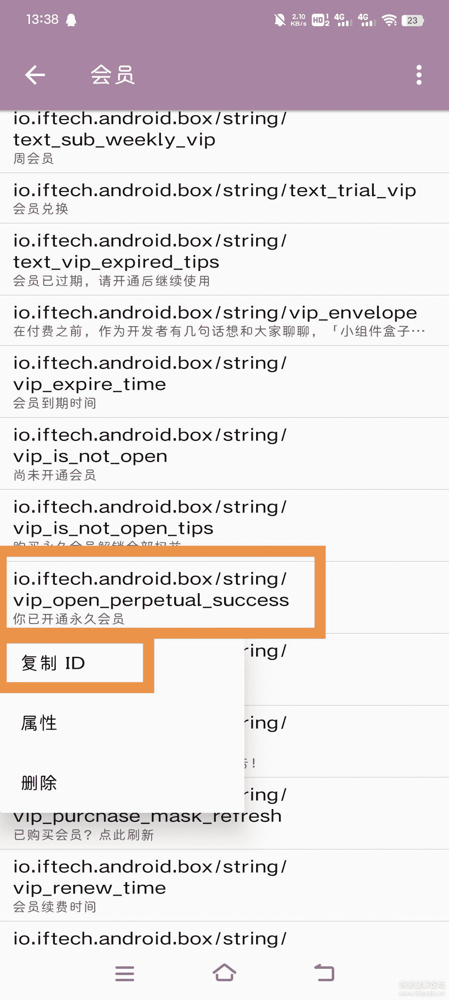
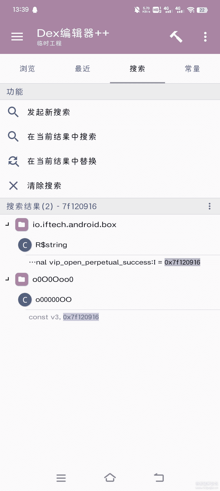
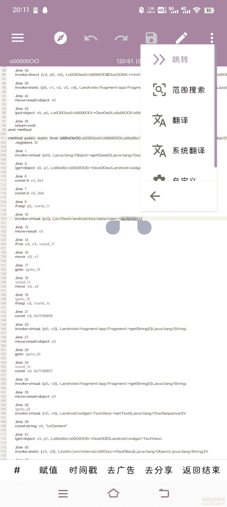
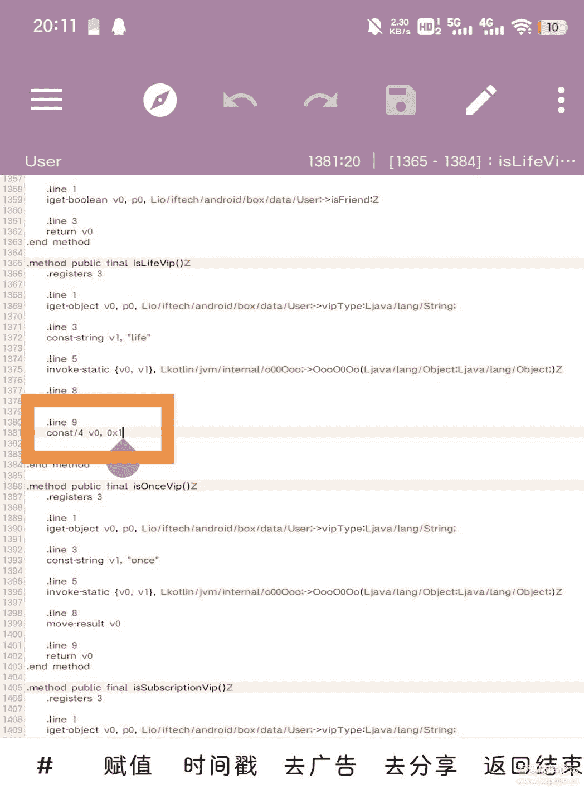
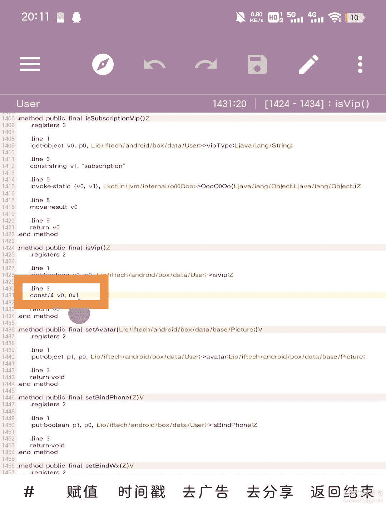

# [Android 分享] 小组件盒子1.27.18解锁永久会员

- 原帖: https://www.52pojie.cn/forum.php?mod=viewthread&tid=1957176
- 抓取时间: 2026-11-01T16:39:48.178Z

## 简单介绍一下软件:

拥有上百种丰富的桌面小组件，能够为您提供多种实用的小工具，包括：系统信息、灵动岛、耳机弹窗、桌面语音、每日诗词、情绪电量、下班倒计时、敲木鱼、动态小风扇等等。

## 准备工具:

- 小组件盒子
- mt管理器
- np管理器
- [脱壳](https://www.52pojie.cn/forum-5-1.html)工具

ps:腾讯御加固，为了脱修后不闪退，不能在`xml`里替换真实入口，不能把所有加固特征都删除。还需要注意全程不要勾选自动签名，这里简单说一下需要删除的无用加固残留文件只能删`assets`文件夹下的

```
0OO00l111l1l
o0oooOO0ooOo.dat
t86
t86_64
tosversion
```



切记不要删除`lib`里的加固特征。

`dex`修复后添加到软件`dex`里。

## 教程开始:

提取安装包，点击功能，用MT的"去除签名校验"去签，点击`arsc`文件，`arsc`编辑器，搜索资源值，会员，字符串，找到你已开通永久会员，复制ID





打开`dex`文件，`dex++`，全选，搜索`7f120916`，整数，第二条结果点进去。



上滑看到`>isLifeVip()Z`跳转进去赋值1





接着往下看到`method public final isVip()Z`跳转进去赋值1即可解锁会员功能。



之后就是保存退出签名安装，需要登录，提示签名不一致，点击下方添加账号，用另一部手机QQ扫码登录即可。

请支持正版，此内容仅供交流学习，不提供任何[破解](https://www.52pojie.cn/)成品；感谢大家支持，一起交流学习～

## 成品图如下:


