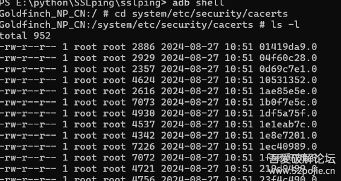
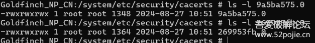
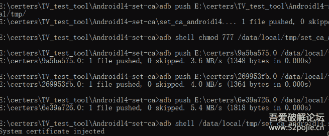
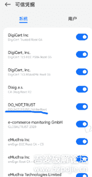

# [Android 分享] Android各种抓包情景

- 原帖: https://www.52pojie.cn/forum.php?mod=viewthread&tid=1958914
- 抓取时间: 2026-11-01T16:39:33.169Z

@[TOC](https://www.52pojie.cn/%E5%9C%A8%E6%8A%93%E5%8C%85%E7%9A%84%E8%B7%AF%E4%B8%8A%E4%B8%80%E5%8E%BB%E4%B8%8D%E8%BF%94)

## Android抓包

Android抓包无非就是三种情况：
1. 未校验：直接放证书就能抓
2. 单向认证：通过hook技术，绕过sslping
3. 双相认证：逆向分析，找证书及密钥

对于前期工作，导入证书信任，可参考下面文章，未作认证校验情况下均可以解决

### 常规抓包（Android 14 可用）

1. 常规使用将证书导入到`/system/etc/securtiy/cacerts`



Android14已经将证书位置更改为`/apex`下面，正常使用`chmod 644`将证书push到`/system`下面已经不再好用，可以尝试将权限更改为777，一般情况下都是可以抓到数据包的。



该操作一般可能需要具备`root`和`remount`权限，能够将整数永久存储在`/system`下面，临时存储的话，可以参考我这篇文章

[//blog.csdn.net/qq_45748106/article/details/136716949?spm=1001.2014.3001.5502](https://blog.csdn.net/qq_45748106/article/details/136716949?spm=1001.2014.3001.5502:https)

### 临时创建映射 apex 下

上述抓包机制，终归是取巧，并非能够真实导入到系统袭人目录下。下面方法，临时创建目录将证书映射到`/apex`下面，不过该方法不是永久的导入到该目录，每次重启设备需要重新导入，可以做成脚本，方便使用。该方法能够将整数添加到设备的系统信任证书根目录下，真正实现系统信任机制

#### 创建命令导入证书与脚本

```bash
adb root
adb push set_ca_android14.sh脚本位置 /data/local/tmp/
adb shell chmod 777 /data/local/tmp/set_ca_android14.sh
adb push 工具证书位置 /data/local/tmp/
adb shell /data/local/tmp/set_ca_android14.sh
```

示例：

```bash
adb root
adb push E:\set_ca_android14.sh /data/local/tmp/
adb shell chmod 777 /data/local/tmp/set_ca_android14.sh
adb push E:\9a5ba575.0 /data/local/tmp/
adb shell /data/local/tmp/set_ca_android14.sh
```

`set_ca_android14.sh` 脚本：

```bash
mkdir -p -m 700 /data/local/tmp/tmp-ca-copy
cp /apex/com.android.conscrypt/cacerts/* /data/local/tmp/tmp-ca-copy/
mount -t tmpfs tmpfs /system/etc/security/cacerts
mv /data/local/tmp/tmp-ca-copy/* /system/etc/security/cacerts/
cp /data/local/tmp/269953fb.0 /system/etc/security/cacerts/
cp /data/local/tmp/9a5ba575.0 /system/etc/security/cacerts/
cp /data/local/tmp/6e39a726.0 /system/etc/security/cacerts/
chown root:root /system/etc/security/cacerts/*
chmod 644 /system/etc/security/cacerts/*
chcon u:object_r:system_file:s0 /system/etc/security/cacerts/*
ZYGOTE_PID=$(pidof zygote || true)
ZYGOTE64_PID=$(pidof zygote64 || true)
for Z_PID in "$ZYGOTE_PID" "$ZYGOTE64_PID"; do
    if [ -n "$Z_PID" ]; then
        nsenter --mount=/proc/$Z_PID/ns/mnt -- \
            /bin/mount --bind /system/etc/security/cacerts /apex/com.android.conscrypt/cacerts
    fi
done
APP_PIDS=$(
    echo "$ZYGOTE_PID $ZYGOTE64_PID" | \
    xargs -n1 ps -o 'PID' -P | \
    grep -v PID
)
for PID in $APP_PIDS; do
    nsenter --mount=/proc/$PID/ns/mnt -- \
        /bin/mount --bind /system/etc/security/cacerts /apex/com.android.conscrypt/cacerts &
done
wait
echo "System certificate injected"
```

其核心原理就是将整数注入到`/apex`下面，具体代码理解大家可以自行搜索，该文章原文来自：

准备好两个文件之后运行第一个`cmd`文件就行，结果：



证书注射成功，查看设备系统信任证书目录



这个是`fiddler`的证书，别的不在列举

### 万能的 Wireshark

#### tcpdump + Wireshark

可根据应用包名，链接`adb`之后，使用`ps`命令获取该应用的进程id

```bash
ps -ef | grep packagename
```

根据应用进程id，使用`netstat`得该应用使用的`tcp`端口号

```bash
netstat -anp | grep pid
```

根据得到的端口号，使用`tcpdump`进行监听指定网卡，并指定端口，抓取数据包
`ifconfig`：根据`ifconfig`命令排查当前使用的网卡是哪个
`tcpdump -i 网卡名 port '(端口号 or 端口号2 or 端口号 3)' -w xxx.pacp` 适用于进程多个端口进行网络数据传输

将`pacp`文件拖入`Wireshark`进行分析，具体加解密机制，可参考此文章

[//www.wsh-study.com/%E8%AE%A1%E7%AE%97%E6%9C%BA%E5%9F%BA%E7%A1%80/%E8%AE%A1%E7%AE%97%E6%9C%BA%E7%BD%91%E7%BB%9C/HTTP/%E5%A6%82%E4%BD%95%E4%BD%BF%E7%94%A8tcpdump%E6%8A%93%E6%8B%8Dhttps%E5%8C%85/](https://www.wsh-study.com/%E8%AE%A1%E7%AE%97%E6%9C%BA%E5%9F%BA%E7%A1%80/%E8%AE%A1%E7%AE%97%E6%9C%BA%E7%BD%91%E7%BB%9C/HTTP/%E5%A6%82%E4%BD%95%E4%BD%BF%E7%94%A8tcpdump%E6%8A%93%E6%8B%8Dhttps%E5%8C%85/:https)

### 小黄鸟

虽然显示目前仅支持13及一下，但是可以通过2中脚本将小黄鸟证书导入到设备中，绕过设备对于根目录证书新人的机制，进行抓包，并且可以进行筛选指定监听的进程

好用，还可以多端互动，设备和`pc`端进行联动，蛮好用的·，`github`链接：

```
[//github.com/MegatronKing/HttpCanary](https://github.com/MegatronKing/HttpCanary:https)
```

### 总结

以上抓包足以满足大部分抓包需求，对于做了证书校验的，如果是单向认证或者伪双相认证，均可以通过`hook`技术，绕过`sslping`机制进行抓包，操作并没有什么难度；针对双向认证，一般就需要逆向基础，去反编译`app`找证书及其通讯的密钥，目前本人水平仅限于`java`层逆向，正在尝试`native`层学习`so`加固相关知识，后续有能力再补充双相认证机制绕过。`hook`绕过`sslping`回头整理一下发出来。

其实测试如果对于`android`版本并没有要求的话，完全可以采用低版本或者模拟器进行抓包，本人是工作所需，所测试任务均指定需要`Android14`和`Android15`，紧跟`android`版本，所以进行各种尝试，对于版本没有要求的完全可以采用低版本进行，方便还好用
