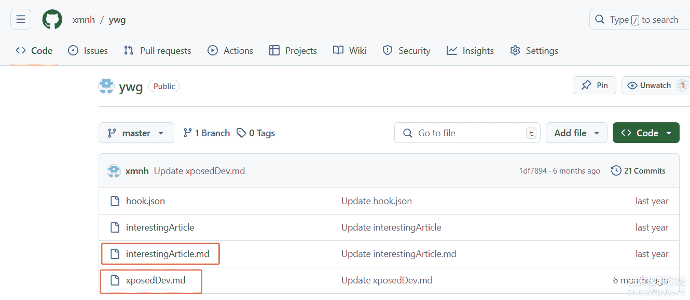
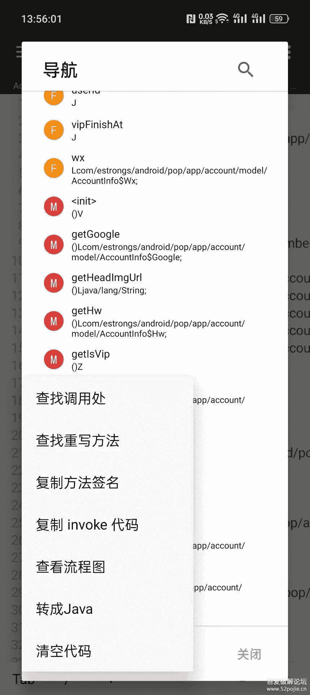
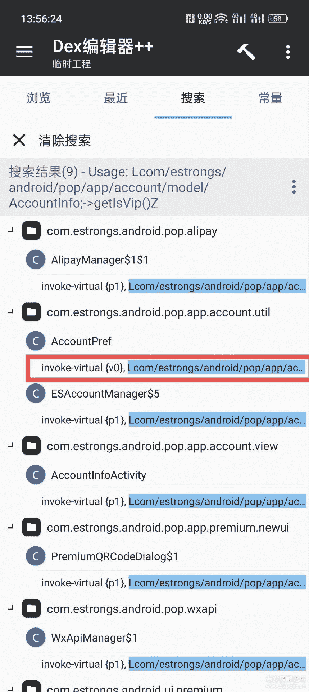
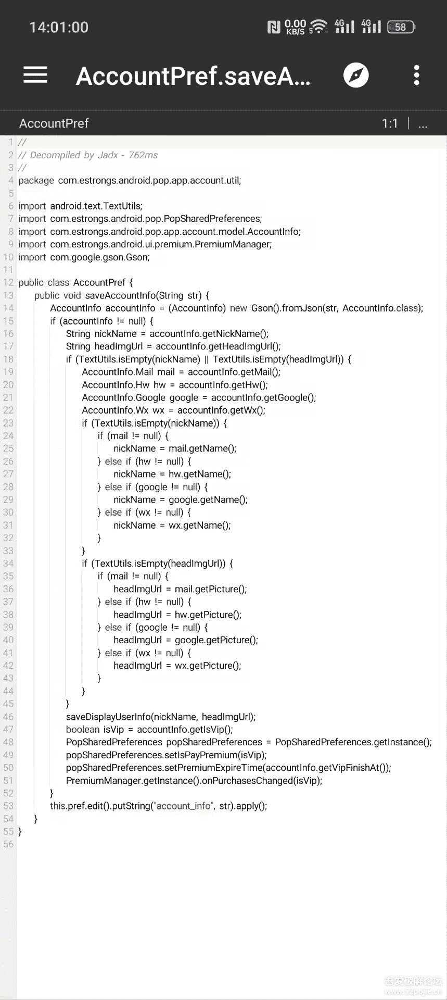
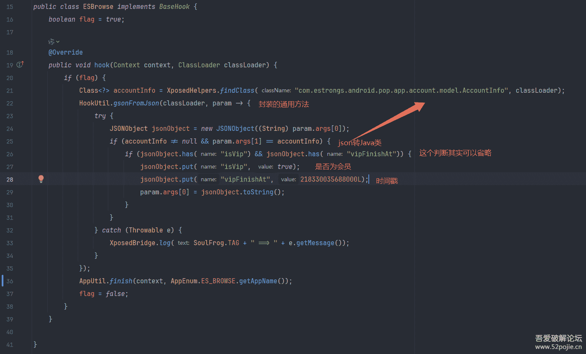

# [Android 原创] 〖xposed模块〗SoulFrog开源项目刨析之ES文件管理器`hook`教程

- 原帖：https://www.52pojie.cn/forum.php?mod=viewthread&tid=1959711
- 抓取时间：2026-11-01T16:39:29.166Z

## 介绍

[SoulFrog](https://github.com/xmnh/SoulFrog)是一个开源xposed模块，精力有限已不再维护。

作为一个逆向爱好者特此写篇帖子帮助共同喜爱逆向的人，目前依旧在新手村，只能做个新手指引人，哈哈哈。

[`//github.com/xmnh/ywg`](https://github.com/xmnh/ywg:https) 这个仓库有xposed开发教程和收集了一些关于逆向的帖子。

## 教程开始

首先通过抓包返回的`json`数据定位到`com.estrongs.android.pop.app.account.model.AccountInfo`。

然后找到`getIsVip()`方法查找调用。

看到有个工具类。

转成Java代码。

可以看到使用了`Gson`库，所以我们可以`hook`这个方法。

由于`accountinfo`这个类是共用的，不会被混淆，所以这个方法是通杀版本。

工具类使用`Consumer`实现。

由于`AccountInfo`这个类是共用的，不会被混淆，所以这个方法是通杀版本。

tips：这个方法好像是从明月小婵婵学来的，嘻嘻嘻
