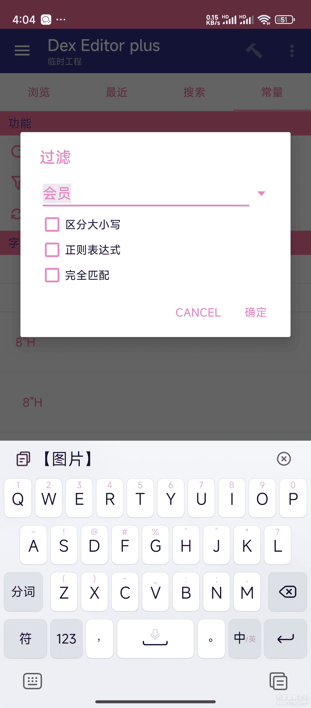
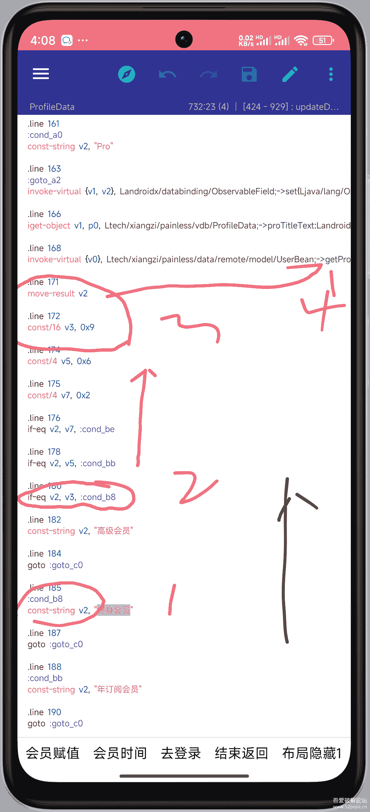
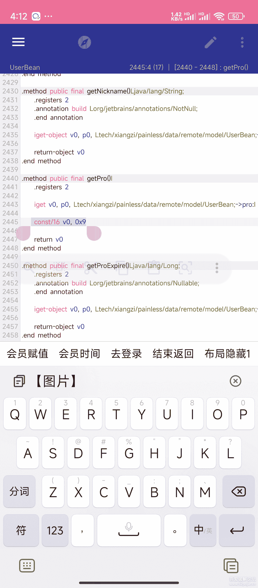

# [Android 分享] 小白逆向无 痛单词会员 `mt` `np`管理器

- 原帖：https://www.52pojie.cn/forum.php?mod=viewthread&tid=1961015
- 抓取时间：2026-11-01T16:32:05.494Z

## 工具

- `mt`或`np`管理器
- 无*痛单词1.16.0（我在小米应用商店下载的）

## 操作步骤

1. 打开应用看是需要会员的
2. 用`mt`管理器提取安装包，查看没有壳，去签（这个版本不去签也不会闪退）
3. 去签后，查看`dex`文件用第一个打开，全选，确定
4. 常量-过滤“会员”
5. 下翻找到“终身会员”搜索
6. 只有一个搜索结果，点进去




### 分析代码

看到终身会员上边有一个转跳标记`cond_b8`，往上翻看到有个`if-eq v2, v3, :cond_b8`的跳转，当寄存器`v2`与`v3`值相等时跳转到`cond_b8`。需要继续往上看看`v2`和`v3`的值分别来自哪里。

```
.line 172
const/16 v3, 0x9
```

可以看到`v3`寄存器值为`0x9`。

```
invoke-virtual {v0}, Ltech/xiangzi/painless/data/remote/model/UserBean;->getPro()I
```

调用`getpro()`方法值。

```
.line 171
move-result v2
```

将返回值放入`v2`寄存器。

可以看到`v2`值其实来自`getPro()`方法的返回值。跳进`getPro()`方法将返回值赋值为`0x9`。

在`return v0`上边那行加上代码：

```
const/16 v0, 0x9
```

保存退出，重新安装。

## 最后效果




