# [Android 原创] 小云朵（原微分身管家）去除木华云弹窗验证

- 原帖：https://www.52pojie.cn/forum.php?mod=viewthread&tid=1961643
- 抓取时间：2026-11-01T16:31:53.156Z

## 前言

声明：本文仅供学习交流使用，所涉及的APP不提供下载渠道。所涉及的技术请勿用于非法活动，否则所带来的一切后果自负。

## 使用工具

- MT管理器
- 算法助手

## 分析过程

- 打开APP就有弹窗

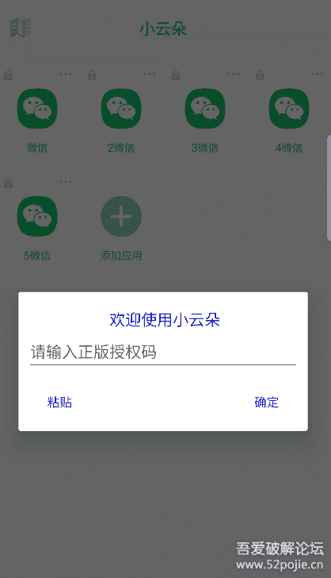

- 算法助手抓弹窗堆栈，重新运行，还是不能按返回键取消，估计是使用了反射

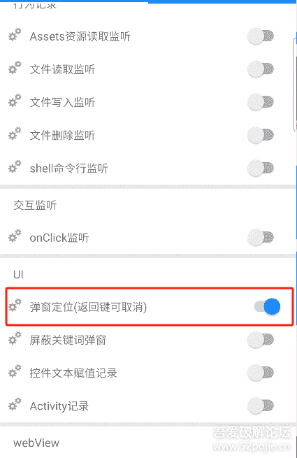

- 抓到一个很可以的调用，看到堆栈日志中确实是使用了反射

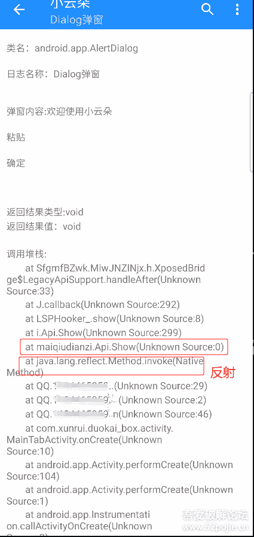

- 将 `Api` 类的 `Show` 方法添加到 `hook` 中

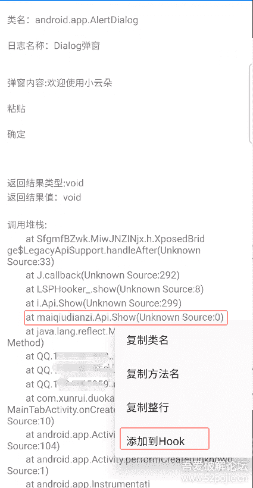

- 使用热修复拦截方法调用测试

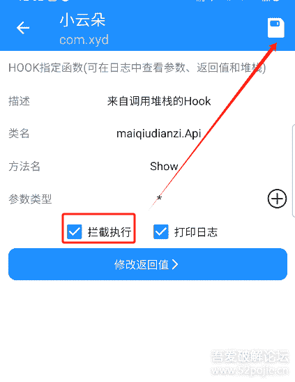

- 拦截成功，弹窗没有了

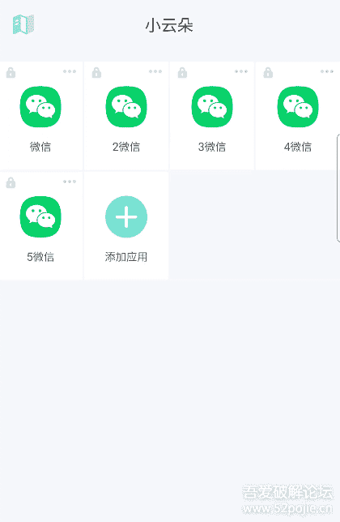

## 破解教程

- 进入 `assets/lspatch` 目录将原包 `origin.apk` 解压出来修改

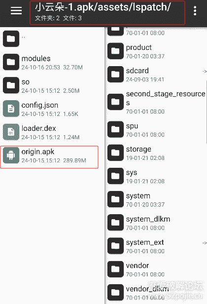

- 搜索到的 `Api` 类

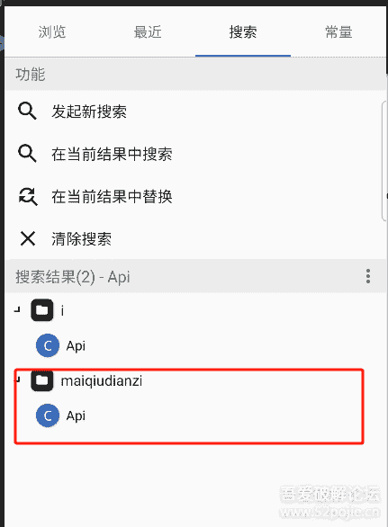

- 无脑一键清空代码

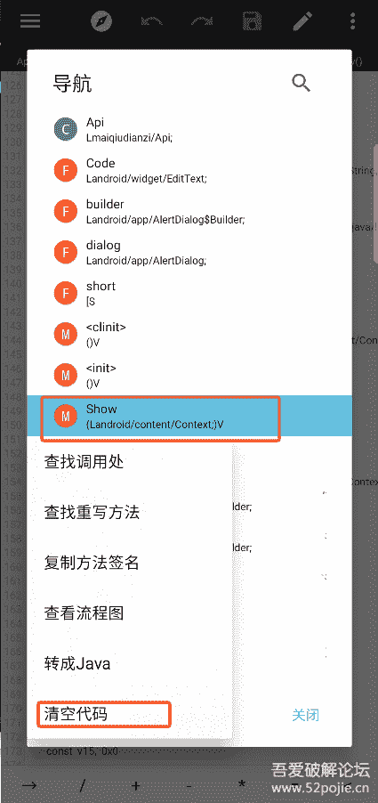

- 清空代码后保存

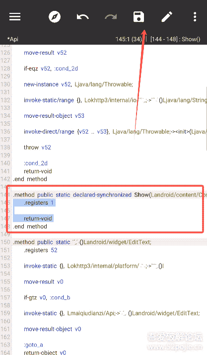

- 将修改后的apk签名，重命名，添加回 `assets/lspatch/`

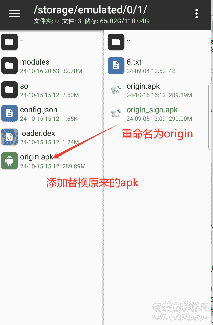

- 然后签名原来Lsp去签的包，重新安装就可以了

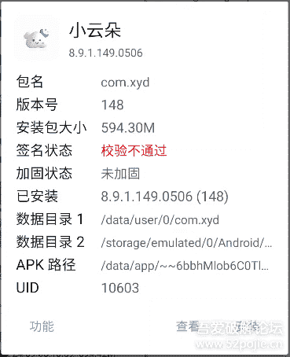
