# [Android 分享] 记一次小白逆向某大神P图VIP过程

- 原帖: https://www.52pojie.cn/forum.php?mod=viewthread&tid=1962149
- 抓取时间: 2026-11-01T16:31:47.699Z

## 工具与应用

工具：`mt管理器`

应用：某大神P图应用，版本6.6.2.1。我从小米应用商店下载的

打开应用看是有会员的。

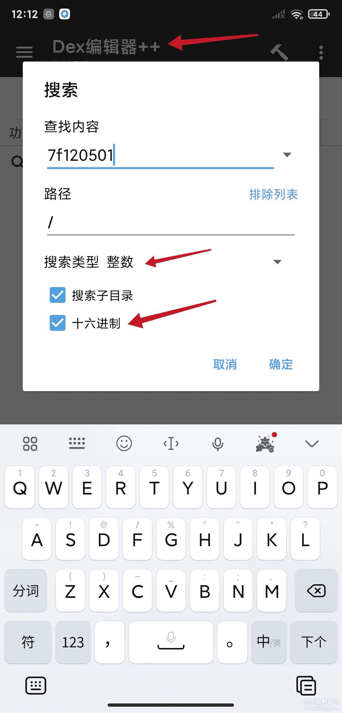

## 定位会员信息

`mt管理器`提取安装包，查看没有壳；去签名校验，打开`dex`，常量—过滤“会员”，搜不到信息。

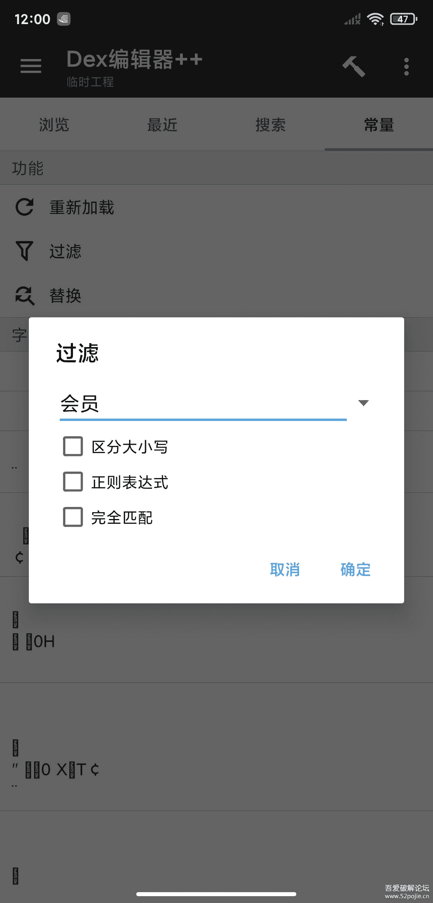

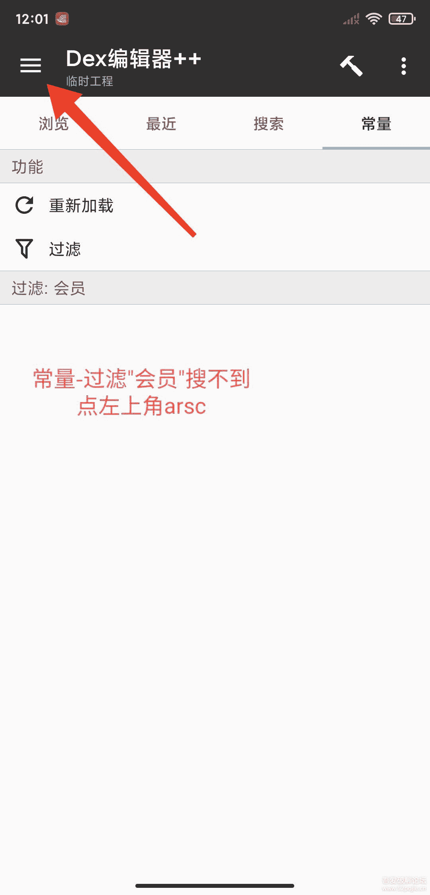

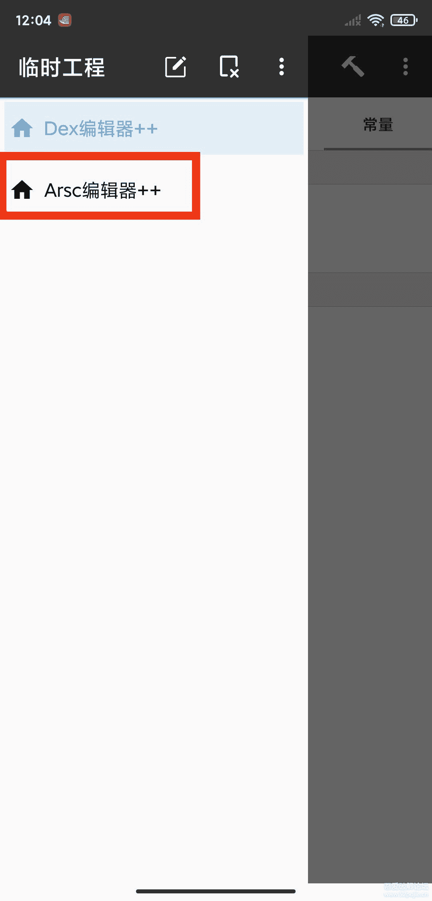

### 使用 `arsc++编辑器` 搜索

用`arsc++编辑器`搜搜试试，常量—过滤“会员”，搜到了。找到“永久VIP会员”，搜索进入复制ID。

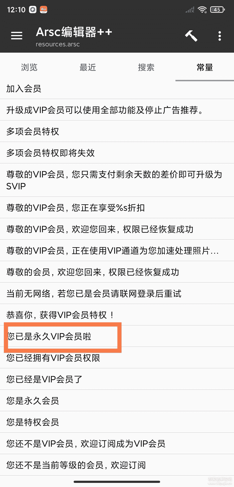

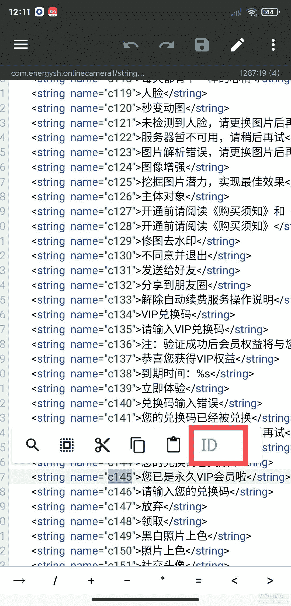

### 修改跳转逻辑

切换到`dex++编辑器`，搜索刚才的ID，找到`const v3`那进去，看到有`goto_79`的跳转标记，

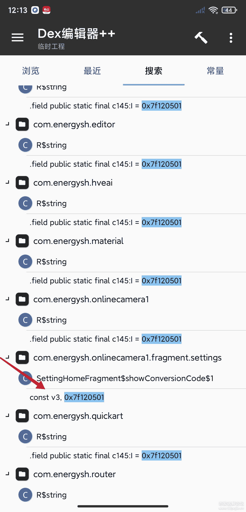

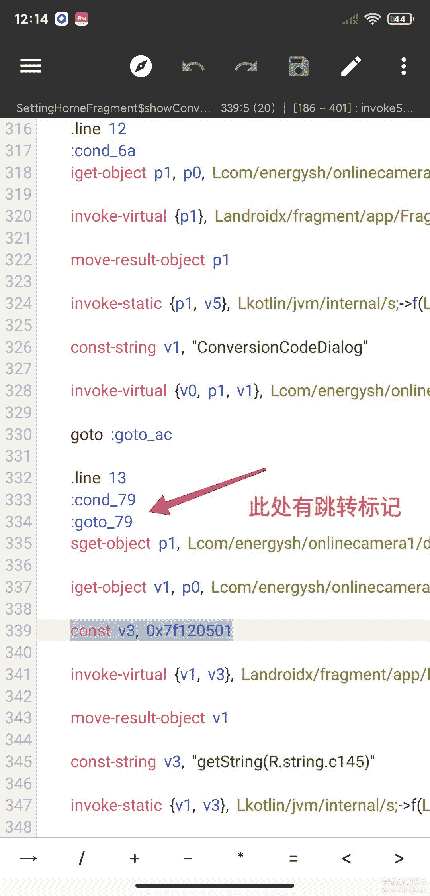

找到上边的直接跳转`goto:goto_79`，继续往上看到还有两个条件跳转，

分别进去`ispermanent()`和`getpaystatus()`方法赋值，不让其跳转。

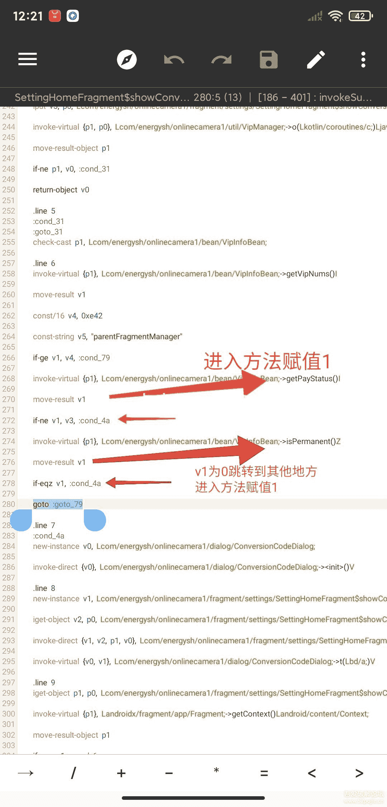

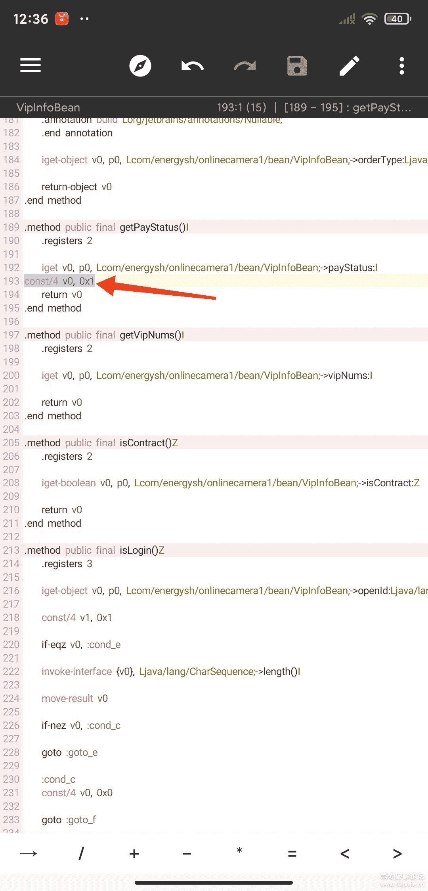

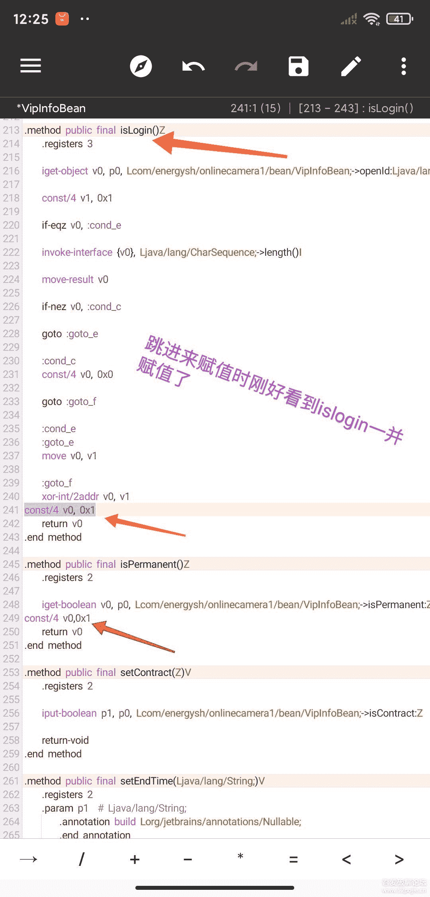

保存退出重新安装点击证件照功能后发现有未登录的跳转，

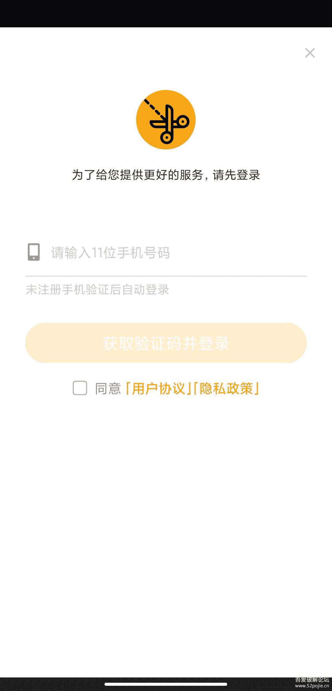

### 处理未登录跳转

继续用`dex++`搜索常量—过滤“登录”，找到未登录跳转，查看代码进入方法`h()`赋0，跳过未登录跳转

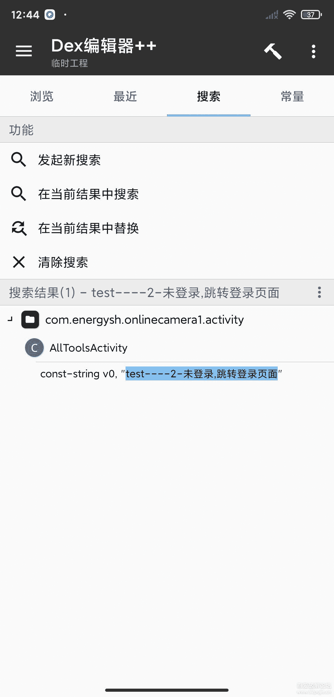

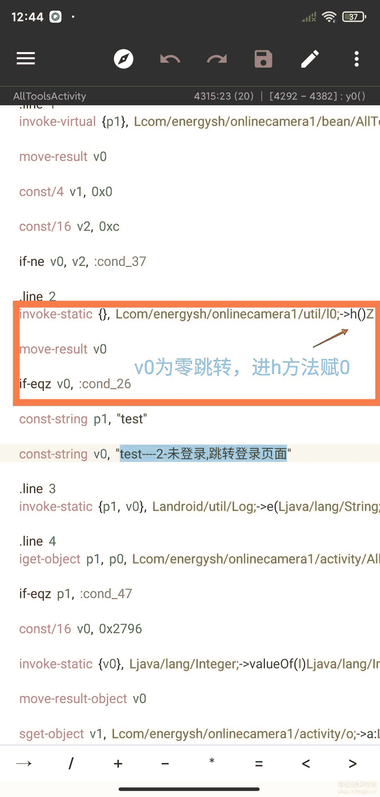

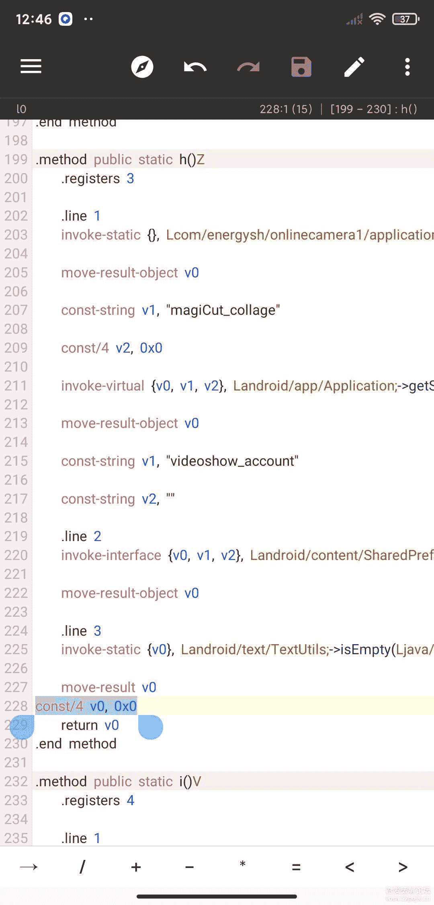

保存退出，重新安装，看效果。

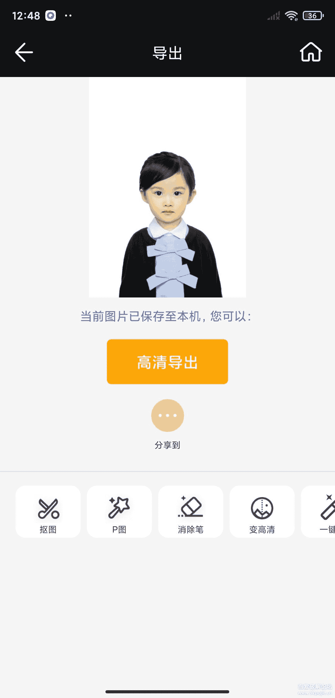

## 更新 6.6.3.0 版本会员

解锁会员搜索类名`Lcom/energysh/onlinecamera1/bean/VipInfoBean`（三个方法都在这个类）导航到方法名同样需要在`islogin()`、`getpaystatus()`和`ispermanent()`方法赋值1

去登录弹窗搜索类名`Lcom/energysh/onlinecamera1/util/m0`

导航到`h()`方法长按清空代码
