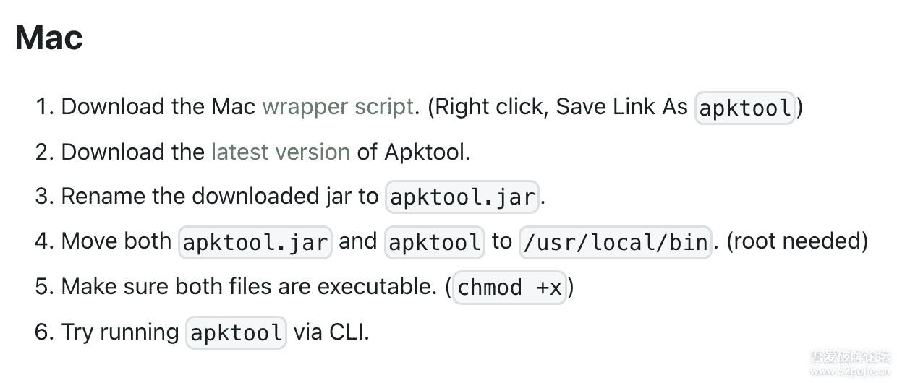
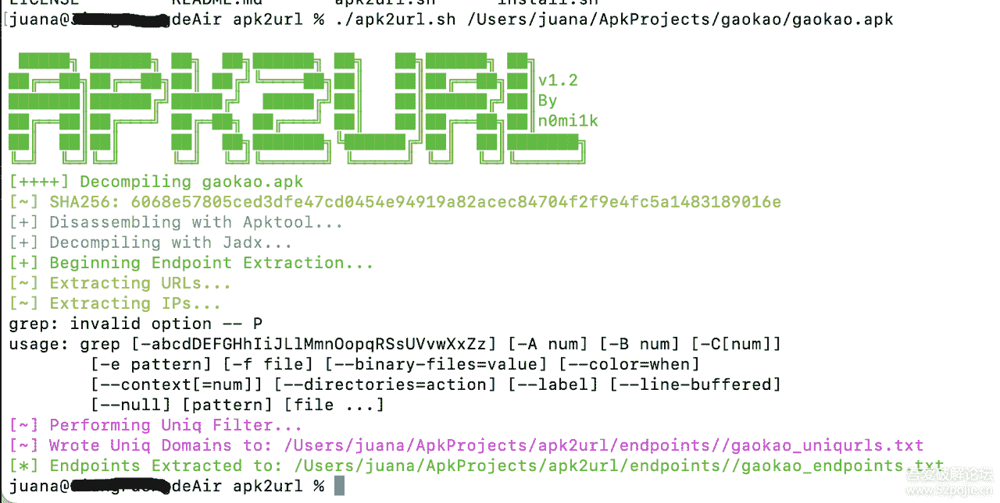
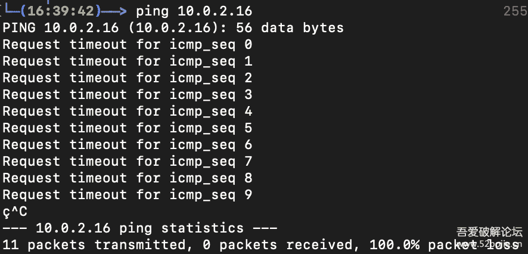
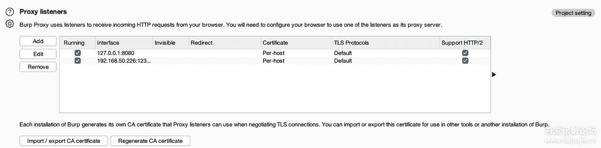
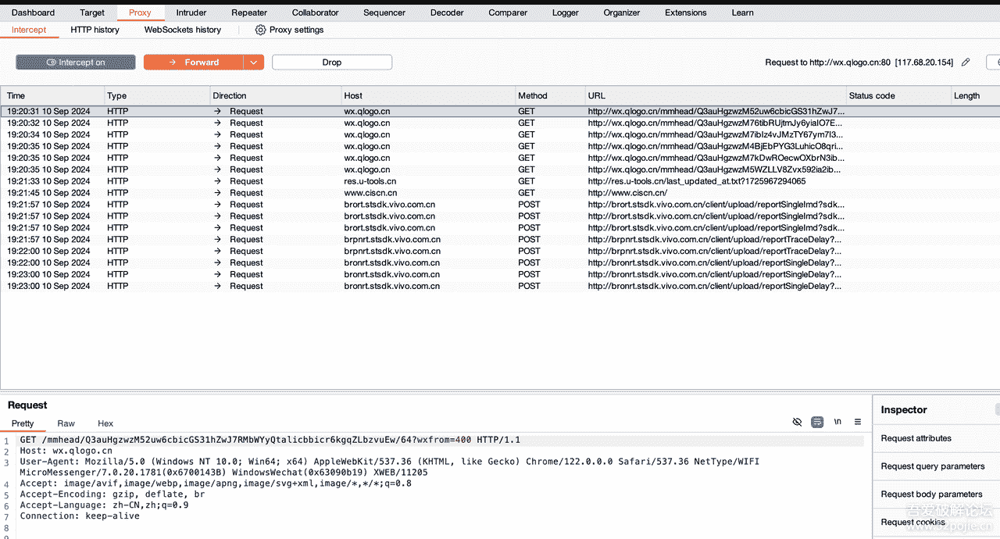
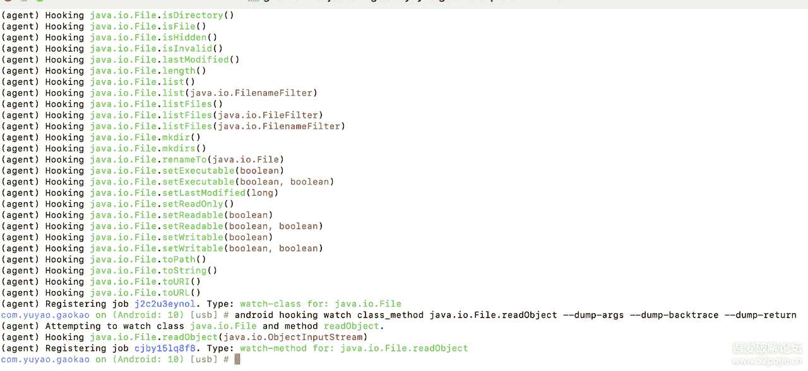

# [Android 原创] 安卓逆向学习3-某apk分析的失败过程

- 原帖: https://www.52pojie.cn/forum.php?mod=viewthread&tid=1963337
- 抓取时间: 2026-11-01T16:31:38.918Z

跟学的书中的apk似乎已经g了，刚好有个网友推荐了一个apk，直接使用它来做本期实验。需求是找到apk中试卷资源的原资源网站地址，鸽了好久，私密马赛，咕咕咕～～～环境的搭建前面已经写过，这里不再赘述。要注意的是需要进入开的`python3.7`版本的[虚拟机](https://www.52pojie.cn/thread-661779-1-1.html)中进行操作，否则会出现`python`、`frida`或者`objection`版本过高的报错信息。还需要的工具是`jeb`，用来查看apk反编译后的代码，笔者使用的macos版，Windows版可以直接运行`jebwin.sh`的Java脚本【?开个坑，安装macos版本时遇到的问题解决方式】

## 0x00 apk2url安装与使用找到apk中的url信息

放链接：https://github.com/n0mi1k/apk2url ，需要安装`apktool`和`jadx`两个依赖，使用`Java8`安装后，`apktool`可以按照官网给的教程https://apktool.org/docs/install/ ，`jadx`直接使用`brew`安装比较快。



使用命令

```
sudo chmod a+x apktool apktool.jar
```

`apk2url`使用命令生成两个从apk中提取的url的txt文件。

```
./apk2url.sh /Users/juana/ApkProjects/gaokao/gaokao.apk
```



## 0x01 分析url

直接对导出的两个文件进行分析，这里遇到的问题是很多网站无法访问，看到的一些资料是通过这些导出的url对网页进行的后续操作。没有经验不会，可以的话能丢些资料给笔者学习一下。提前感谢各位大佬。

## 0x02 bp抓包的使用

这一块是请教了协会的web大佬，使用`Android studio`虚拟机发现无法刷进`kalihunter`获取ip地址，查看虚拟机的设备的设置栏显示的是`10.0.2.16`，使用物理机`ping`一下ip地址来验证与虚拟机之间的连接，发现`ping`超时。



查找相关的资料讲的解决方法是将`android`的版本提高，尝试着解决发现无法解决【laughcrying了】，使用`Charles`和`postern`搭建一个抓包的环境，安装`postern`报错的信息是虚拟机的架构不支持问题，而使用的`vivos9e`(淘汰的旧机)真机发现无法拿到`root`权限，失败！

后面请教了是使用`BurpSuite`代{过}{滤}理配置，在同一局域网下，开单独的通信端口。这里犯了错误是将最上面的本地端口给关掉了，关掉之后发现无法走物理机的路由。



使用安卓真机访问物理机的ip和路由端口，下载`CA`安全证书。手机访问网页或打开软件物理机的`bp`捕捉到数据包【?】。


按照之前的命令，物理机连接测试真机使用`adb`命令安装apk安装包。运行apk发现抓不到相关的数据包。



再去扒数据库只发现是部分的pdf，但确实点击了软件是没有任何网络包通过的，猜测是个静态的软件，好奇怪。时间拖得太久，标记一下。

## 0xCC objection命令学习--内存漫游

### part1:偏静态java类分析

1. 内存中的所有类

```
android hooking list classes
```

2. 已加载类中搜索关键词的类

```
android hooking search classes display
```

`android hooking search classes` 对关键词的类进行搜索

3. 内存中所有包含关键词key的方法

```
android hooking search methods display
```

`android hooking search methods`

4. 某类的所有方法

```
android hooking list class_methods android.view.Display
```

`android hooking list class_methods`

### part2:偏动态查看android操作系统调用【四大组件】

进程活动`activity`

```
android hooking list activities
```

其他组件【services\receivers\providers】只要更换掉`activities`的位置就好

### part3:Hook相关命令

hook掉指定类\方法

```
android hooking watch class java.io.File
```

`android hooking list class`

```
android hooking watch class java.io.File --dump-args --dump-backtrace --dump-return
```

```
android hooking watch class_methods java.io.File
```

`android hooking list class_methods`

```
android hooking watch class_methods java.io.File --dump-args --dump-backtrace --dump-return
```

基础上加上打印【函数的参数、调用栈、返回值】分别对应的是【`--dump-args`、`--dump-backtrace`、`--dump-return`】



通过(agent) Registering job j2c2u3eynol. Type: watch-class for: `java.io.File`这句话判断出开启一个作业job，相关命令

```
jobs list
```
查看当前作业列表
```
jobs kill
```
使用job-ID关闭作业
