# [Android 分享] 小白逆向傻某瓜英语会员过程

- 原帖：https://www.52pojie.cn/forum.php?mod=viewthread&tid=1964018
- 抓取时间：2026-11-01T16:31:31.286Z

某瓜英语2.5.0906正则表达式逆向终身会员

工具：MT管理器、编码工具箱（转正则表达式用）。以下链接来源B站：

- https://www.123pan.com/s/OqXZVv-qGCbv.html
- https://www.123pan.com/s/dQqyjv-RhKd3.html


## 解锁 VIP 的两个步骤

只需以下两个步骤即可完成解锁 VIP。

提取安装包、去签名校验等最基本操作不再赘述。

MT管理器打开 `classes.dex`，搜索第一段代码如下（勾选“搜索子目录”“正则表达式”）：

```
iget-boolean (.*), .*, Lcom/sprite/foreigners/data/bean/table/UserTable;->vip:Z
```

替换为：

```
const $1,1
```

搜索第二段代码：

```
iget (.*), .*, Lcom/sprite/foreigners/data/bean/table/UserTable;->vip_type:I
```

替换为：

```
const $1,0x3
```

保存退出，重新安装。

这两段代码咋来的？下面步骤 4、5 的代码是用编码工具箱里的“转正则表达式”转换的。

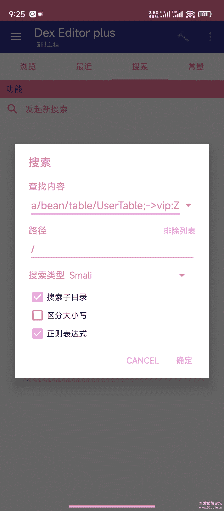

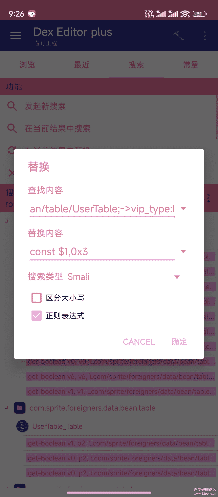

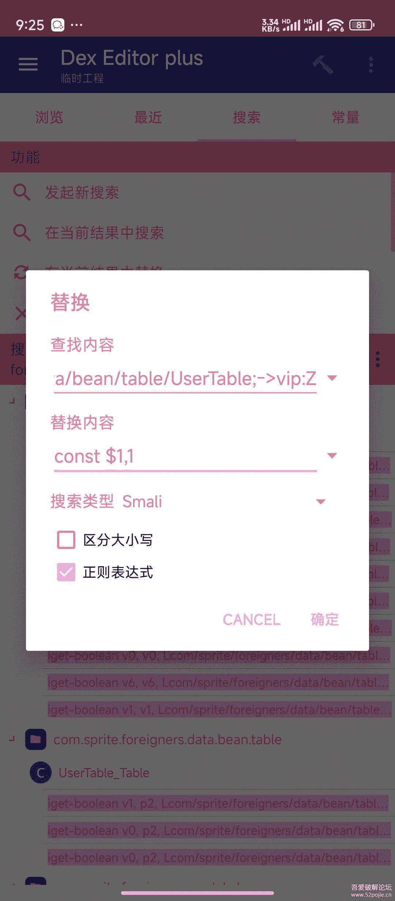

## 具体操作

至于是怎么找的，请看具体操作：

1. MT管理器提取安装包（无壳）。
2. 去签名校验。
3. 打开 `dex` 文件常量，过滤“会员”，找到最贵的终身会员，搜索点进去看代码。
   
   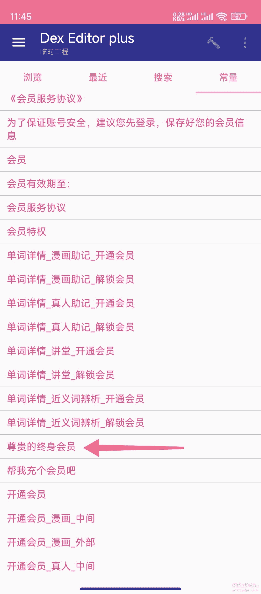
   
   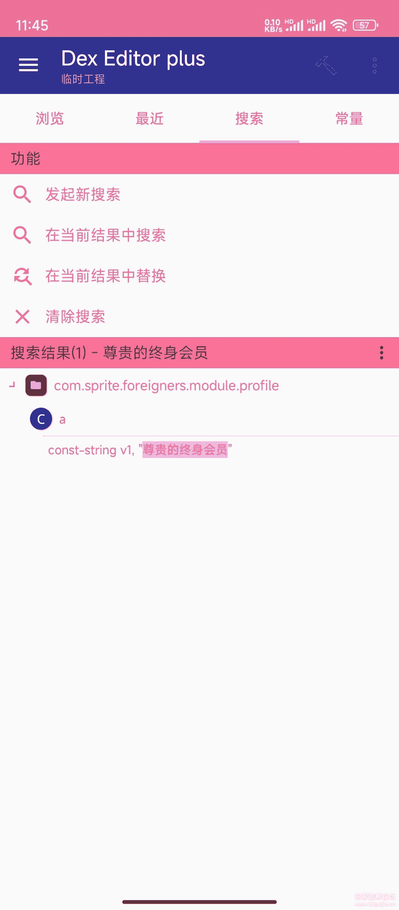
4. 从下往上看，`line8` 中 `v0` 不等于 `v1` 时跳转到别处，`v1` 是 `0x3`，那需要给 `VIP_type` 赋值 `0x3`。
5. `line7` 中 `v1` 为零跳转到别处，需要给 `VIP` 赋值 `1`。

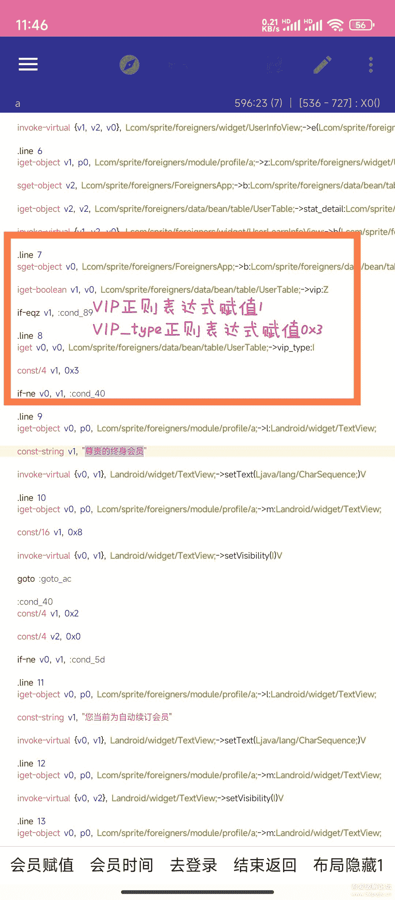

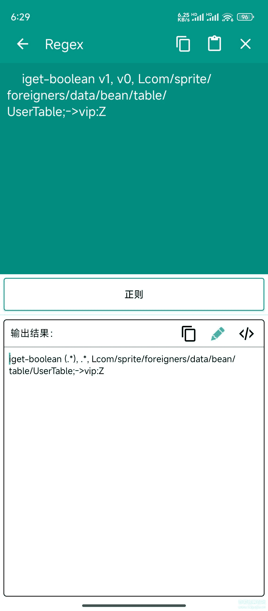

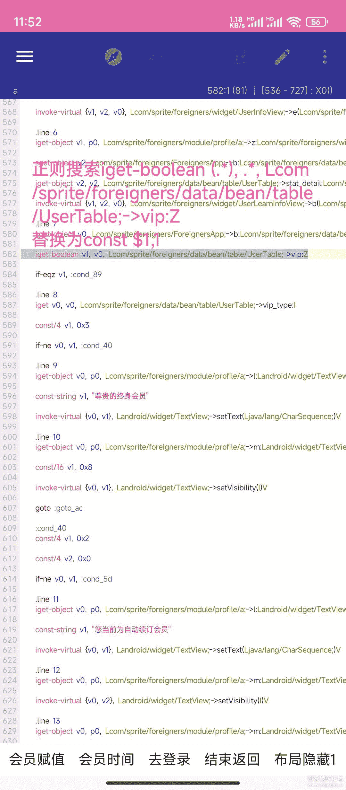

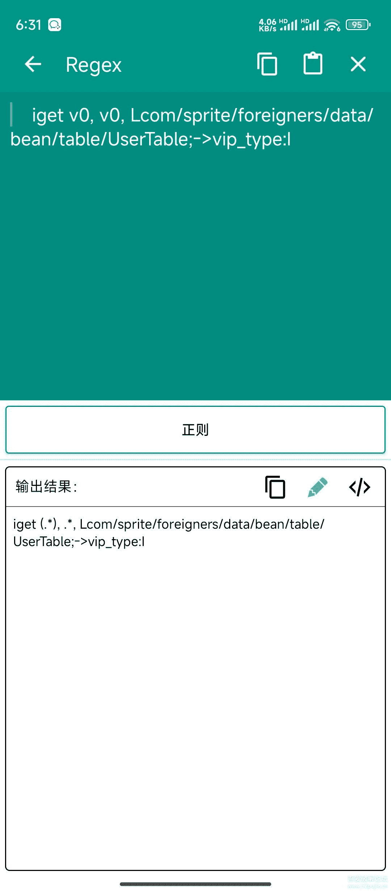

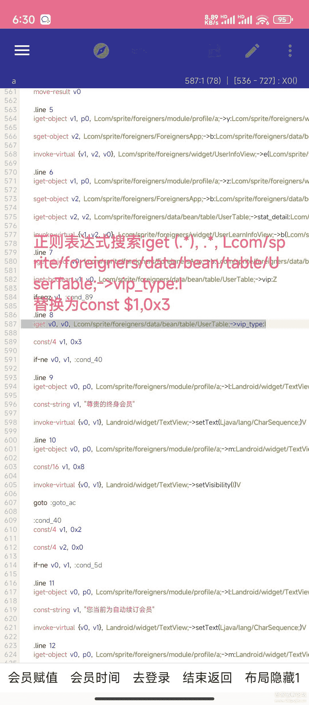

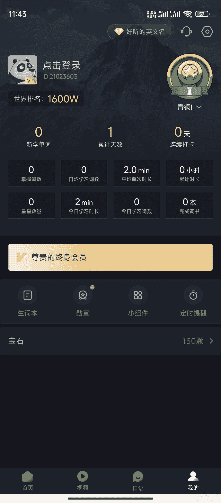
