# [Android 原创] 记一次使用 Xposed RPC 和 BurpGuard 应对金融APP参数签名及加密的详细过程

- 原帖: https://www.52pojie.cn/forum.php?mod=viewthread&tid=1964051
- 抓取时间: 2026-11-01T16:31:23.069Z

## 前言

本文首发于先知论坛：[https://xz.aliyun.com/t/15533](https://xz.aliyun.com/t/15533)

在一次金融渗透测试项目中需要对 APP 进行渗透，发现 APP 对参数进行了签名以及加密，于是便逆向 APP 并通过 Xposed RPC 和 BurpGuard 解决了问题，从中学到了许多，因此记录过程并分享一下思路，代码和图片均做了脱敏处理，同时省略了代码调试的过程。

阅读完本文，你可以学习到：

- APP 请求逆向思路
- 如何查阅资料
- APP 请求签名和加密的原理
- 了解白盒 `WbSM4`
- Xposed RPC 的实现思路
- BurpGuard 如何使用

声明：本文不针对任何 APP，仅对加密及签名技术进行研究，如有侵权，请联系删除。

## 详细过程

测试环境：`mumu`模拟器、`Magisk`、`Lsposed`

### 初探签名及加密

APP 的 HTTPS 验证就不阐述了，常规方式均可绕过。

查看请求包，发现了`MsgId`、`AppSign`以及密文`cTxt`：

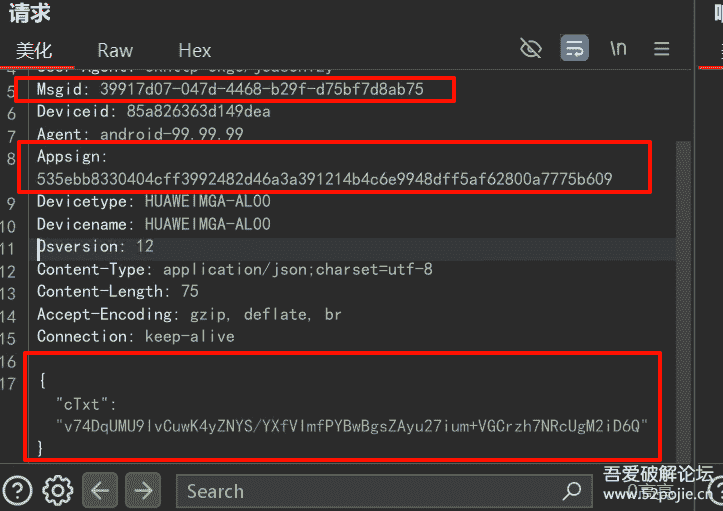

修改`MsgId`，返回 401，很明显做了请求签名：

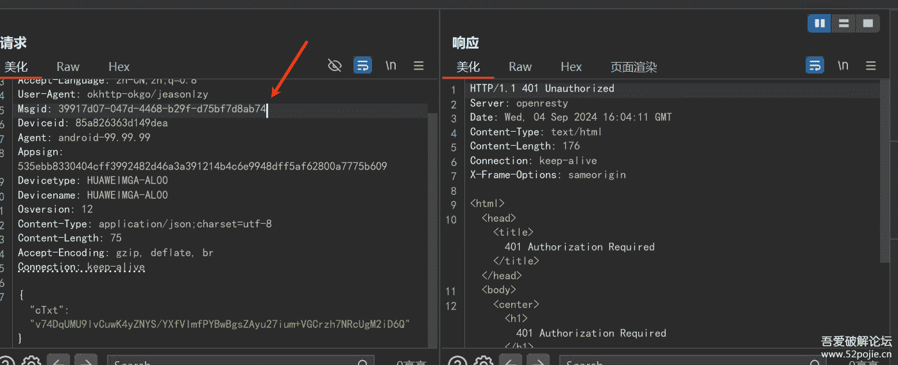

### 加密分析

这里 APP 采用了爱加密企业版加固，于是使用 算法助手Plus + frida 脚本脱壳，使用 Jadx 反编译，搜索关键词，发现没搜到：

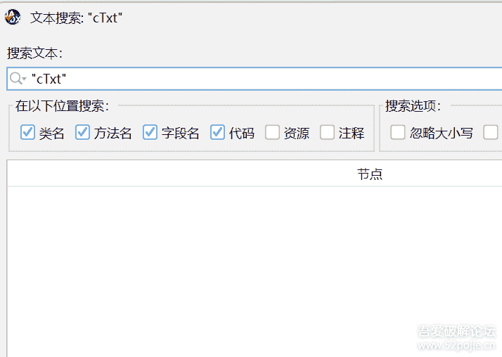

随后翻了翻，发现代码都抽空了，到 native 层去了？似乎是没脱完整：

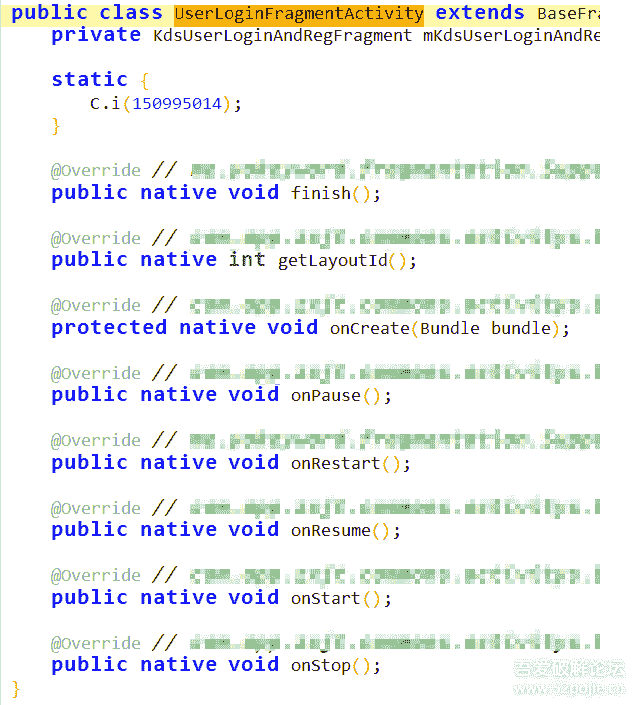

求助某大佬帮忙脱了个壳，继续搜索关键词，找到两处，看到 ECB，莫非是常见的 AES-ECB 加密（心中窃喜）：

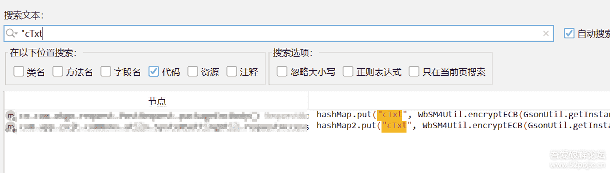

跟进去：


继续跟 encryptECB：

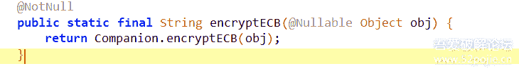

跟进：

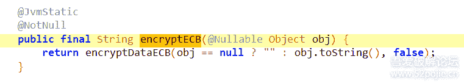

最终来到`xxx.WbSM4Util$Companion`类的`encryptDataECB`方法：

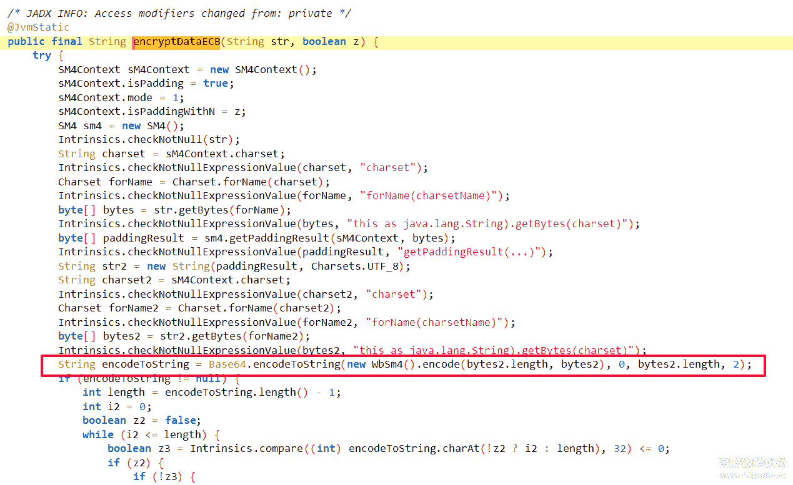

这是对应的解密函数：

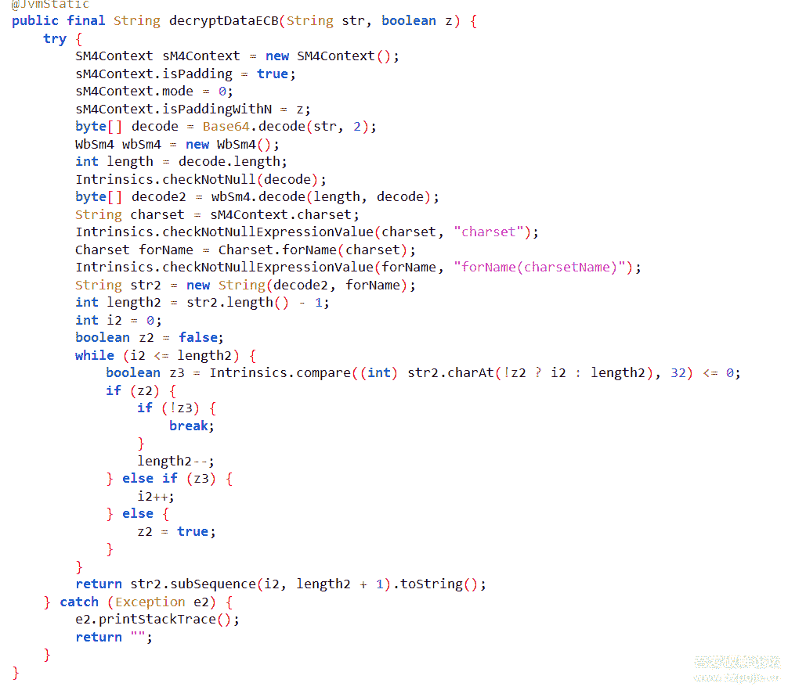

接着看看加密函数中的关键部分`WbSm4().encode()`，这个函数传入的就是明文的字节对象和长度，并没有密钥相关，最后做了一层 Base64：

```
String encodeToString = Base64.encodeToString(new WbSm4().encode(bytes2.length, bytes2), 0, bytes2.length, 2);
```

跟进`WbSm4`一探究竟，发现是 native 的：

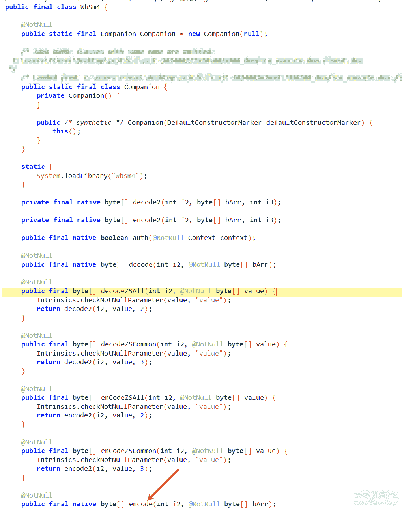

网上搜寻一下看看是什么，似乎是 SM4 国密：

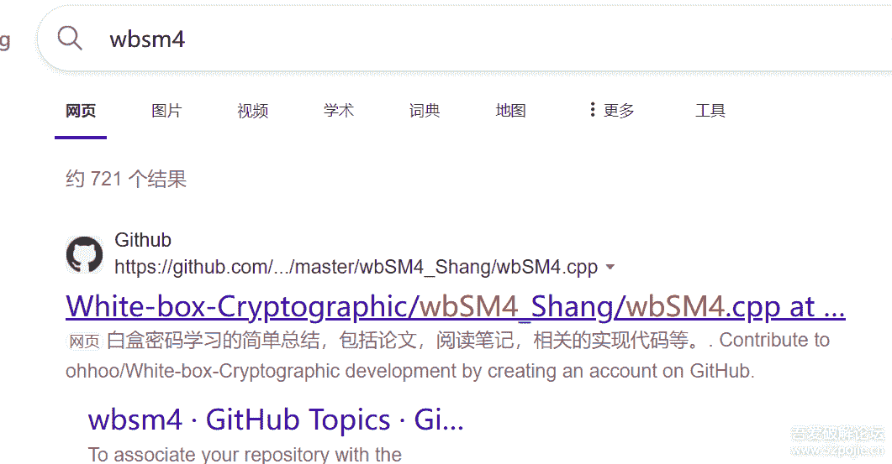

问一下 GPT，白盒`SM4`是什么，看起来是很难复现的算法，密钥也很难提取，后续可能需要采用 RPC 远程调用 ：

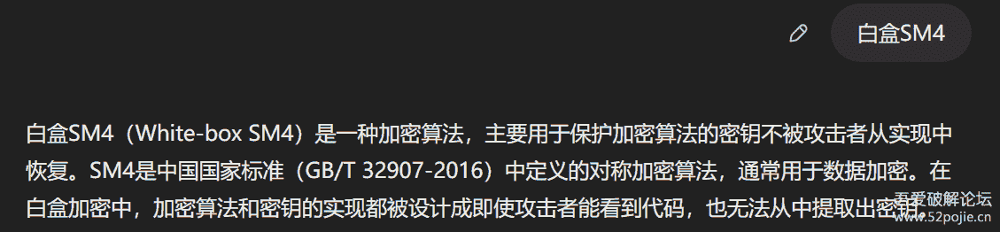

根据上面的代码分析简单画一个图：

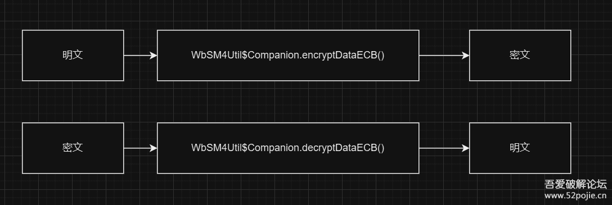

### 签名分析

接下来看看签名，搜索签名关键词`appsign`：

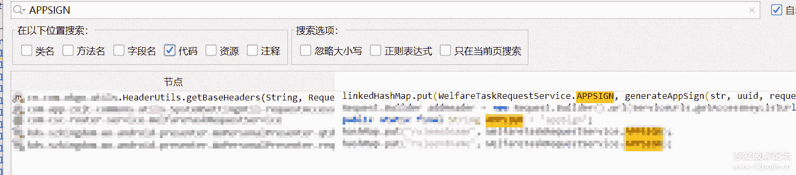

跟进第一个的`WelfareTaskRequestService.APPSIGN`，是个常量：


搜索常量名，看看哪一处使用了它，这里发现第二个是添加请求头，比较可疑：

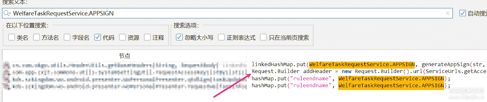

跟进代码如下：

```
String uuid = UUID.randomUUID().toString();

Request.Builder addHeader = new Request.Builder().url(ServiceUrls.getAccessKeyListUrl(ServerInfoMgr.getInstance().getDefaultServerInfo(204))).addHeader(RemoteMessageConst.MSGID, uuid).addHeader("deviceId", SysConfigs.DEVICE_ID).addHeader("agent", "android-" + YBHelper.getAppVersionName()).addHeader(WelfareTaskRequestService.APPSIGN, HeaderUtils.generateAppSign(ServiceUrls.getAccessKeyListUrl(ServerInfoMgr.getInstance().getDefaultServerInfo(204)), uuid, HeaderUtils.requestBodyToString(create)));
```

分析上面代码可知，`RemoteMessageConst.MSGID`是个字符串常量，值为`"MsgId"`，而签名是由静态方法`HeaderUtils.generateAppSign(url,uuid.requestBody)`生成的，其中三个参数分别为：完整 URL、`UUID`、完整请求 Body，可以看出请求 body 与`msgid`和`appsign`强相关，任何一个参数错误都可能导致请求不合法，以下是简单示意图：

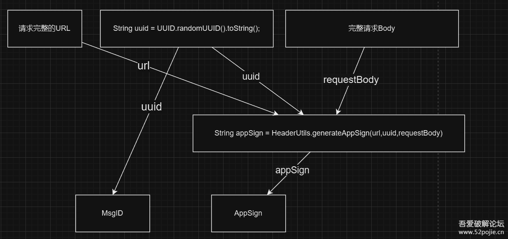

### Xposed RPC 实现

加密和签名都分析完毕，剩下的就是使用 RPC （远程过程调用）了，也就是注入代码，这里我用的是 Xposed 框架，没有检测，但 frida 有检测，过检测的方式参考下方公众号的文章（理论无脑过爱加密企业版），自己试了下确实可以：

[https://mp.weixin.qq.com/s/34c5JVJzSCEfqlPanV1FtA](https://mp.weixin.qq.com/s/34c5JVJzSCEfqlPanV1FtA)

对 Xposed 的 RPC 不太熟悉，网上查阅资料，找到如下文章：

[https://www.52pojie.cn/thread-1519322-1-1.html](https://www.52pojie.cn/thread-1519322-1-1.html)

发现使用`NanoHTTPD`在 APP 内部起一个 HTTP 服务器来与外部通信来实现 RPC 比较方便，写一个 demo，代码可以直接运行，会开启一个 50000 端口的 HTTP 服务器，开放`/encrypt`接口用于加密数据和生成签名，`/decrypt`接口用于解密数据：

```
import com.google.gson.JsonObject;  
import fi.iki.elonen.NanoHTTPD;  

import java.io.IOException;  
import java.util.HashMap;  
import java.util.Map;  

class HTTPServer extends NanoHTTPD {  

    public HTTPServer(int port) {  
        super(port);  
    }  

    @Override  
    public Response serve(IHTTPSession session) {  
        JsonObject responseJson = new JsonObject();  
        String encryptData = "";  
        String decryptData = "";  
        Map map = new HashMap<>();  
        try {  
            session.parseBody(map);  
        } catch (Exception e) {  
            return newFixedLengthResponse(Response.Status.INTERNAL_ERROR, "text/plain", e.getMessage());  
        }  
        if (session.getMethod() == Method.POST) {  
            switch (session.getUri()) {  
                case "/encrypt":  
                    responseJson.addProperty("encryptData", encryptData);  
                    return newFixedLengthResponse(Response.Status.OK, "application/json", responseJson.toString());  
                case "/decrypt":  
                    responseJson.addProperty("decryptData", decryptData);  
                    return newFixedLengthResponse(Response.Status.OK, "application/json", responseJson.toString());  
                default:  
                    return newFixedLengthResponse(Response.Status.NOT_FOUND, "text/plain", "Not Found");  
            }  
        } else {  
            return newFixedLengthResponse(Response.Status.NOT_FOUND, "text/plain", "Not Found");  
        }  
    }  
}  

public class Demo {  
    public static void main(String[] args) throws IOException {  
        HTTPServer httpServer = new HTTPServer(50000);  
        httpServer.start(NanoHTTPD.SOCKET_READ_TIMEOUT, false);  
    }  
}
```

Xposed 模块使用的模板：[https://github.com/yinsel/XposedProjectTemplate](https://github.com/yinsel/XposedProjectTemplate)

完整 Xposed 代码实现如下（代码写的有点烂，勿喷）：

```
package com.example.xposed;  

import android.util.Log;  

import com.google.gson.JsonObject;  

import com.google.gson.JsonParser;  

import java.io.IOException;  

import java.lang.reflect.Constructor;  

import java.lang.reflect.InvocationTargetException;  

import java.lang.reflect.Method;  

import java.util.HashMap;  

import java.util.Map;  

import java.util.UUID;  

import de.robv.android.xposed.IXposedHookLoadPackage;  

import de.robv.android.xposed.callbacks.XC_LoadPackage;  

import fi.iki.elonen.NanoHTTPD;  

public class Hooker implements IXposedHookLoadPackage {  

    private HTTPServer httpServer = new HTTPServer(50000);  

    @Override  

    public void handleLoadPackage(XC_LoadPackage.LoadPackageParam loadPackageParam) throws Throwable {  

        try {  

            Class clazz = Class.forName("xxx.WbSM4Util$Companion", true, loadPackageParam.classLoader);  

            Method methods[] = clazz.getDeclaredMethods();  

            Constructor constructor = clazz.getDeclaredConstructor();  

            constructor.setAccessible(true);  

            Crypto crypto = new Crypto();  

            crypto.setClassLoader(loadPackageParam.classLoader);  

            crypto.setObject(constructor.newInstance());  

            for (int i = 0; i  {  

                try {  

                    httpServer.start(NanoHTTPD.SOCKET_READ_TIMEOUT, false);  

                    Log("HTTP Server started on port " + httpServer.getListeningPort());  

                } catch (IOException e) {  

                    Log("Error starting HTTP Server: " + e.toString());  

                }  

            }).start();  

        }  

    }  

    public static class HTTPServer extends NanoHTTPD {  

        private Crypto crypto;  

        public HTTPServer(int port) {  

            super(port);  

        }  

        public Crypto getCrypto() {  

            return crypto;  
```


```java
        }

        public void setCrypto(Crypto crypto) {
            this.crypto = crypto;
        }

        @Override
        public Response serve(IHTTPSession session) {
            JsonObject responseJson = new JsonObject();
            JsonObject body = new JsonObject();
            Map map = new HashMap<>();
            try {
                session.parseBody(map);
                String data;
                if (session.getMethod() == Method.POST) {
                    body = JsonParser.parseString(map.get("postData")).getAsJsonObject();
                    switch (session.getUri()) {
                        case "/encrypt":
                            // 从BurpGuard拿到需要加密的数据data以及签名需要的url
                            data = body.get("data").getAsString();
                            String url = body.get("url").getAsString();
                            // 反射获取需要的方法
                            Class headerUtil = Class.forName("xxx.HeaderUtils", false, crypto.getClassLoader());
                            java.lang.reflect.Method generateAppSign = headerUtil.getDeclaredMethod("generateAppSign", String.class, String.class, String.class);
                            generateAppSign.setAccessible(true);
                            // 对数据进行加密
                            String encryptData = this.crypto.getEncrypt().invoke(crypto.getObject(), data, false).toString();
                            JsonObject jsondata = new JsonObject();
                            jsondata.addProperty("cTxt", encryptData);
                            String uuid = UUID.randomUUID().toString();
                            // 获取参数签名
                            String appsign = generateAppSign.invoke(null, url, uuid, jsondata.toString()).toString();
                            // 添加签名至响应JSON
                            responseJson.addProperty("msgid", uuid);
                            responseJson.addProperty("appsign", appsign);
                            // 添加加密数据
                            responseJson.addProperty("encryptData", encryptData);
                            return newFixedLengthResponse(Response.Status.OK, "application/json", responseJson.toString());
                        case "/decrypt":
                            // 获取需要解密的数据
                            data = body.get("data").getAsString();
                            // 解密数据
                            String decryptData = this.crypto.getDecrypt().invoke(crypto.getObject(), data, false).toString();
                            responseJson.addProperty("decryptData", decryptData);
                            return newFixedLengthResponse(Response.Status.OK, "application/json", responseJson.toString());
                        default:
                            return newFixedLengthResponse(Response.Status.NOT_FOUND, "text/plain", "Not Found");
                    }
                } else {
                    return newFixedLengthResponse(Response.Status.NOT_FOUND, "text/plain", "Not Found");
                }
            } catch (InvocationTargetException e) {
                Log(e.getCause().fillInStackTrace().toString());
                return newFixedLengthResponse(Response.Status.BAD_REQUEST, "text/plain", "Invalid JSON data");
            } catch (Exception e) {
                Log(e.getCause().fillInStackTrace().toString());
            }
            return newFixedLengthResponse(Response.Status.INTERNAL_ERROR, "text/plain", "Invalid Request");
        }
    }
}
```

连接 `ADB` 将模拟器端口转发出来：

```bash
adb forward tcp:50000 tcp:50000
```

测试 APP 内部的 HTTP 服务器是否启动，成功启动：

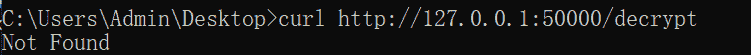

接口测试，这里使用的是 Reqable，测试解密接口：

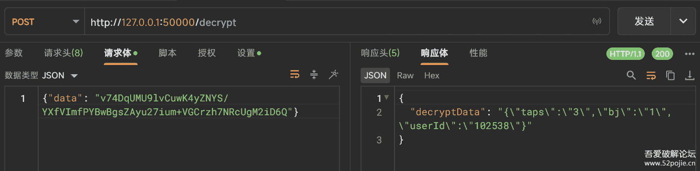

测试加密接口，获取加密数据和签名，可以看到加密的数据一致：

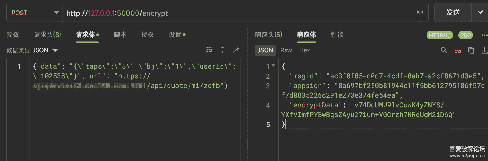

尝试替换获取的签名并发送测试，成功：

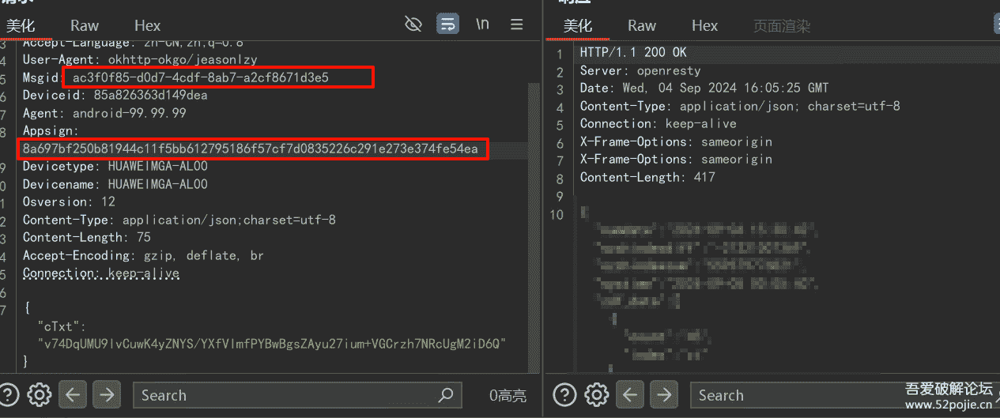

## 4. BurpGuard 实现

BurpGuard 项目地址：[//github.com/yinsel/BurpGuard](https://github.com/yinsel/BurpGuard:https)

这里画一个示意图以便分析和理解：

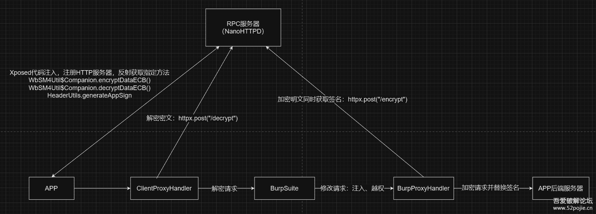

完整代码如下：

`ClientProxyHandler`：

```python
from mitmproxy import http
from Utils.Crypto import *
import httpx
from base64 import b64encode,b64decode
from urllib.parse import quote,unquote
import json
import traceback

class ClientProxyHandler:
    def __init__(self) -> None:
        self.client = httpx.Client(timeout=None,verify=False)

    # 处理来自客户端的请求，通常在这里对请求进行解密
    def request(self,flow: http.HTTPFlow):
        try:
            req = flow.request                  # 获取请求对象
            # 在这里编写你的代码
            # ...
            if req.method == "POST" and "json" in req.headers["Content-Type"] and "\"cTxt\"" in req.text:
                json_data = req.json()
                result = self.client.post("http://127.0.0.1:50000/decrypt", json={"data": json_data["cTxt"]}).json()
                req.text = result["decryptData"]
                # 标记数据包需要由BurpProxyHandler来加密
                req.headers["burp"] = "1"
        except Exception as e:
            traceback.print_exception(e)
        finally:
            return flow

    # 处理返回给客户端的响应，通常在这里对响应进行解密
    def response(self,flow: http.HTTPFlow):
        try:
            req = flow.request                  # 获取请求对象
            rsp = flow.response                 # 获取响应对象
            # 在这里编写你的代码
            # ...
        except Exception as e:
            traceback.print_exception(e)
        finally:
            return flow

addons = [ClientProxyHandler()]
```

`BurpProxyHandler`：

```python
from mitmproxy import http
from Utils.Crypto import *
import httpx
from base64 import b64encode,b64decode
from urllib.parse import quote,unquote
import json
import traceback

class BurpProxyHandler:
    def __init__(self) -> None:
        self.client = httpx.Client(timeout=None,verify=False)

    # 处理来自Burp的请求，通常在这里对请求进行加密
    def request(self,flow: http.HTTPFlow):
        try:
            req = flow.request                  # 获取请求对象
            # 在这里编写你的代码
            # ...
            # 判断数据包是否需要加密
            if req.headers.get("burp"):
                json_data = req.json()
                result = self.client.post("http://127.0.0.1:50000/encrypt", json={"data": req.text,"url": req.url}).json()
                # 去除json字符串空格
                req.text = json.dumps({"cTxt": result["encryptData"]},separators=(',', ':'))
                req.headers["msgid"] = result["msgid"]
                req.headers["appsign"] = result["appsign"]
        except Exception as e:
            traceback.print_exception(e)
        finally:
            return flow

    # 处理返回给Burp的响应，通常在这里对响应进行解密
    def response(self,flow: http.HTTPFlow):
        try:
            req = flow.request                  # 获取请求对象
            rsp = flow.response                 # 获取响应对象
            # 在这里编写你的代码
            # ...
        except Exception as e:
            traceback.print_exception(e)
        finally:
            return flow

addons = [BurpProxyHandler()]
```

## 3. 最终效果

模拟器安装编写的 Xposed 模块，使用 Lsposed 激活并勾选 APP。

运行 `BurpGuard`，并配置模拟器 WIFI 代理为 8081，也就是让 APP 首先走 `ClientProxyHandler`，同时 Burp 配置上游代理为 8082：

```bash
python BurpGuard.py
```

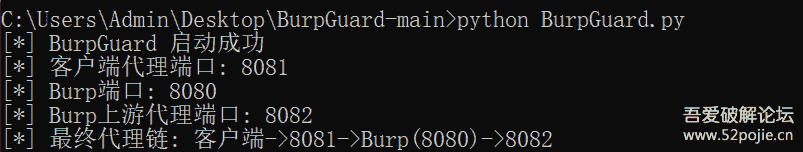

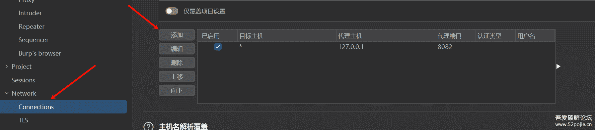

在模拟器操作 APP，并使用 Burp 拦截，可以看到请求 `body` 已经解密：

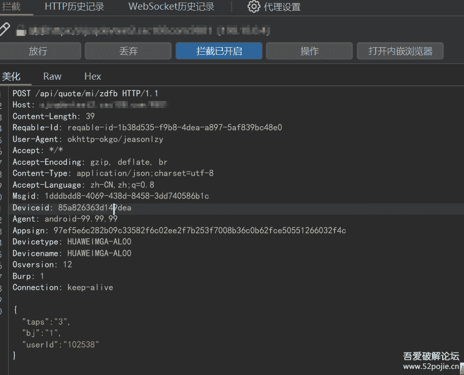

发送至重发器，并尝试修改请求 `body`，这里加了个单引号，请求正常：

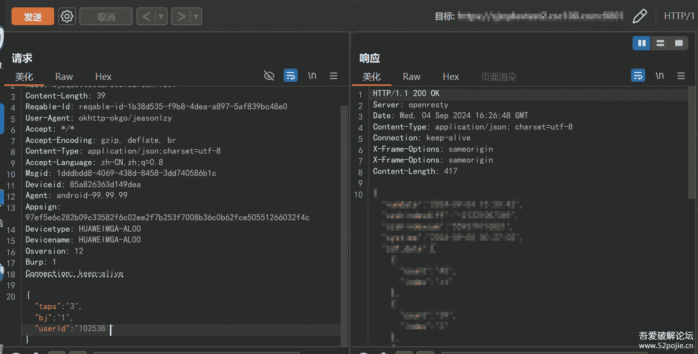

接下来就可以愉快的渗透啦！
