# [Android 分享] VivaCut3.8.2解锁pro功能

- 原帖: https://www.52pojie.cn/forum.php?mod=viewthread&tid=1965931
- 抓取时间: 2026-11-01T16:31:06.167Z

## 简单介绍一下软件
一款专业的手机视频编辑软件，提供视频编辑所需要的几乎所有功能，包括视频剪取、切割、滤镜、变速等，还包括绿幕抠图/视频合成，关键帧动画，蒙版等。

## 准备工具
`VivaCut`、`mt管理器`、`p管理器`

## 教程开始
提取安装包，点击功能，用`MT`的"去除签名校验"去签，
打开`dex`文件，`dex++`，全选，搜索`isprouser`，方法名，第一个结果点进去

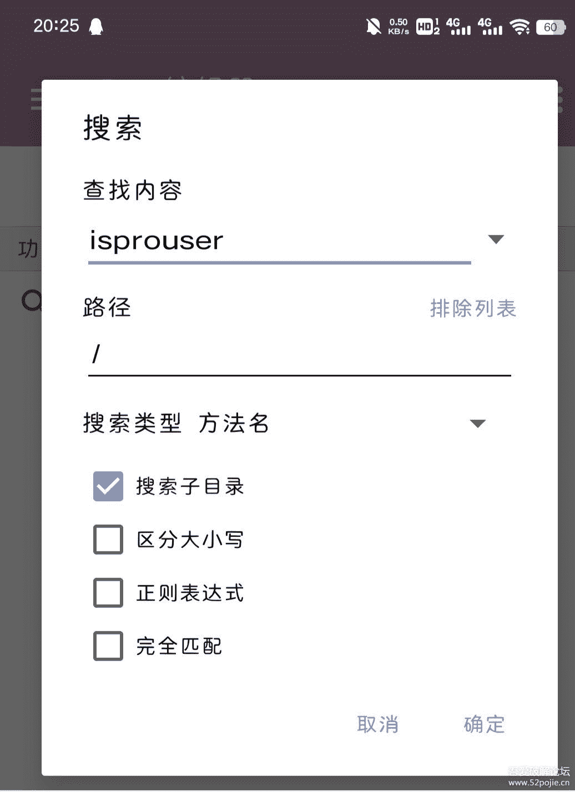

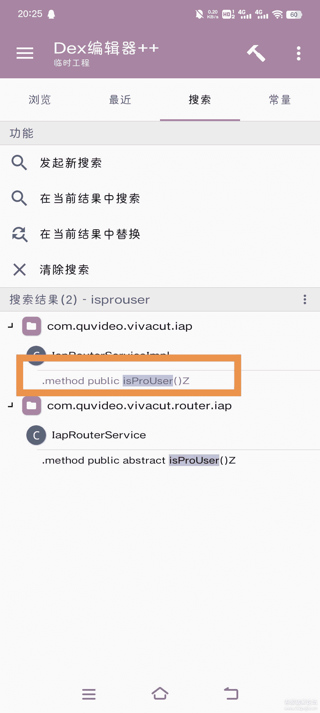

调用的`F()`方法，返回一个布尔值,为`true`即可，所以我们找到`invoke-virtual {v0}, Lcom/quvideo/vivacut/iap/IapService;->F()Z`跳转进去，看看逻辑，再找到`invoke-interface {v0}, Lyx/h;->u()Z`跳转，在`u()`方法里删掉`abstract`

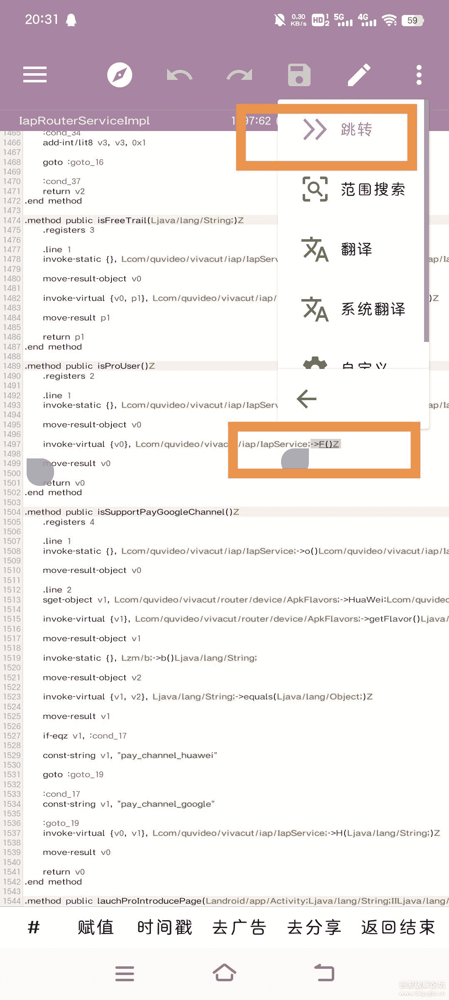

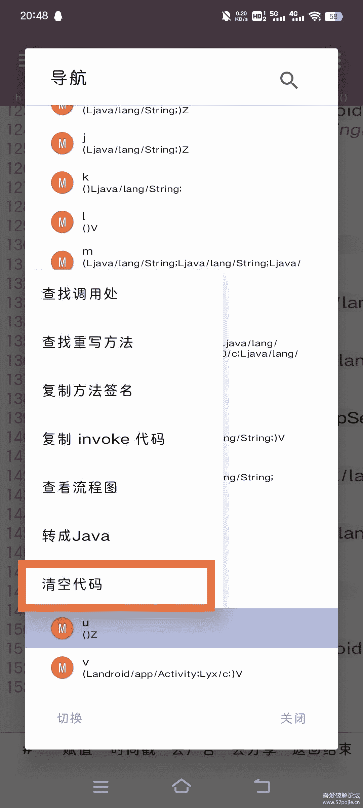

点上方的导航，长按清空代码，并改0为1

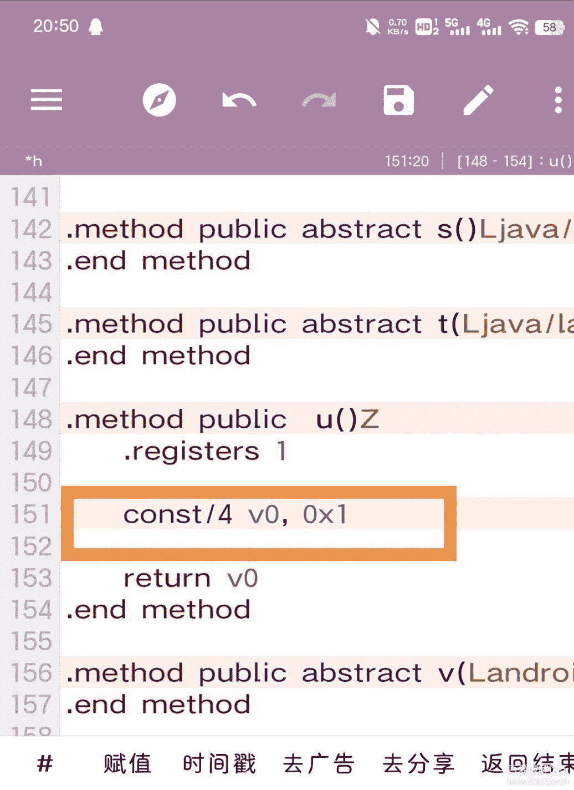

搜索`showAutoTriggerDialog`，方法名，第一个结果点进去，代码一大段可以转成`java`看看，在`cond_28`下改0为1，解锁导出功能。

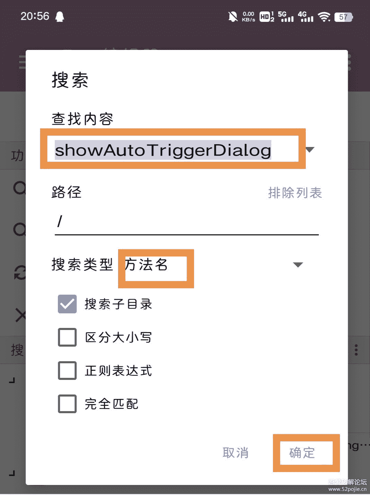

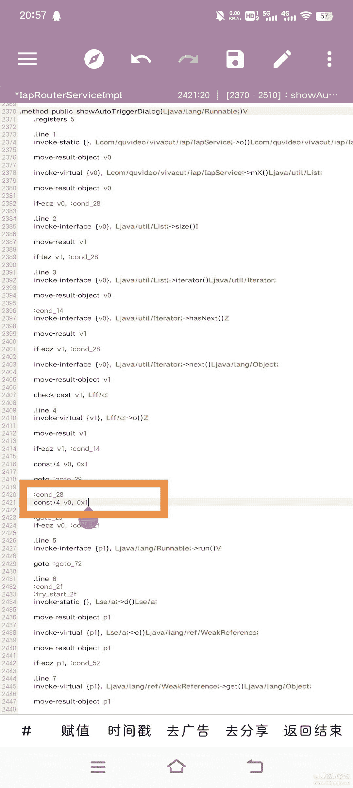

搜索`TYPE_VIP`，代码，点最后一个结果进去，继续转`java`看看，只要返回`true`即可修改购买类型`vip`,所以直接在`cond_29`下改0为1，至此`pro`功能解锁完毕。

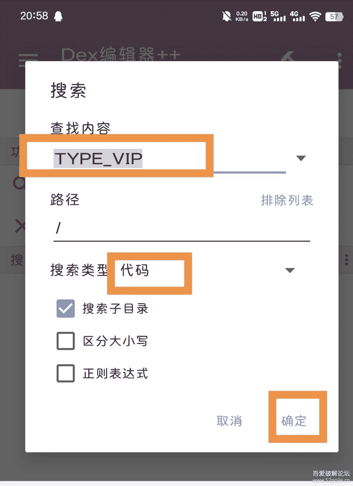

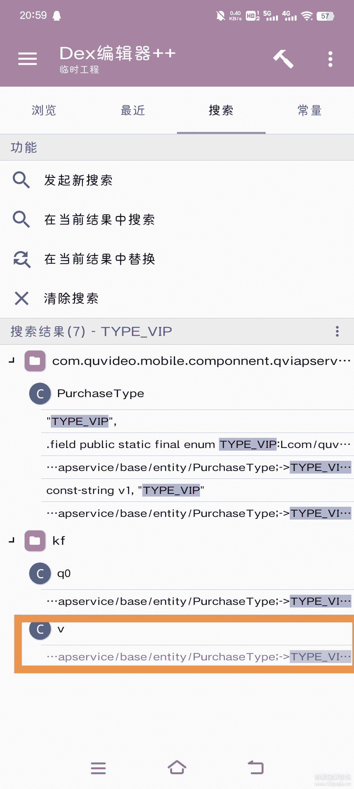

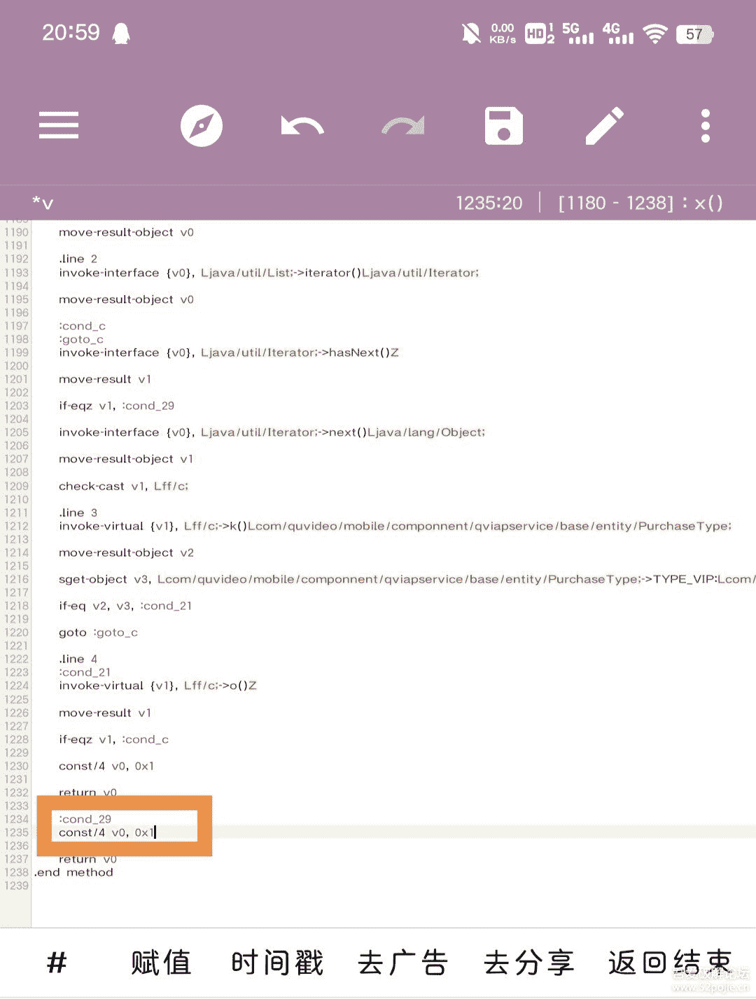

之后就是保存退出签名安装即可。

## 成品图
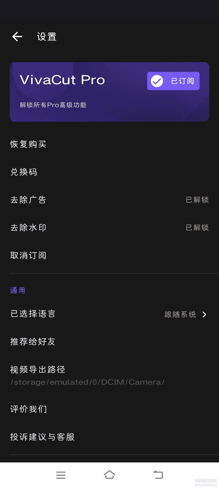

请支持正版，此内容仅供交流学习，不提供成品；感谢大家支持，一起交流学习～
