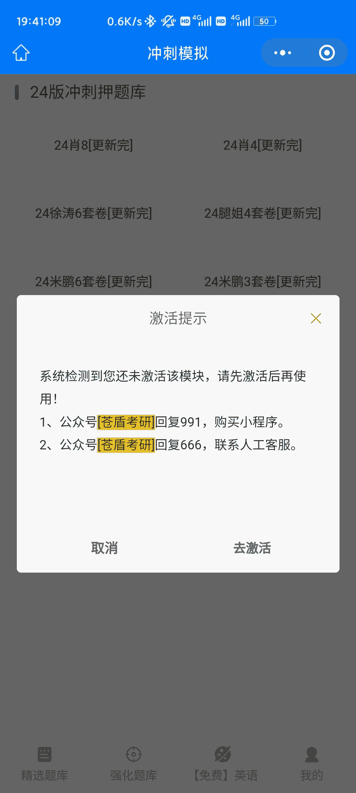
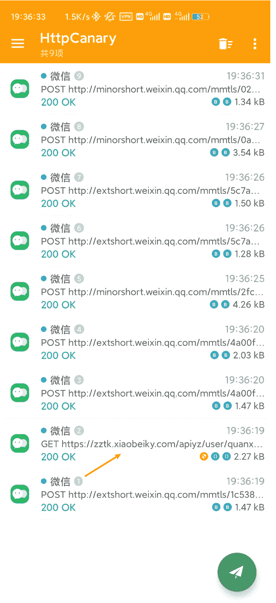
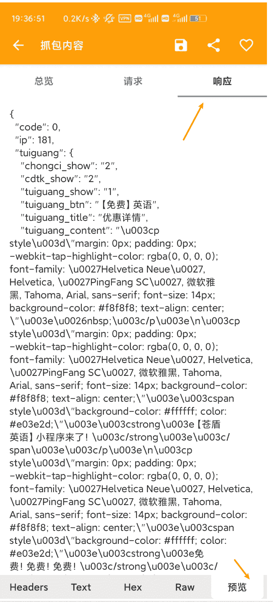
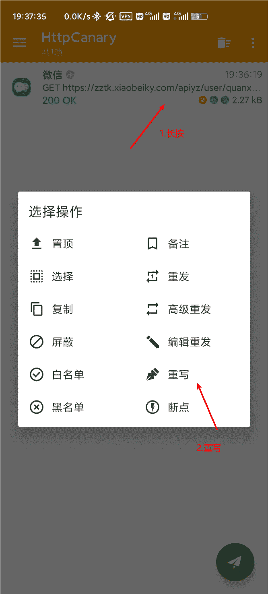
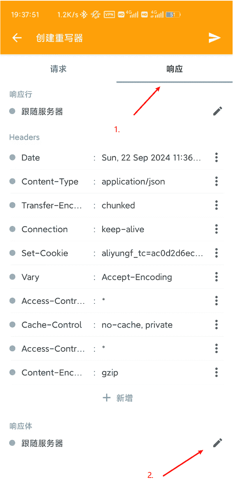
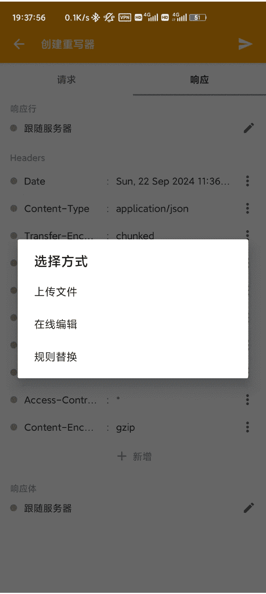
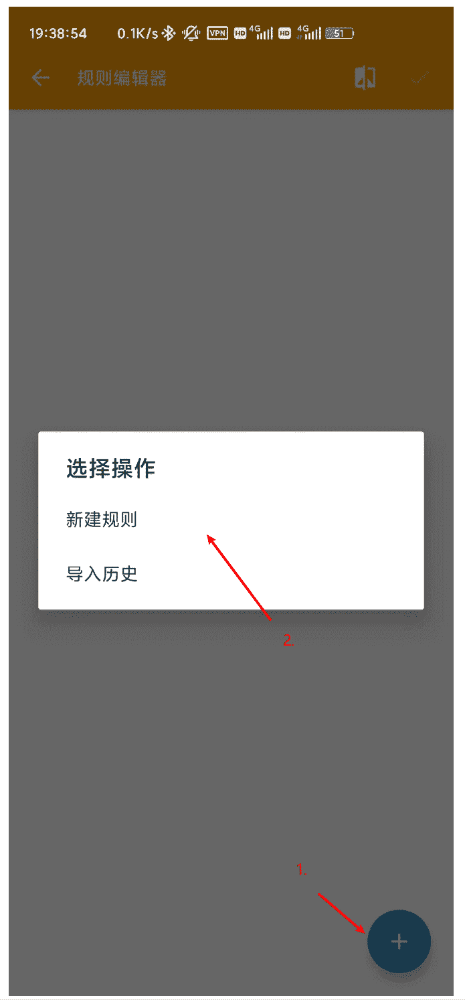
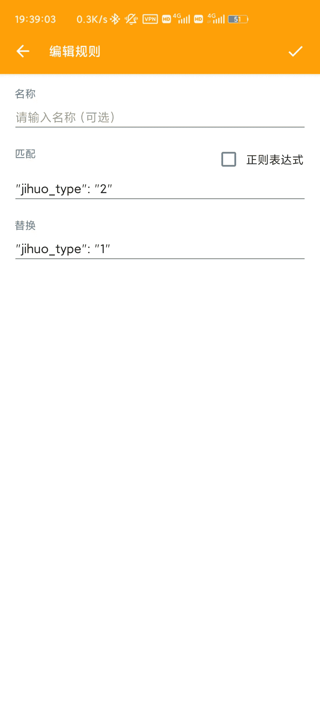
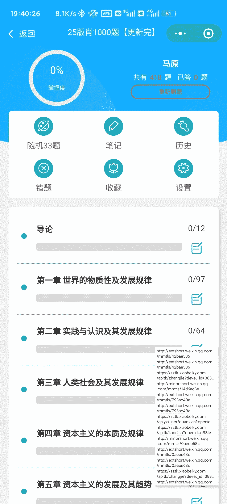

# [Android 原创] 【小黄鸟】用小黄鸟注入某考研政治刷题库小程序

- 原帖: https://www.52pojie.cn/forum.php?mod=viewthread&tid=1966666
- 抓取时间: 2026-11-01T16:31:01.975Z

## 前言
在去年考研阶段时期，由于需要刷政治选择题，而苍盾刷题小程序正是同学们的首选也是各大考研Up主推荐过的(广告)，但由于个人购买需要支付30RMB，因此萌生了此想法。

## 一、准备
对象小程序：`6IuN55u+6ICD56CU5pS/5rK75Yi36aKY5bqT`

工具：`HttpCanary` 小黄鸟 [//www.52pojie.cn/forum.php?mod=viewthread&tid=1718317](https://www.52pojie.cn/forum.php?mod=viewthread&tid=1718317:https)（小黄鸟配置教程参考这篇帖子 [//www.52pojie.cn/thread-1592529-1-1.html](https://www.52pojie.cn/thread-1592529-1-1.html:https)）

工具下载：`HttpCanary_3.3.6.apk` [//wwt.lanzoub.com/ir3py0h0r88b](https://wwt.lanzoub.com/ir3py0h0r88b:https) 密码:5zhq

由于微信的原因，需要额外安装模块：
[//xuanrandev.lanzouw.com/b00qc8yij](https://xuanrandev.lanzouw.com/b00qc8yij:https) 密码 5qiw

安装模块步骤：[//www.coolapk.com/feed/40978636?shareKey=ZjA0ZmE1NTBmODY3NjZmMDFkNjU~&shareUid=3569583&shareFrom=com.coolapk.market_13.4.1](https://www.coolapk.com/feed/40978636?shareKey=ZjA0ZmE1NTBmODY3NjZmMDFkNjU~&shareUid=3569583&shareFrom=com.coolapk.market_13.4.1:https)

## 二、上手分析
小程序未激活提示：


1. 打开小程序，打开小黄鸟应用并将微信添加至目标应用，打开小黄鸟中飞机，此时返回小程序，重新选择导航栏中的 “我的”。


2. 此时看到有关`apiyz/user/quanxina`的拦截信息，打开并查看响应的预览，分析数据


经过各种尝试得出一下结论
```
"chongci_show": "2"  ->  "chongci_show": "1"          导航栏增加冲刺题库
"cdtk_show": "2"         ->  "cdtk_show": "1"                  增加vip题库
"tuiguang_show": "1" ->  "tuiguang_show": "2"   隐藏【免费】英语

"hexing":"2"         ->  "hexing":"1"                          强化题库解锁
"chongci": "2"       ->  "chongci": "1"                 冲刺题库解锁
"cdtk": "2"          ->  "cdtk": "1"                         vip题库解锁

可以根据自己需求进行更改。
```

### 修改方法
步骤1：


步骤2：


步骤3：
可以使用两种方式进行修改，一是在线编辑（相对简单），二是规则替换；

方法一：点击 “在线编辑”
根据第 “3.”得出的结论，进行修改就可以。

方式二：点击 “规则替换”

修改格式类似这样：


修改完成后，点击右上角的 “对勾”，再次点击 右上角。

保持小黄鸟开启，重新打开小程序，即可刷题。


结论：数据加密传输的重要性

感谢各位的免费评分。
