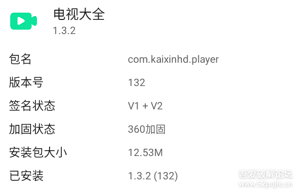
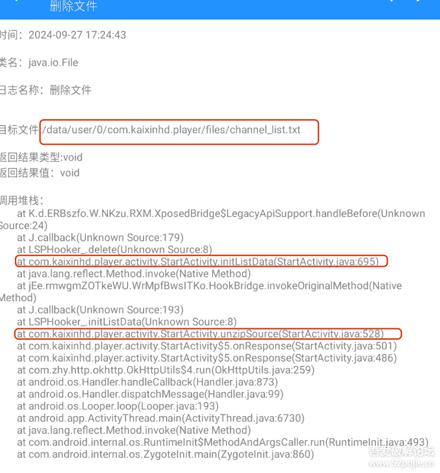
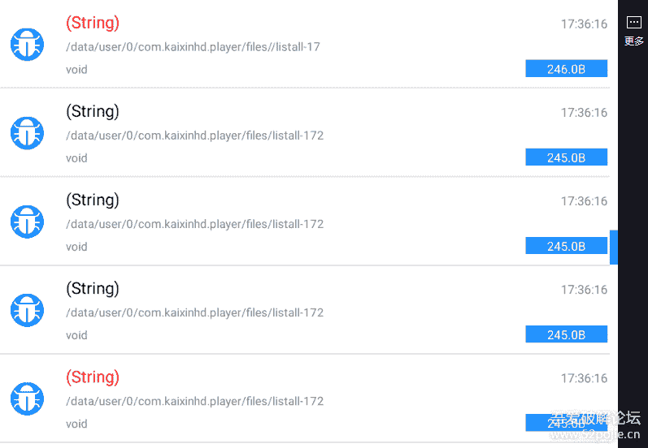
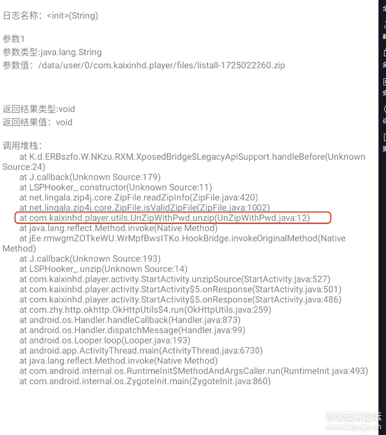
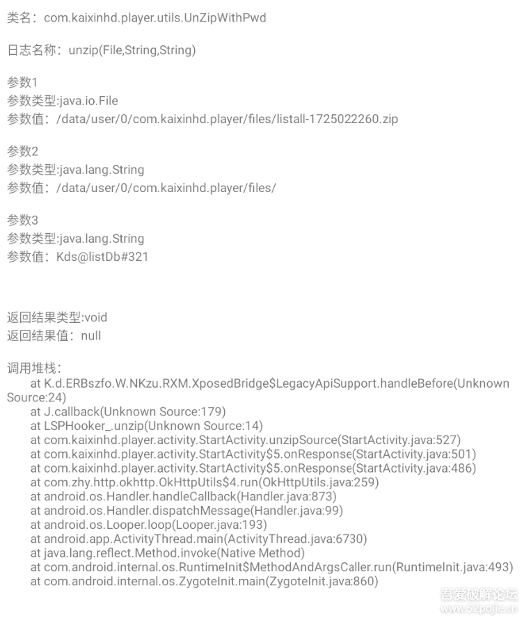

# [Android 原创] 一个新手的Android逆向研究之路,某电视直播软件的直播源萃取经历

- 原帖: https://www.52pojie.cn/forum.php?mod=viewthread&tid=1968233
- 抓取时间: 2026-11-01T16:30:39.252Z

纯新手,Java 0基础(不算js),安卓0基础(没用过安卓机,设置WiFi都找半天的那种)

学这个起因是这样:我是小宽带公司的,经常有用户报故障说电视直播看不了,看着卡,然后每次都去抓包,找到IP调路由,麻烦死了.就想能不能去程序中拿到播放源,就挺方便.

于是按照 吾爱[破解](https://www.52pojie.cn/)安卓逆向0基础入门教程学习,还特没耐心那种,2倍速,逮半截就开跑

学习经历大概是这样:

第一天看动态调试,搞不定,去看模拟器安装.然后继续动态调试. (软件名:看看TV)

第二天继续和动态较劲, 最后的结论-----模拟器跑不动,电脑换了好多台,不调试什么问题没有,一调试速度至少慢几百倍,本来1秒该出画面的,拉个屎出来都等不到画面

第三天,第四天`jadx`,挺好用,可惜基础太差,找到了解密的类和方法,找不到秘钥.

第五天,静态不动了,充电学习第二课,于是知道了有算法助手....

然后...真爽....我早干嘛去了...

`HOOK` 加密算法,搞定...

处于学习心态 `HOOK` 我之前找到的解密类,又搞定次...

`HOOK` 真好

结论:`HOOK` 是安卓的尽头...

然后到了今天要解决的app

开始不知道什么是加固,`jadx` 看了个寂寞

在52里找到了 `BlackDex`,没用.. [脱壳](https://www.52pojie.cn/forum-5-1.html)不是小白该干的事

先抓包,电视源的文件很好拿,`http://file.91kds.cn/jm/listall-1725022260.zip` 加了密的

要解密,肯定会操作文件,我能拿到解密后的文件也是好的啊,于是点了算法助手自带的文件监控,发现他先解压存储到文件,再删除那几个文件

方法名挺清楚的,然后我就试这 `HOOK com.kaixinhd.player.activity.StartActivity.initListData`,并且选上拦截执行

拦截后跑目录下找文件,果然在,搞定!

可是不完美,没拿到密码

然后 `hook com.kaixinhd.player.activity.StartActivity.unzipSource` 发现参数只是路径

观察文件读写日志,发现并没有对 `listall-1725022260.zip` 有读操作,只有删,

那么去 `hook` 打开文件试试, 翻了半天找到了 `java.io.File`.

果然找到了解密的方法

最后

`hook` 真好用

插一句:我开始不知道自定义 `HOOK` 的参数是可以填 `*HOOK` 所有重载的,猜了半天参数类型和个数也是蠢到家了...

纯新手的体验,适合0基础的看看

