# [Android 原创] MOJi辞書版本：8.4.2解锁永久会员（保姆级教程）

- 原帖：https://www.52pojie.cn/forum.php?mod=viewthread&tid=1970081
- 抓取时间：2026-11-01T23:59:35

第一次玩逆向什么都没学，随便在B站看了几个视频，就跟着模仿整了个教程。其实原理根本都不懂，有手就行不用脑的实操。此教程只适合新手小白。

## 准备工具

- 《MT管理器》
- 《MOJi辞書8.4.2版本》

## 操作步骤

首先打开《MT管理器》，提取下MOJi辞書安装包，这个应该没人不会吧。那么正式开始动手吧。

### 1、点开安装包，点击功能

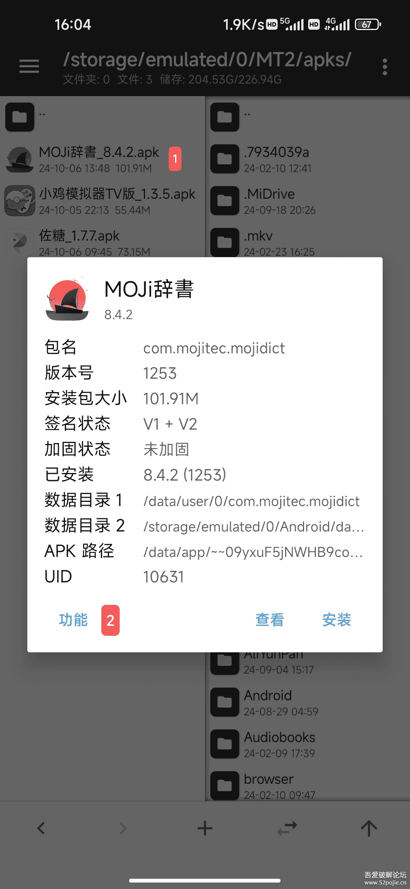

`IMG_20241006_161738.jpg` (198.36 KB, 下载次数: 0)

附件下载：[下载链接](https://www.52pojie.cn/forum.php?mod=attachment&aid=MjcyNjg4NHxkNmQ4ZDliNHwxNzkzNTc3NTczfDE2ODA4NnwxOTcwMDgx&nothumb=yes)

2024-10-6 20:33 上传

### 2、点击去签名校验

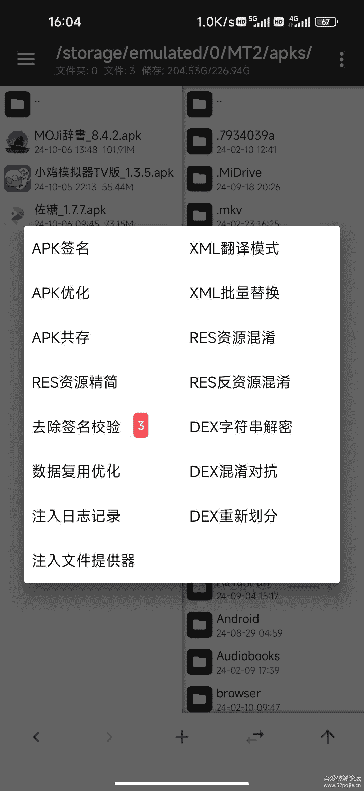

`IMG_20241006_161838.jpg` (194.15 KB, 下载次数: 0)

附件下载：[下载链接](https://www.52pojie.cn/forum.php?mod=attachment&aid=MjcyNjg4NXw3YTQzMjUyN3wxNzkzNTc3NTczfDE2ODA4NnwxOTcwMDgx&nothumb=yes)

2024-10-6 20:33 上传

什么都不用改直接点击确定。

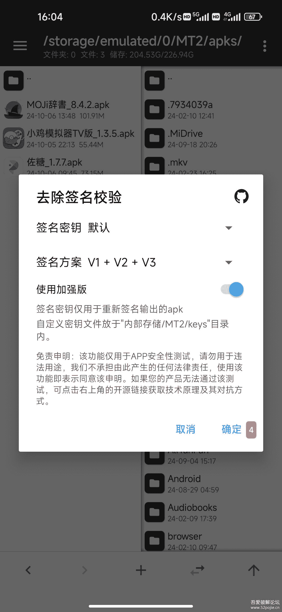

`IMG_20241006_161921.jpg` (209.03 KB, 下载次数: 0)

附件下载：[下载链接](https://www.52pojie.cn/forum.php?mod=attachment&aid=MjcyNjg4Nnw3ZDNlNjEyY3wxNzkzNTc3NTczfDE2ODA4NnwxOTcwMDgx&nothumb=yes)

2024-10-6 20:33 上传

### 3、去完签名后点开带有（`kill`）的安装包查看

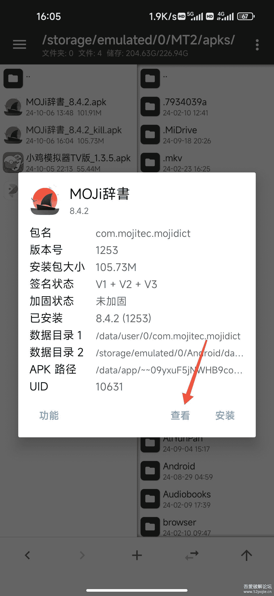

`IMG_20241006_171657.jpg` (202.33 KB, 下载次数: 0)

附件下载：[下载链接](https://www.52pojie.cn/forum.php?mod=attachment&aid=MjcyNjg4N3xiMzM3MjgyMnwxNzkzNTc3NTczfDE2ODA4NnwxOTcwMDgx&nothumb=yes)

2024-10-6 20:33 上传

### 4、点开 `resources.arsc` 准备搜索下会员ID

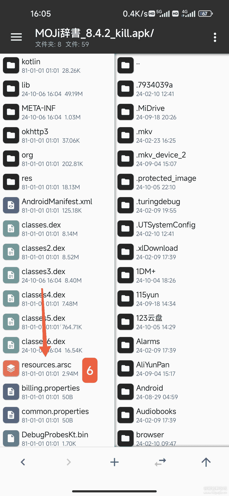

`IMG_20241006_162145.jpg` (278.19 KB, 下载次数: 0)

附件下载：[下载链接](https://www.52pojie.cn/forum.php?mod=attachment&aid=MjcyNjg4OXwzZWZhZWMwMnwxNzkzNTc3NTczfDE2ODA4NnwxOTcwMDgx&nothumb=yes)

2024-10-6 20:33 上传

选择Arsc编辑器。

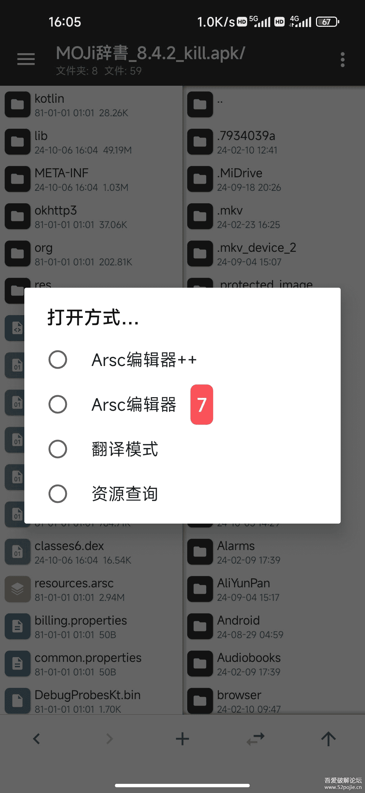

`IMG_20241006_162253.jpg` (182.37 KB, 下载次数: 0)

附件下载：[下载链接](https://www.52pojie.cn/forum.php?mod=attachment&aid=MjcyNjg5MHw3MWMxZDUxZXwxNzkzNTc3NTczfDE2ODA4NnwxOTcwMDgx&nothumb=yes)

2024-10-6 20:33 上传

### 5、点开搜索资源值搜索下会员

`IMG_20241006_162348.jpg` (89.67 KB, 下载次数: 0)

附件下载：[下载链接](https://www.52pojie.cn/forum.php?mod=attachment&aid=MjcyNjg5MXwyZmU2OGYzNnwxNzkzNTc3NTczfDE2ODA4NnwxOTcwMDgx&nothumb=yes)

2024-10-6 20:33 上传

在输入框内输入会员二字，然后点击确定。

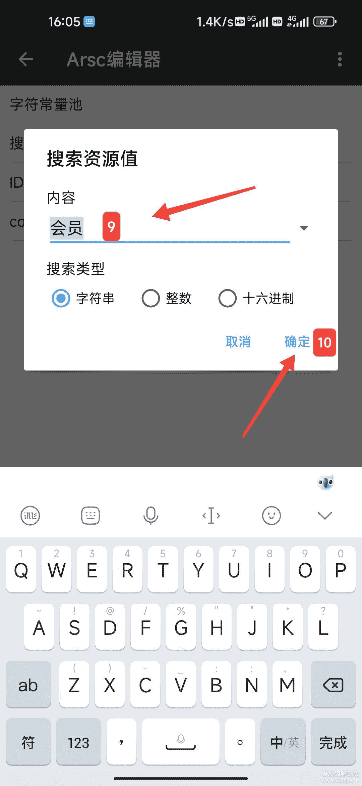

`IMG_20241006_162521.jpg` (171.58 KB, 下载次数: 0)

附件下载：[下载链接](https://www.52pojie.cn/forum.php?mod=attachment&aid=MjcyNjg5MnxkOGU0ZDdiNnwxNzkzNTc3NTczfDE2ODA4NnwxOTcwMDgx&nothumb=yes)

2024-10-6 20:33 上传

### 6、在搜索内容里面找到（永久会员）和（订阅会员）

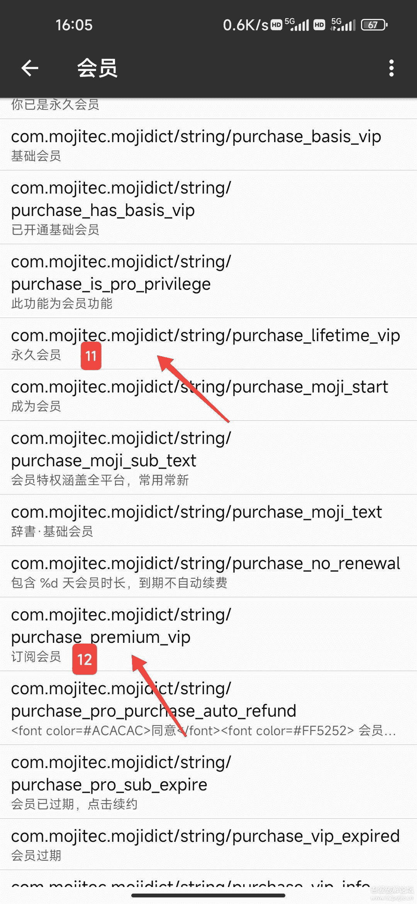

`IMG_20241006_162801.jpg` (320.23 KB, 下载次数: 0)

附件下载：[下载链接](https://www.52pojie.cn/forum.php?mod=attachment&aid=MjcyNjg5M3w2NzE3MTNiNHwxNzkzNTc3NTczfDE2ODA4NnwxOTcwMDgx&nothumb=yes)

2024-10-6 20:33 上传

长按永久会员把ID复制下来。

`IMG_20241006_162911.jpg` (283.81 KB, 下载次数: 0)

附件下载：[下载链接](https://www.52pojie.cn/forum.php?mod=attachment&aid=MjcyNjg5NHxlZDljZjM0ZnwxNzkzNTc3NTczfDE2ODA4NnwxOTcwMDgx&nothumb=yes)

2024-10-6 20:33 上传

以同样方式把订阅会员ID也复制下来。

`IMG_20241006_162943.jpg` (281.01 KB, 下载次数: 0)

附件下载：[下载链接](https://www.52pojie.cn/forum.php?mod=attachment&aid=MjcyNjg5NXxjOWVjZjdhMnwxNzkzNTc3NTczfDE2ODA4NnwxOTcwMDgx&nothumb=yes)

2024-10-6 20:33 上传

### 7、以上步骤做完接着一路返回这个页面

随便选择一个`classes.dex`点开。

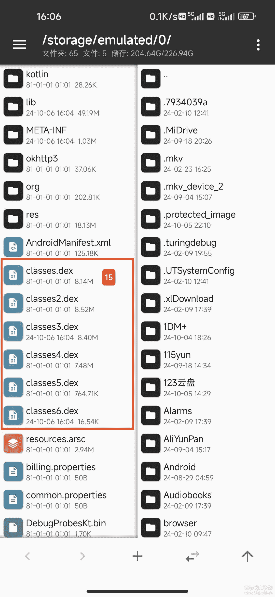

`IMG_20241006_163105.jpg` (290.26 KB, 下载次数: 0)

附件下载：[下载链接](https://www.52pojie.cn/forum.php?mod=attachment&aid=MjcyNjg5Nnw0ZTVmZmU4YnwxNzkzNTc3NTczfDE2ODA4NnwxOTcwMDgx&nothumb=yes)

2024-10-6 20:34 上传

打开方式选择Dex编辑器++。

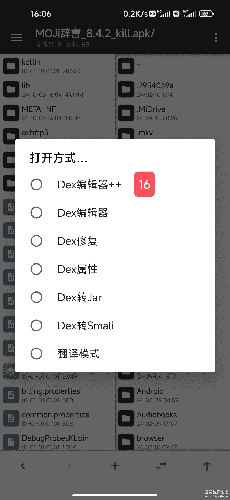

`IMG_20241006_163138.jpg` (171.46 KB, 下载次数: 0)

附件下载：[下载链接](https://www.52pojie.cn/forum.php?mod=attachment&aid=MjcyNjg5N3w5Nzc3ODQzOXwxNzkzNTc3NTczfDE2ODA4NnwxOTcwMDgx&nothumb=yes)

2024-10-6 20:34 上传

接着全选把全部`classes.dex`都勾上然后点确定。

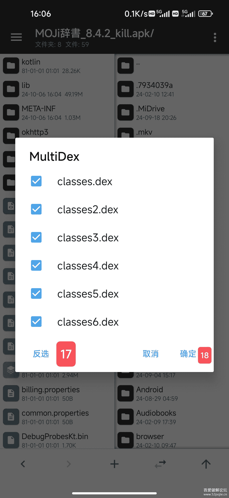

`IMG_20241006_163236.jpg` (173.8 KB, 下载次数: 0)

附件下载：[下载链接](https://www.52pojie.cn/forum.php?mod=attachment&aid=MjcyNjg5OHw0ODJiNjkwY3wxNzkzNTc3NTczfDE2ODA4NnwxOTcwMDgx&nothumb=yes)

2024-10-6 20:34 上传

### 8、现在点搜索

把刚刚我们复制的两个ID找出来逐步赋值一下。

`IMG_20241006_163453.jpg` (85.63 KB, 下载次数: 0)

附件下载：[下载链接](https://www.52pojie.cn/forum.php?mod=attachment&aid=MjcyNjg5OXwyN2JlNjNlYXwxNzkzNTc3NTczfDE2ODA4NnwxOTcwMDgx&nothumb=yes)

2024-10-6 20:34 上传

在搜索框把永久会员的ID：`7f1106b0`粘贴上，选择代码类型然后点确定。

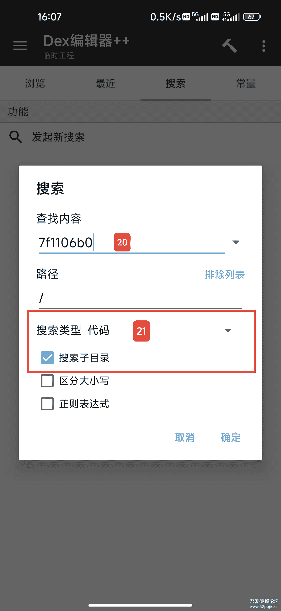

`IMG_20241006_163635.jpg` (132.66 KB, 下载次数: 0)

附件下载：[下载链接](https://www.52pojie.cn/forum.php?mod=attachment&aid=MjcyNjkwMHw3N2RlOWZjN3wxNzkzNTc3NTczfDE2ODA4NnwxOTcwMDgx&nothumb=yes)

2024-10-6 20:34 上传

接着选择`MainMineFragment`内容里的`const v5,0x7f1106b0`点进去。

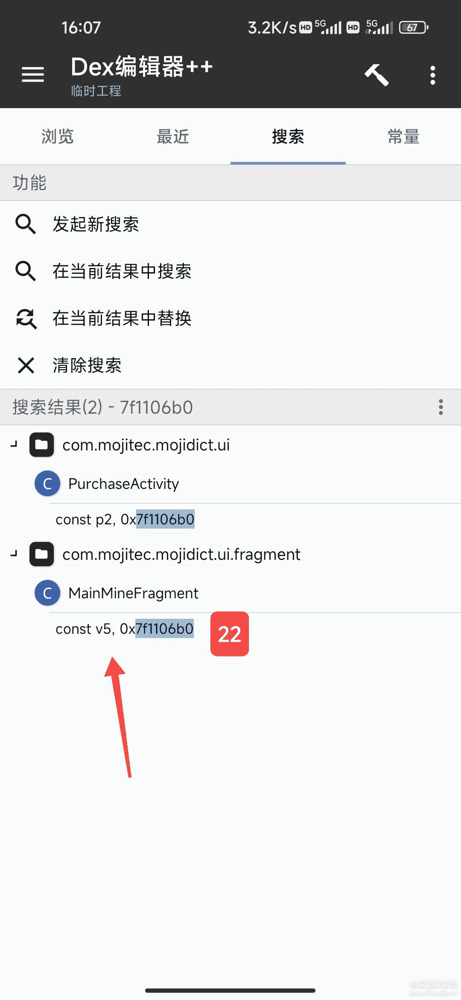

`IMG_20241006_163735.jpg` (146.78 KB, 下载次数: 0)

附件下载：[下载链接](https://www.52pojie.cn/forum.php?mod=attachment&aid=MjcyNjkwMXxiMTE1YTBmNHwxNzkzNTc3NTczfDE2ODA4NnwxOTcwMDgx&nothumb=yes)

2024-10-6 20:34 上传

### 9、进入后往上翻我们就可以在2386行找到

此代码内容`invoke-static {v4},La6/a;->f(Lu4/r;)Z`

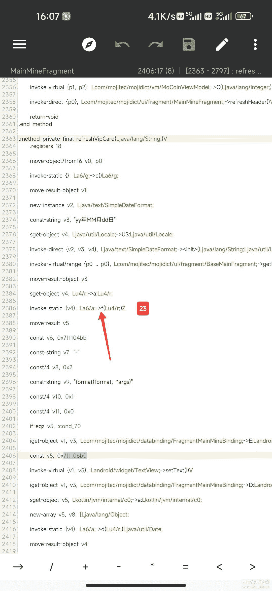

`IMG_20241006_163942.jpg` (264.12 KB, 下载次数: 0)

附件下载：[下载链接](https://www.52pojie.cn/forum.php?mod=attachment&aid=MjcyNjkwMnw5ZmU0ZTkxOHwxNzkzNTc3NTczfDE2ODA4NnwxOTcwMDgx&nothumb=yes)

2024-10-6 20:34 上传

接着长按`->f`进行转跳到里面赋值。

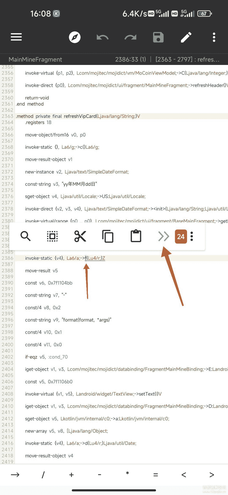

`IMG_20241006_164112.jpg` (269.33 KB, 下载次数: 0)

# MOJi辞書 VIP 解锁操作

[附件下载](https://www.52pojie.cn/forum.php?mod=attachment&aid=MjcyNjkwM3wxM2M0NWUyYXwxNzkzNTc3NTczfDE2ODA4NnwxOTcwMDgx&nothumb=yes)（2024-10-6 20:34 上传）

进来后我们往下翻可以看到：`goto_37`。

我们在它下面 298 行输入 `const/4 v1, 0x1` 进行赋值。

输入完顺手点右上角保存一下。

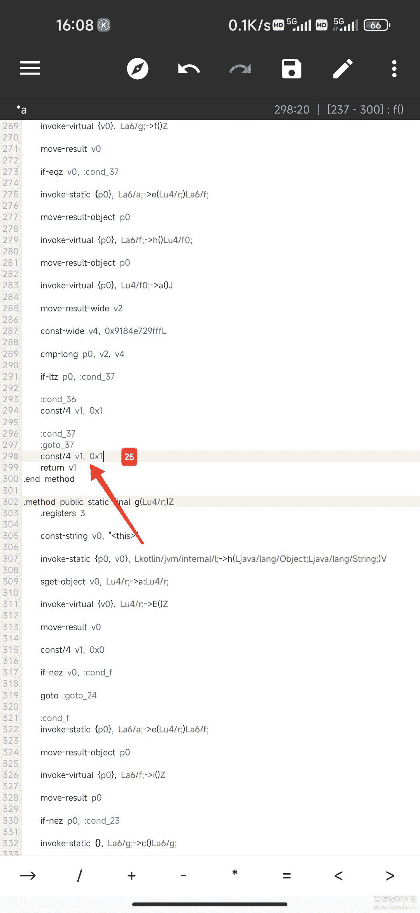

IMG_20241006_164255.jpg (191.58 KB, 下载次数: 0)

[附件下载](https://www.52pojie.cn/forum.php?mod=attachment&aid=MjcyNjkwNHxhNjkzMDc1ZHwxNzkzNTc3NTczfDE2ODA4NnwxOTcwMDgx&nothumb=yes)（2024-10-6 20:34 上传）

## 10、接着一路返回到此搜索页面

开始新的搜索，把订阅会员找出来继续赋值。

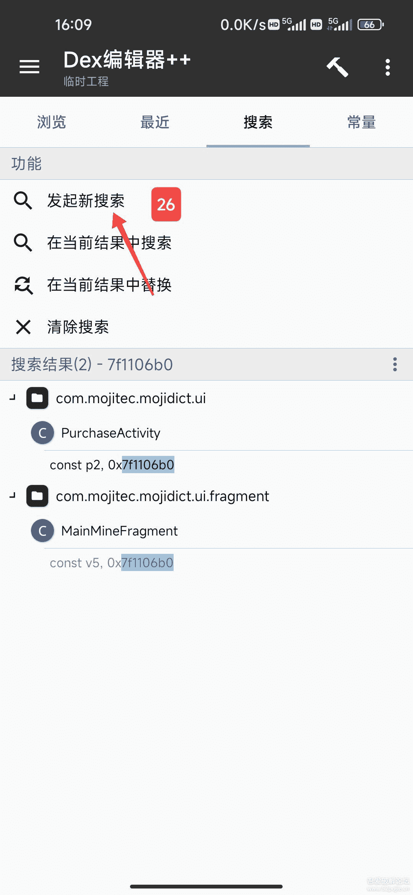

IMG_20241006_164505.jpg (144.8 KB, 下载次数: 0)

[附件下载](https://www.52pojie.cn/forum.php?mod=attachment&aid=MjcyNjkwNXw5YWQ5M2M4MnwxNzkzNTc3NTczfDE2ODA4NnwxOTcwMDgx&nothumb=yes)（2024-10-6 20:34 上传）

在搜索框把之前复制的订阅会员 ID：`7f1106be` 粘贴上，点确定查找。

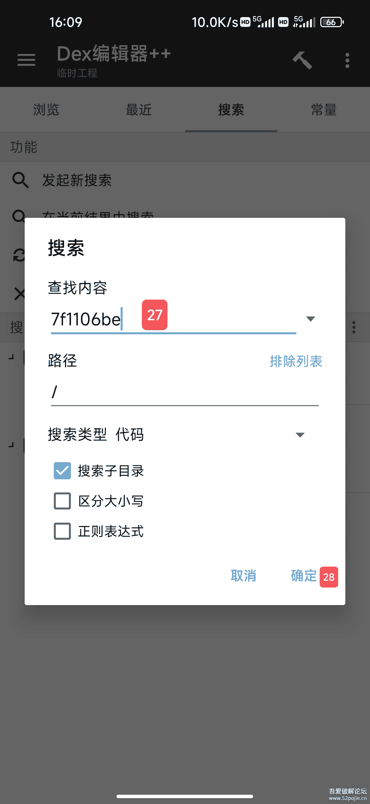

IMG_20241006_164607.jpg (125.68 KB, 下载次数: 0)

[附件下载](https://www.52pojie.cn/forum.php?mod=attachment&aid=MjcyNjkwNnwxMmYzMWQ5NnwxNzkzNTc3NTczfDE2ODA4NnwxOTcwMDgx&nothumb=yes)（2024-10-6 20:34 上传）

点击搜索结果 `MainMineFragment` 内容下面的 `const v6,0x7f1106be` 进去。

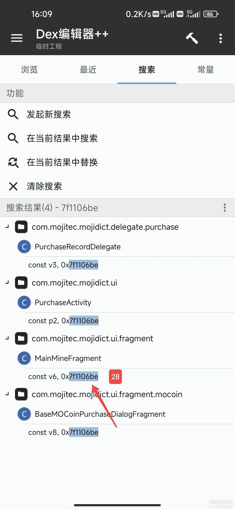

IMG_20241006_164708.jpg (193.95 KB, 下载次数: 0)

[附件下载](https://www.52pojie.cn/forum.php?mod=attachment&aid=MjcyNjkwN3xkOWMyNjM1NnwxNzkzNTc3NTczfDE2ODA4NnwxOTcwMDgx&nothumb=yes)（2024-10-6 20:34 上传）

## 11、进入后往上翻，找到 2473 行的代码

代码内容：`invoke-virtual {v1}, La6/g;->f()Z`

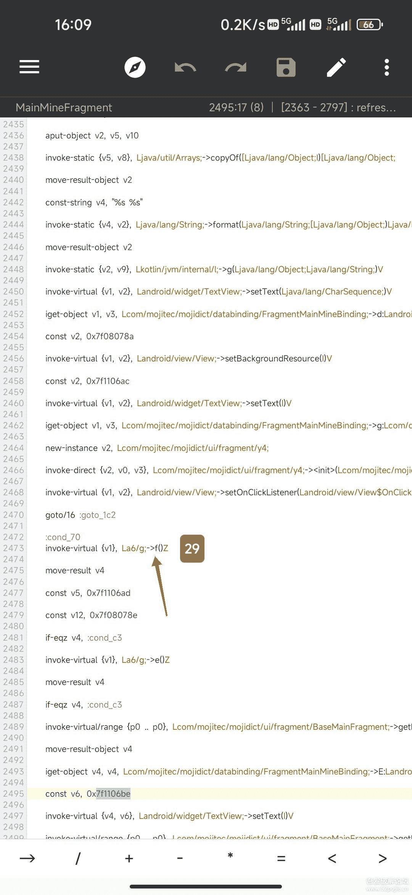

IMG_20241006_164757.jpg (284.6 KB, 下载次数: 0)

[附件下载](https://www.52pojie.cn/forum.php?mod=attachment&aid=MjcyNjkwOHw5MGJiNzg3N3wxNzkzNTc3NTczfDE2ODA4NnwxOTcwMDgx&nothumb=yes)（2024-10-6 20:34 上传）

老样子，长按 -> `f` 跳转。

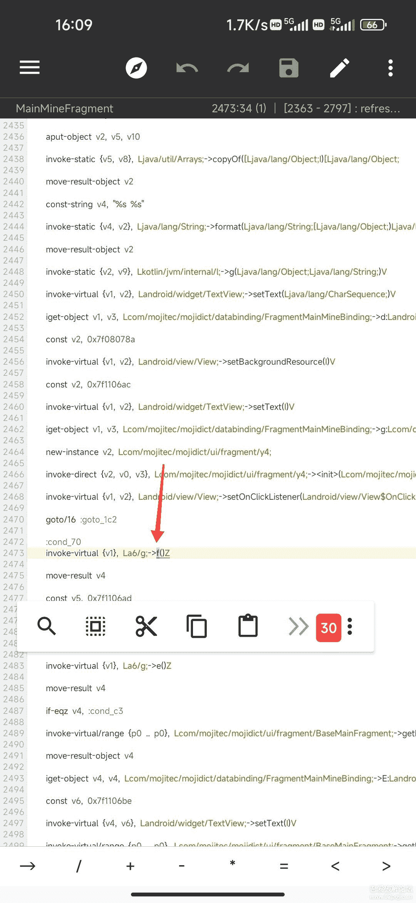

IMG_20241006_164902.jpg (288.18 KB, 下载次数: 0)

[附件下载](https://www.52pojie.cn/forum.php?mod=attachment&aid=MjcyNjkwOXwxZjNlMjI3YnwxNzkzNTc3NTczfDE2ODA4NnwxOTcwMDgx&nothumb=yes)（2024-10-6 20:34 上传）

## 12、往下看在 256 行 `return v0` 代码上面赋值

输入 `const/4 v0, 0x1`。

操作完记得右上角顺手保存。

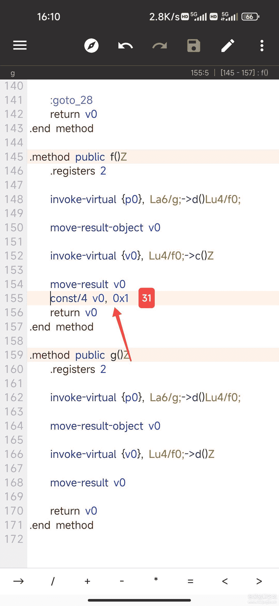

IMG_20241006_164943.jpg (201.38 KB, 下载次数: 0)

[附件下载](https://www.52pojie.cn/forum.php?mod=attachment&aid=MjcyNjkxMHxkZDFlOWI0NHwxNzkzNTc3NTczfDE2ODA4NnwxOTcwMDgx&nothumb=yes)（2024-10-6 20:34 上传）

## 13、完成以上步骤接着一路返回保存并退出

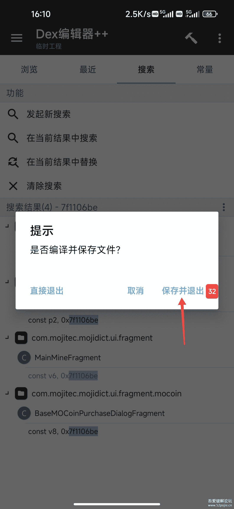

IMG_20241006_165101.jpg (146.39 KB, 下载次数: 0)

[附件下载](https://www.52pojie.cn/forum.php?mod=attachment&aid=MjcyNjkxMXxmM2VmMjVlMXwxNzkzNTc3NTczfDE2ODA4NnwxOTcwMDgx&nothumb=yes)（2024-10-6 20:35 上传）

记得勾选上自动签名再确定。

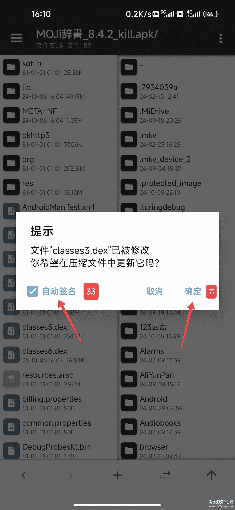

IMG_20241006_165235.jpg (207.36 KB, 下载次数: 0)

[附件下载](https://www.52pojie.cn/forum.php?mod=attachment&aid=MjcyNjkxMnxiMTY5MWY5ZnwxNzkzNTc3NTczfDE2ODA4NnwxOTcwMDgx&nothumb=yes)（2024-10-6 20:35 上传）

操作到这里恭喜你，那么你已经学会傻瓜式的解锁操作啦。

现在就可以点开 `MOJi辞書_8.4.2_kill.apk` 进行安装，登录手机号就可以随意使用各种会员功能了。

IMG_20241006_201359.jpg (171.5 KB, 下载次数: 0)

[附件下载](https://www.52pojie.cn/forum.php?mod=attachment&aid=MjcyNjkxM3w0YmY3MGFjZXwxNzkzNTc3NTczfDE2ODA4NnwxOTcwMDgx&nothumb=yes)（2024-10-6 20:35 上传）

## 后续问题

虽然解锁了 VIP，但是我发现收藏功能并不能收藏。

有没有大佬能发现是哪里出问题了？
