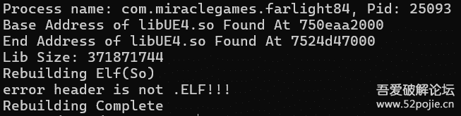
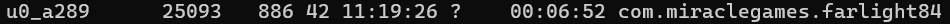
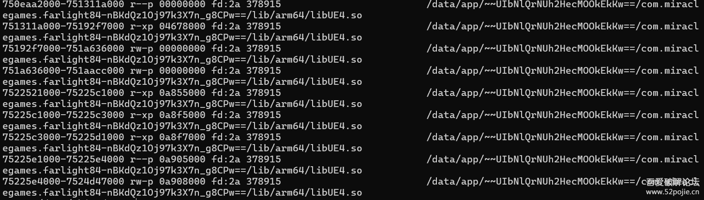
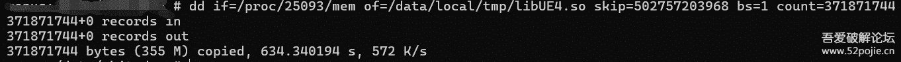
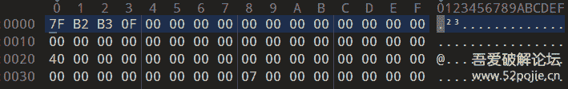
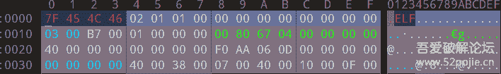
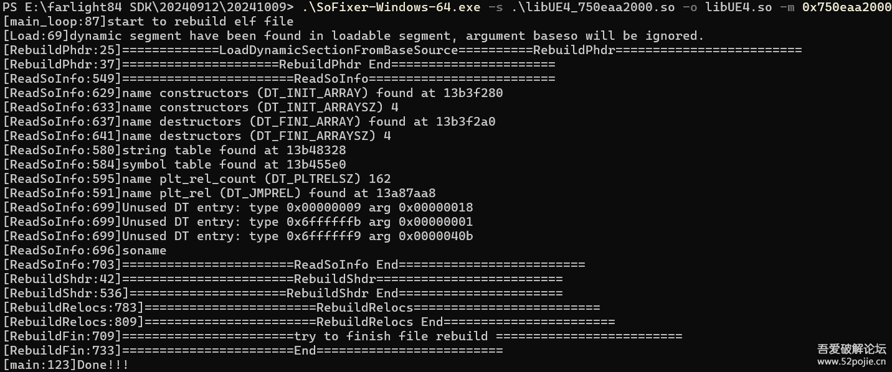
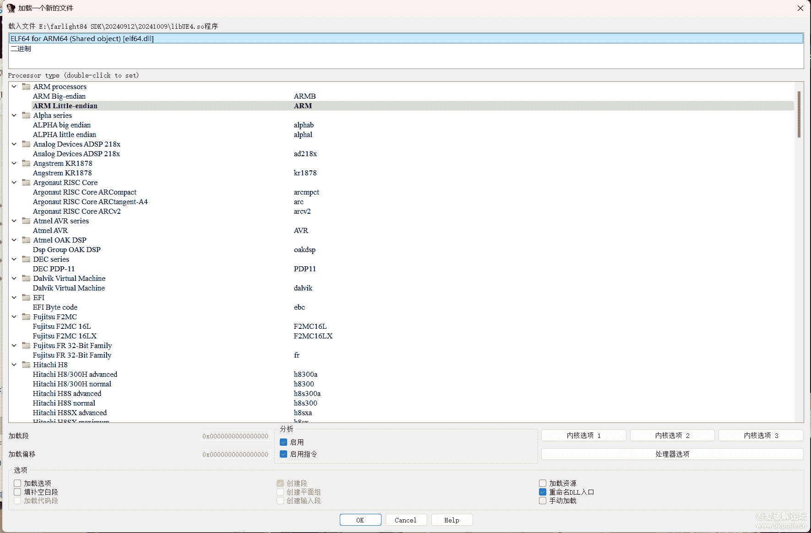

# [Android 原创] dump网易加固的libUE4.so

- 原帖: https://www.52pojie.cn/forum.php?mod=viewthread&tid=1970754
- 抓取时间: 2026-11-01T16:30:05.984Z

## 0x0 前言

刚好最近有空，顺便再记录一下之前一次dump莉莉丝的`farlight84` `libUE4`遇到的问题，他本来用的`tx`的安全，后面不知道为啥换成网易的。

## 0x1 dump libUE4.so

他这个`so`本身也是有加密的，需要dump加载解密后的`libUE4.so`，首先用`ue4dumper`尝试dump一下，结果发现提示不是`elf`文件。



他这个提示头错误不是`elf`文件，那可能就是`elf`头有问题，试试手动给他dump下来，首先找`PID`

```
ps -ef|grep farlight84
```



找到`pid`之后，用这个命令找到`libUE4.so`的起始地址和结束地址

```
cat /proc/25093/maps|grep libUE4
```



用这个命令dump内存，`skip` = 开始内存地址（10进制），`count` = dump内存大小（10进制）

```
dd if=/proc/25093/mem of=/data/local/tmp/libUE4.so skip=502757203968 bs=1 count=371871744
```



`ok`，现在已经成功dump了内存了，那么接下来看看他这个到底是个什么东西。

## 0x2 分析dump后的libUE4.so

拖进`010editor`看看，果然不太对劲，`elf`头被修改了，怪不得



上面这个是dump后的`libUE4`头，下面这个是原版的`libUE4`头



那么很简单，直接给他替换过去就行。

## 0x3 修复dump后的libUE4.so

这里用`sofixer`去修复， https://github.com/F8LEFT/SoFixer



修复后的`so` `ida`能正常识别了



## 0x4 小结

至此，dump `libUE4`的流程就结束了，后面dump `SDK`那些没什么额外的处理。其实后面继续逆向的时候发现，他这种处理方式会导致某些工具因为识别不到`elf`头，找不到`libUE4`，例如`ce`和用某些栈回溯工具。
