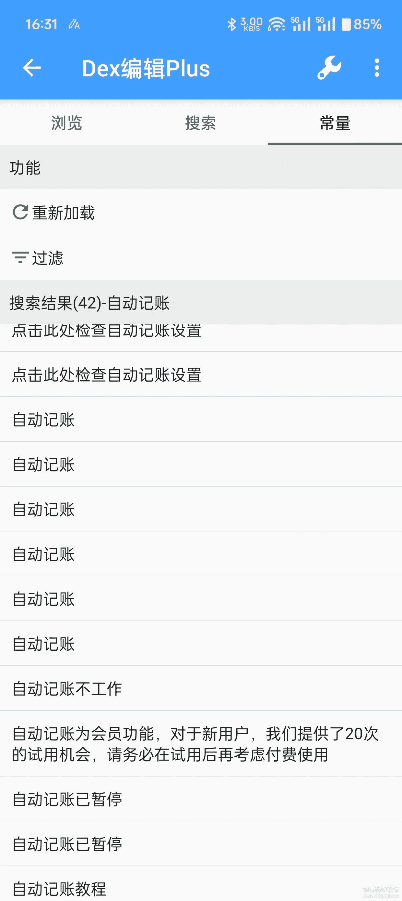
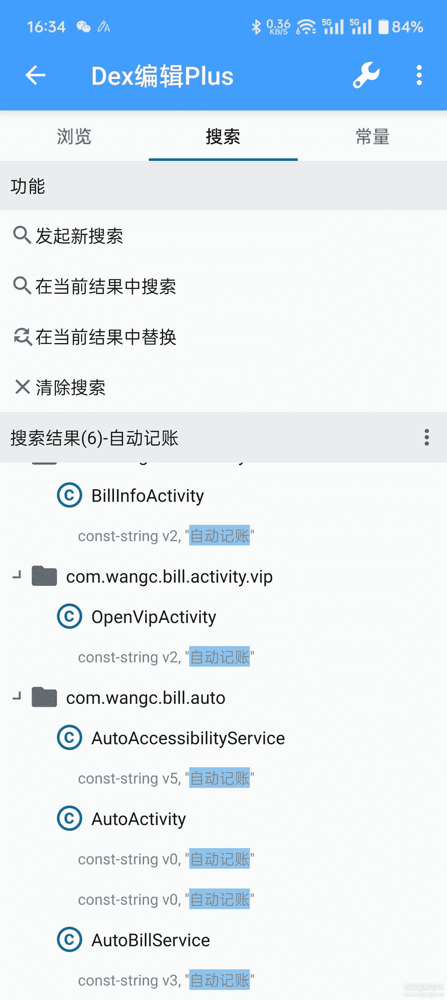
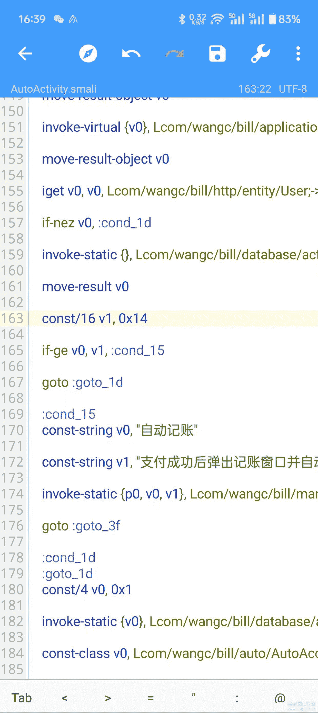
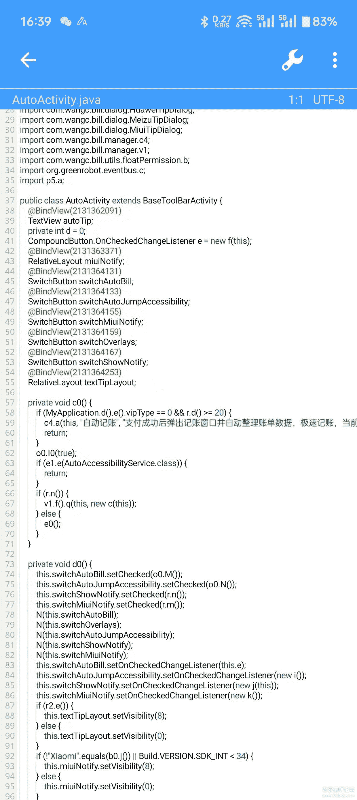
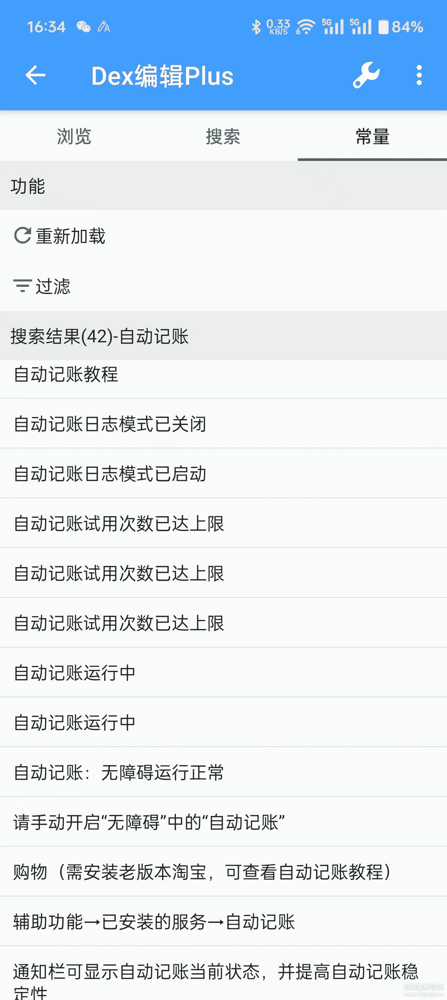
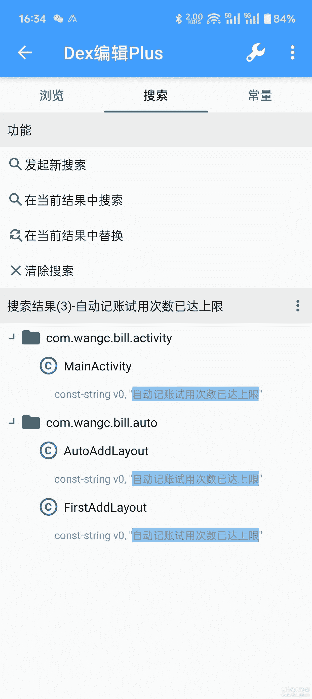
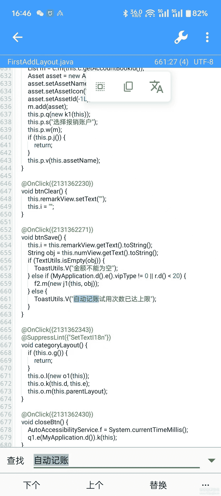

# [Android 原创] 一木记账最新自动记账解锁

- 原帖: https://www.52pojie.cn/forum.php?mod=viewthread&tid=1970853
- 抓取时间: 2026-11-01T16:30:01.363Z

以前都是用的直接把`vipType`更改掉的方式，最新突然想更新新版，结果发现新版更改`vipType`这自动记账是用一次掉一次，然后找了找是不是vip验证的问题，看了一圈眼睛花了还没找到是哪，想到了试用20次这个限制，发现居然可以哎，下面是步骤首先常量搜索自动记账

然后点击搜索，

进入之后挨个转了java代码看了看，发现`AutoActivity`的两个就是判断的

将第一个判断式中的`0x14`修改为`0x4000`保存安装（第二个用的第一个的，改掉第一个的就行），结果不得行还是会掉

然后想到了是不是还有个上限判断，于是在进入搜索

发现3个都包含判断，懒得分辨了直接全改掉

签名安装，让后在通知栏那暂停一下（把旁边3个按钮也点一遍）让后恢复才能不掉

大功告成（不能和之前的解锁vip一起用，不然无效）

过程可以看b站视频https://www.bilibili.com/video/BV1M52MYbEMh/?spm_id_from=333.999.0.0&vd_source=ffda45d2dc5b103e0640a645ff33cfc1
