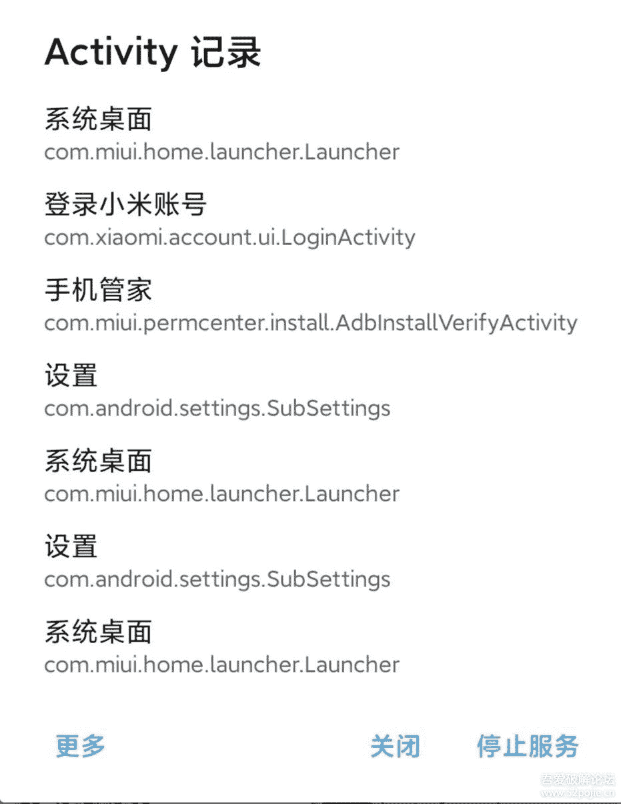
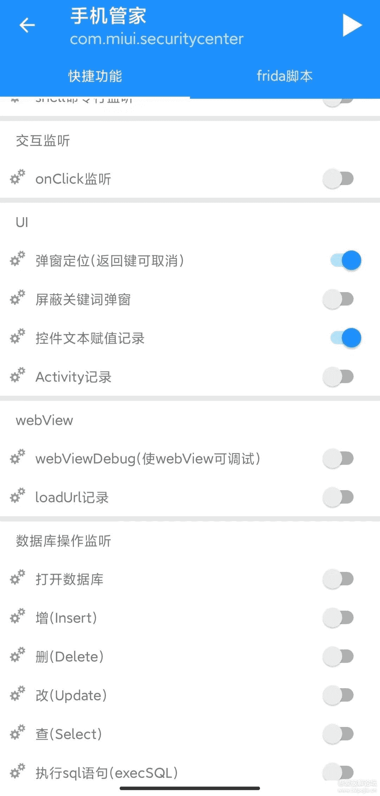
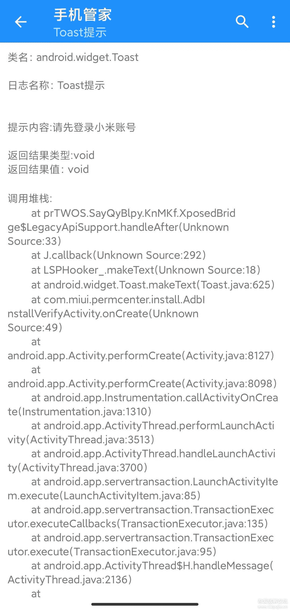
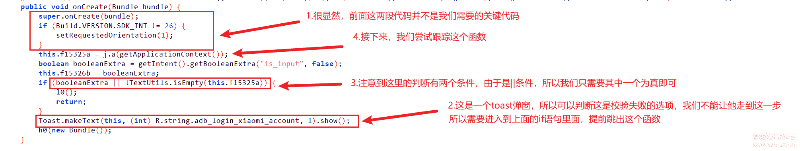
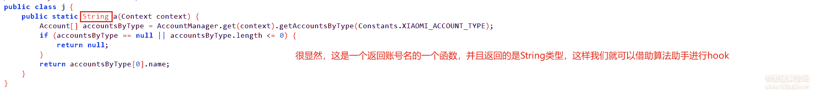
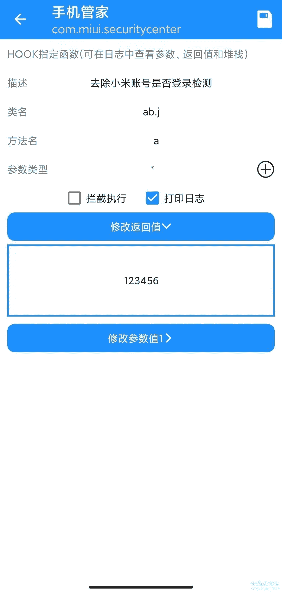
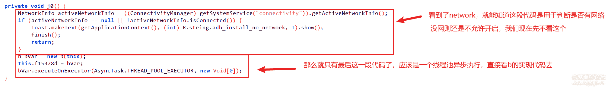
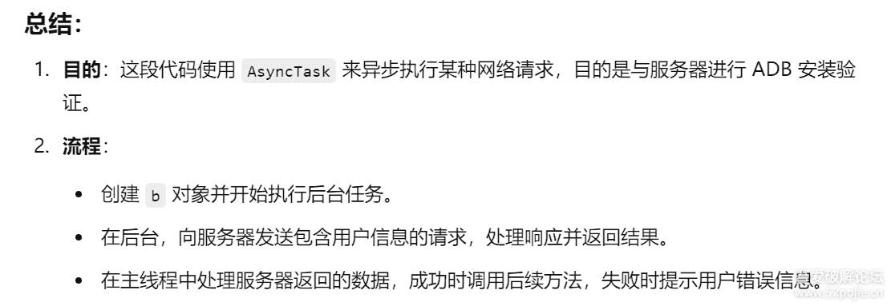
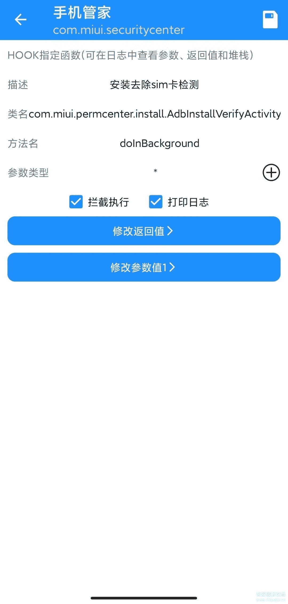

# [Android 原创] MIUI绕过未知来源检测（过系统检测sim卡是否存在以及小米账号是否登录）

- 原帖: https://www.52pojie.cn/forum.php?mod=viewthread&tid=1973953
- 抓取时间: 2026-11-01T16:29:46.525Z

测试版本：MIUI版本为：12.5.1

手机管家版本为：8.7.8-240124.0.1

昨天在手机上更新软件时，发现会跳转到安装未知应用检测

由于我的这部手机仅作于测试机，并没有进行插卡和登录小米账号的原因，系统会提示我登录小米账号和插卡，登录小米账号还勉强可以，但是要插卡的话可就太烦人了，而且我也想起了在开发者模式打开USB安装和USB调试（安全设置）也需要这个步骤，我觉得我还是需要想方法解决一下这个问题。

## 逆向步骤

首先通过`Activity`记录查看具体调用链：

发现是由手机管家拉起了登录小米账号服务，找到了对应的软件，我们直接打开算法助手进行hook，选中如图所示的两个选项即可：

然后在应用设置里结束手机管家的运行，接着再去点击允许安装未知应用，等到"请先登录小米账号"的弹窗出来后，去算法助手里查看对应的日志，在日志栏中搜索"小米"，可以发现有这么一条toast记录，我们打开它，查看它的堆栈信息：

通过堆栈信息可以了解到，调用这个toast的方法为`com.miui.permcenter.install.AdbInstallVerifyActivity.onCreate`，很好，接着我们直接提取安装包，打开`jadx`看看反编译代码：

找到了可以进行hook的函数后，我们打开算法助手进行hook：

开启hook后，我们再次结束手机管家进程，接着再去点击允许安装未知应用，发现它这次不会再进入到登录页面，而是弹出"请先插入SIM卡"的弹窗，说明判断登录的情况已经被我们干掉了，现在需要处理的是判断SIM卡的情况，很好，我们接着往下跟：

注意到，在`onCreate`函数中，如果成功进入到if语句，那么则会跳转到`l0`函数：

看到`b`类里面只有两个函数，直接丢到gpt让他去判断吧：

通过gpt分析这段代码的作用，我们直接拦截`doInBackground`函数就行，因为拦截会直接返回null，那么`onPostExecute`接收到的就是null

继续用算法助手添加hook：

开启完毕，去测试看看吧：

经测试，开发者模式打开USB安装和USB调试（安全设置）也可以绕过，其余设置需自测
